# Leonardo Pattern Design - Appendice Comandi

**Menu LEONARDO 1.18.2** - riferimento rapido di tutte le voci di menu e dei pulsanti.

Per ogni comando: l'icona del pulsante (se c'è), il nome da digitare (porta alla spiegazione nella [Guida Utente](README_UTENTE.md); i comandi di ZWCAD sono senza collegamento), dove si trova nel menu e nelle barre e che cosa fa.

> Pagina generata da `strumenti/genera_appendice.py` il 18/10/2026 a partire da `menu/LEONARDO/LEONARDO 0.mns` e dai sorgenti dei plugin: non modificarla a mano, rilancia lo script dopo ogni cambio del menu.

## Indice

- [Menu Disegno](#menu-disegno)
- [Menu Polilinee](#menu-polilinee)
- [Menu Blocchi e Testi](#menu-blocchi-e-testi)
- [Menu Offset](#menu-offset)
- [Menu Stampe e Nesting](#menu-stampe-e-nesting)
- [Menu Tipolinea e Layer](#menu-tipolinea-e-layer)
- [Menu Tacche](#menu-tacche)
- [Menu Materiali e Articoli](#menu-materiali-e-articoli)
- [Menu AAMA e Export](#menu-aama-e-export)
- [Menu Consumi e Report](#menu-consumi-e-report)
- [Menu Utilità](#menu-utilità)
- [Menu LEONARDO](#menu-leonardo)
- [Barre degli strumenti](#barre-degli-strumenti)
- [Comandi dei plugin senza voce di menu](#comandi-dei-plugin-senza-voce-di-menu)
- [Scorciatoie da tastiera](#scorciatoie-da-tastiera)

## Menu Disegno

### Forme Base

| | Comando | Voce di menu | Barra | Cosa fa |
|:-:|---|---|---|---|
|  | `RECTANG` | Disegno → Forme Base → Rettangolo Standard | Disegno, Modifica Avanzata | Disegna un rettangolo standard |
|  | [`LEORETTANGOLO`](README_UTENTE.md#cmd-leorettangolo) | Disegno → Forme Base → Rettangolo dal Centro | Modifica Avanzata | Rettangolo da punto centrale con larghezza e altezza |
|  | [`LEORACRETT`](README_UTENTE.md#cmd-leoracrett) | Disegno → Forme Base → Rettangolo Raccordato | Modifica Avanzata | Rettangolo con angoli raccordati |
| 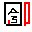 | [`LEOA3`](README_UTENTE.md#cmd-leoa3) | Disegno → Forme Base → Rettangolo A3 (420x297) | Modifica Avanzata | Disegna il rettangolo di un foglio A3 orizzontale (420x297 mm) |
| 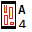 | [`LEOA4`](README_UTENTE.md#cmd-leoa4) | Disegno → Forme Base → Rettangolo A4 (210x297) | Modifica Avanzata | Disegna rettangolo formato A4 (210x297mm) |
|  | [`TRAPI`](README_UTENTE.md#cmd-trapi) | Disegno → Forme Base → Trapezio per Altezza | Modifica Avanzata | Trapezio isoscele definito per altezza |
|  | [`TRAPL`](README_UTENTE.md#cmd-trapl) | Disegno → Forme Base → Trapezio per Lato | Modifica Avanzata | Trapezio isoscele definito per lato obliquo |
|  | `POLYGON` | Disegno → Forme Base → Poligono Regolare | Disegno, Modifica Avanzata | Disegna un poligono regolare |

### Forme Speciali

| | Comando | Voce di menu | Barra | Cosa fa |
|:-:|---|---|---|---|
|  | [`GOLDRECT`](README_UTENTE.md#cmd-goldrect) | Disegno → Forme Speciali → Rettangolo Aureo | Modifica Avanzata | Rettangolo con proporzioni auree (sezione aurea) |
|  | [`GOLDSPIRAL`](README_UTENTE.md#cmd-goldspiral) | Disegno → Forme Speciali → Spirale Aurea | Modifica Avanzata | Spirale aurea: a ogni quarto di giro si stringe della proporzione aurea |
|  | [`SPIRALE`](README_UTENTE.md#cmd-spirale) | Disegno → Forme Speciali → Spirale Generica | Modifica Avanzata | Spirale generica con parametri personalizzabili |
|  | [`OVALE`](README_UTENTE.md#cmd-ovale) | Disegno → Forme Speciali → Ovale | Modifica Avanzata | Disegna un ovale a capsula da larghezza e altezza (polilinea ad archi) |
|  | [`OVOLO`](README_UTENTE.md#cmd-ovolo) | Disegno → Forme Speciali → Ovolo | Modifica Avanzata | Disegna un ovolo (uovo a quattro archi) da larghezza e altezza |
|  | [`ELLISSE`](README_UTENTE.md#cmd-ellisse) | Disegno → Forme Speciali → Ellisse a Polilinea | Modifica Avanzata | Disegna un'ellisse come polilinea ad archi dai due semiassi |
|  | [`CICLOIDE`](README_UTENTE.md#cmd-cicloide) | Disegno → Forme Speciali → Cicloide | Modifica Avanzata | Disegna uno o più archi di cicloide (polilinea ad archi) |
|  | [`TRIANGOLO`](README_UTENTE.md#cmd-triangolo) | Disegno → Forme Speciali → Triangolo Isoscele | Modifica Avanzata | Disegna un triangolo isoscele da base e altezza |
|  | [`ROMBO`](README_UTENTE.md#cmd-rombo) | Disegno → Forme Speciali → Rombo | Modifica Avanzata | Disegna un rombo dalle due diagonali |
|  | [`CIRCONF`](README_UTENTE.md#cmd-circonf) | Disegno → Forme Speciali → Cerchio da Perimetro | Modifica Avanzata | Disegna un cerchio (polilinea) dato il perimetro e riporta raggio e diametro |
|  | [`TASCA`](README_UTENTE.md#cmd-tasca) | Disegno → Forme Speciali → Tasca | Modifica Avanzata | Forma a tasca per pattern pelletteria |
| 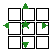 | [`TOPOPT`](README_UTENTE.md#cmd-topopt) | Disegno → Forme Speciali → Top Ottimizzato | Modifica Avanzata | Riempie l'ingombro di un oggetto con una griglia di fori di alleggerimento |

### (voci principali)

| | Comando | Voce di menu | Barra | Cosa fa |
|:-:|---|---|---|---|
| 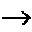 | [`SAR`](README_UTENTE.md#cmd-sar) | Disegno → Disegna Freccia (SAR) | Modifica Avanzata | Disegna freccia di direzione (SAR) |
|  | [`CENTRO`](README_UTENTE.md#cmd-centro) | Disegno → Squadratura (Centro) | Modifica Avanzata | Squadratura: croce della bounding box di una polilinea sul layer squadratura |
|  | [`ARCOTANG`](README_UTENTE.md#cmd-arcotang) | Disegno → Arco Tangente | Utilità Sistema Ext | Arco tangente interattivo tra due archi esistenti |

### Sviluppo Superfici

| | Comando | Voce di menu | Barra | Cosa fa |
|:-:|---|---|---|---|
|  | [`UNROLLSWEEP5`](README_UTENTE.md#cmd-unrollsweep5) | Disegno → Sviluppo Superfici → Sviluppa (Unroll Sweep 5) | - | Sviluppa superficie curva in piano (unroll sweep) |
|  | [`UNROLLSWEEP5SET`](README_UTENTE.md#cmd-unrollsweep5set) | Disegno → Sviluppo Superfici → Impostazioni Unroll | - | Impostazioni per lo sviluppo superfici |

### Forme Avanzate → Quadranti

| | Comando | Voce di menu | Barra | Cosa fa |
|:-:|---|---|---|---|
| 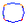 | [`DISEGNAQUADRANGOLO`](README_UTENTE.md#cmd-disegnaquadrangolo) | Disegno → Forme Avanzate → Quadranti → Quadrante ad Archi (DQ) | FASCIA FIANCO, Quadranti | Quadrante ad archi per borse: trapezio con raccordi e lati ad arco (DQ) |
|  | [`DQMODIFICA`](README_UTENTE.md#cmd-dqmodifica) | Disegno → Forme Avanzate → Quadranti → Modifica Quadrante (DQM) | Quadranti | Riapre la finestra su un quadrante di DQ e lo aggiorna dov'è (DQM) |
|  | [`DISEGNAQUADRANGOLOLUNGHEZZE`](README_UTENTE.md#cmd-disegnaquadrangololunghezze) | Disegno → Forme Avanzate → Quadranti → Quadrante a Lunghezze Fisse (DQL) | Quadranti | Come DQ, ma i lati spuntati mantengono il loro sviluppo (DQL) |
|  | [`DQLMODIFICA`](README_UTENTE.md#cmd-dqlmodifica) | Disegno → Forme Avanzate → Quadranti → Modifica a Lunghezze Fisse (DQLM) | Quadranti | Modifica le figure di DQL; una figura di DQ diventa a lunghezze fisse (DQLM) |
|  | [`DISEGNAFASCIA`](README_UTENTE.md#cmd-disegnafascia) | Disegno → Forme Avanzate → Quadranti → Fascia sul Quadrante (DQF) | Quadranti | Fascia che gira attorno ai lati scelti di un quadrante (DQF) |
|  | [`DISEGNAFASCIAMISURE`](README_UTENTE.md#cmd-disegnafasciamisure) | Disegno → Forme Avanzate → Quadranti → Fascia con Misure (DQFM) | Quadranti | Fascia con le misure scritte o prese su una polilinea qualsiasi, con le forme di raccordo di DQF (DQFM) |
|  | [`DISEGNAPENCE`](README_UTENTE.md#cmd-disegnapence) | Disegno → Forme Avanzate → Quadranti → Pence e Cannoni (DQP) | Quadranti | Pence o cannoni sul quadrante, con lo sviluppo che conserva il perimetro cucito (DQP) |
| 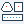 | [`DISEGNACOSTRUZIONI`](README_UTENTE.md#cmd-disegnacostruzioni) | Disegno → Forme Avanzate → Quadranti → Costruzioni (DQC) | Quadranti | Costruzioni del manuale sul quadrante: tutti i pezzi da tagliare, con pieghe, tacche e nomi (DQC) |
|  | [`IMPORTAQUADRANTE`](README_UTENTE.md#cmd-importaquadrante) | Disegno → Forme Avanzate → Quadranti → Importa Quadrante (DQI) | Quadranti | Legge polilinee chiuse qualsiasi come quadranti e disegna sopra i quadranti del plugin (DQI) |
|  | [`TRACCIATURA`](README_UTENTE.md#cmd-tracciatura) | Disegno → Forme Avanzate → Quadranti → Tracciatura (DQT) | Quadranti | Tracciatura di lamiere e tubi applicata alle borse: raccordi fra figure, tubolare, manico a spicchi, tasca innestata (DQT) |

### Forme Avanzate

| | Comando | Voce di menu | Barra | Cosa fa |
|:-:|---|---|---|---|
|  | [`DUERETTANGOLI`](README_UTENTE.md#cmd-duerettangoli) | Disegno → Forme Avanzate → Due Rettangoli | FASCIA FIANCO | Disegna due rettangoli collegati |
| 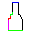 | [`DUERETTANGOLIRAC`](README_UTENTE.md#cmd-duerettangolirac) | Disegno → Forme Avanzate → Due Rettangoli Raccordati | FASCIA FIANCO | Disegna due rettangoli collegati con raccordi |
|  | [`DISEGNAFASCIAFIANCO`](README_UTENTE.md#cmd-disegnafasciafianco) | Disegno → Forme Avanzate → Disegna Fascia Fianco | FASCIA FIANCO | Fascia fianco dalla lunghezza dell'arco di raccordo (raccordi sul rettangolo superiore) |
| 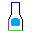 | [`FASCIAFIANCOUI`](README_UTENTE.md#cmd-fasciafiancoui) | Disegno → Forme Avanzate → Fascia Fianco UI | FASCIA FIANCO | Fascia fianco con i raccordi massimi, da una finestra |
|  | [`FASCIAFIANCOMAX`](README_UTENTE.md#cmd-fasciafiancomax) | Disegno → Forme Avanzate → Fascia Fianco Max | FASCIA FIANCO | Fascia fianco con i raccordi massimi, dalla riga di comando |
| 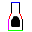 | [`FASCIAFIANCOEXTUI`](README_UTENTE.md#cmd-fasciafiancoextui) | Disegno → Forme Avanzate → Fascia Fianco Ext UI | FASCIA FIANCO | Fascia fianco dalla lunghezza dell'arco di raccordo, da una finestra |

### Raccordi e Smussi

| | Comando | Voce di menu | Barra | Cosa fa |
|:-:|---|---|---|---|
| 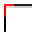 | [`RACCORDA_0`](README_UTENTE.md#cmd-raccorda-0) | Disegno → Raccordi e Smussi → Raccordo Raggio Zero | Modifica Avanzata, Raccordo | Raccordo con raggio zero: unisce due linee con angolo netto |
| 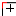 | `FILLET` | Disegno → Raccordi e Smussi → Raccordo Standard | Modifica, Raccordo | Raccordo standard con raggio corrente |
| 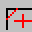 | `CHAMFER` | Disegno → Raccordi e Smussi → Cima | Modifica, Raccordo | Cima/smusso tra due linee |
| 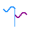 | [`BLEND`](README_UTENTE.md#cmd-blend) | Disegno → Raccordi e Smussi → Blend Curve | Raccordo | Raccordo tra due curve con il raggio ricordato (0 = angolo vivo) |

### Modifica Avanzata

| | Comando | Voce di menu | Barra | Cosa fa |
|:-:|---|---|---|---|
|  | [`COOKIECUTTER2`](README_UTENTE.md#cmd-cookiecutter2) | Disegno → Modifica Avanzata → Svuota Polilinea (Cookie Cutter) | Modifica Avanzata | Svuota polilinea: taglia tutto ciò che attraversa un contorno chiuso, dalla parte scelta |
|  | [`COOKIECUTTER2`](README_UTENTE.md#cmd-cookiecutter2) | Disegno → Modifica Avanzata → Cookie Cutter 2 | Modifica Avanzata | Cookie Cutter 2: taglia tutto ciò che attraversa un contorno chiuso, dalla parte scelta |
|  | [`CC`](README_UTENTE.md#cmd-cc) | Disegno → Modifica Avanzata → Cookie Cutter Alias (CC) | Modifica Avanzata | Alias per Cookie Cutter 2 (CC) |
| 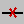 | [`SPEZZA_PUNTO`](README_UTENTE.md#cmd-spezza-punto) | Disegno → Modifica Avanzata → Spezza in Punto | Modifica Avanzata | Interrompe una linea, arco o polilinea in un punto preciso |
|  | [`SPLITCIR`](README_UTENTE.md#cmd-splitcir) | Disegno → Modifica Avanzata → Spezza Cerchio | Utilità Sistema Ext | Divide un cerchio in archi uguali, partendo da un punto |
|  | [`TROVA_GAP`](README_UTENTE.md#cmd-trova-gap) | Disegno → Modifica Avanzata → Trova Gap | Utilità Sistema Ext | Segna con un cerchio sul layer GAP i buchi fra estremi e gli estremi staccati |
|  | [`HEAL`](README_UTENTE.md#cmd-heal) | Disegno → Modifica Avanzata → Ripara Polilinee (Heal) | Polilinea | Ripara: doppioni, vertici doppi, unione e chiusura dei buchi piccoli |
|  | [`CONTROLLA_CONTORNI`](README_UTENTE.md#cmd-controlla-contorni) | Disegno → Modifica Avanzata → Controllo Contorni | Polilinea | Controllo dei contorni prima del taglio, con la finestra che resta aperta |
|  | [`CONFRONTA_UNIONE`](README_UTENTE.md#cmd-confronta-unione) | Disegno → Modifica Avanzata → Confronta Unione con PEDIT | - | Prova: unisce delle copie con PEDIT e con il plugin e dice se la sagoma cambia |
| 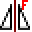 | [`QM`](README_UTENTE.md#cmd-qm) | Disegno → Modifica Avanzata → Specchia Rapido | Modifica Avanzata | Specchiatura rapida degli oggetti selezionati |
|  | [`QMD`](README_UTENTE.md#cmd-qmd) | Disegno → Modifica Avanzata → Specchia Rapido e Cancella | Modifica Avanzata | Specchia gli oggetti rispetto a un oggetto scelto e cancella gli originali |
| 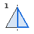 | [`QMO`](README_UTENTE.md#cmd-qmo) | Disegno → Modifica Avanzata → Specchia Oggetto su Se Stesso (1) | Modifica Avanzata | Specchia un oggetto rispetto al proprio lato cliccato |
| 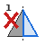 | [`QMOD`](README_UTENTE.md#cmd-qmod) | Disegno → Modifica Avanzata → Specchia Oggetto e Cancella | Modifica Avanzata | Specchia un oggetto rispetto al proprio lato cliccato e cancella l'originale |
|  | `AI_DRAWORDER` | Disegno → Modifica Avanzata → Porta Dietro (`_ai_draworder _Back`) | Polilinea | Porta l'oggetto selezionato dietro agli altri |
|  | [`PERP2ENT`](README_UTENTE.md#cmd-perp2ent) | Disegno → Modifica Avanzata → Perpendicolare a Entità | Modifica Avanzata | Disegna linee perpendicolari da un punto a un'entità |
| 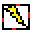 | [`PLJOINFUZZ`](README_UTENTE.md#cmd-pljoinfuzz) | Disegno → Modifica Avanzata → Join Polilinee Fuzzy | Polilinea, Polilinea Estesa | Unisce linee e polilinee con tolleranza fuzzy |

## Menu Polilinee

### Creazione

| | Comando | Voce di menu | Barra | Cosa fa |
|:-:|---|---|---|---|
| 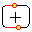 | [`PJ`](README_UTENTE.md#cmd-pj) | Polilinee → Creazione → Creazione Manuale (PJ) | Polilinea | Crea polilinea manualmente unendo linee e archi (PJ) |
| 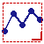 | [`CATENA`](README_UTENTE.md#cmd-catena) | Polilinee → Creazione → Creazione Automatica (Catena) | Polilinea | Catena: seleziona i segmenti collegati, uno dopo l'altro (CATENA) |
| 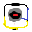 | [`CATENA_UNISCI`](README_UTENTE.md#cmd-catena-unisci) | Polilinee → Creazione → Catena e Unisci | Polilinea | Catena, poi unione in una polilinea e chiusura (CATENA_UNISCI) |
|  | [`CS`](README_UTENTE.md#cmd-cs) | Polilinee → Creazione → Chain Selection | Modifica Avanzata | Chain Selection: selezione concatenata intelligente per endpoint |
|  | [`CATENA_CONFIG`](README_UTENTE.md#cmd-catena-config) | Polilinee → Creazione → Catena Config | Polilinea | Impostazioni della catena (CATENA_CONFIG) |
|  | [`CATENA_STATO`](README_UTENTE.md#cmd-catena-stato) | Polilinee → Creazione → Catena Stato | - | Mostra le impostazioni della catena (CATENA_STATO) |
|  | [`CATENA_PRESET`](README_UTENTE.md#cmd-catena-preset) | Polilinee → Creazione → Catena Preset | Polilinea | Cambio veloce del preset della catena (CATENA_PRESET) |
|  | [`S2P`](README_UTENTE.md#cmd-s2p) | Polilinee → Creazione → Da Spline | Polilinea | Converte spline in polilinea con numero di segmenti definito |
| 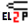 | [`EL2PL`](README_UTENTE.md#cmd-el2pl) | Polilinee → Creazione → Da Ellisse | Polilinea | Converte ellisse o arco ellittico in polilinea |
|  | [`PELL`](README_UTENTE.md#cmd-pell) | Polilinee → Creazione → Da Ellisse (Pell) | Polilinea | Converte ellisse in polilinea con metodo speciale Pell |
|  | [`PLJOINFUZZ`](README_UTENTE.md#cmd-pljoinfuzz) | Polilinee → Creazione → Join Fuzzy | Polilinea, Polilinea Estesa | Unisce linee, archi, polilinee e spline con una distanza di congiunzione |
|  | [`Y`](README_UTENTE.md#cmd-y) | Polilinee → Creazione → Unione Rapida Y | Polilinea Estesa | Unione rapida Y: filtra e unisce in polilinee leggere |

### (voci principali)

| | Comando | Voce di menu | Barra | Cosa fa |
|:-:|---|---|---|---|
| 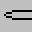 | `PEDIT` | Polilinee → Modifica Polilinea | Polilinea | Editor avanzato per modificare vertici di polilinee |
|  | [`PC`](README_UTENTE.md#cmd-pc) | Polilinee → Chiudi Polilinea | Polilinea | Chiude polilinea aperta collegando fine all'inizio |

### Direzione

| | Comando | Voce di menu | Barra | Cosa fa |
|:-:|---|---|---|---|
|  | [`PLD`](README_UTENTE.md#cmd-pld) | Polilinee → Direzione → Imposta Direzione | Modifica Avanzata, Polilinea | Visualizza direzione polilinea con marcatore e frecce |
|  | [`PLDREV_SHOW_DIRECTION`](README_UTENTE.md#cmd-pldrev-show-direction) | Polilinee → Direzione → Mostra Direzione | Polilinea Estesa | Mostra verso e punto di inizio della polilinea (frecce) |
|  | [`RVRSLINE`](README_UTENTE.md#cmd-rvrsline) | Polilinee → Direzione → Inverti Direzione | Modifica Avanzata, Polilinea | Inverte la direzione di linee e polilinee |
|  | [`NUOVOINIZIOP`](README_UTENTE.md#cmd-nuovoiniziop) | Polilinee → Direzione → Nuovo Inizio | Polilinea | Nuovo punto di inizio di una polilinea chiusa (anche a metà di un lato) |
|  | [`VERSO_UNIFORME`](README_UTENTE.md#cmd-verso-uniforme) | Polilinee → Direzione → Verso Uniforme (tutti i contorni) | Polilinea | Mette tutti i contorni chiusi nello stesso verso; a richiesta l'inizio in basso a sinistra |
|  | [`PLDREV_SETCOLOR`](README_UTENTE.md#cmd-pldrev-setcolor) | Polilinee → Direzione → Imposta Colore Frecce | Polilinea Estesa | Imposta il colore delle frecce di direzione (1-7) |
| 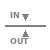 | [`PLDREV_SETPOS`](README_UTENTE.md#cmd-pldrev-setpos) | Polilinee → Direzione → Imposta Posizione Frecce | Polilinea Estesa | Imposta posizione frecce direzione (Interne/Esterne) |

### Rotazioni Rapide

| | Comando | Voce di menu | Barra | Cosa fa |
|:-:|---|---|---|---|
| 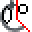 | [`ZR`](README_UTENTE.md#cmd-zr) | Polilinee → Rotazioni Rapide → Rotazione Zero | Modifica Avanzata | Azzera la rotazione di testi, blocchi e MLeader |
|  | [`R9`](README_UTENTE.md#cmd-r9) | Polilinee → Rotazioni Rapide → Rotazione 90 Gradi (R9) | Modifica Avanzata | Ruota la selezione di 90 gradi in senso antiorario (come R90) |
|  | [`R90`](README_UTENTE.md#cmd-r90) | Polilinee → Rotazioni Rapide → Rotazione 90 Gradi | Modifica Avanzata | Ruota la selezione di 90 gradi in senso antiorario |
|  | [`R90M`](README_UTENTE.md#cmd-r90m) | Polilinee → Rotazioni Rapide → Rotazione -90 Gradi | Modifica Avanzata | Ruota la selezione di 90 gradi in senso orario |
|  | [`R180`](README_UTENTE.md#cmd-r180) | Polilinee → Rotazioni Rapide → Rotazione 180 Gradi | Modifica Avanzata | Ruota la selezione di 180 gradi |

### Utilità Polilinee

| | Comando | Voce di menu | Barra | Cosa fa |
|:-:|---|---|---|---|
|  | [`CONP`](README_UTENTE.md#cmd-conp) | Polilinee → Utilità Polilinee → Centro Polilinee (CONP) | Modaris | Mette un punto al centro dell'ingombro delle polilinee sul layer "0" |
|  | [`CONP_C`](README_UTENTE.md#cmd-conp-c) | Polilinee → Utilità Polilinee → Cerchi in Punti (CONP_C) | Modaris | Converte cerchi su layer "0" in punti al centro |
| 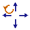 | [`VLMR`](README_UTENTE.md#cmd-vlmr) | Polilinee → Utilità Polilinee → VL Move Rotate | Polilinea | VL Move Rotate: sposta e ruota oggetti interattivamente |
| 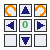 | [`-VLMR`](README_UTENTE.md#cmd-vlmr) | Polilinee → Utilità Polilinee → Muovi/Ruota da Tastierino (-VLMR) | Polilinea | Sposta e ruota gli oggetti con i tasti del tastierino numerico |
| 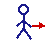 | [`VLWALK`](README_UTENTE.md#cmd-vlwalk) | Polilinee → Utilità Polilinee → Valida Tacche Interattivo | Tacche | Valida tacche in modo interattivo lungo la polilinea |

## Menu Blocchi e Testi

### Indicazioni

| | Comando | Voce di menu | Barra | Cosa fa |
|:-:|---|---|---|---|
|  | [`VR`](README_UTENTE.md#cmd-vr) | Blocchi e Testi → Indicazioni → Verticale | Diciture Standard | Inserisce blocco indicazione direzione VERTICALE materiale |
|  | [`OR`](README_UTENTE.md#cmd-or) | Blocchi e Testi → Indicazioni → Orizzontale | Diciture Standard | Inserisce blocco indicazione direzione ORIZZONTALE materiale |
|  | [`WAR`](README_UTENTE.md#cmd-war) | Blocchi e Testi → Indicazioni → Attenzione | Diciture Standard | Inserisce blocco ATTENZIONE |
|  | [`EQ`](README_UTENTE.md#cmd-eq) | Blocchi e Testi → Indicazioni → Equalizzare | Diciture Standard | Inserisce blocco EQUALIZZARE |
| 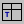 | [`TABT`](README_UTENTE.md#cmd-tabt) | Blocchi e Testi → Indicazioni → Tabella Testi | Diciture Standard | Inserisce blocco tabella testi |
|  | [`PEL`](README_UTENTE.md#cmd-pel) | Blocchi e Testi → Indicazioni → Pelle | Dati Pezzo, Diciture Standard | Inserisce blocco indicazione materiale PELLE |
|  | [`FOD`](README_UTENTE.md#cmd-fod) | Blocchi e Testi → Indicazioni → Fodera | Dati Pezzo, Diciture Standard | Inserisce blocco indicazione materiale FODERA |

### Fustelle

| | Comando | Voce di menu | Barra | Cosa fa |
|:-:|---|---|---|---|
|  | [`LEO_FUST`](README_UTENTE.md#cmd-leo-fust) | Blocchi e Testi → Fustelle → Fustella P (punto) (`_LEO_FUST P`) | Fustelle | Segna il foro di una fustella a punto (P) |
|  | [`LEO_FUST`](README_UTENTE.md#cmd-leo-fust) | Blocchi e Testi → Fustelle → Fustella 0.8 (`_LEO_FUST 0.8`) | Fustelle | Segna il foro di una fustella da 0.8 mm (simbolo e misura scritta) |
|  | [`LEO_FUST`](README_UTENTE.md#cmd-leo-fust) | Blocchi e Testi → Fustelle → Fustella 1 (`_LEO_FUST 1`) | Fustelle | Segna il foro di una fustella da 1 mm (simbolo e misura scritta) |
|  | [`LEO_FUST`](README_UTENTE.md#cmd-leo-fust) | Blocchi e Testi → Fustelle → Fustella 1.5 (`_LEO_FUST 1.5`) | Fustelle | Segna il foro di una fustella da 1.5 mm (simbolo e misura scritta) |
|  | [`LEO_FUST`](README_UTENTE.md#cmd-leo-fust) | Blocchi e Testi → Fustelle → Fustella 2 (`_LEO_FUST 2`) | Fustelle | Segna il foro di una fustella da 2 mm (simbolo e misura scritta) |
|  | [`LEO_FUST`](README_UTENTE.md#cmd-leo-fust) | Blocchi e Testi → Fustelle → Fustella 2.5 (`_LEO_FUST 2.5`) | Fustelle | Segna il foro di una fustella da 2.5 mm (simbolo e misura scritta) |
|  | [`LEO_FUST`](README_UTENTE.md#cmd-leo-fust) | Blocchi e Testi → Fustelle → Fustella 3 (`_LEO_FUST 3`) | Fustelle | Segna il foro di una fustella da 3 mm (simbolo e misura scritta) |
|  | [`LEO_FUST`](README_UTENTE.md#cmd-leo-fust) | Blocchi e Testi → Fustelle → Fustella 3.5 (`_LEO_FUST 3.5`) | Fustelle | Segna il foro di una fustella da 3.5 mm (simbolo e misura scritta) |
|  | [`LEO_FUST`](README_UTENTE.md#cmd-leo-fust) | Blocchi e Testi → Fustelle → Fustella 4 (`_LEO_FUST 4`) | Fustelle | Segna il foro di una fustella da 4 mm (simbolo e misura scritta) |
|  | [`LEO_FUST`](README_UTENTE.md#cmd-leo-fust) | Blocchi e Testi → Fustelle → Fustella 4.5 (`_LEO_FUST 4.5`) | Fustelle | Segna il foro di una fustella da 4.5 mm (simbolo e misura scritta) |
|  | [`LEO_FUST`](README_UTENTE.md#cmd-leo-fust) | Blocchi e Testi → Fustelle → Fustella 5 (`_LEO_FUST 5`) | Fustelle | Segna il foro di una fustella da 5 mm (simbolo e misura scritta) |
|  | [`LEO_FUST`](README_UTENTE.md#cmd-leo-fust) | Blocchi e Testi → Fustelle → Fustella 6 (`_LEO_FUST 6`) | Fustelle | Segna il foro di una fustella da 6 mm (simbolo e misura scritta) |

### Allineamento Testi

| | Comando | Voce di menu | Barra | Cosa fa |
|:-:|---|---|---|---|
| 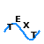 | [`ATC`](README_UTENTE.md#cmd-atc) | Blocchi e Testi → Allineamento Testi → Allinea a Curva | Modifica Avanzata | Allinea testo a curva con controlli dinamici |
|  | [`ZR`](README_UTENTE.md#cmd-zr) | Blocchi e Testi → Allineamento Testi → Rotazione Zero | Modifica Avanzata | Azzera la rotazione del testo selezionato |
|  | [`EDT`](README_UTENTE.md#cmd-edt) | Blocchi e Testi → Allineamento Testi → Ruota Testo | Utilità Sistema Ext | Ruota testo secondo angolo definito da due punti |

### Modifica Testi

| | Comando | Voce di menu | Barra | Cosa fa |
|:-:|---|---|---|---|
|  | [`CHG`](README_UTENTE.md#cmd-chg) | Blocchi e Testi → Modifica Testi → Sostituisci Testo | Utilità Sistema Ext | Sostituisce stringa in selezione multipla di testi |
|  | [`TCASE`](README_UTENTE.md#cmd-tcase) | Blocchi e Testi → Modifica Testi → Maiuscolo/Minuscolo | Utilità Sistema Ext | Converte maiuscolo/minuscolo del testo selezionato |
|  | [`CBP`](README_UTENTE.md#cmd-cbp) | Blocchi e Testi → Modifica Testi → Cambia Punto Base Blocco | UTILITA SISTEMA | Cambia punto base blocco senza rilocare inserimenti |
| 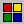 | [`CAMBIACOL`](README_UTENTE.md#cmd-cambiacol) | Blocchi e Testi → Modifica Testi → Cambia Colore | Layer, Utilità Sistema Ext | Cambia il colore degli oggetti: per nome o numero da 1 a 255, anche dalla macro (^C^C_CAMBIACOL Giallo) |

### Diciture Standard

| | Comando | Voce di menu | Barra | Cosa fa |
|:-:|---|---|---|---|
|  | [`DICITURA`](README_UTENTE.md#cmd-dicitura) | Blocchi e Testi → Diciture Standard → Testo Personalizzato... | Diciture Standard | Inserisce un testo personalizzato ripetuto, orientato col mouse |
|  | [`EDG`](README_UTENTE.md#cmd-edg) | Blocchi e Testi → Diciture Standard → Costola | Diciture Standard | Inserisce testo standard "COSTOLA" sul pezzo |
|  | [`FIL`](README_UTENTE.md#cmd-fil) | Blocchi e Testi → Diciture Standard → Filo | Diciture Standard | Inserisce testo standard "FILO" sul pezzo |
|  | [`SCA`](README_UTENTE.md#cmd-sca) | Blocchi e Testi → Diciture Standard → Scarnire | Diciture Standard | Inserisce testo standard "SCARNIRE" sul pezzo |
|  | [`SOT`](README_UTENTE.md#cmd-sot) | Blocchi e Testi → Diciture Standard → Sottomettitura | Diciture Standard | Inserisce testo standard "SOTTOMETTITURA" sul pezzo |
|  | [`RIM`](README_UTENTE.md#cmd-rim) | Blocchi e Testi → Diciture Standard → Rimbocco | Diciture Standard | Inserisce testo standard "RIMBOCCO" sul pezzo |
|  | [`TAL`](README_UTENTE.md#cmd-tal) | Blocchi e Testi → Diciture Standard → Talyn | Diciture Standard | Inserisce testo standard "TALYN" sul pezzo |
|  | [`SAL`](README_UTENTE.md#cmd-sal) | Blocchi e Testi → Diciture Standard → Salpa | Diciture Standard | Inserisce testo standard "SALPA" sul pezzo |
|  | [`ANT`](README_UTENTE.md#cmd-ant) | Blocchi e Testi → Diciture Standard → Antistrappo | Diciture Standard | Inserisce testo standard "ANTISTRAPPO" sul pezzo |
|  | [`BOM`](README_UTENTE.md#cmd-bom) | Blocchi e Testi → Diciture Standard → Bombatura | Diciture Standard | Inserisce testo standard "BOMBATURA" sul pezzo |
|  | [`RIN`](README_UTENTE.md#cmd-rin) | Blocchi e Testi → Diciture Standard → Rinforzo | Diciture Standard | Inserisce testo standard "RINFORZO" sul pezzo |
|  | [`BOR`](README_UTENTE.md#cmd-bor) | Blocchi e Testi → Diciture Standard → Bordatura | Diciture Standard | Inserisce testo standard "BORDATURA" sul pezzo |
|  | [`VAL`](README_UTENTE.md#cmd-val) | Blocchi e Testi → Diciture Standard → Valigiaia | Diciture Standard | Inserisce testo standard "VALIGIAIA" sul pezzo |

### Cucitura

| | Comando | Voce di menu | Barra | Cosa fa |
|:-:|---|---|---|---|
| 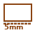 | [`C5`](README_UTENTE.md#cmd-c5) | Blocchi e Testi → Cucitura → CUC.ROV. 5MM | Diciture Standard | Inserisce testo "CUC.ROV. 5MM" |
|  | [`C5P`](README_UTENTE.md#cmd-c5p) | Blocchi e Testi → Cucitura → CUC.ROV. 5MM CON PIPING | Diciture Standard | Inserisce testo "CUC.ROV. 5MM CON PIPING" |
|  | [`C7`](README_UTENTE.md#cmd-c7) | Blocchi e Testi → Cucitura → CUC.ROV. 7MM | Diciture Standard | Inserisce testo "CUC.ROV. 7MM" |
|  | [`C7P`](README_UTENTE.md#cmd-c7p) | Blocchi e Testi → Cucitura → CUC.ROV. 7MM CON PIPING | Diciture Standard | Inserisce testo "CUC.ROV. 7MM CON PIPING" |
|  | [`C5A`](README_UTENTE.md#cmd-c5a) | Blocchi e Testi → Cucitura → CUC.ROV. 5MM APERTA | Diciture Standard | Inserisce testo "CUC.ROV. 5MM APERTA" |
| 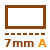 | [`C7A`](README_UTENTE.md#cmd-c7a) | Blocchi e Testi → Cucitura → CUC.ROV. 7MM APERTA | Diciture Standard | Inserisce testo "CUC.ROV. 7MM APERTA" |
| 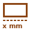 | [`CROV`](README_UTENTE.md#cmd-crov) | Blocchi e Testi → Cucitura → CUC.ROV. a Misura... | Diciture Standard | Inserisce testo "CUC.ROV. x MM" con la misura chiesta |
| 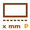 | [`CROVP`](README_UTENTE.md#cmd-crovp) | Blocchi e Testi → Cucitura → CUC.ROV. a Misura con Piping... | Diciture Standard | Inserisce testo "CUC.ROV. x MM CON PIPING" con la misura chiesta |
| 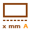 | [`CROVA`](README_UTENTE.md#cmd-crova) | Blocchi e Testi → Cucitura → CUC.ROV. a Misura Riaperta... | Diciture Standard | Inserisce testo "CUC.ROV. x MM RIAPERTA" con la misura chiesta |
| 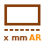 | [`CROVAR`](README_UTENTE.md#cmd-crovar) | Blocchi e Testi → Cucitura → CUC.ROV. a Misura Riaperta e Ribadita... | Diciture Standard | Inserisce testo "CUC.ROV. x MM RIAPERTA E RIBADITA" con la misura chiesta |
|  | [`CIP`](README_UTENTE.md#cmd-cip) | Blocchi e Testi → Cucitura → CUC. in Piedi | Diciture Standard | Inserisce testo "CUC. IN PIEDI" |

### Blocchi Avanzati

| | Comando | Voce di menu | Barra | Cosa fa |
|:-:|---|---|---|---|
| 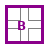 | [`BLOCCO_RAPIDO`](README_UTENTE.md#cmd-blocco-rapido) | Blocchi e Testi → Blocchi Avanzati → Blocco Rapido | BLOCCHI AVANZATI | Crea blocco con nome casuale e lo inserisce |
| 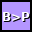 | [`BLOCCHI_IN_PUNTI`](README_UTENTE.md#cmd-blocchi-in-punti) | Blocchi e Testi → Blocchi Avanzati → Blocchi in Punti | BLOCCHI AVANZATI | Converte le tacche PitRTak in punti, nel punto di inserimento |
|  | [`INSERISCI_BLOCCHI`](README_UTENTE.md#cmd-inserisci-blocchi) | Blocchi e Testi → Blocchi Avanzati → Inserisci Blocchi su Polilinea | BLOCCHI AVANZATI, Tacche | Inserisce blocchi lungo polilinea a distanza fissa |
|  | [`CBP`](README_UTENTE.md#cmd-cbp) | Blocchi e Testi → Blocchi Avanzati → Cambia Punto Base | UTILITA SISTEMA | Cambia punto base blocco senza rilocare inserimenti |
|  | [`CBPR`](README_UTENTE.md#cmd-cbpr) | Blocchi e Testi → Blocchi Avanzati → Cambia Punto Base con Riferimento | UTILITA SISTEMA | Cambia punto base blocco e riloca tutti gli inserimenti |

### (voci principali)

| | Comando | Voce di menu | Barra | Cosa fa |
|:-:|---|---|---|---|
| 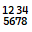 | [`CONTA`](README_UTENTE.md#cmd-conta) | Blocchi e Testi → Conta (Numerazione Progressiva) | Plugin | Inserisce blocchi numerati progressivamente (Conta) |

## Menu Offset

### (voci principali)

| | Comando | Voce di menu | Barra | Cosa fa |
|:-:|---|---|---|---|
|  | [`OFI`](README_UTENTE.md#cmd-ofi) | Offset → Offset Ringrano | Offset Tratto | Offset Ringrano: originale su layer "0", offset su OUTCUT |
|  | [`OFFSET_TRATTO`](README_UTENTE.md#cmd-offset-tratto) | Offset → Offset Tratto di Polilinea | Offset Tratto | Offset di un tratto di polilinea: finestra con variante, distanza, lato e anteprima |
|  | [`OFINC`](README_UTENTE.md#cmd-ofinc) | Offset → Offset Incrementali (OFINC) | Offset Tratto | Offset incrementali: d, d+inc, d+2inc... misurati dall'originale |

### Offset Tratteggiato (Cucitura)

| | Comando | Voce di menu | Barra | Cosa fa |
|:-:|---|---|---|---|
| 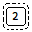 | [`OFT_2`](README_UTENTE.md#cmd-oft-2) | Offset → Offset Tratteggiato (Cucitura) → Offset 2 (scala 0.3) | Offset | Offset 2mm con linea tratteggiata tipo CUCITURA |
| 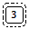 | [`OFT_3`](README_UTENTE.md#cmd-oft-3) | Offset → Offset Tratteggiato (Cucitura) → Offset 3 | Offset | Offset 3mm con linea tratteggiata tipo CUCITURA |
| 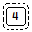 | [`OFT_4`](README_UTENTE.md#cmd-oft-4) | Offset → Offset Tratteggiato (Cucitura) → Offset 4 | Offset | Offset 4mm con linea tratteggiata tipo CUCITURA |
|  | [`OFT_5`](README_UTENTE.md#cmd-oft-5) | Offset → Offset Tratteggiato (Cucitura) → Offset 5 | Offset | Offset 5mm con linea tratteggiata tipo CUCITURA |
| 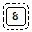 | [`OFT_6`](README_UTENTE.md#cmd-oft-6) | Offset → Offset Tratteggiato (Cucitura) → Offset 6 | Offset | Offset 6mm con linea tratteggiata tipo CUCITURA |
| 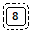 | [`OFT_8`](README_UTENTE.md#cmd-oft-8) | Offset → Offset Tratteggiato (Cucitura) → Offset 8 | Offset | Offset 8mm con linea tratteggiata tipo CUCITURA |
| 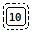 | [`OFT_10`](README_UTENTE.md#cmd-oft-10) | Offset → Offset Tratteggiato (Cucitura) → Offset 10 | Offset | Offset 10mm con linea tratteggiata tipo CUCITURA |
|  | [`OFT`](README_UTENTE.md#cmd-oft) | Offset → Offset Tratteggiato (Cucitura) → Offset Variabile | Offset | Offset tratteggiato a distanza variabile |

### Offset Tratto Avanzato

| | Comando | Voce di menu | Barra | Cosa fa |
|:-:|---|---|---|---|
| 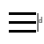 | [`OFFSET_TRATTO_SIMPLE`](README_UTENTE.md#cmd-offset-tratto-simple) | Offset → Offset Tratto Avanzato → Offset Tratto Semplice | Offset Tratto | Offset tratto semplice: solo l'offset del tratto fra due punti |
| 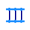 | [`OFFSET_TRATTO_LINKED`](README_UTENTE.md#cmd-offset-tratto-linked) | Offset → Offset Tratto Avanzato → Offset Tratto Collegato | Offset Tratto | Offset tratto collegato: offset del tratto e linee di collegamento agli estremi |
| 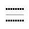 | [`OFFSET_TRATTO_HATCHED`](README_UTENTE.md#cmd-offset-tratto-hatched) | Offset → Offset Tratto Avanzato → Offset Tratto Tratteggiato | Offset Tratto | Offset tratto tratteggiato: offset del tratto con il tipo linea CUCITURA |
|  | [`OFFSET_TRATTO_BREAK`](README_UTENTE.md#cmd-offset-tratto-break) | Offset → Offset Tratto Avanzato → Offset Tratto Spezzato | Offset Tratto | Offset tratto spezzato: toglie il tratto e mette offset e collegamenti |
| 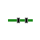 | [`OFFSET_TRATTO_BREAK_CLEAN`](README_UTENTE.md#cmd-offset-tratto-break-clean) | Offset → Offset Tratto Avanzato → Offset Tratto Spezzato Pulito | Offset Tratto | Offset tratto spezzato pulito: toglie il tratto e mette solo l'offset |

## Menu Stampe e Nesting

### Sbozzi

| | Comando | Voce di menu | Barra | Cosa fa |
|:-:|---|---|---|---|
|  | [`SBOZZO`](README_UTENTE.md#cmd-sbozzo) | Stampe e Nesting → Sbozzi → Sbozzo (geometrico o rettangolare) | Sbozzo | Sbozzo geometrico o rettangolare, spigoli vivi o arrotondati, su OUTCUT; tacche cancellate, pezzo sul layer 0 |
|  | [`SBOZZO_RETT`](README_UTENTE.md#cmd-sbozzo-rett) | Stampe e Nesting → Sbozzi → Sbozzo Rettangolare | Sbozzo | Sbozzo rettangolare (ingombro allargato) e poi Nesting Avanzato |
|  | [`SBOZZO_BOUND`](README_UTENTE.md#cmd-sbozzo-bound) | Stampe e Nesting → Sbozzi → Sbozzo Boundary | Sbozzo | Sbozzo boundary: disegna bounding box rettangolare |
|  | [`COPYARRAY`](README_UTENTE.md#cmd-copyarray) | Stampe e Nesting → Sbozzi → Sbozzo Multiplo (Array) | Sbozzo | Sbozzo multiplo: array rettangolare con bbox complessivo |
|  | [`DIMA`](README_UTENTE.md#cmd-dima) | Stampe e Nesting → Sbozzi → Dima Standard | Sbozzo | Crea dima da layer con offset automatico |
|  | [`DIMA_TACCHE_ATOM`](README_UTENTE.md#cmd-dima-tacche-atom) | Stampe e Nesting → Sbozzi → Dima Tacche (Atom) | Sbozzo | Crea dima con tacche in modalita' atomica |
|  | [`CBP`](README_UTENTE.md#cmd-cbp) | Stampe e Nesting → Sbozzi → Sbozzo CBP | UTILITA SISTEMA | Sbozzo con cambio punto base |
|  | [`CHECK_LINEE_INTERNE`](README_UTENTE.md#cmd-check-linee-interne) | Stampe e Nesting → Sbozzi → Verifica Contorni Doppi | - | Contorni OUTCUT/ENDCUT doppi: le copie sul layer ERR, davanti |

### Definisci Tipo Pezzo

| | Comando | Voce di menu | Barra | Cosa fa |
|:-:|---|---|---|---|
|  | [`ED-INFUST`](README_UTENTE.md#cmd-ed-infust) | Stampe e Nesting → Definisci Tipo Pezzo → Definisci Infustitura | Dati Pezzo | Aggiunge prefisso "Infustitura" al nome del pezzo |
|  | [`ED-RIF`](README_UTENTE.md#cmd-ed-rif) | Stampe e Nesting → Definisci Tipo Pezzo → Definisci Rifilo | Dati Pezzo | Aggiunge prefisso "Rifilo" al nome del pezzo |
|  | [`ED-SBOZ`](README_UTENTE.md#cmd-ed-sboz) | Stampe e Nesting → Definisci Tipo Pezzo → Definisci Sbozzo (Taglio) | Dati Pezzo | Definisce lo sbozzo: scrive "Taglio" nel tipo del pezzo e davanti al nome |
|  | [`ED-FOD`](README_UTENTE.md#cmd-ed-fod) | Stampe e Nesting → Definisci Tipo Pezzo → Definisci Fodera | Dati Pezzo | Aggiunge prefisso "Fodera" al nome del pezzo |

### Tavole di Stampa

| | Comando | Voce di menu | Barra | Cosa fa |
|:-:|---|---|---|---|
|  | [`PRESTAMPA`](README_UTENTE.md#cmd-prestampa) | Stampe e Nesting → Tavole di Stampa → Prestampa | Tavola di Stampa | Prepara il disegno per la stampa |
|  | [`TAVOLA_DI_STAMPA_ANTIBUG`](README_UTENTE.md#cmd-tavola-di-stampa-antibug) | Stampe e Nesting → Tavole di Stampa → Tavola Selezione Manuale | Tavola di Stampa | Prepara sagome + nesting per plotter (selezione manuale) |
|  | [`TAVOLA_DI_STAMPA_A3`](README_UTENTE.md#cmd-tavola-di-stampa-a3) | Stampe e Nesting → Tavole di Stampa → Tavola Selezione A3 | Tavola di Stampa | Prepara sagome formato A3 + nesting per plotter |
|  | [`NESTING3`](README_UTENTE.md#cmd-nesting3) | Stampe e Nesting → Tavole di Stampa → Nesting Avanzato | Tavola di Stampa | Nesting avanzato (NESTING3) |

### Nesting Base

| | Comando | Voce di menu | Barra | Cosa fa |
|:-:|---|---|---|---|
|  | [`NESTINGLINEA`](README_UTENTE.md#cmd-nestinglinea) | Stampe e Nesting → Nesting Base → Nesting Linea | AAMA, Nesting Base | Nesting linea: allinea pezzi in riga orizzontale |
|  | [`NESTING1`](README_UTENTE.md#cmd-nesting1) | Stampe e Nesting → Nesting Base → Nesting Singola Linea | Nesting Base | Nesting singola linea semplificato |
|  | [`NESTINGAREA`](README_UTENTE.md#cmd-nestingarea) | Stampe e Nesting → Nesting Base → Nesting Area | Nesting Base | Definisce area temporanea per il nesting |
|  | [`NESTING3`](README_UTENTE.md#cmd-nesting3) | Stampe e Nesting → Nesting Base → Nesting Avanzato (3) | Tavola di Stampa | Nesting avanzato variante 3 |
|  | [`NESTING5`](README_UTENTE.md#cmd-nesting5) | Stampe e Nesting → Nesting Base → Nesting Multi-Riga (5) | Nesting Base | Nesting multi-riga con spacing configurabile |
|  | [`NESTING51`](README_UTENTE.md#cmd-nesting51) | Stampe e Nesting → Nesting Base → Nesting Alternato (51) | Nesting Base | Nesting alternato: righe con direzione invertita |
|  | [`NESTING52`](README_UTENTE.md#cmd-nesting52) | Stampe e Nesting → Nesting Base → Nesting Ordinato (52) | Nesting Base | Nesting ordinato: ordina i pezzi per dimensione prima del nesting |
|  | [`NESTING1_TAVOLA`](README_UTENTE.md#cmd-nesting1-tavola) | Stampe e Nesting → Nesting Base → Nesting Base senza spazio | - | Nesting base a scalini senza spazio, righe a serpentina, tavola rettangolare |

### Nesting Algoritmi Avanzati

| | Comando | Voce di menu | Barra | Cosa fa |
|:-:|---|---|---|---|
|  | [`NESTING`](README_UTENTE.md#cmd-nesting) | Stampe e Nesting → Nesting Algoritmi Avanzati → Nesting Base | NESTING AVANZATO | Nesting base con gestione overflow automatico |
|  | [`NESTING-BESTFIT`](README_UTENTE.md#cmd-nesting-bestfit) | Stampe e Nesting → Nesting Algoritmi Avanzati → Nesting Best Fit | NESTING AVANZATO | Nesting best fit: ottimizzazione massima dell'area |
|  | [`NESTING-BESTFIT2`](README_UTENTE.md#cmd-nesting-bestfit2) | Stampe e Nesting → Nesting Algoritmi Avanzati → Nesting Best Fit 2 | NESTING AVANZATO | Nesting best fit versione 2 ottimizzata |
|  | [`NESTING-TRUESHAPE3`](README_UTENTE.md#cmd-nesting-trueshape3) | Stampe e Nesting → Nesting Algoritmi Avanzati → Nesting TrueShape 3 | NESTING AVANZATO | Nesting true shape: incastro sulla forma reale dei pezzi |
|  | [`NESTING-MAXRECTS`](README_UTENTE.md#cmd-nesting-maxrects) | Stampe e Nesting → Nesting Algoritmi Avanzati → Nesting MaxRects | NESTING AVANZATO | Nesting MaxRects: rettangoli liberi massimi, 4 regole x 3 ordinamenti, rotazione 90 |
|  | [`NESTING-OTTIMIZZA`](README_UTENTE.md#cmd-nesting-ottimizza) | Stampe e Nesting → Nesting Algoritmi Avanzati → Nesting Ottimizzato (forma vera) | NESTING AVANZATO | Nesting ottimizzato sulla forma vera: elimina le sovrapposizioni per il tempo scelto |
|  | [`NESTING_CONFRONTA`](README_UTENTE.md#cmd-nesting-confronta) | Stampe e Nesting → Nesting Algoritmi Avanzati → Nesting Confronta (tutti, sceglie il migliore) | NESTING AVANZATO | Confronta i nesting scelti (tavole, occupazione, controlli) e applica quello scelto |
|  | [`NESTING_CONFRONTA_IMPOSTAZIONI`](README_UTENTE.md#cmd-nesting-confronta-impostazioni) | Stampe e Nesting → Nesting Algoritmi Avanzati → Nesting Confronta Impostazioni... | NESTING AVANZATO | Sceglie quali nesting confronta NESTING_CONFRONTA e i loro parametri |
|  | [`NESTING-CENTERED`](README_UTENTE.md#cmd-nesting-centered) | Stampe e Nesting → Nesting Algoritmi Avanzati → Nesting Centrato | NESTING AVANZATO | Nesting centrato: disposizione simmetrica rispetto al centro |
|  | [`NESTING-CLUSTER`](README_UTENTE.md#cmd-nesting-cluster) | Stampe e Nesting → Nesting Algoritmi Avanzati → Nesting Cluster | NESTING AVANZATO | Nesting cluster: raggruppa pezzi per tipo o dimensione |
|  | [`NESTING-COLUMN`](README_UTENTE.md#cmd-nesting-column) | Stampe e Nesting → Nesting Algoritmi Avanzati → Nesting Colonna | NESTING AVANZATO | Nesting colonne: dispone i pezzi in colonne verticali |
|  | [`NESTING-GUILLOTINE`](README_UTENTE.md#cmd-nesting-guillotine) | Stampe e Nesting → Nesting Algoritmi Avanzati → Nesting Ghigliottina | NESTING AVANZATO | Nesting ghigliottina: tagli ortogonali progressivi |
|  | [`NESTING-HYBRID`](README_UTENTE.md#cmd-nesting-hybrid) | Stampe e Nesting → Nesting Algoritmi Avanzati → Nesting Ibrido | NESTING AVANZATO | Nesting ibrido: combina più strategie di ottimizzazione |
|  | [`NESTING-SPIRAL`](README_UTENTE.md#cmd-nesting-spiral) | Stampe e Nesting → Nesting Algoritmi Avanzati → Nesting Spirale | NESTING AVANZATO | Nesting spirale: disposizione a spirale dal centro della tavola |
|  | [`NESTING-TETRIS`](README_UTENTE.md#cmd-nesting-tetris) | Stampe e Nesting → Nesting Algoritmi Avanzati → Nesting Tetris | NESTING AVANZATO | Nesting tetris: incastro pezzi stile tetris |

### Fogli Plotter

| | Comando | Voce di menu | Barra | Cosa fa |
|:-:|---|---|---|---|
|  | [`LEOUM`](README_UTENTE.md#cmd-leoum) | Stampe e Nesting → Fogli Plotter → Singolo Foglio (650x950) | Tavola di Stampa | Foglio plotter singolo 650x950mm |
|  | [`LEOUM2`](README_UTENTE.md#cmd-leoum2) | Stampe e Nesting → Fogli Plotter → Due Fogli (1300x950) | Tavola di Stampa | Due fogli plotter 1300x950mm |
|  | [`LEOUM4`](README_UTENTE.md#cmd-leoum4) | Stampe e Nesting → Fogli Plotter → Quattro Fogli (1300x1800) | Tavola di Stampa | Quattro fogli plotter 1300x1800mm |

### (voci principali)

| | Comando | Voce di menu | Barra | Cosa fa |
|:-:|---|---|---|---|
|  | [`PASSANTE`](README_UTENTE.md#cmd-passante) | Stampe e Nesting → Passante Tracolla | Plugin | Calcola e disegna passante tracolla perfetto |

## Menu Tipolinea e Layer

### (voci principali)

| | Comando | Voce di menu | Barra | Cosa fa |
|:-:|---|---|---|---|
|  | [`PENNA`](README_UTENTE.md#cmd-penna) | Tipolinea e Layer → Penna (Layer 0) | Layer | Ripristina layer "0" con colore BYLAYER (penna standard) |
|  | [`ENDCUT`](README_UTENTE.md#cmd-endcut) | Tipolinea e Layer → Rifilo (ENDCUT) | Layer | Sposta oggetto sul layer ENDCUT (rifilo, Ciano) |
|  | [`OUTCUT`](README_UTENTE.md#cmd-outcut) | Tipolinea e Layer → Taglio (OUTCUT) | Layer | Sposta oggetto sul layer OUTCUT (taglio esterno, Rosso) |
|  | [`INTCUT`](README_UTENTE.md#cmd-intcut) | Tipolinea e Layer → Taglio Interno (INTCUT) | Layer | Sposta oggetto sul layer INTCUT (taglio interno, Blu) |

### Colori Rapidi

| | Comando | Voce di menu | Barra | Cosa fa |
|:-:|---|---|---|---|
|  | [`GGG`](README_UTENTE.md#cmd-ggg) | Tipolinea e Layer → Colori Rapidi → Giallo (2) | Layer | Imposta colore Giallo (ACI 2) per gli oggetti selezionati |
|  | [`VVV`](README_UTENTE.md#cmd-vvv) | Tipolinea e Layer → Colori Rapidi → Verde (3) | Layer | Imposta colore Verde (ACI 3) per gli oggetti selezionati |
|  | [`AAA`](README_UTENTE.md#cmd-aaa) | Tipolinea e Layer → Colori Rapidi → Arancione (30) | Layer | Imposta colore Arancione (ACI 30) per gli oggetti selezionati |
|  | [`FFF`](README_UTENTE.md#cmd-fff) | Tipolinea e Layer → Colori Rapidi → Magenta (6) | Layer | Imposta colore Magenta (ACI 6) per gli oggetti selezionati |
|  | [`BBB`](README_UTENTE.md#cmd-bbb) | Tipolinea e Layer → Colori Rapidi → Bianco (254) | Layer | Imposta colore Bianco (ACI 254) per gli oggetti selezionati |

### (voci principali)

| | Comando | Voce di menu | Barra | Cosa fa |
|:-:|---|---|---|---|
|  | [`CUCITURA`](README_UTENTE.md#cmd-cucitura) | Tipolinea e Layer → Nuova Cucitura | Layer | Imposta tipo linea CUCITURA (tratteggiato, scala 0.3) |
|  | [`CONTINUA`](README_UTENTE.md#cmd-continua) | Tipolinea e Layer → Linea Continua | Layer | Ripristina tipo linea continua (BYLAYER) |

## Menu Tacche

### (voci principali)

| | Comando | Voce di menu | Barra | Cosa fa |
|:-:|---|---|---|---|
|  | [`INSERISCI_TACCA`](README_UTENTE.md#cmd-inserisci-tacca) | Tacche → Inserisci Tacca | Tacche | Inserisce blocco tacca con orientamento automatico sulla polilinea |
|  | [`TACCA_DAPOLI`](README_UTENTE.md#cmd-tacca-dapoli) | Tacche → Tacca da Polilinea | Tacche | Copia distanza tra due punti della polilinea e inserisce tacca |
|  | [`TACCA_DA_MISURA`](README_UTENTE.md#cmd-tacca-da-misura) | Tacche → Tacca da Misura | Tacche | Inserisce tacca a distanza numerica specifica |
|  | [`TACCA`](README_UTENTE.md#cmd-tacca) | Tacche → Menu Tacche (TACCA) | Tacche | Menu principale tacche con selezione modalita' |

### Modifica Tacche

| | Comando | Voce di menu | Barra | Cosa fa |
|:-:|---|---|---|---|
|  | [`COPIA_TACCHE`](README_UTENTE.md#cmd-copia-tacche) | Tacche → Modifica Tacche → Copia Tacche | Tacche | Copia tacche da un pezzo (fianco) a un altro (quadrante/fascia) |
|  | [`RIBALTA_TACCHE`](README_UTENTE.md#cmd-ribalta-tacche) | Tacche → Modifica Tacche → Ribalta Tacche | Tacche | Ruota le tacche di 180 gradi (cambia verso) |
|  | [`RIPOSIZIONA_TACCHE`](README_UTENTE.md#cmd-riposiziona-tacche) | Tacche → Modifica Tacche → Riposiziona Tacche | Tacche | Riposiziona tacche da polilinea netta a sbozzo |
|  | [`SOSTITUISCI_TACCHE`](README_UTENTE.md#cmd-sostituisci-tacche) | Tacche → Modifica Tacche → Sostituisci Tacche | Tacche | Sostituisce tacche esistenti |
|  | [`METTI_V`](README_UTENTE.md#cmd-metti-v) | Tacche → Modifica Tacche → Metti V | Tacche | Inserisce rientranza V sulla polilinea (Metti V) |
|  | [`METTI_V_AUTO`](README_UTENTE.md#cmd-metti-v-auto) | Tacche → Modifica Tacche → Metti V Automatico | Tacche | Trova tacche vicine e le sostituisce automaticamente con V |

### Conversione Tacche

| | Comando | Voce di menu | Barra | Cosa fa |
|:-:|---|---|---|---|
|  | [`TACCHE_IN_TAGLIATE`](README_UTENTE.md#cmd-tacche-in-tagliate) | Tacche → Conversione Tacche → Tacche in Tagliate | Conversione Tacche | Converte blocchi "tacca" in "tacca_t" (tacche tagliate) |
|  | [`TAGLIATE_IN_TACCHE`](README_UTENTE.md#cmd-tagliate-in-tacche) | Tacche → Conversione Tacche → Tagliate in Tacche | Conversione Tacche | Converte blocchi "tacca_t" in "tacca" (tacche standard) |
|  | [`TACCHE_IN_PUNTI`](README_UTENTE.md#cmd-tacche-in-punti) | Tacche → Conversione Tacche → Tacche in Punti | Conversione Tacche | Converte blocchi tacca in punti POINT |
|  | [`PUNTI_IN_TACCHE`](README_UTENTE.md#cmd-punti-in-tacche) | Tacche → Conversione Tacche → Punti in Tacche | Conversione Tacche | Converte punti POINT in blocchi tacca |
|  | [`MOZART_IN_TACCHE`](README_UTENTE.md#cmd-mozart-in-tacche) | Tacche → Conversione Tacche → Mozart in Tacche | Conversione Tacche | Converte blocchi Mozart "PitTacCT" in tacche standard |
|  | [`TACCHE_IN_MOZART`](README_UTENTE.md#cmd-tacche-in-mozart) | Tacche → Conversione Tacche → Tacche in Mozart | Conversione Tacche | Converte tacche standard in blocchi Mozart "PitTacCT" |

### (voci principali)

| | Comando | Voce di menu | Barra | Cosa fa |
|:-:|---|---|---|---|
|  | [`VLWALK`](README_UTENTE.md#cmd-vlwalk) | Tacche → Valida Tacche Interattivo | Tacche | Valida tacche in modo interattivo lungo la polilinea |

## Menu Materiali e Articoli

### Gestione Materiali

| | Comando | Voce di menu | Barra | Cosa fa |
|:-:|---|---|---|---|
|  | [`MAT`](README_UTENTE.md#cmd-mat) | Materiali e Articoli → Gestione Materiali → Inserisci Materiale | Dati Pezzo | Inserisce materiale del pezzo (4 schede: Pelle/Infust/Tela/Fodera) |
|  | [`ED-MAT`](README_UTENTE.md#cmd-ed-mat) | Materiali e Articoli → Gestione Materiali → Modifica Materiale | Dati Pezzo | Modifica il materiale del pezzo tramite dialog |
|  | [`ED-MATERIALE`](README_UTENTE.md#cmd-ed-materiale) | Materiali e Articoli → Gestione Materiali → Modifica Quantità/Tipologia | Dati Pezzo | Modifica rapidamente quantità e tipologia del materiale |
|  | [`SOSTMAT`](README_UTENTE.md#cmd-sostmat) | Materiali e Articoli → Gestione Materiali → Sostituisci Materiale (batch) | Gestione Materiali DB | Sostituisce materiale in batch mantenendo quantità e tipologia |
|  | [`MAT1`](README_UTENTE.md#cmd-mat1) | Materiali e Articoli → Gestione Materiali → Visualizza per Materiale | Gestione Materiali DB | Visualizza e zooma i pezzi filtrati per materiale |
|  | [`SELEZIONA-PERMAT`](README_UTENTE.md#cmd-seleziona-permat) | Materiali e Articoli → Gestione Materiali → Seleziona per Materiale | Gestione Materiali DB | Seleziona sagome per materiale specifico |
|  | [`MAPPAMAT`](README_UTENTE.md#cmd-mappamat) | Materiali e Articoli → Gestione Materiali → Mappa dei Materiali | Gestione Materiali DB | Colora i pezzi per materiale, con legenda (i colori spariscono chiudendo la legenda) |
|  | [`MAPPACAT`](README_UTENTE.md#cmd-mappacat) | Materiali e Articoli → Gestione Materiali → Mappa delle Categorie | Gestione Materiali DB | Colora i pezzi per categoria: Infustiture, Pelle, Tele, Fodere |
|  | [`CONTROLLA`](README_UTENTE.md#cmd-controlla) | Materiali e Articoli → Gestione Materiali → Controllo dei Pezzi | Gestione Materiali DB | Trova i pezzi senza materiale o nome e i blocchi fuori dai pezzi, prima del taglio |
|  | [`GESTMAT`](README_UTENTE.md#cmd-gestmat) | Materiali e Articoli → Gestione Materiali → Database Materiali | Gestione Materiali DB | Dialog gestione e modifica liste materiali |
|  | [`GNAMES`](README_UTENTE.md#cmd-gnames) | Materiali e Articoli → Gestione Materiali → Database Nomi | Gestione Materiali DB | Dialog gestione liste nomi pezzo (Nome1/2/3.txt) |

### Gestione Articoli

| | Comando | Voce di menu | Barra | Cosa fa |
|:-:|---|---|---|---|
|  | [`NUM`](README_UTENTE.md#cmd-num) | Materiali e Articoli → Gestione Articoli → Inserisci Numero Articolo | Dati Pezzo | Inserisce numero articolo nel disegno |
|  | [`ED-NUMART`](README_UTENTE.md#cmd-ed-numart) | Materiali e Articoli → Gestione Articoli → Modifica Numero Articolo | - | Modifica un numero articolo esistente |
|  | [`NOM`](README_UTENTE.md#cmd-nom) | Materiali e Articoli → Gestione Articoli → Inserisci Nome Pezzo | Dati Pezzo | Inserisce il nome del pezzo tramite dialog a 3 liste |
|  | [`ED-NOM`](README_UTENTE.md#cmd-ed-nom) | Materiali e Articoli → Gestione Articoli → Modifica Nome Pezzo | Dati Pezzo | Modifica il nome del pezzo tramite dialog |

### Accessori e Lavorazioni

| | Comando | Voce di menu | Barra | Cosa fa |
|:-:|---|---|---|---|
|  | [`ACC`](README_UTENTE.md#cmd-acc) | Materiali e Articoli → Accessori e Lavorazioni → Inserisci Accessorio | Lavorazioni e Accessori | Inserisce accessori metallici multipli (max 16) con quantità |
|  | [`ED-ACC`](README_UTENTE.md#cmd-ed-acc) | Materiali e Articoli → Accessori e Lavorazioni → Modifica Accessorio | Lavorazioni e Accessori | Modifica, aggiunge, rimuove o riordina accessori |
|  | [`ED-DB-ACC`](README_UTENTE.md#cmd-ed-db-acc) | Materiali e Articoli → Accessori e Lavorazioni → Database Accessori | Lavorazioni e Accessori | Edita il database accessori (accessori.txt) |
|  | [`CREA-DATACC`](README_UTENTE.md#cmd-crea-datacc) | Materiali e Articoli → Accessori e Lavorazioni → Crea Blocco Dati Accessori | Lavorazioni e Accessori | Crea blocco DATACC con 32 attributi per accessori |
|  | [`LAV`](README_UTENTE.md#cmd-lav) | Materiali e Articoli → Accessori e Lavorazioni → Inserisci Lavorazione | Lavorazioni e Accessori | Inserisce lavorazioni multiple (max 16) con ripetizioni |
|  | [`ED-LAV`](README_UTENTE.md#cmd-ed-lav) | Materiali e Articoli → Accessori e Lavorazioni → Modifica Lavorazione | Lavorazioni e Accessori | Modifica, aggiunge, rimuove o riordina lavorazioni |
|  | [`ED-DB-LAV`](README_UTENTE.md#cmd-ed-db-lav) | Materiali e Articoli → Accessori e Lavorazioni → Database Lavorazioni | Lavorazioni e Accessori | Edita il database lavorazioni (lavorazioni.txt) |
|  | [`CREA-DATLAV`](README_UTENTE.md#cmd-crea-datlav) | Materiali e Articoli → Accessori e Lavorazioni → Crea Blocco Dati Lavorazioni | Lavorazioni e Accessori | Crea blocco DATLAV con 32 attributi per lavorazioni |

### (voci principali)

| | Comando | Voce di menu | Barra | Cosa fa |
|:-:|---|---|---|---|
|  | [`SPESSORE`](README_UTENTE.md#cmd-spessore) | Materiali e Articoli → Gestione Spessore | Dati Pezzo | Scrive lo spessore finito del pezzo (SF.) nei punti indicati |

## Menu AAMA e Export

### AAMA Standard

| | Comando | Voce di menu | Barra | Cosa fa |
|:-:|---|---|---|---|
|  | [`AAMA`](README_UTENTE.md#cmd-aama) | AAMA e Export → AAMA Standard → AAMA Standard | AAMA | Processa sagome AAMA standard per macchine da taglio |
|  | [`AAMA-SILENT`](README_UTENTE.md#cmd-aama-silent) | AAMA e Export → AAMA Standard → AAMA Silent (batch) | - | Elaborazione AAMA in modalita' silenziosa per batch |
|  | [`AAMA_SPACING`](README_UTENTE.md#cmd-aama-spacing) | AAMA e Export → AAMA Standard → AAMA Spaziatura | - | Apre le impostazioni AAMA sulla scheda Posizionamento (spazi fra i blocchi) |
|  | [`AAMA_ESTRAI`](README_UTENTE.md#cmd-aama-estrai) | AAMA e Export → AAMA Standard → AAMA Estrai | AAMA | Crea il DXF dai blocchi AAMA a video (layer 1) |
|  | [`AAMA-SEL`](README_UTENTE.md#cmd-aama-sel) | AAMA e Export → AAMA Standard → AAMA Selezione (clic nei pezzi) | AAMA | AAMA sui pezzi scelti con un clic dentro o con una finestra |
|  | [`AAMA-MAT`](README_UTENTE.md#cmd-aama-mat) | AAMA e Export → AAMA Standard → AAMA per Materiale | AAMA | AAMA per materiale: un DXF per ogni materiale scelto o i blocchi a video |
|  | [`AAMA-DXF`](README_UTENTE.md#cmd-aama-dxf) | AAMA e Export → AAMA Standard → AAMA DXF dai blocchi | - | Crea il DXF dai blocchi AAMA a video (come AAMA Estrai) |
|  | [`AAMA-BATCH`](README_UTENTE.md#cmd-aama-batch) | AAMA e Export → AAMA Standard → AAMA su Cartella | AAMA | AAMA su tutti i DWG di una cartella, senza aprirli |
|  | [`AAMA_RUN_FILE`](README_UTENTE.md#cmd-aama-run-file) | AAMA e Export → AAMA Standard → AAMA su File | - | AAMA su un DWG scelto, senza aprirlo |
|  | [`AAMA_TEST`](README_UTENTE.md#cmd-aama-test) | AAMA e Export → AAMA Standard → AAMA Test | - | Test elaborazione AAMA |
|  | [`AAMA_DEBUG`](README_UTENTE.md#cmd-aama-debug) | AAMA e Export → AAMA Standard → AAMA Debug | - | Debug elaborazione AAMA |
|  | [`AAMA_ERRORS`](README_UTENTE.md#cmd-aama-errors) | AAMA e Export → AAMA Standard → AAMA Errori | - | Mostra errori elaborazione AAMA |
|  | [`AAMA_CLEAR_ERRORS`](README_UTENTE.md#cmd-aama-clear-errors) | AAMA e Export → AAMA Standard → AAMA Cancella Errori | - | Cancella gli errori AAMA segnalati |
|  | [`AAMA-CFG`](README_UTENTE.md#cmd-aama-cfg) | AAMA e Export → AAMA Standard → Impostazioni AAMA... | AAMA | Impostazioni AAMA: DXF, posizionamento, rifilo, tacche, layer e colori, Modaris |

### AAMA Rifilo

| | Comando | Voce di menu | Barra | Cosa fa |
|:-:|---|---|---|---|
|  | [`AAMAR_INIT`](README_UTENTE.md#cmd-aamar-init) | AAMA e Export → AAMA Rifilo → AAMA-R Inizializza | AAMA Rifilo | Rimette i valori RIFILO di partenza e apre la scheda Rifilo delle impostazioni |
|  | [`AAMAR`](README_UTENTE.md#cmd-aamar) | AAMA e Export → AAMA Rifilo → AAMA-R Principale | AAMA, AAMA Rifilo | Esegue elaborazione AAMA Rifilo (aamar principale) |
|  | [`AAMAR_MATERIAL`](README_UTENTE.md#cmd-aamar-material) | AAMA e Export → AAMA Rifilo → AAMA-R Materiale | AAMA Rifilo | Materiale RIFILO: apre la scheda Rifilo delle impostazioni AAMA |
|  | [`AAMAR_TIPOLOGIA`](README_UTENTE.md#cmd-aamar-tipologia) | AAMA e Export → AAMA Rifilo → AAMA-R Tipologia | AAMA Rifilo | Tipologia RIFILO: apre la scheda Rifilo delle impostazioni AAMA |
|  | [`AAMAR_QUANTITA`](README_UTENTE.md#cmd-aamar-quantita) | AAMA e Export → AAMA Rifilo → AAMA-R Quantità | AAMA Rifilo | Quantità RIFILO: apre la scheda Rifilo delle impostazioni AAMA |
|  | [`AAMAR_SPACING`](README_UTENTE.md#cmd-aamar-spacing) | AAMA e Export → AAMA Rifilo → AAMA-R Spaziatura | AAMA Rifilo | Spazio fra i blocchi RIFILO: apre la scheda Rifilo delle impostazioni AAMA |
|  | [`AAMAR_SETTINGS`](README_UTENTE.md#cmd-aamar-settings) | AAMA e Export → AAMA Rifilo → AAMA-R Impostazioni | AAMA Rifilo | Impostazioni RIFILO: apre la scheda Rifilo delle impostazioni AAMA |
|  | [`AAMAR_TEST`](README_UTENTE.md#cmd-aamar-test) | AAMA e Export → AAMA Rifilo → AAMA-R Test | - | Test elaborazione AAMA Rifilo |
|  | [`AAMAR_DEBUG`](README_UTENTE.md#cmd-aamar-debug) | AAMA e Export → AAMA Rifilo → AAMA-R Debug | - | Debug elaborazione AAMA Rifilo |
|  | [`AAMAR_ERRORS`](README_UTENTE.md#cmd-aamar-errors) | AAMA e Export → AAMA Rifilo → AAMA-R Errori | - | Mostra errori elaborazione AAMA Rifilo |
|  | [`AAMAR_CLEAR_ERRORS`](README_UTENTE.md#cmd-aamar-clear-errors) | AAMA e Export → AAMA Rifilo → AAMA-R Cancella Errori | - | Cancella gli errori AAMA Rifilo segnalati |

### Geber

| | Comando | Voce di menu | Barra | Cosa fa |
|:-:|---|---|---|---|
|  | [`GEBER`](README_UTENTE.md#cmd-geber) | AAMA e Export → Geber → Geber Converti | AAMA | Converti batch blocchi tacca in punti (formato Geber) |
|  | [`SET_GEBER_TOLERANCE`](README_UTENTE.md#cmd-set-geber-tolerance) | AAMA e Export → Geber → Geber Tolleranza | AAMA | Imposta tolleranze per la conversione tacche Geber |

### Foratura e Marcatura

| | Comando | Voce di menu | Barra | Cosa fa |
|:-:|---|---|---|---|
|  | [`DRILL1`](README_UTENTE.md#cmd-drill1) | AAMA e Export → Foratura e Marcatura → Drill 1 | AAMA | Drill 1 (layer 201): punti scelti o cliccati; sui cerchi il punto al centro |
|  | [`DRILL2`](README_UTENTE.md#cmd-drill2) | AAMA e Export → Foratura e Marcatura → Drill 2 | AAMA | Drill 2 (layer 202): punti scelti o cliccati; sui cerchi il punto al centro |
|  | [`DRILLP`](README_UTENTE.md#cmd-drillp) | AAMA e Export → Foratura e Marcatura → Drill P | AAMA | Pricker (layer 100): punti scelti o cliccati; sui cerchi il punto al centro |
|  | [`MARCATURA`](README_UTENTE.md#cmd-marcatura) | AAMA e Export → Foratura e Marcatura → Marcatura | AAMA | Sposta oggetto su layer 91 MARCATURA (Ciano) |
|  | [`PROIEZIONE`](README_UTENTE.md#cmd-proiezione) | AAMA e Export → Foratura e Marcatura → Proiezione | AAMA | Sposta oggetto su layer 90 PROIEZIONE (Fucsia) |
|  | [`AAMA-OGGETTI`](README_UTENTE.md#cmd-aama-oggetti) | AAMA e Export → Foratura e Marcatura → Definisci Oggetti AAMA... | AAMA | Definisce gli oggetti AAMA: drill, pricker, tacche, marcature, proiezioni |
|  | [`AAMA-VIS`](README_UTENTE.md#cmd-aama-vis) | AAMA e Export → Foratura e Marcatura → Visualizza Oggetti AAMA | - | Visualizza gli oggetti AAMA |
|  | [`AAMA-NAS`](README_UTENTE.md#cmd-aama-nas) | AAMA e Export → Foratura e Marcatura → Nascondi Oggetti AAMA | - | Nasconde gli oggetti AAMA |
|  | [`AAMA-SOLO`](README_UTENTE.md#cmd-aama-solo) | AAMA e Export → Foratura e Marcatura → Visualizza Solo Oggetti AAMA | AAMA | Visualizza soltanto gli oggetti AAMA e le sagome |
|  | [`AAMA-MOD`](README_UTENTE.md#cmd-aama-mod) | AAMA e Export → Foratura e Marcatura → Visualizza Modello | AAMA | Visualizza tutto il modello |
|  | [`AAMA-DAV`](README_UTENTE.md#cmd-aama-dav) | AAMA e Export → Foratura e Marcatura → Porta Davanti Oggetti AAMA | - | Porta in primo piano gli oggetti AAMA |
|  | [`AAMA-TOGLI`](README_UTENTE.md#cmd-aama-togli) | AAMA e Export → Foratura e Marcatura → Togli Evidenziazione | - | Toglie l'evidenziazione dei pezzi estratti |

### Modaris

| | Comando | Voce di menu | Barra | Cosa fa |
|:-:|---|---|---|---|
|  | [`MODARIS-AAMA`](README_UTENTE.md#cmd-modaris-aama) | AAMA e Export → Modaris → Modaris AAMA | Modaris | Converte blocchi Modaris v3.0 per elaborazione AAMA |
|  | [`MA-CONFIG`](README_UTENTE.md#cmd-ma-config) | AAMA e Export → Modaris → Modaris Config | Modaris | Configurazione parametri conversione Modaris-AAMA |
|  | [`MA-TEST`](README_UTENTE.md#cmd-ma-test) | AAMA e Export → Modaris → Modaris Test | - | Test conversione Modaris |
|  | [`MA-DEBUG`](README_UTENTE.md#cmd-ma-debug) | AAMA e Export → Modaris → Modaris Debug | - | Debug conversione Modaris |
|  | [`MODARIS-AAMA-BATCH`](README_UTENTE.md#cmd-modaris-aama-batch) | AAMA e Export → Modaris → Modaris su Cartella | Modaris | Modaris-AAMA su tutti i DWG di una cartella (file nome_AAMA.dwg) |

### ATOM Layout

| | Comando | Voce di menu | Barra | Cosa fa |
|:-:|---|---|---|---|
|  | [`ATOM-LAYOUT`](README_UTENTE.md#cmd-atom-layout) | AAMA e Export → ATOM Layout → Nuovo Layout... | ATOM | Nuovo layout ATOM: foglio o rotolo con i pezzi AAMA disposti in automatico |
|  | [`ATOM-PEZZI`](README_UTENTE.md#cmd-atom-pezzi) | AAMA e Export → ATOM Layout → Aggiungi Pezzi | ATOM | Aggiunge pezzi AAMA a un layout ATOM |
|  | [`ATOM-DISPONI`](README_UTENTE.md#cmd-atom-disponi) | AAMA e Export → ATOM Layout → Disponi Pezzi | ATOM | Ridispone tutti i pezzi del layout ATOM |
|  | [`ATOM-CONTROLLA`](README_UTENTE.md#cmd-atom-controlla) | AAMA e Export → ATOM Layout → Controlla Layout | ATOM | Elenca pezzi fuori foglio, sovrapposti o più vicini del gap |
|  | [`ATOM-DATI`](README_UTENTE.md#cmd-atom-dati) | AAMA e Export → ATOM Layout → Dati del Layout... | ATOM | Cambia i dati del layout ATOM (codice, materiale, misure, gap, cartella) |
|  | [`ATOM-SALVA`](README_UTENTE.md#cmd-atom-salva) | AAMA e Export → ATOM Layout → Salva per ATOM (.lay .die .shc) | ATOM | Scrive il layout per la ATOM: .lay, .shc e un .die per sagoma |
|  | [`ATOM-APRI`](README_UTENTE.md#cmd-atom-apri) | AAMA e Export → ATOM Layout → Apri File ATOM... | ATOM | Apre un file ATOM (.lay, .shc o .die) nel disegno |
|  | [`ATOM-DIE`](README_UTENTE.md#cmd-atom-die) | AAMA e Export → ATOM Layout → Solo Sagome .die e .shc | ATOM | Scrive solo le sagome .die e lo .shc dai blocchi AAMA, senza layout |
|  | [`ATOM-CFG`](README_UTENTE.md#cmd-atom-cfg) | AAMA e Export → ATOM Layout → Impostazioni ATOM... | ATOM | Impostazioni ATOM: layer, utensili, tacche, tolleranza, rotazioni |

## Menu Consumi e Report

### Calcolo Consumi

| | Comando | Voce di menu | Barra | Cosa fa |
|:-:|---|---|---|---|
|  | [`CONSUMI_METRO`](README_UTENTE.md#cmd-consumi-metro) | Consumi e Report → Calcolo Consumi → Consumi Metro | CONSUMI NOG | Quanti pezzi stanno in un foglio (anche scegliendo il pezzo nel disegno) |
|  | [`CONSUMI_ROTOLO`](README_UTENTE.md#cmd-consumi-rotolo) | Consumi e Report → Calcolo Consumi → Consumi Rotolo | CONSUMI NOG | Metri di rotolo per un numero di pezzi (anche scegliendo il pezzo nel disegno) |

### Computo Materiali

| | Comando | Voce di menu | Barra | Cosa fa |
|:-:|---|---|---|---|
|  | [`NOG`](README_UTENTE.md#cmd-nog) | Consumi e Report → Computo Materiali → Computo NOG... | CONSUMI NOG | Calcolo consumi: finestra con approssimazione, sfrido, unita' e formato, poi il documento riepilogativo |
|  | [`COMPUTO_FILE`](README_UTENTE.md#cmd-computo-file) | Consumi e Report → Computo Materiali → Computo su File (senza finestra) | CONSUMI NOG | Consumi senza finestra con le scelte dell'ultimo NOG: CSV e documento accanto al disegno |
|  | [`NOG-TOGLI`](README_UTENTE.md#cmd-nog-togli) | Consumi e Report → Computo Materiali → Togli Evidenziazione Consumi | - | Toglie l'evidenziazione dei pezzi (verdi calcolati, rossi scartati) |
|  | [`NOG-ADDMAT`](README_UTENTE.md#cmd-nog-addmat) | Consumi e Report → Computo Materiali → NOG Aggiungi Materiale | NOG Configurazione | Materiali specifici: aggiunge, aggiorna o toglie i parametri di un materiale |
|  | [`NOG-CONFIG`](README_UTENTE.md#cmd-nog-config) | Consumi e Report → Computo Materiali → NOG Configurazione | NOG Configurazione | Configurazione dei consumi: categorie, misura, materiali specifici, pelle campione |

### Schede e Report

| | Comando | Voce di menu | Barra | Cosa fa |
|:-:|---|---|---|---|
|  | [`SCHEDA`](README_UTENTE.md#cmd-scheda) | Consumi e Report → Schede e Report → Menu Schede e Computi... | Schede e Report | Menu di schede, consumi e computi: sceglie e lancia il comando |
|  | [`RIEPILOGO_MATERIALI`](README_UTENTE.md#cmd-riepilogo-materiali) | Consumi e Report → Schede e Report → Riepilogo Materiali | Schede e Report | Riepilogo materiali: quantità per materiale e spessore, CSV e HTML |
|  | [`SCHEDAPRO`](README_UTENTE.md#cmd-schedapro) | Consumi e Report → Schede e Report → Scheda Pezzi PRO (immagini, HTML) | Schede e Report | Scheda materiali dei pezzi con immagini: HTML interattivo e CSV |
|  | [`SCHEDA-ACC`](README_UTENTE.md#cmd-scheda-acc) | Consumi e Report → Schede e Report → Scheda Accessori | Schede e Report | Genera scheda accessori metallici per articolo |
|  | [`SCHEDA-LAV`](README_UTENTE.md#cmd-scheda-lav) | Consumi e Report → Schede e Report → Scheda Lavorazioni | Schede e Report | Genera la scheda delle lavorazioni con i costi |
|  | [`SCHEDA-PEZZI-ACC`](README_UTENTE.md#cmd-scheda-pezzi-acc) | Consumi e Report → Schede e Report → Scheda Pezzi Accessori | Schede e Report | Genera scheda pezzi con dettaglio accessori |
|  | [`SCHEDA-PEZZI-LAV`](README_UTENTE.md#cmd-scheda-pezzi-lav) | Consumi e Report → Schede e Report → Scheda Pezzi Lavorazioni | Schede e Report | Genera scheda pezzi con dettaglio lavorazioni |
|  | [`SCHEDAPRO_HTML`](README_UTENTE.md#cmd-schedapro-html) | Consumi e Report → Schede e Report → Rigenera HTML | Schede e Report | Rigenera la scheda HTML da un'estrazione precedente (.dat) |
|  | [`SCHEDAPRO_CFG`](README_UTENTE.md#cmd-schedapro-cfg) | Consumi e Report → Schede e Report → Configura Scheda | Schede e Report | Configurazione della scheda pezzi PRO |

### Computi

| | Comando | Voce di menu | Barra | Cosa fa |
|:-:|---|---|---|---|
|  | [`COMPUTO_COSTI`](README_UTENTE.md#cmd-computo-costi) | Consumi e Report → Computi → Computo Costi del modello | Schede e Report | Costo del modello: consumi x prezzi, accessori, lavorazioni, cuciture, ricarico |
|  | [`COMPUTO_PEZZI`](README_UTENTE.md#cmd-computo-pezzi) | Consumi e Report → Computi → Computo Pezzi | Schede e Report | Pezzi, materiali, quantità, aree e perimetri |
|  | [`COMPUTO_TAGLIO`](README_UTENTE.md#cmd-computo-taglio) | Consumi e Report → Computi → Computo Taglio | Schede e Report | Metri e tempo di taglio per materiale |

### (voci principali)

| | Comando | Voce di menu | Barra | Cosa fa |
|:-:|---|---|---|---|
|  | [`MISURA-CUCITURA`](README_UTENTE.md#cmd-misura-cucitura) | Consumi e Report → Misura Cucitura | Utilità Sistema Ext | Misura cucitura: lunghezza delle cuciture dentro ogni pezzo |

## Menu Utilità

### Sistema

| | Comando | Voce di menu | Barra | Cosa fa |
|:-:|---|---|---|---|
|  | [`INIZIALIZZA2`](README_UTENTE.md#cmd-inizializza2) | Utilità → Sistema → Inizializza Librerie | UTILITA SISTEMA | Carica librerie .dll esterne (prerequisito avvio) |
|  | [`FONT_TEST`](README_UTENTE.md#cmd-font-test) | Utilità → Sistema → Test Font SHX | Utilità Sistema Ext | Crea righe di test per font .shx da directory |
|  | [`HEXDECCONVERTER`](README_UTENTE.md#cmd-hexdecconverter) | Utilità → Sistema → HexDec Converter | Utilità Sistema Ext | Converte testo tra esadecimale e decimale |

### Utilità Blocchi

| | Comando | Voce di menu | Barra | Cosa fa |
|:-:|---|---|---|---|
|  | [`BLOCCO_RAPIDO`](README_UTENTE.md#cmd-blocco-rapido) | Utilità → Utilità Blocchi → Blocco Rapido | BLOCCHI AVANZATI | Crea blocco con nome casuale e lo inserisce |
|  | [`BLOCCHI_IN_PUNTI`](README_UTENTE.md#cmd-blocchi-in-punti) | Utilità → Utilità Blocchi → Blocchi in Punti | BLOCCHI AVANZATI | Converte le tacche PitRTak in punti, nel punto di inserimento |
|  | [`INSERISCI_BLOCCHI`](README_UTENTE.md#cmd-inserisci-blocchi) | Utilità → Utilità Blocchi → Inserisci Blocchi su Polilinea | BLOCCHI AVANZATI, Tacche | Inserisce blocchi lungo polilinea a distanza fissa |
|  | [`CBP`](README_UTENTE.md#cmd-cbp) | Utilità → Utilità Blocchi → Cambia Punto Base | UTILITA SISTEMA | Cambia punto base blocco senza rilocare inserimenti |
|  | [`CBPR`](README_UTENTE.md#cmd-cbpr) | Utilità → Utilità Blocchi → Cambia Punto Base con Riferimento | UTILITA SISTEMA | Cambia punto base blocco e riloca tutti gli inserimenti |

### Utilità Geometria

| | Comando | Voce di menu | Barra | Cosa fa |
|:-:|---|---|---|---|
|  | [`SPLITCIR`](README_UTENTE.md#cmd-splitcir) | Utilità → Utilità Geometria → Spezza Cerchio | Utilità Sistema Ext | Divide un cerchio in archi uguali, partendo da un punto |
|  | [`TROVA_GAP`](README_UTENTE.md#cmd-trova-gap) | Utilità → Utilità Geometria → Trova Gap | Utilità Sistema Ext | Cerca gap tra entità e li segnala |
|  | [`MISURA-CUCITURA`](README_UTENTE.md#cmd-misura-cucitura) | Utilità → Utilità Geometria → Misura Cucitura | Utilità Sistema Ext | Misura cucitura: calcola lunghezze per modello |

## Menu LEONARDO

### (voci principali)

| | Comando | Voce di menu | Barra | Cosa fa |
|:-:|---|---|---|---|
|  | `BROWSER` | LEONARDO → Visita Sito Web (`_Browser http://www.guasqui.it`) | - | Apre il sito web www.guasqui.it |
|  | `BROWSER` | LEONARDO → Guida in Linea (`_Browser https://github.com/leongua/leonardo`) | - | Apre la guida in linea su GitHub |
|  | [`INIZIALIZZA2`](README_UTENTE.md#cmd-inizializza2) | LEONARDO → Inizializza App Sistema | UTILITA SISTEMA | Inizializza le librerie di sistema |

### Gestione Licenza

| | Comando | Voce di menu | Barra | Cosa fa |
|:-:|---|---|---|---|
|  | [`ACTIVATE-LICENSE`](README_UTENTE.md#cmd-activate-license) | LEONARDO → Gestione Licenza → Attiva Licenza | - | Attiva la licenza del software |
|  | [`SHOW-SYSTEM-ID`](README_UTENTE.md#cmd-show-system-id) | LEONARDO → Gestione Licenza → Mostra System ID | - | Mostra il System ID per la registrazione |

## Barre degli strumenti

Ogni pulsante ha due icone: la piccola (16×16, `nome_16.bmp`) e la grande. ZWCAD usa l'una o l'altra secondo l'impostazione "pulsanti grandi"; le icone `ZWRC_...` sono quelle interne di ZWCAD.

### Principale

| Piccola | Grande | Pulsante | Comando |
|:-:|:-:|---|---|
| `ZWRC_NEW` | `ZWRC_NEW` | Nuovo | `NEW` |
| `ZWRC_OPEN` | `ZWRC_OPEN` | Apri | `OPEN` |
| `ZWRC_SAVE` | `ZWRC_SAVE` | Salva | `QSAVE` |
| `ZWRC_PLOT` | `ZWRC_PLOT` | Stampa | `PLOT` |
| `ZWRC_UNDO` | `ZWRC_UNDO` | Annulla | `UNDO` |
| `ZWRC_REDO` | `ZWRC_REDO` | Ripristina | `REDO` |

### Disegno

| Piccola | Grande | Pulsante | Comando |
|:-:|:-:|---|---|
| `ZWRC_LINE` | `ZWRC_LINE` | Linea | `LINE` |
| `ZWRC_PLINE` | `ZWRC_PLINE` | Polilinea | `PLINE` |
| `ZWRC_CIRCLE` | `ZWRC_CIRCLE` | Cerchio | `CIRCLE` |
| `ZWRC_ARC` | `ZWRC_ARC` | Arco | `ARC` |
| `ZWRC_RECTAN` | `ZWRC_RECTAN` | Rettangolo | `RECTANG` |
| `ZWRC_POLYGO` | `ZWRC_POLYGO` | Poligono | `POLYGON` |
| `ZWRC_ELLIPS` | `ZWRC_ELLIPS` | Ellisse | `ELLIPSE` |
| `ZWRC_SPLINE` | `ZWRC_SPLINE` | Spline | `SPLINE` |
| `ZWRC_BHATCH` | `ZWRC_BHATCH` | Tratteggio | `BHATCH` |
| `ZWRC_TEXT` | `ZWRC_TEXT` | Testo Riga | `TEXT` |
| `ZWRC_MTEXT` | `ZWRC_MTEXT` | Testo Multilinea | `MTEXT` |

### Modifica

| Piccola | Grande | Pulsante | Comando |
|:-:|:-:|---|---|
| `ZWRC_ERASE` | `ZWRC_ERASE` | Cancella | `ERASE` |
| `ZWRC_COPY` | `ZWRC_COPY` | Copia | `COPY` |
| `ZWRC_MIRROR` | `ZWRC_MIRROR` | Specchio | `MIRROR` |
| `ZWRC_OFFSET` | `ZWRC_OFFSET` | Offset | `OFFSET` |
| `ZWRC_MOVE` | `ZWRC_MOVE` | Sposta | `MOVE` |
| `ZWRC_ROTATE` | `ZWRC_ROTATE` | Ruota | `ROTATE` |
| `ZWRC_SCALE` | `ZWRC_SCALE` | Scala | `SCALE` |
| `ZWRC_STRETC` | `ZWRC_STRETC` | Stira | `STRETCH` |
| `ZWRC_TRIM` | `ZWRC_TRIM` | Taglia | `TRIM` |
| `ZWRC_EXTEND` | `ZWRC_EXTEND` | Estendi | `EXTEND` |
| `ZWRC_BREAK` | `ZWRC_BREAK` | Spezza | `BREAK` |
| `ZWRC_FILLET` | `ZWRC_FILLET` | Raccorda | `FILLET` |
| `ZWRC_CHAMFER` | `ZWRC_CHAMFER` | Smusso | `CHAMFER` |
| `ZWRC_EXPLOD` | `ZWRC_EXPLOD` | Esplodi | `EXPLODE` |
| `ZWRC_ALIGN` | `ZWRC_ALIGN` | Allinea | `ALIGN` |

### Layer

| Piccola | Grande | Pulsante | Comando |
|:-:|:-:|---|---|
|  |  | Giallo (2) | [`GGG`](README_UTENTE.md#cmd-ggg) |
|  |  | Verde (3) | [`VVV`](README_UTENTE.md#cmd-vvv) |
|  |  | Arancione (30) | [`AAA`](README_UTENTE.md#cmd-aaa) |
|  |  | Magenta (6) | [`FFF`](README_UTENTE.md#cmd-fff) |
|  |  | Bianco (254) | [`BBB`](README_UTENTE.md#cmd-bbb) |
|  |  | Cambia Colore (tutti i colori) | [`CAMBIACOL`](README_UTENTE.md#cmd-cambiacol) |
|  |  | Penna | [`PENNA`](README_UTENTE.md#cmd-penna) |
|  |  | Rifilo (ENDCUT) | [`ENDCUT`](README_UTENTE.md#cmd-endcut) |
|  |  | Taglio (OUTCUT) | [`OUTCUT`](README_UTENTE.md#cmd-outcut) |
|  |  | Taglio Interno (INTCUT) | [`INTCUT`](README_UTENTE.md#cmd-intcut) |
|  |  | Cucitura | [`CUCITURA`](README_UTENTE.md#cmd-cucitura) |
|  |  | Continua | [`CONTINUA`](README_UTENTE.md#cmd-continua) |

### Raccordo

| Piccola | Grande | Pulsante | Comando |
|:-:|:-:|---|---|
|  |  | Raccordo Raggio Zero | [`RACCORDA_0`](README_UTENTE.md#cmd-raccorda-0) |
|  |  | Cima | `CHAMFER` |
|  |  | Raccordo | `FILLET` |
|  |  | Blend Curve | [`BLEND`](README_UTENTE.md#cmd-blend) |

### Arco

| Piccola | Grande | Pulsante | Comando |
|:-:|:-:|---|---|
| `ZWRC_ARCSER` | `ZWRC_ARCSER` | Inizio, Fine, Raggio | `ARC` |
| `ZWRC_ARCCON` | `ZWRC_ARCCON` | Continua | `ARC` |

### Polilinea

| Piccola | Grande | Pulsante | Comando |
|:-:|:-:|---|---|
|  |  | Edita Polilinea | `PEDIT` |
|  |  | Creazione Manuale (PJ) | [`PJ`](README_UTENTE.md#cmd-pj) |
|  |  | Catena e Unisci | [`CATENA_UNISCI`](README_UTENTE.md#cmd-catena-unisci) |
|  |  | Catena (selezione) | [`CATENA`](README_UTENTE.md#cmd-catena) |
|  |  | Catena Config | [`CATENA_CONFIG`](README_UTENTE.md#cmd-catena-config) |
|  |  | Catena Preset | [`CATENA_PRESET`](README_UTENTE.md#cmd-catena-preset) |
|  |  | Da Spline | [`S2P`](README_UTENTE.md#cmd-s2p) |
|  |  | Da Ellisse | [`EL2PL`](README_UTENTE.md#cmd-el2pl) |
|  |  | Da Ellisse (Pell) | [`PELL`](README_UTENTE.md#cmd-pell) |
|  |  | Chiudi | [`PC`](README_UTENTE.md#cmd-pc) |
|  |  | Join Fuzz | [`PLJOINFUZZ`](README_UTENTE.md#cmd-pljoinfuzz) |
|  |  | Heal (Ripara) | [`HEAL`](README_UTENTE.md#cmd-heal) |
|  |  | Controllo Contorni | [`CONTROLLA_CONTORNI`](README_UTENTE.md#cmd-controlla-contorni) |
|  |  | Visualizza e Imposta Direzione | [`PLD`](README_UTENTE.md#cmd-pld) |
|  |  | Inverti Direzione | [`RVRSLINE`](README_UTENTE.md#cmd-rvrsline) |
|  |  | Nuovo Inizio | [`NUOVOINIZIOP`](README_UTENTE.md#cmd-nuovoiniziop) |
|  |  | Verso Uniforme | [`VERSO_UNIFORME`](README_UTENTE.md#cmd-verso-uniforme) |
| `ZWRC_SN2BCK` | `ZWRC_SN2BCK` | Porta Dietro | `AI_DRAWORDER` |
|  |  | VL Move Rotate | [`VLMR`](README_UTENTE.md#cmd-vlmr) |
|  |  | Muovi/Ruota da Tastierino | [`-VLMR`](README_UTENTE.md#cmd-vlmr) |

### Polilinea Estesa

| Piccola | Grande | Pulsante | Comando |
|:-:|:-:|---|---|
|  |  | Unione Rapida Y | [`Y`](README_UTENTE.md#cmd-y) |
|  |  | Join Fuzz | [`PLJOINFUZZ`](README_UTENTE.md#cmd-pljoinfuzz) |
|  |  | Mostra Direzione | [`PLDREV_SHOW_DIRECTION`](README_UTENTE.md#cmd-pldrev-show-direction) |
|  |  | Imposta Colore Frecce | [`PLDREV_SETCOLOR`](README_UTENTE.md#cmd-pldrev-setcolor) |
|  |  | Imposta Posizione Frecce | [`PLDREV_SETPOS`](README_UTENTE.md#cmd-pldrev-setpos) |

### Tacche

| Piccola | Grande | Pulsante | Comando |
|:-:|:-:|---|---|
|  |  | Inserisci Tacca | [`INSERISCI_TACCA`](README_UTENTE.md#cmd-inserisci-tacca) |
|  |  | Menu Tacche | [`TACCA`](README_UTENTE.md#cmd-tacca) |
|  |  | Tacca da Polilinea | [`TACCA_DAPOLI`](README_UTENTE.md#cmd-tacca-dapoli) |
|  |  | Tacca da Misura | [`TACCA_DA_MISURA`](README_UTENTE.md#cmd-tacca-da-misura) |
|  |  | Copia Tacche | [`COPIA_TACCHE`](README_UTENTE.md#cmd-copia-tacche) |
|  |  | Ribalta Tacche | [`RIBALTA_TACCHE`](README_UTENTE.md#cmd-ribalta-tacche) |
|  |  | Riposiziona Tacche | [`RIPOSIZIONA_TACCHE`](README_UTENTE.md#cmd-riposiziona-tacche) |
|  |  | Sostituisci Tacche | [`SOSTITUISCI_TACCHE`](README_UTENTE.md#cmd-sostituisci-tacche) |
|  |  | Metti V | [`METTI_V`](README_UTENTE.md#cmd-metti-v) |
|  |  | Sostituisci tacche con rientri a V | [`METTI_V_AUTO`](README_UTENTE.md#cmd-metti-v-auto) |
|  |  | Inserisci Blocchi a distanza | [`INSERISCI_BLOCCHI`](README_UTENTE.md#cmd-inserisci-blocchi) |
|  |  | Valida tacche interattivo | [`VLWALK`](README_UTENTE.md#cmd-vlwalk) |

### Conversione Tacche

| Piccola | Grande | Pulsante | Comando |
|:-:|:-:|---|---|
|  |  | Tacche in Tagliate | [`TACCHE_IN_TAGLIATE`](README_UTENTE.md#cmd-tacche-in-tagliate) |
|  |  | Tagliate in Tacche | [`TAGLIATE_IN_TACCHE`](README_UTENTE.md#cmd-tagliate-in-tacche) |
|  |  | Tacche in Punti | [`TACCHE_IN_PUNTI`](README_UTENTE.md#cmd-tacche-in-punti) |
|  |  | Punti in Tacche | [`PUNTI_IN_TACCHE`](README_UTENTE.md#cmd-punti-in-tacche) |
|  |  | Mozart in Tacche | [`MOZART_IN_TACCHE`](README_UTENTE.md#cmd-mozart-in-tacche) |
|  |  | Tacche in Mozart | [`TACCHE_IN_MOZART`](README_UTENTE.md#cmd-tacche-in-mozart) |

### AAMA

| Piccola | Grande | Pulsante | Comando |
|:-:|:-:|---|---|
|  |  | AAMA Standard | [`AAMA`](README_UTENTE.md#cmd-aama) |
|  |  | AAMA Standard Rifilo | [`AAMAR`](README_UTENTE.md#cmd-aamar) |
|  |  | AAMA Estrai | [`AAMA_ESTRAI`](README_UTENTE.md#cmd-aama-estrai) |
|  |  | AAMA Selezione | [`AAMA-SEL`](README_UTENTE.md#cmd-aama-sel) |
|  |  | AAMA per Materiale | [`AAMA-MAT`](README_UTENTE.md#cmd-aama-mat) |
|  |  | AAMA su Cartella | [`AAMA-BATCH`](README_UTENTE.md#cmd-aama-batch) |
|  |  | Drill 1 | [`DRILL1`](README_UTENTE.md#cmd-drill1) |
|  |  | Drill 2 | [`DRILL2`](README_UTENTE.md#cmd-drill2) |
|  |  | Drill P | [`DRILLP`](README_UTENTE.md#cmd-drillp) |
|  |  | Proiezione | [`PROIEZIONE`](README_UTENTE.md#cmd-proiezione) |
|  |  | Marcatura | [`MARCATURA`](README_UTENTE.md#cmd-marcatura) |
|  |  | Definisci Oggetti AAMA | [`AAMA-OGGETTI`](README_UTENTE.md#cmd-aama-oggetti) |
|  |  | Visualizza Solo Oggetti AAMA | [`AAMA-SOLO`](README_UTENTE.md#cmd-aama-solo) |
|  |  | Visualizza Modello | [`AAMA-MOD`](README_UTENTE.md#cmd-aama-mod) |
|  |  | Allinea Blocchi | [`NESTINGLINEA`](README_UTENTE.md#cmd-nestinglinea) |
|  |  | Trasforma le tacche in punti geber | [`GEBER`](README_UTENTE.md#cmd-geber) |
|  |  | Tolleranza Geber | [`SET_GEBER_TOLERANCE`](README_UTENTE.md#cmd-set-geber-tolerance) |
|  |  | Impostazioni AAMA | [`AAMA-CFG`](README_UTENTE.md#cmd-aama-cfg) |

### AAMA Rifilo

| Piccola | Grande | Pulsante | Comando |
|:-:|:-:|---|---|
|  |  | Inizializza RIFILO | [`AAMAR_INIT`](README_UTENTE.md#cmd-aamar-init) |
|  |  | AAMA Rifilo | [`AAMAR`](README_UTENTE.md#cmd-aamar) |
|  |  | RIFILO - Materiale | [`AAMAR_MATERIAL`](README_UTENTE.md#cmd-aamar-material) |
|  |  | RIFILO - Tipologia | [`AAMAR_TIPOLOGIA`](README_UTENTE.md#cmd-aamar-tipologia) |
|  |  | RIFILO - Quantità | [`AAMAR_QUANTITA`](README_UTENTE.md#cmd-aamar-quantita) |
|  |  | RIFILO - Spaziatura | [`AAMAR_SPACING`](README_UTENTE.md#cmd-aamar-spacing) |
|  |  | RIFILO - Impostazioni | [`AAMAR_SETTINGS`](README_UTENTE.md#cmd-aamar-settings) |

### ATOM

| Piccola | Grande | Pulsante | Comando |
|:-:|:-:|---|---|
|  |  | ATOM Nuovo Layout | [`ATOM-LAYOUT`](README_UTENTE.md#cmd-atom-layout) |
|  |  | ATOM Aggiungi Pezzi | [`ATOM-PEZZI`](README_UTENTE.md#cmd-atom-pezzi) |
|  |  | ATOM Disponi Pezzi | [`ATOM-DISPONI`](README_UTENTE.md#cmd-atom-disponi) |
|  |  | ATOM Controlla Layout | [`ATOM-CONTROLLA`](README_UTENTE.md#cmd-atom-controlla) |
|  |  | ATOM Dati del Layout | [`ATOM-DATI`](README_UTENTE.md#cmd-atom-dati) |
|  |  | ATOM Salva | [`ATOM-SALVA`](README_UTENTE.md#cmd-atom-salva) |
|  |  | ATOM Apri | [`ATOM-APRI`](README_UTENTE.md#cmd-atom-apri) |
|  |  | ATOM Solo Sagome | [`ATOM-DIE`](README_UTENTE.md#cmd-atom-die) |
|  |  | Impostazioni ATOM | [`ATOM-CFG`](README_UTENTE.md#cmd-atom-cfg) |

### Modifica Avanzata

| Piccola | Grande | Pulsante | Comando |
|:-:|:-:|---|---|
|  |  | Svuota Polilinea | [`COOKIECUTTER2`](README_UTENTE.md#cmd-cookiecutter2) |
|  |  | Cookie Cutter (CC) | [`CC`](README_UTENTE.md#cmd-cc) |
|  |  | Perp a Ent | [`PERP2ENT`](README_UTENTE.md#cmd-perp2ent) |
|  |  | Spezza in Punto | [`SPEZZA_PUNTO`](README_UTENTE.md#cmd-spezza-punto) |
|  |  | Raccordo Raggio Zero | [`RACCORDA_0`](README_UTENTE.md#cmd-raccorda-0) |
|  |  | Rotazione Zero | [`ZR`](README_UTENTE.md#cmd-zr) |
|  |  | Rotazione 90 (R9) | [`R9`](README_UTENTE.md#cmd-r9) |
|  |  | Rotazione 90 | [`R90`](README_UTENTE.md#cmd-r90) |
|  |  | Rotazione -90 | [`R90M`](README_UTENTE.md#cmd-r90m) |
|  |  | Rotazione 180 | [`R180`](README_UTENTE.md#cmd-r180) |
|  |  | Squadratura (Centro) | [`CENTRO`](README_UTENTE.md#cmd-centro) |
|  |  | Disegna Freccia (SAR) | [`SAR`](README_UTENTE.md#cmd-sar) |
|  |  | Specchia Rapido | [`QM`](README_UTENTE.md#cmd-qm) |
|  |  | Specchia Rapido e Cancella | [`QMD`](README_UTENTE.md#cmd-qmd) |
|  |  | Specchia Oggetto | [`QMO`](README_UTENTE.md#cmd-qmo) |
|  |  | Specchia Oggetto e Cancella | [`QMOD`](README_UTENTE.md#cmd-qmod) |
|  |  | Allinea Testo a Curva | [`ATC`](README_UTENTE.md#cmd-atc) |
| `ZWRC_POLYGO` | `ZWRC_POLYGO` | Poligono | `POLYGON` |
| `ZWRC_RECTAN` | `ZWRC_RECTAN` | Rettangolo | `RECTANG` |
|  |  | Rettangolo dal Centro | [`LEORETTANGOLO`](README_UTENTE.md#cmd-leorettangolo) |
|  |  | Rettangolo Raccordato | [`LEORACRETT`](README_UTENTE.md#cmd-leoracrett) |
|  |  | Rettangolo A3 | [`LEOA3`](README_UTENTE.md#cmd-leoa3) |
|  |  | Rettangolo A4 | [`LEOA4`](README_UTENTE.md#cmd-leoa4) |
|  |  | Trapezio per Altezza | [`TRAPI`](README_UTENTE.md#cmd-trapi) |
|  |  | Trapezio per Lato | [`TRAPL`](README_UTENTE.md#cmd-trapl) |
|  |  | Rettangolo Aureo | [`GOLDRECT`](README_UTENTE.md#cmd-goldrect) |
|  |  | Spirale Aurea | [`GOLDSPIRAL`](README_UTENTE.md#cmd-goldspiral) |
|  |  | Spirale | [`SPIRALE`](README_UTENTE.md#cmd-spirale) |
|  |  | Ovale | [`OVALE`](README_UTENTE.md#cmd-ovale) |
|  |  | Ovolo | [`OVOLO`](README_UTENTE.md#cmd-ovolo) |
|  |  | Ellisse a Polilinea | [`ELLISSE`](README_UTENTE.md#cmd-ellisse) |
|  |  | Cicloide | [`CICLOIDE`](README_UTENTE.md#cmd-cicloide) |
|  |  | Triangolo Isoscele | [`TRIANGOLO`](README_UTENTE.md#cmd-triangolo) |
|  |  | Rombo | [`ROMBO`](README_UTENTE.md#cmd-rombo) |
|  |  | Cerchio da Perimetro | [`CIRCONF`](README_UTENTE.md#cmd-circonf) |
|  |  | Tasca | [`TASCA`](README_UTENTE.md#cmd-tasca) |
|  |  | Top Ottimizzato | [`TOPOPT`](README_UTENTE.md#cmd-topopt) |
|  |  | Direzione Polilinea | [`PLD`](README_UTENTE.md#cmd-pld) |
|  |  | Inverti Direzione | [`RVRSLINE`](README_UTENTE.md#cmd-rvrsline) |
|  |  | Chain Selection | [`CS`](README_UTENTE.md#cmd-cs) |

### Tavola di Stampa

| Piccola | Grande | Pulsante | Comando |
|:-:|:-:|---|---|
|  |  | Prestampa | [`PRESTAMPA`](README_UTENTE.md#cmd-prestampa) |
|  |  | Tavola Selezione Manuale | [`TAVOLA_DI_STAMPA_ANTIBUG`](README_UTENTE.md#cmd-tavola-di-stampa-antibug) |
|  |  | Tavola A3 | [`TAVOLA_DI_STAMPA_A3`](README_UTENTE.md#cmd-tavola-di-stampa-a3) |
|  |  | Nesting Avanzato | [`NESTING3`](README_UTENTE.md#cmd-nesting3) |
|  |  | Foglio Plotter Singolo | [`LEOUM`](README_UTENTE.md#cmd-leoum) |
|  |  | 2 Fogli Plotter | [`LEOUM2`](README_UTENTE.md#cmd-leoum2) |
|  |  | 4 Fogli Plotter | [`LEOUM4`](README_UTENTE.md#cmd-leoum4) |

### Sbozzo

| Piccola | Grande | Pulsante | Comando |
|:-:|:-:|---|---|
|  |  | Sbozzo Singolo | [`SBOZZO`](README_UTENTE.md#cmd-sbozzo) |
|  |  | Sbozzo Rettangolare | [`SBOZZO_RETT`](README_UTENTE.md#cmd-sbozzo-rett) |
|  |  | Sbozzo Boundary | [`SBOZZO_BOUND`](README_UTENTE.md#cmd-sbozzo-bound) |
|  |  | Sbozzo Multiplo | [`COPYARRAY`](README_UTENTE.md#cmd-copyarray) |
|  |  | Dima | [`DIMA`](README_UTENTE.md#cmd-dima) |
|  |  | Dima Tacche (Atom) | [`DIMA_TACCHE_ATOM`](README_UTENTE.md#cmd-dima-tacche-atom) |

### Plugin

| Piccola | Grande | Pulsante | Comando |
|:-:|:-:|---|---|
|  |  | Conta | [`CONTA`](README_UTENTE.md#cmd-conta) |
|  |  | Passante | [`PASSANTE`](README_UTENTE.md#cmd-passante) |

### Offset

| Piccola | Grande | Pulsante | Comando |
|:-:|:-:|---|---|
|  |  | Offset 2 |  |
|  |  | Offset 3 |  |
|  |  | Offset 4 |  |
|  |  | Offset 5 |  |
|  |  | Offset 6 |  |
|  |  | Offset 8 |  |
|  |  | Offset 10 |  |
|  |  | Offset Variabile | `OFFSET` |
|  |  | Offset 2 Tratteggiato | [`OFT_2`](README_UTENTE.md#cmd-oft-2) |
|  |  | Offset 3 Tratteggiato | [`OFT_3`](README_UTENTE.md#cmd-oft-3) |
|  |  | Offset 4 Tratteggiato | [`OFT_4`](README_UTENTE.md#cmd-oft-4) |
|  |  | Offset 5 Tratteggiato | [`OFT_5`](README_UTENTE.md#cmd-oft-5) |
|  |  | Offset 6 Tratteggiato | [`OFT_6`](README_UTENTE.md#cmd-oft-6) |
|  |  | Offset 8 Tratteggiato | [`OFT_8`](README_UTENTE.md#cmd-oft-8) |
|  |  | Offset 10 Tratteggiato | [`OFT_10`](README_UTENTE.md#cmd-oft-10) |
|  |  | Offset Tratteggiato | [`OFT`](README_UTENTE.md#cmd-oft) |

### Offset Tratto

| Piccola | Grande | Pulsante | Comando |
|:-:|:-:|---|---|
|  |  | OFI | [`OFI`](README_UTENTE.md#cmd-ofi) |
|  |  | Offset Incrementali | [`OFINC`](README_UTENTE.md#cmd-ofinc) |
|  |  | Offset Tratto (finestra) | [`OFFSET_TRATTO`](README_UTENTE.md#cmd-offset-tratto) |
|  |  | Offset Tratto Semplice | [`OFFSET_TRATTO_SIMPLE`](README_UTENTE.md#cmd-offset-tratto-simple) |
|  |  | Offset Tratto Collegato | [`OFFSET_TRATTO_LINKED`](README_UTENTE.md#cmd-offset-tratto-linked) |
|  |  | Offset Tratto Tratteggiato | [`OFFSET_TRATTO_HATCHED`](README_UTENTE.md#cmd-offset-tratto-hatched) |
|  |  | Offset Tratto Spezzato | [`OFFSET_TRATTO_BREAK`](README_UTENTE.md#cmd-offset-tratto-break) |
|  |  | Offset Tratto Pulito | [`OFFSET_TRATTO_BREAK_CLEAN`](README_UTENTE.md#cmd-offset-tratto-break-clean) |

### Interroga

| Piccola | Grande | Pulsante | Comando |
|:-:|:-:|---|---|
| `ZWRC_DIMALI` | `ZWRC_DIMALI` | Quota Allineata | `DIMALIGNED` |
| `ZWRC_DIMRAD` | `ZWRC_DIMRAD` | Quota Raggio | `DIMRADIUS` |
| `ZWRC_DIMDIA` | `ZWRC_DIMDIA` | Quota Diametro | `DIMDIAMETER` |
| `ZWRC_LIST` | `ZWRC_LIST` | Elenca | `LIST` |
| `ZWRC_DIST` | `ZWRC_DIST` | Distanza |  |
| `ZWRC_AREA` | `ZWRC_AREA` | Area | `AREA` |
| `ZWRC_IMGATT` | `ZWRC_IMGATT` | Attacca Immagine | `IMAGEATTACH` |

### CONSUMI NOG

| Piccola | Grande | Pulsante | Comando |
|:-:|:-:|---|---|
|  |  | Consumi Metro | [`CONSUMI_METRO`](README_UTENTE.md#cmd-consumi-metro) |
|  |  | Consumi Rotolo | [`CONSUMI_ROTOLO`](README_UTENTE.md#cmd-consumi-rotolo) |
|  |  | Computo Materiali | [`NOG`](README_UTENTE.md#cmd-nog) |
|  |  | Computo su File | [`COMPUTO_FILE`](README_UTENTE.md#cmd-computo-file) |

### NOG Configurazione

| Piccola | Grande | Pulsante | Comando |
|:-:|:-:|---|---|
|  |  | Configurazione NOG | [`NOG-CONFIG`](README_UTENTE.md#cmd-nog-config) |
|  |  | NOG Aggiungi Materiale | [`NOG-ADDMAT`](README_UTENTE.md#cmd-nog-addmat) |

### Schede e Report

| Piccola | Grande | Pulsante | Comando |
|:-:|:-:|---|---|
|  |  | Menu Schede e Computi | [`SCHEDA`](README_UTENTE.md#cmd-scheda) |
|  |  | Riepilogo Materiali | [`RIEPILOGO_MATERIALI`](README_UTENTE.md#cmd-riepilogo-materiali) |
|  |  | Scheda Pezzi PRO | [`SCHEDAPRO`](README_UTENTE.md#cmd-schedapro) |
|  |  | Scheda Accessori | [`SCHEDA-ACC`](README_UTENTE.md#cmd-scheda-acc) |
|  |  | Scheda Lavorazioni | [`SCHEDA-LAV`](README_UTENTE.md#cmd-scheda-lav) |
|  |  | Scheda Pezzi+Accessori | [`SCHEDA-PEZZI-ACC`](README_UTENTE.md#cmd-scheda-pezzi-acc) |
|  |  | Scheda Pezzi+Lavorazioni | [`SCHEDA-PEZZI-LAV`](README_UTENTE.md#cmd-scheda-pezzi-lav) |
|  |  | Rigenera HTML | [`SCHEDAPRO_HTML`](README_UTENTE.md#cmd-schedapro-html) |
|  |  | Configura Scheda | [`SCHEDAPRO_CFG`](README_UTENTE.md#cmd-schedapro-cfg) |
|  |  | Computo Costi | [`COMPUTO_COSTI`](README_UTENTE.md#cmd-computo-costi) |
|  |  | Computo Pezzi | [`COMPUTO_PEZZI`](README_UTENTE.md#cmd-computo-pezzi) |
|  |  | Computo Taglio | [`COMPUTO_TAGLIO`](README_UTENTE.md#cmd-computo-taglio) |

### FASCIA FIANCO

| Piccola | Grande | Pulsante | Comando |
|:-:|:-:|---|---|
|  |  | Disegna Fascia | [`DISEGNAFASCIAFIANCO`](README_UTENTE.md#cmd-disegnafasciafianco) |
|  |  | Fascia UI | [`FASCIAFIANCOUI`](README_UTENTE.md#cmd-fasciafiancoui) |
|  |  | Fascia Ext | [`FASCIAFIANCOEXTUI`](README_UTENTE.md#cmd-fasciafiancoextui) |
|  |  | Fascia Fianco Max | [`FASCIAFIANCOMAX`](README_UTENTE.md#cmd-fasciafiancomax) |
|  |  | Quadrante ad Archi | [`DISEGNAQUADRANGOLO`](README_UTENTE.md#cmd-disegnaquadrangolo) |
|  |  | Due Rettangoli | [`DUERETTANGOLI`](README_UTENTE.md#cmd-duerettangoli) |
|  |  | Due Rettangoli Raccordati | [`DUERETTANGOLIRAC`](README_UTENTE.md#cmd-duerettangolirac) |

### Quadranti

| Piccola | Grande | Pulsante | Comando |
|:-:|:-:|---|---|
|  |  | Quadrante ad Archi (DQ) | [`DISEGNAQUADRANGOLO`](README_UTENTE.md#cmd-disegnaquadrangolo) |
|  |  | Modifica Quadrante (DQM) | [`DQMODIFICA`](README_UTENTE.md#cmd-dqmodifica) |
|  |  | Quadrante a Lunghezze Fisse (DQL) | [`DISEGNAQUADRANGOLOLUNGHEZZE`](README_UTENTE.md#cmd-disegnaquadrangololunghezze) |
|  |  | Modifica a Lunghezze Fisse (DQLM) | [`DQLMODIFICA`](README_UTENTE.md#cmd-dqlmodifica) |
|  |  | Fascia sul Quadrante (DQF) | [`DISEGNAFASCIA`](README_UTENTE.md#cmd-disegnafascia) |
|  |  | Fascia con Misure (DQFM) | [`DISEGNAFASCIAMISURE`](README_UTENTE.md#cmd-disegnafasciamisure) |
|  |  | Pence e Cannoni (DQP) | [`DISEGNAPENCE`](README_UTENTE.md#cmd-disegnapence) |
|  |  | Costruzioni (DQC) | [`DISEGNACOSTRUZIONI`](README_UTENTE.md#cmd-disegnacostruzioni) |
|  |  | Importa Quadrante (DQI) | [`IMPORTAQUADRANTE`](README_UTENTE.md#cmd-importaquadrante) |
|  |  | Tracciatura (DQT) | [`TRACCIATURA`](README_UTENTE.md#cmd-tracciatura) |

### BLOCCHI AVANZATI

| Piccola | Grande | Pulsante | Comando |
|:-:|:-:|---|---|
|  |  | Blocchi in Punti | [`BLOCCHI_IN_PUNTI`](README_UTENTE.md#cmd-blocchi-in-punti) |
|  |  | Blocco Rapido | [`BLOCCO_RAPIDO`](README_UTENTE.md#cmd-blocco-rapido) |
|  |  | Inserisci Blocchi su polilinea | [`INSERISCI_BLOCCHI`](README_UTENTE.md#cmd-inserisci-blocchi) |

### UTILITA SISTEMA

| Piccola | Grande | Pulsante | Comando |
|:-:|:-:|---|---|
|  |  | Inizializza | [`INIZIALIZZA2`](README_UTENTE.md#cmd-inizializza2) |
|  |  | cambia punto base blocco | [`CBP`](README_UTENTE.md#cmd-cbp) |
|  |  | cambia punto base blocco con riferimento | [`CBPR`](README_UTENTE.md#cmd-cbpr) |

### Utilità Sistema Ext

| Piccola | Grande | Pulsante | Comando |
|:-:|:-:|---|---|
|  |  | Hex/Dec Converter | [`HEXDECCONVERTER`](README_UTENTE.md#cmd-hexdecconverter) |
|  |  | Test Font SHX | [`FONT_TEST`](README_UTENTE.md#cmd-font-test) |
|  |  | Cambia Colore | [`CAMBIACOL`](README_UTENTE.md#cmd-cambiacol) |
|  |  | Maiuscolo/Minuscolo | [`TCASE`](README_UTENTE.md#cmd-tcase) |
|  |  | Sostituisci Stringa | [`CHG`](README_UTENTE.md#cmd-chg) |
|  |  | Ruota Testo | [`EDT`](README_UTENTE.md#cmd-edt) |
|  |  | Arco Tangente | [`ARCOTANG`](README_UTENTE.md#cmd-arcotang) |
|  |  | Spezza Cerchio | [`SPLITCIR`](README_UTENTE.md#cmd-splitcir) |
|  |  | Trova Gap | [`TROVA_GAP`](README_UTENTE.md#cmd-trova-gap) |
|  |  | Misura Cucitura | [`MISURA-CUCITURA`](README_UTENTE.md#cmd-misura-cucitura) |

### NESTING AVANZATO

| Piccola | Grande | Pulsante | Comando |
|:-:|:-:|---|---|
|  |  | Nesting Base | [`NESTING`](README_UTENTE.md#cmd-nesting) |
|  |  | Nesting Best Fit | [`NESTING-BESTFIT`](README_UTENTE.md#cmd-nesting-bestfit) |
|  |  | Nesting Best Fit 2 | [`NESTING-BESTFIT2`](README_UTENTE.md#cmd-nesting-bestfit2) |
|  |  | Nesting True-Shape 3 | [`NESTING-TRUESHAPE3`](README_UTENTE.md#cmd-nesting-trueshape3) |
|  |  | Nesting Ottimizzato | [`NESTING-OTTIMIZZA`](README_UTENTE.md#cmd-nesting-ottimizza) |
|  |  | Nesting Centrato | [`NESTING-CENTERED`](README_UTENTE.md#cmd-nesting-centered) |
|  |  | Nesting Cluster | [`NESTING-CLUSTER`](README_UTENTE.md#cmd-nesting-cluster) |
|  |  | Nesting Colonna | [`NESTING-COLUMN`](README_UTENTE.md#cmd-nesting-column) |
|  |  | Nesting Ghigliottina | [`NESTING-GUILLOTINE`](README_UTENTE.md#cmd-nesting-guillotine) |
|  |  | Nesting MaxRects | [`NESTING-MAXRECTS`](README_UTENTE.md#cmd-nesting-maxrects) |
|  |  | Nesting Ibrido | [`NESTING-HYBRID`](README_UTENTE.md#cmd-nesting-hybrid) |
|  |  | Nesting Spirale | [`NESTING-SPIRAL`](README_UTENTE.md#cmd-nesting-spiral) |
|  |  | Nesting Tetris | [`NESTING-TETRIS`](README_UTENTE.md#cmd-nesting-tetris) |
|  |  | Nesting Confronta | [`NESTING_CONFRONTA`](README_UTENTE.md#cmd-nesting-confronta) |
|  |  | Impostazioni Confronto | [`NESTING_CONFRONTA_IMPOSTAZIONI`](README_UTENTE.md#cmd-nesting-confronta-impostazioni) |

### Nesting Base

| Piccola | Grande | Pulsante | Comando |
|:-:|:-:|---|---|
|  |  | Nesting Linea | [`NESTINGLINEA`](README_UTENTE.md#cmd-nestinglinea) |
|  |  | Nesting Singola Linea | [`NESTING1`](README_UTENTE.md#cmd-nesting1) |
|  |  | Nesting Area | [`NESTINGAREA`](README_UTENTE.md#cmd-nestingarea) |
|  |  | Nesting Multi-Riga | [`NESTING5`](README_UTENTE.md#cmd-nesting5) |
|  |  | Nesting Alternato | [`NESTING51`](README_UTENTE.md#cmd-nesting51) |
|  |  | Nesting Ordinato | [`NESTING52`](README_UTENTE.md#cmd-nesting52) |

### Dati Pezzo

| Piccola | Grande | Pulsante | Comando |
|:-:|:-:|---|---|
|  |  | Nome Pezzo | [`NOM`](README_UTENTE.md#cmd-nom) |
|  |  | Modifica Nome Pezzo | [`ED-NOM`](README_UTENTE.md#cmd-ed-nom) |
|  |  | Materiale | [`MAT`](README_UTENTE.md#cmd-mat) |
|  |  | Modifica Materiale | [`ED-MAT`](README_UTENTE.md#cmd-ed-mat) |
|  |  | Modifica Quantità/Tipologia | [`ED-MATERIALE`](README_UTENTE.md#cmd-ed-materiale) |
|  |  | Numero Articolo | [`NUM`](README_UTENTE.md#cmd-num) |
|  |  | Spessore | [`SPESSORE`](README_UTENTE.md#cmd-spessore) |
|  |  | Pelle | [`PEL`](README_UTENTE.md#cmd-pel) |
|  |  | Fodera | [`FOD`](README_UTENTE.md#cmd-fod) |
|  |  | Definisci Infustitura | [`ED-INFUST`](README_UTENTE.md#cmd-ed-infust) |
|  |  | Definisci Fodera | [`ED-FOD`](README_UTENTE.md#cmd-ed-fod) |
|  |  | Definisci Rifilo | [`ED-RIF`](README_UTENTE.md#cmd-ed-rif) |
|  |  | Definisci Sbozzo/Taglio | [`ED-SBOZ`](README_UTENTE.md#cmd-ed-sboz) |

### Lavorazioni e Accessori

| Piccola | Grande | Pulsante | Comando |
|:-:|:-:|---|---|
|  |  | Inserisci Lavorazione | [`LAV`](README_UTENTE.md#cmd-lav) |
|  |  | Modifica Lavorazione | [`ED-LAV`](README_UTENTE.md#cmd-ed-lav) |
|  |  | Database Lavorazioni | [`ED-DB-LAV`](README_UTENTE.md#cmd-ed-db-lav) |
|  |  | Crea Blocco Dati Lavorazioni | [`CREA-DATLAV`](README_UTENTE.md#cmd-crea-datlav) |
|  |  | Inserisci Accessorio | [`ACC`](README_UTENTE.md#cmd-acc) |
|  |  | Modifica Accessorio | [`ED-ACC`](README_UTENTE.md#cmd-ed-acc) |
|  |  | Database Accessori | [`ED-DB-ACC`](README_UTENTE.md#cmd-ed-db-acc) |
|  |  | Crea Blocco Dati Accessori | [`CREA-DATACC`](README_UTENTE.md#cmd-crea-datacc) |

### Gestione Materiali DB

| Piccola | Grande | Pulsante | Comando |
|:-:|:-:|---|---|
|  |  | Database Materiali | [`GESTMAT`](README_UTENTE.md#cmd-gestmat) |
|  |  | Database Nomi | [`GNAMES`](README_UTENTE.md#cmd-gnames) |
|  |  | Sostituisci Materiale (batch) | [`SOSTMAT`](README_UTENTE.md#cmd-sostmat) |
|  |  | Visualizza per Materiale | [`MAT1`](README_UTENTE.md#cmd-mat1) |
|  |  | Seleziona per Materiale | [`SELEZIONA-PERMAT`](README_UTENTE.md#cmd-seleziona-permat) |
|  |  | Mappa dei Materiali | [`MAPPAMAT`](README_UTENTE.md#cmd-mappamat) |
|  |  | Mappa delle Categorie | [`MAPPACAT`](README_UTENTE.md#cmd-mappacat) |
|  |  | Controllo dei Pezzi | [`CONTROLLA`](README_UTENTE.md#cmd-controlla) |

### Fustelle

| Piccola | Grande | Pulsante | Comando |
|:-:|:-:|---|---|
|  |  | Fustella P | [`LEO_FUST`](README_UTENTE.md#cmd-leo-fust) |
|  |  | Fustella 0.8mm | [`LEO_FUST`](README_UTENTE.md#cmd-leo-fust) |
|  |  | Fustella 1mm | [`LEO_FUST`](README_UTENTE.md#cmd-leo-fust) |
|  |  | Fustella 1.5mm | [`LEO_FUST`](README_UTENTE.md#cmd-leo-fust) |
|  |  | Fustella 2mm | [`LEO_FUST`](README_UTENTE.md#cmd-leo-fust) |
|  |  | Fustella 2.5mm | [`LEO_FUST`](README_UTENTE.md#cmd-leo-fust) |
|  |  | Fustella 3mm | [`LEO_FUST`](README_UTENTE.md#cmd-leo-fust) |
|  |  | Fustella 3.5mm | [`LEO_FUST`](README_UTENTE.md#cmd-leo-fust) |
|  |  | Fustella 4mm | [`LEO_FUST`](README_UTENTE.md#cmd-leo-fust) |
|  |  | Fustella 4.5mm | [`LEO_FUST`](README_UTENTE.md#cmd-leo-fust) |
|  |  | Fustella 5mm | [`LEO_FUST`](README_UTENTE.md#cmd-leo-fust) |
|  |  | Fustella 6mm | [`LEO_FUST`](README_UTENTE.md#cmd-leo-fust) |

### Modaris

| Piccola | Grande | Pulsante | Comando |
|:-:|:-:|---|---|
|  |  | Modaris AAMA | [`MODARIS-AAMA`](README_UTENTE.md#cmd-modaris-aama) |
|  |  | Modaris Config | [`MA-CONFIG`](README_UTENTE.md#cmd-ma-config) |
|  |  | Modaris su Cartella | [`MODARIS-AAMA-BATCH`](README_UTENTE.md#cmd-modaris-aama-batch) |
|  |  | CONP - Centro Polilinee | [`CONP`](README_UTENTE.md#cmd-conp) |
|  |  | CONP_C - Cerchi in Punti | [`CONP_C`](README_UTENTE.md#cmd-conp-c) |

### Diciture Standard

| Piccola | Grande | Pulsante | Comando |
|:-:|:-:|---|---|
|  |  | Testo Personalizzato | [`DICITURA`](README_UTENTE.md#cmd-dicitura) |
|  |  | COSTOLA | [`EDG`](README_UTENTE.md#cmd-edg) |
|  |  | FILO | [`FIL`](README_UTENTE.md#cmd-fil) |
|  |  | SCARNIRE | [`SCA`](README_UTENTE.md#cmd-sca) |
|  |  | SOTTOMETTITURA | [`SOT`](README_UTENTE.md#cmd-sot) |
|  |  | RIMBOCCO | [`RIM`](README_UTENTE.md#cmd-rim) |
|  |  | TALYN | [`TAL`](README_UTENTE.md#cmd-tal) |
|  |  | SALPA | [`SAL`](README_UTENTE.md#cmd-sal) |
|  |  | ANTISTRAPPO | [`ANT`](README_UTENTE.md#cmd-ant) |
|  |  | BOMBATURA | [`BOM`](README_UTENTE.md#cmd-bom) |
|  |  | RINFORZO | [`RIN`](README_UTENTE.md#cmd-rin) |
|  |  | BORDATURA | [`BOR`](README_UTENTE.md#cmd-bor) |
|  |  | VALIGIAIA | [`VAL`](README_UTENTE.md#cmd-val) |
|  |  | CUC.ROV. 5MM | [`C5`](README_UTENTE.md#cmd-c5) |
|  |  | CUC.ROV. 5MM + PIPING | [`C5P`](README_UTENTE.md#cmd-c5p) |
|  |  | CUC.ROV. 7MM | [`C7`](README_UTENTE.md#cmd-c7) |
|  |  | CUC.ROV. 7MM + PIPING | [`C7P`](README_UTENTE.md#cmd-c7p) |
|  |  | CUC.ROV. 5MM APERTA | [`C5A`](README_UTENTE.md#cmd-c5a) |
|  |  | CUC.ROV. 7MM APERTA | [`C7A`](README_UTENTE.md#cmd-c7a) |
|  |  | CUC.ROV. a misura | [`CROV`](README_UTENTE.md#cmd-crov) |
|  |  | CUC.ROV. a misura + PIPING | [`CROVP`](README_UTENTE.md#cmd-crovp) |
|  |  | CUC.ROV. a misura RIAPERTA | [`CROVA`](README_UTENTE.md#cmd-crova) |
|  |  | CUC.ROV. a misura RIAPERTA E RIBADITA | [`CROVAR`](README_UTENTE.md#cmd-crovar) |
|  |  | CUC. IN PIEDI | [`CIP`](README_UTENTE.md#cmd-cip) |
|  |  | Direzione Verticale | [`VR`](README_UTENTE.md#cmd-vr) |
|  |  | Direzione Orizzontale | [`OR`](README_UTENTE.md#cmd-or) |
|  |  | Attenzione | [`WAR`](README_UTENTE.md#cmd-war) |
|  |  | Equalizzare | [`EQ`](README_UTENTE.md#cmd-eq) |
|  |  | Tabella Testi | [`TABT`](README_UTENTE.md#cmd-tabt) |
|  |  | Pelle | [`PEL`](README_UTENTE.md#cmd-pel) |
|  |  | Fodera | [`FOD`](README_UTENTE.md#cmd-fod) |

## Comandi dei plugin senza voce di menu

Questi comandi esistono nei plugin ma non hanno (ancora) una voce nel menu: si digitano sulla riga di comando.

- [`AAMA_NEST_SETUP`](README_UTENTE.md#cmd-aama-nest-setup)
- [`AAMA_RUN_FOLDER`](README_UTENTE.md#cmd-aama-run-folder)
- [`CAMBIALAYERBATCH`](README_UTENTE.md#cmd-cambialayerbatch)
- [`CERCASAGOME3`](README_UTENTE.md#cmd-cercasagome3)
- [`COMPARA`](README_UTENTE.md#cmd-compara)
- [`COMPARAMODELLI`](README_UTENTE.md#cmd-comparamodelli)
- [`CONTROLLA_CONTORNI_CORREGGI`](README_UTENTE.md#cmd-controlla-contorni-correggi)
- [`CONTROLLA_CONTORNI_GIRO`](README_UTENTE.md#cmd-controlla-contorni-giro)
- [`CONTROLLA_CONTORNI_SEMPLICI`](README_UTENTE.md#cmd-controlla-contorni-semplici)
- [`CONTROLLA_CORREGGI`](README_UTENTE.md#cmd-controlla-correggi)
- [`CONTROLLA_GIRO`](README_UTENTE.md#cmd-controlla-giro)
- [`CS3`](README_UTENTE.md#cmd-cs3)
- [`CS3AGGIUNGI`](README_UTENTE.md#cmd-cs3aggiungi)
- [`DG`](README_UTENTE.md#cmd-dg)
- [`DISEGNAGUANTI`](README_UTENTE.md#cmd-disegnaguanti)
- [`DQ`](README_UTENTE.md#cmd-dq)
- [`DQC`](README_UTENTE.md#cmd-dqc)
- [`DQF`](README_UTENTE.md#cmd-dqf)
- [`DQFM`](README_UTENTE.md#cmd-dqfm)
- [`DQI`](README_UTENTE.md#cmd-dqi)
- [`DQL`](README_UTENTE.md#cmd-dql)
- [`DQLM`](README_UTENTE.md#cmd-dqlm)
- [`DQM`](README_UTENTE.md#cmd-dqm)
- [`DQP`](README_UTENTE.md#cmd-dqp)
- [`DQT`](README_UTENTE.md#cmd-dqt)
- [`PIE`](README_UTENTE.md#cmd-pie)
- [`PLDREV`](README_UTENTE.md#cmd-pldrev)
- [`SCHEDA_ESEGUI`](README_UTENTE.md#cmd-scheda-esegui)
- [`SPRO`](README_UTENTE.md#cmd-spro)
- [`SPROC`](README_UTENTE.md#cmd-sproc)
- [`SPROH`](README_UTENTE.md#cmd-sproh)
- [`TRAD`](README_UTENTE.md#cmd-trad)
- [`TRAD-DICT`](README_UTENTE.md#cmd-trad-dict)
- [`TRAD-SETUP`](README_UTENTE.md#cmd-trad-setup)
- [`VLMOVEROTATE`](README_UTENTE.md#cmd-vlmoverotate)

## Scorciatoie da tastiera

| Tasti | Comando |
|---|---|
| `CONTROL+Q` | `DIMALIGNED` |
| `CONTROL+E` | `EXTEND` |
| `CONTROL+W` | `TRIM` |
| `TOOLBAR+F6` | [`CUCITURA`](README_UTENTE.md#cmd-cucitura) |
| `TOOLBAR+F5` | [`CONTINUA`](README_UTENTE.md#cmd-continua) |
