<!-- Pagina generata da strumenti/genera_guida.py a partire da strumenti/testi/*.md e dal menu:
     per cambiare il testo modifica i file in strumenti/testi e rilancia lo script. -->

# Leonardo Pattern Design - Guida Utente

**Per pellettieri e modellisti** · versione per ZWCAD 2026 · menu LEONARDO 1.18.2

Autore: Leonardo Guasqui · leonardo@guasqui.it · www.guasqui.it

---

Leonardo Pattern Design è il tuo aiuto in ZWCAD per:

- disegnare sagome e modelli (anche quadranti, fasce, pence, costruzioni del manuale, guanti);
- dare a ogni pezzo nome, materiale, lavorazioni e accessori;
- mettere le tacche;
- preparare i pezzi per il taglio (AAMA, Geber, ATOM) e per la stampa;
- calcolare consumi e costi e fare le schede del modello.

Questa guida segue il **menu LEONARDO**: un capitolo per ogni menu, nello stesso ordine, e dentro ogni capitolo i comandi
come li trovi nelle voci. Per ogni comando trovi l'icona del pulsante, dove si trova nel menu e nelle barre, che cosa fa e
che cosa chiede. L'elenco completo e compatto di tutte le voci, con le icone, è nell'**[Appendice comandi](README.md)**.

## Indice

**Per cominciare**
- [Avvio e licenza](#avvio-e-licenza)
- [Come si danno i comandi](#come-si-danno-i-comandi)
- [Il flusso di lavoro](#il-flusso-di-lavoro)
- [I dati del pezzo](#i-dati-del-pezzo)
- [I layer che contano](#i-layer-che-contano)

**I menu**
1. [Disegno](#1-disegno) - forme, quadranti e fasce, raccordi, modifica avanzata
2. [Polilinee](#2-polilinee) - unire, chiudere, verso e inizio, rotazioni rapide
3. [Blocchi e Testi](#3-blocchi-e-testi) - indicazioni, fustelle, diciture, cuciture, blocchi
4. [Offset](#4-offset) - ringrano, cucitura, offset di un tratto
5. [Stampe e Nesting](#5-stampe-e-nesting) - sbozzi, dime, tavole di stampa, nesting, fogli, passante
6. [Tipolinea e Layer](#6-tipolinea-e-layer) - layer di taglio, colori rapidi, cucitura
7. [Tacche](#7-tacche) - inserire, copiare, convertire, tagliare le tacche
8. [Materiali e Articoli](#8-materiali-e-articoli) - materiale, nome pezzo, lavorazioni, accessori
9. [AAMA e Export](#9-aama-e-export) - AAMA, rifilo, Geber, forature, Modaris, ATOM
10. [Consumi e Report](#10-consumi-e-report) - consumi, computi, schede
11. [Utilità e menu LEONARDO](#11-utilità-e-menu-leonardo) - sistema, blocchi, licenza

**In più**
- [Comandi che non sono nel menu](#comandi-che-non-sono-nel-menu)
- [Consigli e problemi frequenti](#consigli-e-problemi-frequenti)
- [Parole del mestiere e del programma](#parole-del-mestiere-e-del-programma)
- [Supporto](#supporto)

---

# Per cominciare

## Avvio e licenza

Dopo l'installazione apri ZWCAD: in alto c'è il menu **LEONARDO** con i suoi menu (Disegno, Polilinee, Blocchi e Testi,
...) e intorno al disegno le barre degli strumenti. Menu e comandi si caricano da soli all'avvio; se il menu non c'è, vedi
[Consigli e problemi frequenti](#consigli-e-problemi-frequenti).

I pulsanti hanno due icone, una piccola e una grande: ZWCAD usa la grande se nelle opzioni hai scelto i pulsanti grandi.

### La licenza

I comandi di Leonardo, prima di fare qualsiasi cosa, controllano la licenza. Il controllo si fa una volta sola per
sessione di ZWCAD. Vanno bene due tipi di licenza:

- **online**: la chiave ricevuta con l'acquisto, convalidata in rete;
- **statica**: un file di licenza (`.lic`) o un testo che comincia con `LEOV4`, che funziona senza rete.

Basta che una delle due sia valida. Se non lo è, compare un avviso con lo stato ("NON ATTIVATA", "LICENZA SCADUTA"...)
e sulla riga di comando ti viene chiesta la licenza: scrivi la chiave online, oppure incolla il testo `LEOV4...` o il
percorso del file `.lic` (anche tra virgolette). Leonardo capisce da solo di che tipo è. Hai tre tentativi; con Esc ti
fermi subito. Senza una licenza valida il comando non parte.

Per attivare o controllare la licenza ci sono `ACTIVATE-LICENSE` (attiva con la chiave), `SHOW-SYSTEM-ID` (il codice
della postazione, da comunicare all'assistenza) e `LICENSE-INFO` (lo stato della licenza), spiegati in
[Utilità e menu LEONARDO](#11-utilità-e-menu-leonardo).

## Come si danno i comandi

Ogni comando si può lanciare in tre modi: dal **menu**, con un **pulsante** delle barre, oppure **scrivendone il nome**
sulla riga di comando (il nome è quello tra apici inversi in questa guida, per esempio `OVOLO`). Invio a vuoto ripete
l'ultimo comando, come sempre in ZWCAD.

Alcune regole valgono per quasi tutti i comandi di Leonardo:

- **Oggetti già selezionati.** Molti comandi usano gli oggetti che hai selezionato prima di lanciarli (per esempio i
  colori rapidi, i layer di taglio, le rotazioni rapide, la squadratura, le unioni). Se non c'è niente selezionato, te
  li chiedono.
- **Misure.** Quando ti viene chiesta una misura (una larghezza, un'altezza, un raggio, una distanza) puoi scriverla
  oppure **indicarla nel disegno con due punti**: vale la distanza fra i due punti.
- **Valore proposto.** Il valore tra `< >` alla fine della domanda è quello che vale se premi Invio.
- **Opzioni.** Le parole tra parentesi quadre `[Si/No]`, `[Impostazioni]`... sono le opzioni: scrivi la lettera
  maiuscola (o la parola) oppure cliccala sulla riga di comando.
- **Esc** interrompe il comando. Quello che non è ancora stato confermato non entra nel disegno.
- **Le ultime scelte restano.** Distanze, preset, dimensioni e impostazioni dei comandi si ricordano: alcune per la
  sessione di ZWCAD, la maggior parte anche dopo averlo chiuso. La volta dopo te le ritrovi proposte.
- **Finestre.** I comandi più ricchi aprono una finestra con le misure e l'anteprima. Nelle finestre il pulsante
  **↔** accanto a una misura chiude la finestra un momento, ti fa prendere la misura nel disegno e la riapre con il
  valore al suo posto. Alcune finestre (il controllo dei pezzi, il controllo dei contorni, la legenda delle mappe dei
  materiali, la ricerca delle sagome) **restano aperte** mentre lavori nel disegno.
- **Evidenziazioni.** Alcuni comandi colorano i pezzi per farteli vedere (i pezzi estratti da AAMA in verde, i pezzi
  calcolati dai consumi in verde e quelli scartati in rosso, le mappe dei materiali). Questi colori **non fanno parte
  del disegno**: non si salvano, non si stampano e spariscono con il comando che li toglie o chiudendo il disegno.
- **Annulla.** Dopo un comando di Leonardo, un solo `ANNULLA` (U) riporta il disegno com'era prima del comando.
- **Layer bloccati.** Molti comandi saltano gli oggetti sui layer bloccati. Se un comando si ferma con un errore su un
  oggetto, controlla che il suo layer non sia bloccato.

## Il flusso di lavoro

Ecco il percorso normale di un modello, dalla sagoma al taglio. Ogni passo rimanda al capitolo che lo spiega.

1. **Disegnare le sagome** ([Disegno](#1-disegno)): forme base, ovali e ovoli, quadranti con fasce, pence e
   costruzioni del manuale, tracciature, passanti, guanti.
2. **Sistemare i contorni** ([Polilinee](#2-polilinee)): unire i tratti in polilinee chiuse (`CATENA_UNISCI`, `Y`,
   `PC`), trovare i buchi ([`TROVA_GAP`](#cmd-trova-gap)), controllare tutto con
   [`CONTROLLA_CONTORNI`](#cmd-controlla-contorni), mettere i contorni nello stesso verso (`VERSO_UNIFORME`).
3. **Dare i layer di taglio** ([Tipolinea e Layer](#6-tipolinea-e-layer)): contorno esterno su `OUTCUT`, tagli interni
   su `INTCUT`, rifili su `ENDCUT`.
4. **Inserire i dati del pezzo** ([Materiali e Articoli](#8-materiali-e-articoli)): nome con `NOM`, materiale con `MAT`,
   se serve lavorazioni con `LAV` e accessori con `ACC`. Poi un giro di `CONTROLLA` per trovare pezzi senza nome o
   senza materiale, e `MAPPAMAT` per vedere a colpo d'occhio i materiali.
5. **Mettere le tacche** ([Tacche](#7-tacche)): `TACCA`, `COPIA_TACCHE` fra pezzi che si cuciono, `METTI_V` per
   tagliarle nel contorno.
6. **Offset, cuciture e sbozzi** ([Offset](#4-offset), [Stampe e Nesting](#5-stampe-e-nesting)): linee di cucitura
   (`OFT_2`...), ringrano (`OFI`), sbozzi (`SBOZZO`), dime.
7. **Preparare il taglio** ([AAMA e Export](#9-aama-e-export)):
   - per le macchine che leggono il DXF AAMA: `AAMA` (o `AAMA-SEL`, `AAMA-MAT`), poi `AAMA_ESTRAI` scrive il DXF;
   - per la macchina ATOM: `ATOM-LAYOUT`, sistemare il foglio, `ATOM-SALVA`;
   - per Geber: `GEBER`.
8. **Stampare il cartamodello** ([Stampe e Nesting](#5-stampe-e-nesting)): `PRESTAMPA` e un nesting sulla tavola.
9. **Consumi e documenti** ([Consumi e Report](#10-consumi-e-report)): `NOG` per i consumi, `COMPUTO_COSTI` per il
   costo del modello, `SCHEDAPRO` per la scheda dei pezzi con le immagini.

## I dati del pezzo

Un pezzo, per Leonardo, è una **polilinea chiusa** (il contorno) con dentro i **blocchi dei dati**. I dati non stanno in
file a parte: viaggiano con il disegno.

| Blocco | Che cosa dice | Si mette con |
|---|---|---|
| `DATIT` | il **nome del pezzo** (attributo TESTO1) e il suo tipo (TIPOLOGIA: Infustitura, Fodera, Rifilo, Taglio...) | `NOM`, `ED-NOM`, `ED-INFUST`... |
| `DATIM` | il **materiale** (MATERIALE, con il prefisso della categoria), la quantità (NPEZZI), per quanti articoli vale (TIPOLOGIA) e lo spessore (TESTO6) | `MAT`, `ED-MAT`, `ED-MATERIALE` |
| `DATLAV` | fino a 16 **lavorazioni**, ognuna con le ripetizioni e la descrizione | `LAV`, `ED-LAV` |
| `DATACC` | fino a 16 righe di **accessori**, con quantità o misura | `ACC`, `ED-ACC` |

Un pezzo può avere **più materiali** (più DATIM: per esempio pelle e fodera dello stesso pezzo). Il testo visibile del
materiale è del tipo "2 VITELLO", oppure "2 VITELLO vale x 3 art." quando la quantità vale per più articoli.

**Le categorie dei materiali** si riconoscono dal prefisso del nome del materiale. Le finestre dei materiali, il
controllo e le mappe conoscono le prime quattro; i consumi tengono conto anche degli accessori `G-` e mettono fra gli
"Altri" i materiali senza prefisso:

| Prefisso | Categoria | Si misura in |
|---|---|---|
| `A-` | Pelle | metri quadri |
| `I-` | Infustiture | metri quadri |
| `D-` | Tele | metri quadri |
| `F-` | Fodere | metri quadri |
| `G-` | Accessori | pezzi |
| (nessuno) | Altri | metri quadri |

Gli elenchi da cui si scelgono materiali, nomi, lavorazioni e accessori sono file di testo nella cartella comune di
Leonardo (`C:\LEONARDO\Common`): `Pelle.txt`, `Infustiture.txt`, `Tele.txt`, `Fodere.txt`, `Nome1.txt`, `Nome2.txt`,
`Nome3.txt`, `lavorazioni.txt`, `accessori.txt`. Si modificano dalle finestre di Leonardo (`GESTMAT`, `GNAMES`,
`ED-DB-LAV`, `ED-DB-ACC`), che tengono anche una copia di sicurezza.

## I layer che contano

In Leonardo i nomi dei layer non sono solo un modo di ordinare il disegno: i comandi li usano per capire che cosa è un
oggetto. Non rinominarli.

| Layer | Colore | Che cosa ci va |
|---|---|---|
| `OUTCUT` | rosso | il **contorno esterno** da tagliare |
| `INTCUT` | blu | i **tagli interni** (asole, finestre, fori sagomati) |
| `ENDCUT` | ciano | il **rifilo** |
| `0` | bianco | la penna: disegno, cuciture, linee di riferimento |
| `TAVOLA_DI_STAMPA` | giallo | i blocchi dei pezzi pronti per la stampa |
| `TAVOLA_DI_STAMPA_TAGLIO` | rosso | i contorni dei pezzi per la stampa |
| `1`, `11`, `4` | | nei blocchi AAMA: contorno, tagli interni, tacche |
| `201`, `202`, `100` | | forature: drill 1, drill 2, punzone (pricker) |
| `91`, `90` | | marcatura e proiezione |
| `squadratura` | grigio | la croce della squadratura (`CENTRO`) |
| `GAP`, `ERR` | | i segni dei controlli (buchi fra estremi, contorni doppi) |
| `ATOM_FOGLIO`, `ATOM_PEZZI` | | il foglio e i pezzi di un layout ATOM |

La linea di cucitura usa il tipo di linea **CUCITURA** del file `LEONARDO.lin`, che Leonardo carica all'avvio.

---

## 1. Disegno

Il menu **Disegno** raccoglie i comandi per tracciare le sagome: le forme di base (rettangoli, trapezi), le forme
speciali (ovali, ovoli, ellissi, spirali, rombi...), la freccia di direzione, la squadratura, l'arco tangente e lo
sviluppo in piano di una fascia 3D. Più avanti nello stesso menu trovi le **Forme Avanzate** (quadranti, fasce, pence,
costruzioni), i **Raccordi e Smussi** e la **Modifica Avanzata**.

Quasi tutte le figure di questo menu sono **polilinee** sul layer corrente, chiuse quando la forma è chiusa; le parti
curve sono fatte con archi di polilinea, non con tanti tratti dritti, così il contorno resta pulito per il taglio e per
gli offset. Di solito il comando ti chiede prima le misure e per ultimo il punto in cui mettere la figura.

### Forme Base

I rettangoli e i trapezi che servono tutti i giorni: per un pezzo di cui conosci le misure finite, per un formato di
stampa, per un fianco o un soffietto.

- **Rettangolo Standard** e **Poligono Regolare** sono i comandi normali di ZWCAD.

<a id="cmd-leorettangolo"></a>
####  Rettangolo dal Centro — `LEORETTANGOLO`

> **Dove:** menu *Disegno → Forme Base → Rettangolo dal Centro*; barra *Modifica Avanzata*

Disegna un rettangolo partendo dal **centro**: è il modo più rapido per un pezzo di cui conosci larghezza e altezza.

1. `Punto centrale del rettangolo:`: clicca il punto.
2. `Larghezza <100>:` e `Altezza <50>:`: scrivi le misure o prendile nel disegno.

Il rettangolo è una polilinea chiusa sul layer corrente.

<a id="cmd-leoracrett"></a>
####  Rettangolo Raccordato — `LEORACRETT`

> **Dove:** menu *Disegno → Forme Base → Rettangolo Raccordato*; barra *Modifica Avanzata*

Disegna un rettangolo con i quattro angoli raccordati, tutti con lo stesso raggio.

1. `Inserisci larghezza:` e `Inserisci altezza:`.
2. `Punto superiore sinistro:`: l'angolo in alto a sinistra; il rettangolo va verso destra e verso il basso.
3. Sulla riga di comando compare il `Raggio massimo utilizzabile` (metà del lato più corto), poi
   `Inserisci raggio raccordo:`.

Se scrivi un raggio più grande del massimo, viene usato il massimo; con raggio 0 ottieni un rettangolo con gli spigoli
vivi.

<a id="cmd-leoa3"></a><a id="cmd-leoa4"></a>
#### 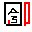 Rettangolo A3 (420x297) — `LEOA3`, `LEOA4`

> **Dove:** menu *Disegno → Forme Base → Rettangolo A3 (420x297)* · *Disegno → Forme Base → Rettangolo A4 (210x297)*; barra *Modifica Avanzata*

Disegnano il riquadro di un foglio: `LEOA3` un rettangolo di **420 x 297** (A3 orizzontale), `LEOA4` un rettangolo di
**210 x 297** (A4 verticale). Ti chiedono solo il `Punto superiore sinistro:`; il foglio va verso destra e verso il
basso. Utile per impaginare una stampa o una scheda.

<a id="cmd-trapi"></a>
####  Trapezio per Altezza — `TRAPI`

> **Dove:** menu *Disegno → Forme Base → Trapezio per Altezza*; barra *Modifica Avanzata*

Disegna un **trapezio isoscele** dalle due basi e dall'altezza: per esempio un fianco o un soffietto che si stringe.

1. `Base inferiore:`, `Altezza:`, `Base superiore:`.
2. `Punto di inserimento:`: il **punto medio della base inferiore**.

La base superiore può essere più corta o più lunga di quella inferiore.

<a id="cmd-trapl"></a>
#### 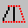 Trapezio per Lato — `TRAPL`

> **Dove:** menu *Disegno → Forme Base → Trapezio per Lato*; barra *Modifica Avanzata*

Come `TRAPI`, ma invece dell'altezza dai la lunghezza del **lato obliquo**: serve quando conosci la misura della
cucitura sul fianco e non l'altezza.

1. `Base inferiore:`, `Base superiore:`, `Lato obliquo:`.
2. `Punto di inserimento:`: il punto medio della base inferiore.

Se il lato è troppo corto per unire le due basi compare `Il lato è troppo corto per queste basi.` e non viene
disegnato niente.

### Forme Speciali

Forme geometriche che nel cartamodello tornano spesso: ovali e ovoli per patte, tiretti e placche, ellissi, cerchi
di una circonferenza data, e qualche forma decorativa (spirali, cicloide).

<a id="cmd-goldrect"></a>
####  Rettangolo Aureo — `GOLDRECT`

> **Dove:** menu *Disegno → Forme Speciali → Rettangolo Aureo*; barra *Modifica Avanzata*

Disegna un **rettangolo aureo**: un lato è 1,618 volte l'altro, la proporzione "armoniosa" usata in tante borse.

1. `Specifica da [Maggiore/Minore] <Maggiore>:`: scegli se la misura che dai è il lato lungo o quello corto.
2. `Base MAGGIORE (mm):` oppure `Base MINORE (mm):`: la misura del lato scelto.
3. `Primo angolo:`: l'angolo in basso a sinistra; il rettangolo va verso destra e verso l'alto, con il lato lungo in
   orizzontale.

Alla fine la riga di comando ti scrive le due misure del rettangolo.

<a id="cmd-goldspiral"></a>
####  Spirale Aurea — `GOLDSPIRAL`

> **Dove:** menu *Disegno → Forme Speciali → Spirale Aurea*; barra *Modifica Avanzata*

Disegna una **spirale aurea**: a ogni quarto di giro la spirale si stringe della proporzione aurea.

1. `Dimensione iniziale (mm) <100>:`: la distanza dal centro del punto più esterno, dove la spirale comincia.
2. `Numero di giri <3>:` (al massimo 100).
3. `Centro della spirale:`.

La spirale parte dall'esterno e gira verso il centro. È una polilinea aperta, disegnata in **verde**.

<a id="cmd-spirale"></a>
####  Spirale Generica — `SPIRALE`

> **Dove:** menu *Disegno → Forme Speciali → Spirale Generica*; barra *Modifica Avanzata*

Disegna una spirale aperta che parte vicino al centro e si allarga.

1. `Tipo [Archimede/Logaritmica/Fibonacci] <Archimede>:`
   - **Archimede**: le spire sono tutte alla stessa distanza fra loro (il passo);
   - **Logaritmica**: le spire si allargano sempre di più;
   - **Fibonacci**: a ogni giro la distanza dal centro cresce della proporzione aurea.
2. `Punto centro spirale:`.
3. `Raggio iniziale (mm) <10>:`, `Numero spire <3>:`, `Passo spirale (mm) <20>:`.

Il passo conta solo per la spirale di Archimede; per gli altri due tipi viene chiesto ma non cambia la forma.

<a id="cmd-ovale"></a>
####  Ovale — `OVALE`

> **Dove:** menu *Disegno → Forme Speciali → Ovale*; barra *Modifica Avanzata*

Disegna un **ovale a capsula**: due semicerchi uniti da due tratti dritti. È la forma classica di placche, asole
lunghe e tiretti.

1. `Larghezza massima:` e `Altezza massima:`.
2. `Centro dell'ovale:`.

I tratti dritti stanno sul lato più lungo: se la larghezza è maggiore l'ovale è orizzontale, se è maggiore l'altezza è
verticale. Con larghezza e altezza uguali ottieni un cerchio.

<a id="cmd-ovolo"></a>
####  Ovolo — `OVOLO`

> **Dove:** menu *Disegno → Forme Speciali → Ovolo*; barra *Modifica Avanzata*

Disegna un **ovolo**, cioè un uovo fatto con quattro archi raccordati: un semicerchio in basso, due fianchi e una
calotta più stretta in alto.

1. `Larghezza massima:`.
2. `Altezza massima <...>:`: il valore proposto è l'uovo classico, alto circa 1,29 volte la larghezza. Puoi scrivere
   un'altra altezza: la calotta e i fianchi si adattano.
3. `Centro dell'ovolo:`: il centro dell'ingombro della figura.

L'altezza non può essere minore della larghezza (`L'altezza dell'ovolo non può essere minore della larghezza.`). La
forma è più "a uovo" con altezze fra 1,1 e 1,5 volte la larghezza. La punta dell'uovo è verso l'alto.

<a id="cmd-ellisse"></a>
####  Ellisse a Polilinea — `ELLISSE`

> **Dove:** menu *Disegno → Forme Speciali → Ellisse a Polilinea*; barra *Modifica Avanzata*

Disegna un'**ellisse come polilinea chiusa** (fatta di archi), invece dell'ellisse vera di ZWCAD: così la puoi usare come
contorno di taglio, unire, raccordare e passare agli offset come ogni altra sagoma.

1. `Semiasse orizzontale:` e `Semiasse verticale:`: metà della larghezza e metà dell'altezza.
2. `Centro dell'ellisse:`.

<a id="cmd-cicloide"></a>
####  Cicloide — `CICLOIDE`

> **Dove:** menu *Disegno → Forme Speciali → Cicloide*; barra *Modifica Avanzata*

Disegna uno o più **archi di cicloide**, la curva che descrive un punto di una ruota che rotola: una forma decorativa a
festoni, per bordi e smerli.

1. `Raggio del cerchio generatore:`: ogni arco è largo circa 6,28 volte il raggio e alto due volte il raggio.
2. `Numero di archi <1>:` (al massimo 100).
3. `Punto iniziale della cicloide:`: la curva parte da qui e va verso destra, sopra il punto.

È una polilinea aperta.

<a id="cmd-triangolo"></a>
####  Triangolo Isoscele — `TRIANGOLO`

> **Dove:** menu *Disegno → Forme Speciali → Triangolo Isoscele*; barra *Modifica Avanzata*

Disegna un **triangolo isoscele** dalla base e dall'altezza.

1. `Lunghezza della base:` e `Altezza:`.
2. `Punto medio della base:`: la punta è verso l'alto.

<a id="cmd-rombo"></a>
####  Rombo — `ROMBO`

> **Dove:** menu *Disegno → Forme Speciali → Rombo*; barra *Modifica Avanzata*

Disegna un **rombo** dalle due diagonali.

1. `Diagonale orizzontale:` e `Diagonale verticale:`.
2. `Centro del rombo:`.

<a id="cmd-circonf"></a>
####  Cerchio da Perimetro — `CIRCONF`

> **Dove:** menu *Disegno → Forme Speciali → Cerchio da Perimetro*; barra *Modifica Avanzata*

Disegna un cerchio partendo dalla **circonferenza** che vuoi ottenere: per esempio un fondo tondo che deve misurare
quanto la fascia che ci va cucita attorno.

1. `Perimetro del cerchio:`.
2. `Centro del cerchio:`.

Il cerchio è una polilinea chiusa (due semicerchi esatti). Sulla riga di comando leggi il diametro e il raggio
calcolati.

<a id="cmd-tasca"></a>
####  Tasca — `TASCA`

> **Dove:** menu *Disegno → Forme Speciali → Tasca*; barra *Modifica Avanzata*

Disegna la base di una **tasca**: un rettangolo con gli angoli raccordati, con in più, a scelta, la linea della zip o
le pieghe del soffietto.

1. `Larghezza tasca (mm):` e `Altezza tasca (mm):`.
2. `Raggio angoli (mm) <5>:`.
3. `Tipo [Patch/Zip/Soffietto] <Patch>:`
   - **Patch**: solo il rettangolo raccordato (tasca applicata);
   - **Zip**: aggiunge una linea verticale al centro, tratteggiata e gialla, che segna la cerniera;
   - **Soffietto**: aggiunge due linee verticali, a un quarto e a tre quarti della larghezza, per le pieghe; ti chiede
     anche `Profondità soffietto (mm) <20>:`.
4. `Punto inserimento:`: l'angolo in basso a sinistra.

Le misure qui vanno scritte. Il contorno è una polilinea chiusa sul layer corrente.

<a id="cmd-topopt"></a>
#### 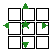 Top Ottimizzato — `TOPOPT`

> **Dove:** menu *Disegno → Forme Speciali → Top Ottimizzato*; barra *Modifica Avanzata*

Riempie l'ingombro di un oggetto con una **griglia regolare di fori tondi**, per alleggerire un pezzo o per una
foratura decorativa.

1. `Seleziona area da ottimizzare:`: clicca il contorno.
2. `Livello ottimizzazione [Leggera/Media/Aggressiva] <Media>:`: quanto fitti sono i fori.

| Livello | Passo della griglia | Diametro del foro |
|---|---|---|
| Leggera | 40 mm | circa 13,3 mm |
| Media | 25 mm | circa 8,3 mm |
| Aggressiva | 15 mm | 5 mm |

I fori sono cerchi rossi sul layer corrente. Alla fine la riga di comando ti scrive quanti fori ha fatto e il
`Risparmio peso` in percentuale.

Attenzione: la griglia copre tutto il **rettangolo di ingombro** dell'oggetto, non solo l'interno del contorno. Con una
sagoma non rettangolare cancella i fori che cadono fuori o troppo vicini al bordo. Per farli tagliare dalla macchina
mettili sul layer dei tagli interni `INTCUT` (vedi [Tipolinea e Layer](#6-tipolinea-e-layer)).

### Freccia, Squadratura e Arco Tangente

Tre voci che stanno direttamente nel menu Disegno, senza sottomenu.

<a id="cmd-sar"></a>
#### 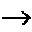 Disegna Freccia (SAR) — `SAR`

> **Dove:** menu *Disegno → Disegna Freccia (SAR)*; barra *Modifica Avanzata*

Disegna una **freccia di direzione**, per esempio per indicare il verso del ringrano o del pelo, o il senso di
montaggio di un pezzo.

1. `Punto iniziale della freccia o [Dimensione] <punta 3 x 2>:`: clicca la coda della freccia. Con **Dimensione**
   cambi la `Lunghezza della punta:` e la `Larghezza della punta:`; poi la domanda torna.
2. `Punto finale della freccia:`: mentre muovi il mouse vedi la freccia; clicca dove va la punta.

La freccia è un'unica polilinea (asta e triangolo della punta) sul layer corrente. La dimensione della punta resta
quella scelta finché non chiudi ZWCAD.

<a id="cmd-centro"></a>
####  Squadratura (Centro) — `CENTRO`

> **Dove:** menu *Disegno → Squadratura (Centro)*; barra *Modifica Avanzata*

Disegna la **squadratura** di un pezzo: una croce formata da una linea orizzontale e una verticale che passano per il
centro del suo rettangolo di ingombro e sporgono un po' oltre i bordi. Serve per mettere in squadro i pezzi, per
allinearli fra loro e per trovarne il centro.

- Se hai **selezionato** dei pezzi prima di lanciare il comando, la squadratura si fa su tutti in una volta.
- Altrimenti: `Seleziona la polilinea da squadrare o [Impostazioni] <fuoriuscita orizz. 10, vert. 10>:`. Clicca i
  pezzi uno dopo l'altro (va bene una polilinea o un'altra curva: arco, cerchio, spline...); Invio per finire.
- **Impostazioni** cambia di quanto sporgono le linee:
  `Fuoriuscita della linea orizzontale oltre i lati sinistro e destro:` e
  `Fuoriuscita della linea verticale oltre i lati alto e basso:`. Le due sporgenze possono essere diverse e valgono
  finché non chiudi ZWCAD.

Le linee vanno sul layer `squadratura` (grigio, colore 8), che viene creato se manca. Così le puoi spegnere o
congelare tutte insieme quando non servono.

<a id="cmd-arcotang"></a>
####  Arco Tangente — `ARCOTANG`

> **Dove:** menu *Disegno → Arco Tangente*; barra *Utilità Sistema Ext*

Disegna un **arco tangente** a due archi che hai già nel disegno, scegliendo il raggio a vista col mouse: per raccordare
due curve di un contorno con un arco morbido.

1. Seleziona il primo arco, poi il secondo. Devono essere **archi veri** (non cerchi, non archi dentro una polilinea):
   se no compare `Il primo oggetto non è un arco.` o `Il secondo oggetto non è un arco.`.
2. Muovi il mouse: più ti allontani dal punto di mezzo fra i centri dei due archi, più grande è il raggio. Vedi
   l'arco in verde, i due punti di tangenza con una crocetta rossa e il centro con una crocetta ciano; il raggio è
   scritto nella barra di stato. Se con quel raggio non c'è un arco che tocca i due archi leggi `Nessun arco valido`.
3. **Spazio** inverte il verso dell'arco (nella barra di stato compare `[INVERTITO]`).
4. **Clic sinistro** conferma; clic destro o Esc annullano.

L'arco viene creato sul layer corrente come arco normale di ZWCAD. Gli archi di partenza non vengono tagliati: se ti
serve, accorciali e poi unisci tutto in una polilinea (vedi [Polilinee](#2-polilinee)). Se all'inizio compare
`Nessun punto di tangenza trovato`, i due archi sono troppo lontani o messi in modo che un arco tangente non si possa
fare.

### Sviluppo Superfici

Questi comandi servono a **sviluppare in piano una fascia** disegnata in 3D: per esempio la fascia di una borsa di cui
hai modellato i due bordi (quello verso il fondo e quello verso la bocca) come curve nello spazio. Il risultato è la
sagoma piana da tagliare, con le misure vere dei bordi.

<a id="cmd-unrollsweep5"></a>
#### Sviluppa (Unroll Sweep 5) — `UNROLLSWEEP5`

> **Dove:** menu *Disegno → Sviluppo Superfici → Sviluppa (Unroll Sweep 5)*

Srotola sul piano la fascia compresa fra due bordi 3D. Prima di lanciarlo ti servono: i due bordi (linee, archi,
polilinee anche 3D, spline o ellissi) e una **linea** che unisce l'inizio del primo bordo all'inizio del secondo.

1. `[1] Seleziona PERCORSO A (bordo 1):` e `[2] Seleziona PERCORSO B (bordo 2):`. Se clicchi a vuoto ti chiede
   `Nessuna selezione. Riprovare? [Si/No] <Si>:`.
2. `[3] Seleziona LINEA SWEEP (da inizio_A a inizio_B):`: la linea di partenza; deve essere una linea semplice. Non
   importa in che verso l'hai disegnata, né in che verso sono disegnati i bordi: il comando li gira da solo dalla
   parte della linea (e te lo scrive, `invertito`).
3. `[4] Metodo di sviluppo [Frame/Triangolazione] <Frame>:`
   - **Frame**: sviluppa la fascia a strisce, una dopo l'altra; è esatto quando ogni striscia è piana. È la scelta
     normale.
   - **Triangolazione**: divide ogni striscia in due triangoli, usando la diagonale più corta, e conserva le misure
     della superficie campionata.

   Il metodo scelto viene riproposto la volta dopo (finché non chiudi ZWCAD).
4. `[5] Numero passi campionamento (min 5) <150>:`: in quante strisce viene divisa la fascia. Più passi, più
   precisione.
5. `[6] Punto di inserimento sviluppo <0,0>:`: dove mettere lo sviluppo; con Invio va nell'origine. Il primo lato
   della fascia è verticale e la fascia si sviluppa verso destra.

Che cosa disegna:

- sul layer `UNROLL-SWEEP` (verde): i due bordi sviluppati, le due testate e il **contorno chiuso** della fascia, che è
  la sagoma da usare;
- sul layer `UNROLL-GEN` (grigio): le generatrici di controllo, cioè le linee trasversali che mostrano come si
  corrispondono i punti dei due bordi (una ogni 10 passi, si cambia con `UNROLLSWEEP5SET`).

Alla fine la riga di comando ti dà un riepilogo: lunghezza di ciascun bordo in 3D e nello sviluppo, larghezza della
fascia all'inizio e alla fine, area dello sviluppo e distorsione. Se leggi
`Superficie GAUCHE (non sviluppabile)`, la fascia non si può stendere in piano senza tirarla: lo sviluppo è
un'approssimazione e va controllato (la percentuale ti dice quanto è grande l'errore). Se invece leggi
`Sviluppo isometrico entro tolleranza`, le misure sono rispettate.

<a id="cmd-unrollsweep5set"></a>
#### Impostazioni Unroll — `UNROLLSWEEP5SET`

> **Dove:** menu *Disegno → Sviluppo Superfici → Impostazioni Unroll*

Cambia le impostazioni di `UNROLLSWEEP5`:

1. `Numero passi campionamento (min 5) <150>:`.
2. `Generatrice di controllo ogni N passi <10>:`: ogni quanti passi disegnare una generatrice di controllo.

Le impostazioni valgono per gli sviluppi successivi ma non vengono salvate: quando riapri ZWCAD tornano 150 e 10.

### Forme Avanzate

Qui ci sono le forme che servono per costruire una borsa: il **quadrante** (il davanti e il dietro), la **fascia** che
gli gira attorno, le pence, i fianchi e gli altri pezzi del manuale, più alcuni comandi veloci per disegnare una fascia
fianco a partire da due rettangoli.

### Quadranti

I comandi dei quadranti lavorano insieme. Si parte sempre dal quadrante (`DQ` o `DQL`); fascia (`DQF`), pence (`DQP`)
e costruzioni (`DQC`) leggono le misure da un quadrante già disegnato, così le lunghezze combaciano. Una sagoma
disegnata in un altro modo si trasforma in quadrante con `DQI`. La fascia a misure (`DQFM`) e la tracciatura (`DQT`)
non hanno bisogno del quadrante.

Ogni comando ha un nome lungo e uno corto (`DISEGNAQUADRANGOLO` o `DQ`, `DISEGNAFASCIA` o `DQF`...): fanno la stessa
cosa. Per gli esempi con le figure e le tabelle di tutte le misure c'è anche la guida dedicata ai quadranti.

**Come sono fatte le finestre.** Tutti questi comandi aprono una finestra grande:

- a **sinistra** i campi, divisi in gruppi; a **destra** l'**anteprima**, che si aggiorna mentre scrivi, senza
  premere Invio. È calcolata come la figura che finirà nel disegno;
- sotto l'anteprima le **misure** (area, perimetro, ingombro...). Se la figura non si può fare, al loro posto c'è il
  **motivo in rosso** e il pulsante **Disegna** resta spento: correggi il valore e l'anteprima torna;
- nei campi puoi battere il punto o la virgola; i campi in grigio sono calcolati dal programma o non servono con le
  scelte fatte; fermando il mouse su un campo compare una spiegazione;
- la **croce rossa** nell'anteprima è il punto base, quello che segue il cursore quando inserisci;
- in basso **Carica preset…** e **Salva preset…** leggono e scrivono tutte le misure della finestra in un file `.xml`
  (comodo per i modelli che rifai spesso), **Annulla** e **Disegna**.

**Misure prese nel disegno.** Accanto a quasi tutte le misure c'è il pulsante **↔** (in `DQFM` e `DQT` si chiama
**Misura**). In questi comandi funziona così:

- **lunghezza**: scegli una polilinea, una linea, un arco o una spline e clicca due punti: vale la lunghezza **lungo la
  curva** fra i due punti. Le frecce mostrano il verso, il cerchio rosso l'inizio. Sulle curve chiuse si prende il
  tratto più corto; con **Altro** prendi l'altro. Scrivendo **T** al primo punto prendi tutta la curva. Con Invio al
  posto della curva misuri la distanza dritta fra due punti;
- **raggio**: clicca un cerchio, un arco o il tratto ad arco di una polilinea (o Invio e due punti);
- **diametro**: un cerchio o un arco; una curva chiusa dà il diametro dello stesso perimetro (o Invio e due punti);
- **freccia** (la sporgenza di un arco): clicca l'arco o il tratto ad arco (un tratto dritto dà 0), oppure Invio e tre
  punti: i due estremi e il punto della curva a metà;
- **angolo**: tre punti (il vertice, un punto sul primo lato, uno sul secondo), oppure Invio e due linee da cliccare.

Il segno non si prende dal disegno: una sporgenza verso l'interno o un'inclinazione dall'altra parte la correggi tu
con il `-`.

**Uscita e inserimento** (uguali in tutte le finestre):

- **Layer**: scegli dall'elenco o scrivi un nome nuovo, che viene creato. Di partenza è `0`.
- **Colore**: DaLayer, DaBlocco o un colore da 1 a 9.
- **Crea come blocco**: tutto quello che disegni diventa un blocco con il nome scritto accanto (`FIGURA_001`,
  `FASCIA_001`, `PENCE_001`, `COSTRUZIONE_001`, `TRACCIATURA_001`); se il nome c'è già si usa il primo libero
  (`FIGURA_002`...).
- **Punto base** e **Rotazione (gradi)**: quale punto della figura segue il cursore e di quanto è girata.

Premuto **Disegna**, la figura segue il cursore: `Punto di inserimento:` la posa. Poi
`Punto di inserimento della copia successiva <Invio per terminare>:` ti fa mettere altre copie uguali; Invio o Esc per
finire. Sulla riga di comando restano quante figure hai inserito e le loro misure.

**Il quadrante ricorda le sue misure.** Ogni quadrante disegnato con `DQ`, `DQL` o `DQI` porta dentro di sé i suoi
parametri, sia come polilinea sia come blocco: per questo `DQM` e `DQLM` lo riaprono con i valori giusti e `DQF`,
`DQP`, `DQC` ne leggono le misure. Se lo esplodi o lo ridisegni a mano, i parametri si perdono. Quando un comando ti
chiede il quadrante, **Invio** usa l'ultimo quadrante confermato in `DQ` o `DQL`.

<a id="cmd-disegnaquadrangolo"></a><a id="cmd-dq"></a>
#### 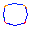 Quadrante ad Archi (DQ) — `DISEGNAQUADRANGOLO`, `DQ`

> **Dove:** menu *Disegno → Forme Avanzate → Quadranti → Quadrante ad Archi (DQ)*; barra *FASCIA FIANCO*, *Quadranti*

Disegna il **quadrante** della borsa: una polilinea chiusa unica a forma di trapezio, con i quattro angoli raccordati
e, se vuoi, i lati ad arco. Le misure si danno sul trapezio teorico, cioè fra i vertici senza raccordi.

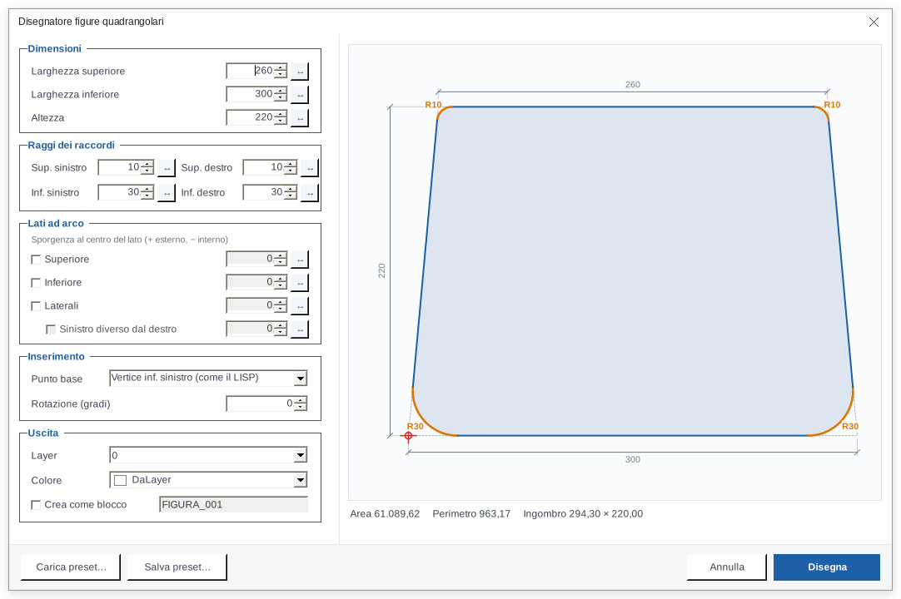

Si apre subito la finestra **Disegnatore figure quadrangolari**. Dall'alto in basso:

- **Dimensioni**, in mm sul trapezio teorico. Il trapezio è sempre simmetrico, con la testa centrata sul fondo (per
  spostarla c'è `DQL`):
  - **Larghezza superiore**: la testa, cioè il lato in alto;
  - **Larghezza inferiore**: il fondo;
  - **Altezza**: la distanza in verticale fra fondo e testa.
- **Raggi dei raccordi**: **Sup. sinistro**, **Sup. destro**, **Inf. sinistro**, **Inf. destro**: il raggio di ogni
  angolo, in mm; 0 = spigolo vivo. Valgono anche con i lati ad arco.
- **Lati ad arco** (sotto il titolo: `Sporgenza al centro del lato (+ esterno, − interno)`): spunta **Superiore**,
  **Inferiore** o **Laterali** e scrivi nel campo accanto la **sporgenza**, cioè la freccia dell'arco al centro del
  lato, misurata dalla corda fra i due vertici del trapezio (+ verso l'esterno, − verso l'interno). Finché il lato non
  è spuntato il campo è grigio e il lato resta dritto. **Laterali** vale per i due fianchi; spuntando anche
  **Sinistro diverso dal destro**, il campo di quella riga è la sporgenza del lato sinistro e quello di **Laterali**
  resta al destro.
- **Inserimento**: **Punto base**, cioè quale punto segue il cursore: **Vertice inf. sinistro** (il vertice teorico in
  basso a sinistra, senza il raccordo), **Centro del lato inferiore**, **Centro dell'ingombro** o **Angolo inf.
  sinistro dell'ingombro** (il rettangolo che racchiude la figura); **Rotazione (gradi)**, da -360 a 360.
- **Uscita**: layer, colore e blocco, come detto sopra.

Nell'anteprima il trapezio teorico è tratteggiato con le tre quote, i raccordi sono in arancione con il loro raggio.
Sotto: area, perimetro e ingombro. Se un raggio non ci sta, il messaggio in rosso ti dice anche il raggio massimo
possibile in quell'angolo.

Le misure partono dall'ultimo quadrante che hai disegnato (la prima volta: larghezza superiore 100, inferiore 150,
altezza 80).

<a id="cmd-dqmodifica"></a><a id="cmd-dqm"></a>
####  Modifica Quadrante (DQM) — `DQMODIFICA`, `DQM`

> **Dove:** menu *Disegno → Forme Avanzate → Quadranti → Modifica Quadrante (DQM)*; barra *Quadranti*

Riapre la finestra di `DQ` su un quadrante già disegnato e lo aggiorna **al suo posto**.

1. `Seleziona la figura da modificare:` clicca il quadrante (polilinea o blocco fatti con `DQ` o importati con `DQI`).
2. Si apre la finestra **Modifica figura quadrangolare** con i valori della figura; il pulsante diventa **Aggiorna**.
3. Cambia le misure e premi **Aggiorna**.

Il quadrante nuovo prende il posto del vecchio, con lo stesso layer e colore: in modifica i gruppi **Inserimento** e
**Uscita** sono spenti. Se il quadrante è un blocco, il blocco viene ridefinito e cambiano tutte le sue copie. Sulla
riga di comando ti restano area e perimetro nuovi.

Un quadrante fatto con `DQL` (lati a lunghezza fissa) non si modifica qui: `DQM` ti avvisa di usare `DQLM`.

Attenzione: il quadrante aggiornato si mette nella posizione in cui era stato **disegnato**. Se nel frattempo l'hai
spostato, ruotato o copiato, controlla dove è finito dopo l'aggiornamento.

<a id="cmd-disegnaquadrangololunghezze"></a><a id="cmd-dql"></a>
####  Quadrante a Lunghezze Fisse (DQL) — `DISEGNAQUADRANGOLOLUNGHEZZE`, `DQL`

> **Dove:** menu *Disegno → Forme Avanzate → Quadranti → Quadrante a Lunghezze Fisse (DQL)*; barra *Quadranti*

Come `DQ`, ma i lati che scegli **mantengono il loro sviluppo**. Serve quando la lunghezza di un lato è data, per
esempio perché deve combaciare con la fascia o con un altro pezzo: cambi raggi e sporgenze, e il programma ricalcola il
trapezio perché quei lati restino lunghi uguali.

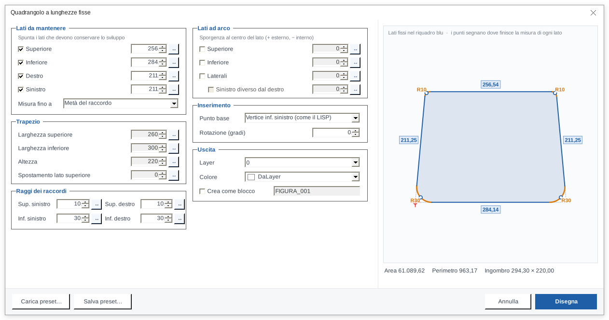

La finestra **Quadrangolo a lunghezze fisse** ha due colonne di campi: nella prima **Lati da mantenere**,
**Trapezio** e **Raggi dei raccordi**, nella seconda **Lati ad arco**, **Inserimento** e **Uscita**. Rispetto a `DQ`
ci sono in più:

- **Lati da mantenere**: spunta **Superiore**, **Inferiore**, **Destro**, **Sinistro**. Quando spunti un lato, il suo
  sviluppo attuale diventa quello da mantenere (la figura non si muove); se vuoi, scrivi tu lo sviluppo nel campo
  accanto, in mm, misurato lungo il contorno. Per i lati non spuntati il valore è in grigio e serve solo da
  riferimento.
- **Misura fino a**: fin dove si misura un lato quando l'angolo è raccordato.
  - **Metà del raccordo**: ogni raccordo è diviso a metà fra i due lati (la somma dei quattro lati è il perimetro);
  - **Spigolo vivo (vertice teorico)**: come se l'angolo non fosse raccordato;
  - **Punto di tangenza**: solo la parte del lato fuori dai raccordi;
  - **Inscrizione (punto sulla bisettrice)**: fino al punto dove la bisettrice dell'angolo taglia il raccordo;
  - **Poligono circoscritto, tangente agli archi**: il lato del poligono che racchiude la figura, con i lati
    paralleli al trapezio (come un ingombro che segue l'inclinazione dei lati);
  - **Poligono circoscritto, archi come corda**: come sopra, ma i lati ad arco si attraversano con la corda.
  Cambiando modo, la forma resta quella e cambiano solo i numeri dei lati spuntati.
- **Trapezio**: **Larghezza superiore**, **Larghezza inferiore** e **Altezza** come in `DQ`, più lo **Spostamento
  lato superiore** (+ a destra, − a sinistra: con `DQL` la testa può non essere centrata sul fondo; 0 = centrata). Le
  misure legate a un lato spuntato diventano grigie e si ricalcolano da sole: inferiore → larghezza inferiore,
  superiore → larghezza superiore, un laterale → altezza, tutti e due i laterali → altezza e spostamento. Le altre
  restano quelle che scrivi. Con tutti e quattro i lati spuntati, come di partenza, sono grigie tutte e quattro.

Raggi, lati ad arco, inserimento e uscita sono quelli di `DQ`. Nell'anteprima i lati fissi hanno la misura in un
riquadro blu e i punti segnano dove finisce la misura di ogni lato. Se un lato non si riesce a tenere con quei raggi,
il messaggio in rosso ti dice il valore più vicino possibile: cambia raggi o sporgenze, oppure togli la spunta.

<a id="cmd-dqlmodifica"></a><a id="cmd-dqlm"></a>
####  Modifica a Lunghezze Fisse (DQLM) — `DQLMODIFICA`, `DQLM`

> **Dove:** menu *Disegno → Forme Avanzate → Quadranti → Modifica a Lunghezze Fisse (DQLM)*; barra *Quadranti*

Modifica un quadrante a lunghezze fisse, come `DQM` fa per `DQ`: `Seleziona la figura da modificare:`, si apre la
finestra di `DQL` con i valori della figura e **Aggiorna** lo cambia al suo posto.

Puoi selezionare anche un quadrante fatto con `DQ`: diventa a lunghezze fisse (gli sviluppi attuali dei lati diventano
quelli da mantenere) e da quel momento si modifica con `DQLM`.

<a id="cmd-disegnafascia"></a><a id="cmd-dqf"></a>
####  Fascia sul Quadrante (DQF) — `DISEGNAFASCIA`, `DQF`

> **Dove:** menu *Disegno → Forme Avanzate → Quadranti → Fascia sul Quadrante (DQF)*; barra *Quadranti*

Disegna la **fascia** che gira attorno ai lati scelti di un quadrante, stesa in piano. Prende le parti dritte dei
lati e la lunghezza vera degli archi dei raccordi, così la fascia è lunga esattamente quanto il contorno che deve
cucire.

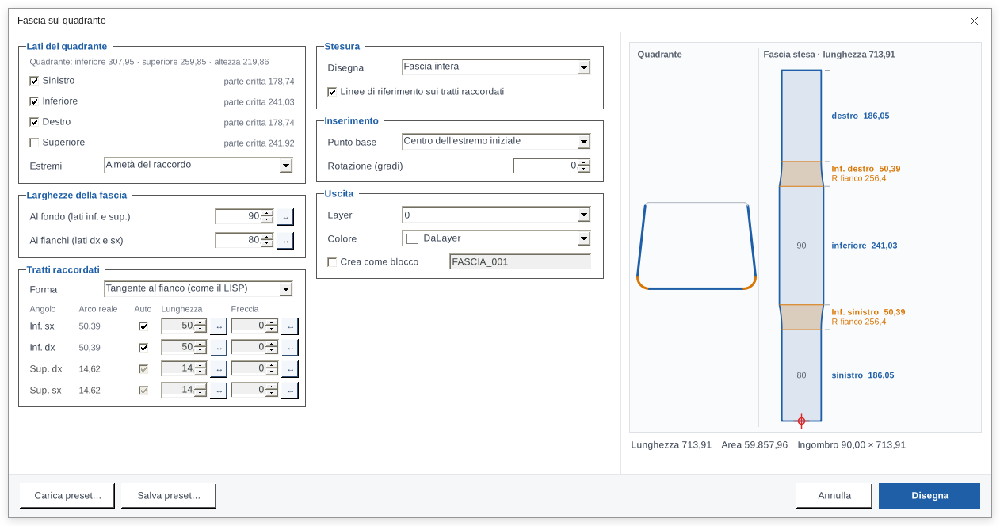

1. `Seleziona il quadrante attorno a cui gira la fascia <Invio = ultimo quadrante disegnato>:` clicca un quadrante di
   `DQ`/`DQL`, oppure Invio.
2. Nella finestra **Fascia sul quadrante** scegli lati, larghezze e forma dei tratti raccordati.
3. **Disegna** e posa la fascia.

Le parti della finestra (prima colonna: lati, larghezze, tratti raccordati; seconda: stesura, inserimento, uscita):

- **Lati del quadrante**: in alto, in grigio, le misure del quadrante scelto (inferiore, superiore, altezza). Spunta
  i lati attorno a cui gira la fascia (**Sinistro**, **Inferiore**, **Destro**, **Superiore**; di partenza tutti
  tranne il superiore): devono essere uno di seguito all'altro. A destra di ogni lato c'è la lunghezza della sua
  **parte dritta**, fra i due raccordi: si legge soltanto. Con tutti e quattro la fascia fa il giro completo e si apre
  a metà del lato superiore. **Estremi** dice dove finisce la fascia se l'angolo all'estremità è raccordato: **A metà
  del raccordo**, **Al punto di tangenza** (dove comincia l'arco) o **Raccordo intero**.
- **Larghezze della fascia**, in mm: **Al fondo (lati inf. e sup.)** è la larghezza della fascia lungo il fondo (e la
  testa), **Ai fianchi (lati dx e sx)** quella lungo i fianchi. Di partenza 100 e 80.
- **Tratti raccordati**: in alto la **Forma**, cioè come la fascia passa dalla larghezza del fondo a quella del
  fianco:
  - **Tangente al fianco**: un arco che arriva dritto sul fianco, con il raggio calcolato da solo;
  - **Arco per 3 punti (freccia)**: l'arco passa per l'inizio, la fine e un punto a metà spostato della freccia;
  - **Doppio raccordo (fondo e fianco)**: due archi a S, tangenti al bordo del fondo e a quello del fianco.

  Sotto c'è una riga per angolo (**Inf. sx**, **Inf. dx**, **Sup. dx**, **Sup. sx**); sono accese solo quelle degli
  angoli che la fascia attraversa. Le colonne:
  - **Arco reale**: la lunghezza vera del raccordo del quadrante, da leggere;
  - **Auto**: spuntato, il tratto è lungo quanto l'arco reale;
  - **Lunghezza**: si scrive solo togliendo **Auto** (parte dall'arco reale). I lati vicini si allungano o accorciano
    della stessa quantità, così la fascia resta lunga quanto il quadrante;
  - **Freccia** (con **Arco per 3 punti**): quanto il punto a metà del tratto si sposta dalla retta fra inizio e fine,
    in mm (+ verso l'esterno, 0 = tratto dritto). Con le altre forme è grigia;
  - **% sul fondo** (prende il posto della freccia con il **Doppio raccordo**): quanta parte della curva sta sul fondo.
    50 = due archi con lo stesso raggio, 0 = solo l'arco sul fianco, 100 = solo quello sul fondo.
- **Stesura**: **Disegna** **Fascia intera**, oppure **Metà, dal centro verso la fine** o **Metà, dal centro verso
  l'inizio** (la metà va dal centro della fascia fino a un estremo). **Linee di riferimento sui tratti raccordati**
  aggiunge le linee trasversali all'inizio e alla fine di ogni tratto raccordato, per allineare la cucitura.
- **Inserimento**: **Punto base** **Centro dell'estremo iniziale**, **Centro della fascia** o **Angolo inf. sinistro
  dell'ingombro**, e **Rotazione (gradi)**.
- **Uscita**: come detto sopra.

Nell'anteprima vedi a sinistra il quadrante con i lati scelti e a destra la fascia stesa, con la lunghezza di ogni
tratto e i raggi usati; sotto, lunghezza totale, area e ingombro.

Nel disegno la fascia è una **polilinea chiusa** sul layer scelto, con le linee di riferimento come linee semplici.

<a id="cmd-disegnafasciamisure"></a><a id="cmd-dqfm"></a>
####  Fascia con Misure (DQFM) — `DISEGNAFASCIAMISURE`, `DQFM`

> **Dove:** menu *Disegno → Forme Avanzate → Quadranti → Fascia con Misure (DQFM)*; barra *Quadranti*

Disegna la stessa fascia di `DQF` **senza il quadrante**: le lunghezze le scrivi oppure le prendi con il pulsante
**Misura** su una polilinea qualsiasi (un quadrante disegnato a mano, una sagoma arrivata da un altro file). Si apre
subito la finestra **Fascia a misure**.

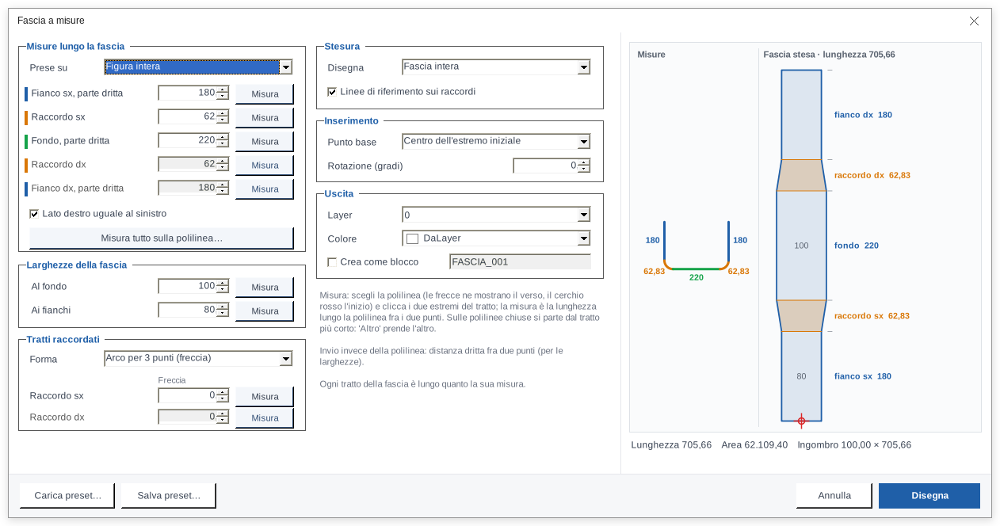

- **Misure lungo la fascia**, tutte in mm:
  - **Prese su**: **Figura intera** oppure **Mezza figura (fondo dall'asse)**. Con la mezza figura il campo del fondo
    diventa **Fondo, dall'asse (metà)**, il lato destro è per forza uguale al sinistro e il pulsante in fondo al gruppo
    diventa **Misura tutto sulla mezza figura…**. In **Stesura** scegli poi se disegnare la fascia intera (specchiata
    sull'asse) o la metà dal centro del fondo;
  - poi, nell'ordine in cui stanno lungo la fascia: **Fianco sx, parte dritta**, **Raccordo sx** (la lunghezza
    dell'arco), **Fondo, parte dritta**, **Raccordo dx**, **Fianco dx, parte dritta**. Ogni tratto della fascia è
    lungo quanto la sua misura; il trattino colorato accanto al nome è il colore del tratto nell'anteprima (blu i
    fianchi, arancione i raccordi, verde il fondo);
  - **Lato destro uguale al sinistro**: spuntato (di partenza), **Raccordo dx** e **Fianco dx** sono grigi e
    prendono le misure del sinistro; togli la spunta per scriverle diverse;
  - **Misura** accanto a ogni campo: la finestra si chiude, scegli la polilinea e clicca i due estremi del tratto
    (vedi sopra le misure prese nel disegno); il valore va nel campo e la finestra si riapre. Con Invio al posto
    della polilinea misuri la distanza dritta fra due punti, comoda per le larghezze;
  - **Misura tutto sulla polilinea…**: scegli una volta la polilinea e clicca i punti in fila (la riga di comando ti
    dice quale): `la testa del fianco sinistro`, `la fine del fianco (inizio del raccordo)`, `la fine del raccordo
    (inizio del fondo)`, poi `la fine del fondo (inizio del raccordo destro)` (o `l'asse del fondo` con la mezza
    figura) e, se il lato destro è diverso, la fine del raccordo destro e la testa del fianco destro. Ogni tratto si
    colora mentre lo prendi.
- **Larghezze della fascia**: **Al fondo** e **Ai fianchi**, come in `DQF`, ognuna con il suo **Misura**.
- **Tratti raccordati**: la **Forma** come in `DQF` (di partenza **Doppio raccordo (fondo e fianco)**). Sotto ci sono
  solo le righe **Raccordo sx** e **Raccordo dx**, perché le lunghezze dei raccordi le hai già scritte sopra:
  - con **Arco per 3 punti** il campo è la **Freccia**, quanto il punto a metà del raccordo si sposta dalla retta
    (+ verso l'esterno), con il suo **Misura**;
  - con **Doppio raccordo** è la **% sul fondo** (50 = due archi uguali, 0 = solo l'arco sul fianco, 100 = solo
    quello sul fondo);
  - con **Tangente al fianco** non c'è niente da scrivere.

  Con il lato destro uguale al sinistro, anche la riga **Raccordo dx** è grigia e copia la sinistra.
- **Stesura**, **Inserimento** e **Uscita** come in `DQF` (qui la spunta si chiama **Linee di riferimento sui
  raccordi**). Sotto **Uscita** un promemoria ricorda come si usa il pulsante **Misura**.

Un lato con fianco e raccordo a zero non c'è: la fascia comincia o finisce sul fondo. Nel disegno la fascia è una
polilinea chiusa, come in `DQF`.

<a id="cmd-disegnapence"></a><a id="cmd-dqp"></a>
#### 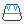 Pence e Cannoni (DQP) — `DISEGNAPENCE`, `DQP`

> **Dove:** menu *Disegno → Forme Avanzate → Quadranti → Pence e Cannoni (DQP)*; barra *Quadranti*

Sviluppa il quadrante con le **pence** o i **cannoni** senza cambiare il perimetro cucito: chiuse le pence, il contorno
è lungo quanto il quadrante, quindi la fascia fatta con `DQF` combacia ancora.

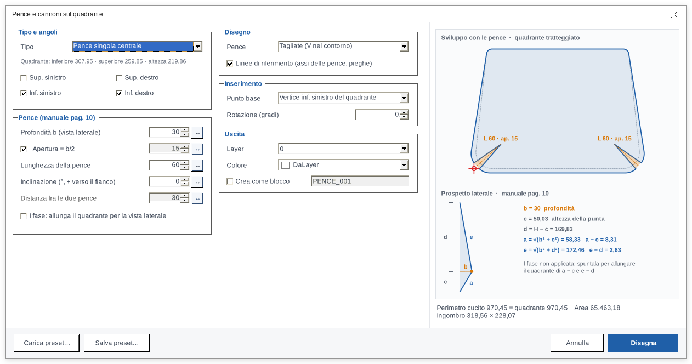

1. `Seleziona il quadrante su cui fare pence o cannoni <Invio = ultimo quadrante disegnato>:`
2. Nella finestra **Pence e cannoni sul quadrante** scegli il tipo, dove metterlo e le misure.
3. **Disegna** e posa lo sviluppo.

**Tipo e angoli** - il **Tipo** (sotto, in grigio, le misure del quadrante scelto):

| Tipo | Dove va |
|---|---|
| **Pence singola centrale** | a metà della curva di ogni angolo spuntato |
| **Pence doppia al centro curva** | due pence ai lati del centro della curva |
| **Cannoni (bocca → raccordo)** | piega dalla bocca a un punto della curva del fondo (solo angoli in basso) |
| **Pence singola sul fondo** | sul tratto dritto del fondo, al centro o spostata |
| **Cannone sul fondo (bocca → fondo)** | piega dritta dalla bocca al fondo, al centro o spostata |

Per i tipi sugli angoli spunti gli angoli (**Sup. sinistro**, **Sup. destro**, **Inf. sinistro**, **Inf. destro**,
messi come sul quadrante): ogni angolo con la pence deve essere raccordato. Con i **Cannoni** i due angoli in alto sono
grigi, perché i cannoni partono solo dagli angoli del fondo. Per i tipi sul fondo, al posto degli angoli c'è
**Spostamento dal centro (+ destra)**, in mm (0 = al centro, + verso destra, − verso sinistra; per il cannone si
spostano insieme il punto sul fondo e quello in bocca); sotto il campo leggi quanto è lungo il tratto dritto del fondo
(e della bocca) e fra quali valori puoi spostare.

Sotto c'è il gruppo **Pence** oppure, con i due tipi di cannone, il gruppo **Cannoni**. Tutte le misure sono in mm,
tranne gli angoli.

**Pence (manuale pag. 10)**:

- **Profondità b (vista laterale)**: quanto la borsa prende profondità vista di lato. L'apertura della pence è b/2 (con
  la doppia, b/4 per ciascuna). Di partenza 30.
- **Apertura = b/2** (con la doppia **Apertura di ogni pence = b/4**): con la casella spuntata il campo è grigio e
  segue la profondità; togli la spunta per scrivere tu l'apertura di ogni pence.
- **Lunghezza della pence**: dalla punta al bordo, cioè la lunghezza della cucitura. Di partenza 60.
- **Inclinazione (°, + verso il fianco)**: 0 = la pence punta al centro della curva; + verso il fianco. Sul fondo la
  scritta diventa **Inclinazione (°, + verso destra)** e 0 vuol dire perpendicolare al fondo. Va da -60 a 60 gradi.
- **Distanza fra le due pence**: solo per la doppia (con gli altri tipi è grigia), misurata lungo la curva.
- **I fase: allunga il quadrante per la vista laterale**: il quadrante si allunga in testa e sul fondo come nella I
  fase del manuale. Sotto l'anteprima trovi le misure del quadrante allungato: **la fascia va fatta su quelle**.

**Cannoni (manuale pag. 33-36)**:

- **Profondità del cannone**: distanza in bocca fra la piega visibile e la linea di profondità. Sotto, in grigio,
  quanto si aggiunge in bocca: due falde larghe quanto la profondità.
- **Punto in bocca**: **Distanza dal fianco** oppure **Lunghezza della piega**; nel campo **Valore** sotto scrivi la
  misura scelta: con la distanza dal fianco, quanto c'è da dove parte la bocca vicino al fianco fino alla piega; con
  la lunghezza della piega, quanto deve essere lunga la piega (il punto in bocca si trova da solo). Ognuna delle due
  misure ricorda il suo valore.
- **Arrivo sulla curva (% dal fianco)**: dove la piega tocca la curva del fondo, 0 = dove la curva inizia sul fianco,
  100 = dove finisce sul fondo.
- Per il **Cannone sul fondo**, al posto di punto in bocca e arrivo c'è **Piega verso**, che sceglie da che parte si
  ripiega la falda: **Sinistra (ruota la parte destra)** o **Destra (ruota la parte sinistra)** del quadrante. La
  piega va dritta dalla bocca al fondo.

**Disegno**: **Pence** **Tagliate (V nel contorno)** oppure **Solo segnate (linee)** (il contorno passa dritto e la
pence è disegnata con le sue linee); con i cannoni la scelta è grigia. **Linee di riferimento (assi delle pence,
pieghe)** aggiunge assi e pieghe.

**Inserimento**: **Punto base** **Vertice inf. sinistro del quadrante**, **Centro del lato inferiore**, **Centro
dell'ingombro** o **Angolo inf. sinistro dell'ingombro**, e **Rotazione (gradi)**. **Uscita** come detto sopra.

Sotto l'anteprima: perimetro cucito confrontato con quello del quadrante, area e ingombro; con le pence c'è anche il
prospetto laterale. Nel disegno esce il **contorno sviluppato** (polilinea chiusa) con le linee delle pence e delle
pieghe.

<a id="cmd-disegnacostruzioni"></a><a id="cmd-dqc"></a>
#### 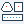 Costruzioni (DQC) — `DISEGNACOSTRUZIONI`, `DQC`

> **Dove:** menu *Disegno → Forme Avanzate → Quadranti → Costruzioni (DQC)*; barra *Quadranti*

Disegna **tutti i pezzi** di una costruzione del manuale partendo dal quadrante: fianchi, soffietti, guardolo, pattina,
fodere, con pieghe, tacche e nomi.

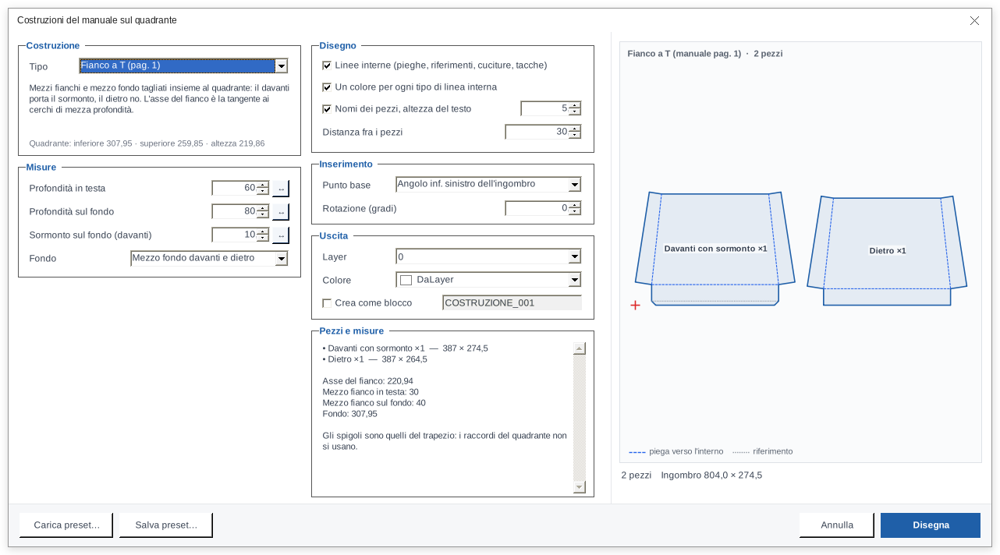

1. `Seleziona il quadrante per la costruzione <Invio = ultimo quadrante disegnato>:`
2. Nella finestra **Costruzioni del manuale sul quadrante** scegli la costruzione in `Tipo`: sotto compare che cosa fa,
   e il gruppo **Misure** mostra solo i campi che le servono.
3. Scrivi la profondità della borsa (vista di lato) **in testa** e **sul fondo** e le altre misure.
4. **Disegna** e posa i pezzi; puoi inserire altre copie, Invio per finire.

Le costruzioni (tra parentesi la pagina del manuale):

| Costruzione | Che cosa esce |
|---|---|
| **Fianco a T** (pag. 1) | davanti con mezzo fondo e sormonto, dietro con mezzo fondo, mezzi fianchi attaccati |
| **Fianco a baffo** (pag. 2) | fianco separato, scarseggiato, con i baffi sotto gli spigoli |
| **Fondo a barchetta** (pag. 3) | davanti e dietro con mezzi fianchi e talloni, fondo con le punte |
| **Guardolo** (pag. 7) | striscia centinata fra quadrante e fianco |
| **Fianco a pari** (pag. 8) | fianco scarseggiato della costola, quadrante con le tacche |
| **Pence sul fianco** (pag. 37-42) | fianco con le pince: con spigoli, stondato o Gucci |
| **Fianco a cartella** (pag. 11-12) | fianco con la V a piega, oppure cucito con il fondo a punte |
| **Pattina** (pag. 14, 60-63) | pattina, infustitura, contropattina |
| **Fodera a sacchetto con cornice** (pag. 13a-13b) | cornice, fodera ed elmetta del quadrante (e dei fianchi) |
| **Fodera per borse rovesciate** (pag. 23) | fodera del quadrante con le pence nelle curve, fodera fianco-fascia |
| **Costruzione a croce** (pag. 21A-21B) | fondo, davanti, dietro e fianchi in un pezzo solo, con i soffietti |
| **Fianco a dente** (pag. 57-59) | quadrante tagliato sulle pieghe dentro il suo prospetto, fianco con i denti, fondo; anche con la tramezza |
| **Fianco a soffietto** | fianco con 1-12 pieghe verso l'interno |
| **Soffietto fianco/fondo collegato** | quadrante con l'arrivo interno e le falde del soffietto; anche con la tramezza |
| **Soffietto a facce ruotate** | quadrante tagliato sulle pieghe e due soffietti cuciti al centro del fondo |

Profondità, spessore e le altre misure comuni restano quando cambi costruzione. Se il quadrante ha i lati destro e
sinistro diversi, i fianchi separati escono in due pezzi, destro e sinistro.

**Il gruppo Costruzione.** In **Tipo** scegli la costruzione (accanto al nome c'è la pagina del manuale); sotto leggi
che cosa fa e, in grigio, le misure del quadrante scelto (inferiore, superiore, altezza).

**Il gruppo Misure.** Cambia con la costruzione e, dentro la stessa costruzione, con le scelte fatte nelle tendine
(alcuni campi compaiono solo con certe scelte). Le misure sono in mm, tranne gli angoli; accanto ai campi con le misure
c'è il pulsante **↔**, non accanto a quelli a numero intero (come il numero di pieghe). Tre campi tornano in molte
costruzioni:

- **Profondità in testa**: la profondità della borsa in testa, vista di lato, cioè la larghezza del fianco in alto (di
  partenza 60);
- **Profondità sul fondo**: la profondità sul fondo, cioè la larghezza del fianco in basso (di partenza 80);
- **Spessore del materiale**: lo spessore della pelle con il rinforzo, da 0 a 20 (di partenza 1,2); serve per il giro
  nelle curve.

Poi, costruzione per costruzione (tra parentesi i valori di partenza o quelli del manuale):

- **Fianco a T**: profondità in testa e sul fondo, poi
  - **Sormonto sul fondo (davanti)**: il davanti porta il mezzo fondo più il sormonto, smussato a 45° agli spigoli;
    il dietro si cuce sopra (10);
  - **Fondo**: **Mezzo fondo davanti e dietro** oppure **Fondo intero sul davanti**.
- **Fianco a baffo**: profondità in testa e sul fondo, poi
  - **Larghezza del baffo**: il baffo sotto lo spigolo del fondo (10, come il manuale);
  - **Altezza del baffo (0 = metà fondo)**: con 0 il baffo è alto metà della profondità sul fondo;
  - **Rotazione del baffo (°)**: di quanto il baffo ruota verso l'interno attorno allo spigolo, da 0 a 45 (5);
  - **Scarseggio in altezza e sul fondo**: di quanto si scarseggia il fianco (1, come il manuale).
- **Fondo a barchetta**: profondità in testa e sul fondo, spessore, poi
  - **Raggio del tallone**: il raggio degli angoli in basso del quadrante con i mezzi fianchi (60); se è troppo
    piccolo per la profondità sul fondo, il messaggio in rosso te lo dice;
  - **Sormonto**: il sormonto segnato sul quadrante lungo fondo e talloni (10).
- **Guardolo**: non chiede le profondità. Spessore, poi
  - **Larghezza del guardolo**: la larghezza della striscia fra quadrante e fianco (10);
  - **Scarto del bordo corto**: il bordo corto è scarseggiato di spessore + scarto; la differenza fa centinare la
    striscia nelle curve (2). Il quadrante deve avere i raccordi in basso più grandi di spessore + scarto.
- **Fianco a pari**: profondità in testa e sul fondo, poi
  - **Spessore della costola**: di quanto si scarseggia il netto del fianco su lati e fondo (2);
  - **Rientro (a)**: di quanto il fianco rientra rispetto al quadrante; aumenta i raccordi alla base (5);
  - **Raggio alla base del fianco**: il raggio degli angoli in basso del fianco netto (10).
- **Pence sul fianco**: profondità in testa e sul fondo, poi
  - **Forma del fianco**: **Con spigoli** (la pince è al centro del fondo, pag. 37-38), **Stondato** o **Gucci** (le
    pince sono sui bordi, pag. 39-42; Gucci ha la testa tonda). Di partenza Stondato;
  - **Raggio in basso**: il raggio degli angoli in basso del fianco (non c'è con gli spigoli; 10);
  - **Raggio in testa**: il raggio degli angoli in testa, solo con Gucci (15);
  - **Altezza della linea di pince**: la distanza della linea di pince dal fondo del fianco (30);
  - **Larghezza della linea di pince**: la lunghezza del tratto orizzontale della linea di pince, centrato sull'asse
    (non con gli spigoli; 25);
  - **Altezza del punto sul bordo**: dove la diagonale della pince arriva sul bordo del fianco, misurato dal fondo
    (non con gli spigoli; 12);
  - **Apertura della pince**: con gli spigoli la larghezza della V al centro del fondo, con stondato e Gucci
    l'apertura di ogni pince sul bordo (6).
- **Fianco a cartella**: profondità in testa e sul fondo, poi
  - **Canaletto**: la V sale di mezzo fondo più il canaletto (2);
  - **Esecuzione**: **A piega** (la V resta nel fianco come pieghe) oppure **Cucito al fondo** (la V si toglie e il
    fondo ha le punte);
  - **Margine di cucitura**: il margine segnato lungo le V, solo con il cucito (5);
  - **Tacca in testa (AA')**: il margine di cucitura in testa sul lato del quadrante (3, come il manuale);
  - **Tacca sul fondo (BB')**: il margine di cucitura sul fondo sul lato del quadrante (10, come il manuale).
- **Pattina**: profondità in testa e sul fondo, spessore, poi
  - **Attacco sul dietro**: quanto sotto la testa parte la pattina sul dietro, misurato lungo il fianco (30);
  - **Arrivo sul davanti**: fin dove scende la pattina sul davanti, lungo il fianco (120). Attacco e arrivo devono
    essere più corti del fianco;
  - **Luce del dorso**: quanto il dorso sale sopra la testa, la luce BC del manuale (15);
  - **Larghezza (0 = testa del quadrante)**: con 0 la pattina è larga quanto la testa del quadrante;
  - **Punta**: **Angoli raccordati** oppure **Ad arco**;
  - **Raggio degli angoli** (con gli angoli raccordati, 30) oppure **Altezza dell'arco** (con la punta ad arco: quanto
    sale l'arco, al massimo metà della larghezza);
  - **Infustitura**: **Senza infustitura** o **Con infustitura** (di partenza con): con l'infustitura la pattina è il
    terzo strato e si allunga di due spessori sul giro;
  - **Rientro della contropattina**: di quanto la contropattina (e l'infustitura) sono più strette per lato (2).
- **Fodera a sacchetto con cornice**: non chiede lo spessore.
  - **Larghezza della cornice**: la cornice di salpa (o talin) su lati e fondo (15, come il manuale);
  - **Fodera sotto la cornice**: di quanto la fodera entra sotto la cornice; è la linea di cucitura (5);
  - **Altezza dell'elmetta**: l'elmetta copre la testa, dal bordo in alto fino a questa misura (40); deve essere più
    alta della cornice più il sormonto;
  - **Sormonto sotto l'elmetta**: di quanto fodera e cornice salgono sotto l'elmetta (10);
  - **Fianchi**: **Solo quadrante** oppure **Quadrante e fianchi** (anche cornice, fodera ed elmetta del fianco
    separato); solo con i fianchi compaiono **Profondità in testa** e **Profondità sul fondo**.
- **Fodera per borse rovesciate**: solo la profondità sul fondo, poi
  - **Spessore del fianco esterno**: il bordo interno della fodera rientra di questa misura; le pence nelle curve la
    recuperano (3);
  - **Margine di cucitura**: la linea di cucitura sulla fodera del quadrante e sulla fodera fianco-fascia (5);
  - **Lunghezza delle pence**: le pence da cucire nelle curve del fondo (30; 0 = non segnate).
- **Costruzione a croce**: profondità in testa e sul fondo, poi **Larghezza dei soffietti**: il soffietto che gira su
  tutti i bordi liberi, unito agli angoli del fondo (15; 0 = senza soffietti).
- **Fianco a dente**: il fianco è fascia + tratto centrale + fascia = profondità della borsa.
  - **Profondità in testa**: compare solo con la variante inclinata; **Profondità sul fondo** sempre;
  - **Variante**: **Dritto** (fianco profondo uguale in testa e sul fondo), **Inclinato** (in testa profondo quanto la
    profondità in testa) o **Con tramezza** (due scomparti, ognuno profondo metà);
  - **Decidi**: **La fascia** (scrivi la fascia e il tratto centrale ne viene) oppure **Il tratto centrale** (scrivi il
    tratto centrale e la fascia ne viene);
  - **Fascia (= larghezza del dente)**, con "La fascia": la distanza della piega dal lato del quadrante; la fascia,
    con sotto il dente largo uguale, si taglia dal quadrante e passa al fianco (30). Non può essere più larga di metà
    della profondità del fianco (con la tramezza, di metà scomparto);
  - **Tratto centrale del fianco**, con "Il tratto centrale": la parte del fianco fra le due fasce; la fascia viene
    (profondità − tratto centrale) / 2 (20);
  - **Altezza del dente**: la piega del fondo sul quadrante; sotto ci sono il dente (che va al fianco) e la striscia
    che fa i lembi del fondo (10);
  - **Taglio del dente**: dove va il taglio sotto la piega del fondo: **Dritto** (in verticale fino al fondo, con o
    senza raccordo), **Centro del raccordo / spigolo** (inclinato fino a metà del raccordo in basso, o allo spigolo se
    il raccordo non c'è) o **Parallelo al fondo** (sulla piega, senza dente: la striscia sotto resta al quadrante);
  - **Scollo in testa al fianco**: quanto scende l'arco in testa al tratto centrale del fianco (0 = dritto);
  - solo con la tramezza: **Rialzo della tramezza** (di quanto la tramezza sta sopra il fondo, perché la borsa poggi
    solo su davanti e dietro e non basculi; 5, come il manuale), **Rientro della tramezza sui lati** (di quanto è più
    stretta del quadrante per lato; 0 = larga uguale), **Raccordi tramezza** (**Come il quadrante** o **Raggio
    scritto**: i denti dal lato della tramezza li seguono) e, con il raggio scritto, **Raggio in basso della
    tramezza** (10).
- **Fianco a soffietto**: profondità in testa e sul fondo, poi
  - **Numero di pieghe verso l'interno**: da 1 a 12; 1 = una piega al centro, 2 = due pieghe (a W), e così via (2);
  - **Profondità della piega (0 = auto)**: con 0 il fianco steso è largo quanto la profondità della borsa; con una
    misura ogni falda è larga così e il fianco steso è 2 × pieghe × profondità della piega;
  - **Tacche**: **Senza tacche** o **Tacche in testa e sul fondo** (le tacche delle pieghe).
- **Soffietto fianco/fondo collegato**: profondità in testa e sul fondo, poi
  - **Arrivo interno**: la distanza della piega interna dal bordo del quadrante, a borsa aperta; sul quadrante è la
    parallela a lati e fondo (20). Ogni falda è larga circa la radice di arrivo² + (mezza profondità)², con la
    tramezza (un quarto di profondità)²;
  - **Piega interna**: **A offset (falda intera)**, la piega segue la parallela, raccordata negli angoli, e ogni falda
    è un pezzo solo; oppure **A spigolo (quartabuono)**, la piega fa spigolo negli angoli e ogni falda si taglia a
    quartabuono sulla bisettrice in fianco, fondo, fianco (tre pezzi, sei con la tramezza);
  - **Tramezza**: **Senza tramezza** o **Con tramezza** (due scomparti: per ognuno una falda sul quadrante e una, più
    stretta, sulla tramezza); con la tramezza compaiono **Rialzo della tramezza**, **Rientro della tramezza sui
    lati**, **Raccordi tramezza** e **Raggio in basso della tramezza**, come nel fianco a dente. L'arrivo interno
    deve essere più grande del rialzo e del rientro.
- **Soffietto a facce ruotate**: qui le due profondità si leggono così:
  - **Profondità in testa**: vista dall'alto, la faccia del soffietto va dalla piega del lato alla piega centrale, a
    metà profondità; in testa è larga la radice di fascia² + (profondità / 2)²;
  - **Profondità sul fondo**: vista di lato, la striscia sale dalla piega del fondo al centro del fondo, a metà
    profondità; sviluppata è lunga la radice di altezza² + (profondità / 2)²;
  - **Fascia (rientro del soffietto)**: la distanza della piega del lato dal bordo del quadrante; la fascia, con il
    dente sotto, passa al soffietto come faccia ed è anche di quanto rientra il soffietto visto dall'alto (30);
  - **Altezza della piega del fondo**: la piega del fondo sul quadrante; la striscia sotto passa al soffietto ed è
    anche di quanto sale il centro del fondo visto di lato (10);
  - **Taglio del dente**: come nel fianco a dente.

Gli altri gruppi della finestra:

- **Disegno**: **Linee interne (pieghe, riferimenti, cuciture, tacche)**; **Un colore per ogni tipo di linea interna**
  (grigia se togli le linee interne); **Nomi dei pezzi, altezza del testo** (scrive nome e quantità dentro ogni pezzo,
  per esempio "Fianco x2"; il campo accanto è l'altezza del testo, 5 di partenza, grigio se togli i nomi); **Distanza
  fra i pezzi** (30 di partenza: i pezzi si mettono in fila a questa distanza, su più righe se serve).
- **Inserimento**: punto base **Angolo inf. sinistro dell'ingombro** o **Centro dell'ingombro** di tutti i pezzi, e
  rotazione.
- **Uscita**: come detto sopra.
- **Pezzi e misure**: si legge soltanto (con tanti pezzi scorre con la barra): l'elenco dei pezzi con quantità e
  ingombro, poi le misure che devono combaciare e le note del calcolo.

Nel disegno ogni pezzo è una **polilinea chiusa** sul layer scelto, le linee interne sono linee semplici e i nomi sono
testi. Con `Un colore per ogni tipo di linea interna`: pieghe verso l'interno blu (5), verso l'esterno rosse (1),
cuciture verdi (3), riferimenti grigi (8), assi magenta (6); contorni, tacche e nomi nel colore scelto. Con **Crea come
blocco** tutta la costruzione diventa un blocco solo.

Fianco a T, a baffo, fondo a barchetta, guardolo, pattina e fianco a cartella seguono il manuale passo per passo. Le
altre costruzioni sono ricostruite dal risultato del manuale: **provale su un modello vero** prima di usarle in
produzione.

<a id="cmd-importaquadrante"></a><a id="cmd-dqi"></a>
#### 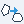 Importa Quadrante (DQI) — `IMPORTAQUADRANTE`, `DQI`

> **Dove:** menu *Disegno → Forme Avanzate → Quadranti → Importa Quadrante (DQI)*; barra *Quadranti*

Trasforma in quadrante una sagoma **non disegnata con `DQ`**: disegnata a mano, arrivata da un altro file o da un DXF.
Dopo, su quella sagoma puoi usare `DQM`, `DQF`, `DQP` e `DQC`.

1. `Seleziona le polilinee chiuse da importare come quadranti:` scegline una o più.
2. Per ognuna si apre la finestra **Importa quadrante**: nell'anteprima la polilinea è in grigio, il quadrante letto in
   blu tratteggiato e il fondo in verde.
3. Controlla le misure lette e premi **Importa**.

Le parti della finestra:

- **Polilinea**: quanti tratti ha e `Tolleranza per i trattini (mm)` (di partenza 0,05): le polilinee fatte di tanti
  trattini (da spline o da DXF) si leggono come rette e archi che passano entro questa distanza.
- **Fondo e modifica**: `Fondo` è il lato che fa da fondo; di solito lo trova da solo (il lato più in basso della coppia
  parallela), ma puoi sceglierne un altro. `Modifica con` **DQM (misure del trapezio)** o **DQLM (lunghezze dei lati)**:
  se la testa non è centrata sul fondo il quadrante si modifica con `DQLM`.
- **Quadrante letto**: fondo, testa, altezza, spostamento della testa, raggi, lati (dritti o ad arco), rotazione e lo
  **scarto dalla polilinea**: la distanza massima fra la tua polilinea e il quadrante (punto rosso nell'anteprima).
  Zero vuol dire che coincidono. Sotto ci sono gli avvisi su che cosa non è uguale.
- **Uscita**: `Sul layer della polilinea`, oppure un altro layer, e il colore.
- Con più polilinee: **Salta** passa alla prossima senza importare questa; `Importa le altre polilinee senza chiedere`
  importa le restanti con le stesse scelte (quelle che non sono quadranti si saltano). **Annulla** ferma tutto.

Il quadrante si disegna **sopra** la polilinea, con i suoi parametri dentro; la polilinea resta com'è. Sulla riga di
comando leggi le misure e con quale comando si modifica. L'ultimo importato diventa l'ultimo quadrante (quello che usi
con Invio in `DQF`, `DQP`, `DQC`).

Non si importano le polilinee aperte, che si incrociano, con meno o più di 4 angoli, con un angolo rientrante, fuori
dal piano, o che sono già quadranti.

<a id="cmd-tracciatura"></a><a id="cmd-dqt"></a>
####  Tracciatura (DQT) — `TRACCIATURA`, `DQT`

> **Dove:** menu *Disegno → Forme Avanzate → Quadranti → Tracciatura (DQT)*; barra *Quadranti*

La **tracciatura** di lamiere e tubi applicata alle borse: sviluppa tramogge (borse svasate), secchielli, raccordi
quadro-tondo, tubolari, manici a spicchi e tasche innestate. Non parte dal quadrante: le misure le scrivi o le prendi
nel disegno con il pulsante **Misura**. Lo spessore non si considera: si sviluppa sulle linee delle figure.

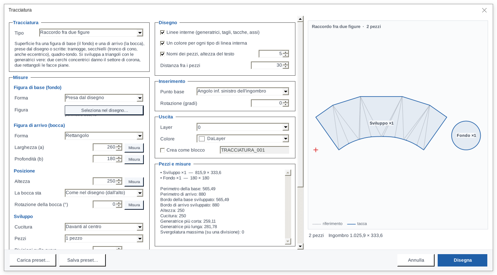

1. Si apre la finestra **Tracciatura**: scegli il `Tipo`.
2. Scrivi o misura i valori (il gruppo **Misure** mostra solo quelli del tipo scelto).
3. Controlla anteprima, pezzi e misure, poi **Disegna**.

| Tipo | Che cosa scegli | Che cosa esce |
|---|---|---|
| **Raccordo fra due figure** | figura di base (fondo) e di arrivo (bocca), altezza, dove sta la bocca, rotazione, cucitura, pezzi | sviluppo in un pezzo, in due metà o a facce separate, con generatrici e tacche; fondo; sagoma della bocca |
| **Tubolare** | sezione, altezza, inclinazione della bocca e del fondo, lato più basso, cucitura | sviluppo (col bordo a onda se la bocca è inclinata), fondo, sagoma della bocca |
| **Manico a spicchi** | diametro, raggio della curva sull'asse, angolo, numero di tagli, cucitura | spicchi separati oppure tutti in una striscia con le curve di taglio |
| **Tasca tubolare sul corpo (innesto)** | diametro del corpo e della tasca, angolo fra gli assi, spostamento dell'asse, lunghezza | sviluppo della tasca, foro da riportare sul corpo steso, tabella delle misure |
| **Percorso del tubolare** | curva, spostamento o doppio spostamento, diametro, raggio, angoli, tratti dritti | percorso in pianta e, se vuoi, la striscia del tubolare |

**Il gruppo Tracciatura.** In **Tipo** scegli che cosa sviluppare; sotto leggi che cosa fa.

**Il gruppo Misure.** Mostra solo i campi del tipo scelto, divisi da titoletti blu. È lungo: per arrivare ai campi in
fondo scorri la colonna con la barra. Le misure sono in mm, tranne gli angoli in gradi. Accanto alle lunghezze, ai
diametri, ai raggi e agli angoli c'è il pulsante **Misura** (vedi sopra le misure prese nel disegno): la finestra si
chiude, prendi la misura e si riapre con il valore nel campo.

**Le figure.** Il raccordo ha la **Figura di base (fondo)** e la **Figura di arrivo (bocca)**, il tubolare la
**Sezione del tubolare**. Per ognuna:

- **Forma**: **Cerchio**, **Ovale / ellisse**, **Rettangolo**, **Rettangolo raccordato** (con le misure scritte),
  **Presa dal disegno** oppure **Ultimo quadrante di DQ** (il contorno dell'ultimo quadrante di `DQ`/`DQL`);
- **Diametro**, solo per il cerchio. Con **Misura** clicchi un cerchio o un arco, una curva chiusa (vale il diametro
  dello stesso perimetro) oppure Invio e due punti;
- **Larghezza (a)** da sinistra a destra e **Profondità (b)** dal davanti al dietro, per l'ovale e i rettangoli;
- **Raggio degli angoli**, solo per il rettangolo raccordato: al più metà del lato corto;
- **Figura**, con **Presa dal disegno**: il pulsante **Seleziona nel disegno…** chiude la finestra e chiede
  `Seleziona la figura di base (polilinea chiusa, cerchio o ellisse):` (o la figura di arrivo, o la sezione); poi la
  finestra si riapre. Sotto il pulsante leggi che cosa hai preso, oppure `Nessuna figura scelta`. Si usano le
  coordinate vere del disegno. Con **Ultimo quadrante di DQ** non c'è niente da scegliere: al posto del pulsante leggi
  le misure dell'ultimo quadrante.

Di partenza la base è un cerchio di diametro 160 e la bocca un rettangolo 260 × 180, alta 250.

**Raccordo fra due figure**: le due figure, poi

- **Posizione**:
  - **Altezza**: la distanza fra la base e la bocca;
  - **La bocca sta**: **Come nel disegno (dall'alto)** (la posizione vera delle due figure prese dal disegno, vista
    dall'alto; se una è scritta, le due si centrano), **Centrata sul fondo** o **Spostata di eₓ, eᵧ**;
  - **Spostamento eₓ (+ a destra)** e **Spostamento eᵧ (+ verso il dietro)**: di quanto si sposta il centro della
    bocca, solo con "Spostata";
  - **Rotazione della bocca (°)**: la bocca gira attorno al suo centro, vista dall'alto, in senso antiorario.
- **Sviluppo**:
  - **Cucitura**: dove cade la cucitura, cioè la prima generatrice dello sviluppo: **Davanti al centro**, **Dietro al
    centro**, **Fianco sinistro**, **Fianco destro**, **Su uno spigolo** (lo spigolo davanti a sinistra della bocca,
    o della base se la bocca non ne ha) oppure **Punto scelto nel disegno**. Con le due metà c'è anche la cucitura
    dalla parte opposta;
  - **Punto**, con il punto scelto: **Scegli il punto…** chiude la finestra e chiede
    `Clicca il punto della cucitura sulla figura di base:`. Serve la base presa dal disegno; sotto leggi le coordinate
    del punto, o `Nessun punto scelto`;
  - **Pezzi**: **1 pezzo**, **2 metà** (cucitura anche dalla parte opposta) o **Facce separate (sugli spigoli)**: una
    faccia per lato, con le cuciture sugli spigoli;
  - **Divisioni sulla curva**: in quante parti si divide la curva più lunga (le altre in proporzione), da 8 a 2000,
    di partenza 96. Servono per generatrici e tacche: il calcolo resta preciso comunque;
  - **Generatrici**: **Vere (condizione torsale)** o **Più corte (diagonale)**, a ogni passo la diagonale più corta.
- **Disegna anche**:
  - **Fondo come pezzo**: **Sì** aggiunge la figura di base come pezzo da tagliare;
  - **Sagoma della bocca**: **Sì** aggiunge la bocca come sagoma di controllo, che non si taglia;
  - **Linee ogni (divisioni)**: le generatrici disegnate sullo sviluppo ogni tante divisioni (8 di partenza;
    0 = nessuna);
  - **Tacche**: **Senza tacche** o **Sulle linee** (le tacche di montaggio alle due estremità delle linee).

**Tubolare**: la sezione, poi

- **Altezze e inclinazioni**:
  - **Altezza (sul lato più basso)**: l'altezza del tubolare dove la bocca è più bassa;
  - **Inclinazione della bocca (°)**: da 0 a 80; 0 = bocca dritta, altrimenti scende verso il lato più basso;
  - **Lato più basso (°)**: dove bocca e fondo sono più bassi: 0 davanti, 90 a destra, 180 dietro, 270 a sinistra;
  - **Inclinazione del fondo (°)**: da 0 a 80; 0 = fondo dritto, altrimenti sale verso lo stesso lato della bocca.
- **Sviluppo** e **Disegna anche** come nel raccordo, senza la scelta delle generatrici; **Fondo come pezzo** aggiunge
  la sezione.

**Manico a spicchi**:

- **Tubolare e curva**:
  - **Diametro del tubolare**: il diametro del manico;
  - **Raggio della curva (sull'asse)**: misurato sull'asse del tubolare, più grande del raggio del tubolare;
  - **Angolo della curva (°)**: da 1 a 360; 180 = manico a U;
  - **Numero di tagli**: da 1 a 60; gli spicchi interi sono tagli − 1, più due mezzi spicchi alle estremità.
- **Sviluppo**:
  - **Cucitura**: **All'intradosso**, **All'estradosso** o **Sul fianco**: dove cade la cucitura di ogni spicchio;
  - **Disposizione**: **Spicchi separati** oppure **In una striscia**, con le curve di taglio dentro (si montano
    girando di 180° uno sì e uno no);
  - **Punti sulla curva**: con quanti punti si disegnano le curve di taglio (da 24 in su);
  - **Tacche**: **Senza tacche** o **Sì** (su estradosso, intradosso e fianchi).

**Tasca tubolare sul corpo (innesto)**:

- **Corpo e tasca**:
  - **Diametro del corpo**: il corpo tondo su cui si innesta la tasca (240 di partenza);
  - **Diametro della tasca**: al più quello del corpo (80);
  - **Angolo fra gli assi (°)**: da 10 a 170; 90 = tasca perpendicolare, più piccolo = tasca inclinata;
  - **Spostamento dell'asse (e)**: 0 = gli assi si incontrano; con e + raggio della tasca = raggio del corpo la tasca è
    tangente;
  - **Lunghezza fuori dal corpo**: la lunghezza della tasca sulla generatrice più corta (60).
- **Sviluppo**:
  - **Cucitura**: **Sul lato corto** o **Sul lato lungo** della tasca;
  - **Punti della tabella**: da 4 a 72 (12): i punti della tabella y(φ) che trovi in **Pezzi e misure** e delle linee
    sullo sviluppo;
  - **Punti sulla curva**: con quanti punti si disegna il bordo di innesto (da 72 in su);
  - **Sagoma del foro**: **Sì** aggiunge il foro da riportare sul corpo steso (non si taglia);
  - **Linee (0 = no)**: le linee sulla tasca ai punti della tabella;
  - **Tacche**: **Senza tacche** o **Sulle linee** (sul bordo di innesto).

**Percorso del tubolare**:

- **Percorso**:
  - **Tipo**: **Curva**, **Spostamento** (due curve uguali) o **Doppio spostamento** (in orizzontale e in verticale);
  - **Diametro del tubolare**: manico, tracolla o bordino;
  - **Raggio della curva (sull'asse)**: il raggio delle curve sull'asse del tubolare;
  - **Angolo della curva (°)**, solo per la curva: di quanto gira, da 1 a 179;
  - **Angolo delle curve (°)**, per gli spostamenti: l'angolo di ognuna delle due curve, da 1 a 89;
  - **Dislivello S**, per lo spostamento: di quanto si sposta il tubolare;
  - **Spostamento orizzontale a** e **Spostamento verticale b**, per il doppio spostamento;
  - **Tratto dritto prima** e **Tratto dritto dopo**: i tratti dritti prima della prima curva e dopo l'ultima.
- **Disegna anche**: **Striscia del tubolare**, **Sì** aggiunge la striscia lunga quanto l'asse e larga quanto la
  circonferenza, con i segni delle curve. Il percorso in pianta si disegna sempre.

I gruppi **Disegno** (qui la prima spunta è **Linee interne (generatrici, tagli, tacche, assi)**), **Inserimento**,
**Uscita** e **Pezzi e misure** sono quelli di `DQC`: i pezzi escono come polilinee chiuse, con generatrici, tacche e
nomi.

### Due rettangoli e fasce fianco

Questi comandi disegnano velocemente un pezzo di fascia fianco steso in verticale: in basso un rettangolo (il tratto
del **fondo**), in alto un altro rettangolo (il tratto del **fianco**), centrati sullo stesso asse e collegati da due
tratti obliqui o curvi. Il punto di inserimento è il centro del lato in basso. Escono **linee** separate (non una
polilinea chiusa) sul layer corrente; le linee fra un tratto e l'altro restano come riferimento.

Per una fascia completa, con le misure prese su un quadrante e una polilinea chiusa pronta per il taglio, è più comodo
[`DQFM`](#cmd-disegnafasciamisure).

<a id="cmd-duerettangoli"></a>
####  Due Rettangoli — `DUERETTANGOLI`

> **Dove:** menu *Disegno → Forme Avanzate → Due Rettangoli*; barra *FASCIA FIANCO*

Due rettangoli centrati, collegati da due tratti dritti.

1. `Larghezza del rettangolo inferiore:`, `Altezza del rettangolo inferiore:`
2. `Larghezza del rettangolo superiore:`, `Altezza del rettangolo superiore:`
3. `Lunghezza del tratto obliquo:` la lunghezza dei due tratti di collegamento. La distanza verticale fra i
   rettangoli la calcola il comando; il tratto deve essere almeno metà della differenza fra le due larghezze.
4. Leggi il riepilogo, `Procedere con il disegno? [Si/No] <Si>:` e `Specifica punto di inserimento:`.

<a id="cmd-duerettangolirac"></a>
#### 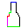 Due Rettangoli Raccordati — `DUERETTANGOLIRAC`

> **Dove:** menu *Disegno → Forme Avanzate → Due Rettangoli Raccordati*; barra *FASCIA FIANCO*

Come [`DUERETTANGOLI`](#cmd-duerettangoli), ma i tratti di collegamento sono **raccordati** ai lati dei rettangoli.
Dopo le cinque misure chiede i quattro raggi: `Raggio di raccordo inferiore sinistro (default 5.0):`, inferiore
destro, superiore sinistro, superiore destro (Invio = 5). "Inferiore" è l'attacco sul rettangolo in basso, "superiore"
quello sul rettangolo in alto; 0 = nessun raccordo.

<a id="cmd-disegnafasciafianco"></a>
####  Disegna Fascia Fianco — `DISEGNAFASCIAFIANCO`

> **Dove:** menu *Disegno → Forme Avanzate → Disegna Fascia Fianco*; barra *FASCIA FIANCO*

Disegna la fascia fianco partendo dalla **lunghezza dell'arco di raccordo**: è quella che ti serve quando sai quanto è
lungo l'angolo curvo del quadrante su cui va cucita.

1. `Larghezza del rettangolo INFERIORE [o P per polilinea]:` e `Altezza del rettangolo INFERIORE`: il tratto del fondo.
2. `Larghezza del rettangolo SUPERIORE` e `Altezza del rettangolo SUPERIORE`: il tratto del fianco.
3. `Lunghezza DELL'ARCO desiderata (TOTALE) [o P per polilinea]:` la lunghezza totale dei raccordi, che viene divisa
   sui due lati.
4. Leggi il riepilogo (corda per lato, distanza verticale, raggio dei raccordi, altezza effettiva del fianco),
   `Procedere con il disegno? [Si/No] <Si>:` e `Specifica punto di inserimento:`.

A ogni misura puoi scrivere **P** e prenderla su una polilinea: scegli la polilinea (le frecce bianche ne mostrano il
verso, il cerchio rosso l'inizio), poi `Punto di inizio:` e `Punto di fine:`; vale la lunghezza lungo la polilinea fra
i due punti.

Il comando raccorda solo gli attacchi sul rettangolo superiore, con il raggio più grande possibile, e allunga il
rettangolo superiore di metà della lunghezza dell'arco (nel riepilogo: "Altezza EFFETTIVA").

<a id="cmd-fasciafiancoui"></a>
#### 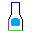 Fascia Fianco UI — `FASCIAFIANCOUI`

> **Dove:** menu *Disegno → Forme Avanzate → Fascia Fianco UI*; barra *FASCIA FIANCO*

La fascia fianco con i **raccordi massimi**, da una finestra. Scrivi le misure nei gruppi **FONDO** (Larghezza,
Altezza) e **FIANCO** (Larghezza, Altezza) e in **PARAMETRI RACCORDO** il `tratto obliquo per massimo raccordo`: la
lunghezza **diritta** del tratto di collegamento (non dell'arco).

- **Misura da Polilinea** accanto a ogni campo chiude la finestra un momento e prende la misura lungo una polilinea fra
  due punti, come l'opzione P di [`DISEGNAFASCIAFIANCO`](#cmd-disegnafasciafianco).
- **VALIDA FIGURA** riempie il **RIEPILOGO VALORI CALCOLATI**: distanza verticale, obliquo minimo e raggio del
  raccordo. Se il tratto obliquo è troppo corto lo dice qui.
- **OK - Disegna** chiede `Specifica punto di inserimento:`. Tutti i valori devono essere maggiori di zero.

I valori restano proposti la volta dopo, finché non chiudi ZWCAD.

<a id="cmd-fasciafiancomax"></a>
####  Fascia Fianco Max — `FASCIAFIANCOMAX`

> **Dove:** menu *Disegno → Forme Avanzate → Fascia Fianco Max*; barra *FASCIA FIANCO*

La stessa fascia di [`FASCIAFIANCOUI`](#cmd-fasciafiancoui), ma dalla riga di comando: larghezza e altezza del
rettangolo inferiore e di quello superiore, poi `Lunghezza del tratto OBLIQUO [o P per polilinea]:`. A ogni misura
**P** la prende su una polilinea. Il riepilogo mostra il raggio dei raccordi superiori, calcolato da solo; poi
`Procedere con il disegno? [Si/No] <Si>:` e il punto di inserimento.

<a id="cmd-fasciafiancoextui"></a>
#### 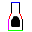 Fascia Fianco Ext UI — `FASCIAFIANCOEXTUI`

> **Dove:** menu *Disegno → Forme Avanzate → Fascia Fianco Ext UI*; barra *FASCIA FIANCO*

La versione a finestra di [`DISEGNAFASCIAFIANCO`](#cmd-disegnafasciafianco): stesse misure, con i nomi del lavoro.

- **FONDO**: `Larghezza Fondo` e `Lunghezza fondo`.
- **FIANCO**: `Larghezza Fianco in testa` e `Tratto Parallelo`.
- **PARAMETRI RACCORDO**: `Lunghezza Arco Di Raccordo` (l'arco totale viene diviso sui due lati).
- **Misura da Polilinea** accanto a ogni campo, **VALIDA FIGURA** per vedere corda per lato, distanza verticale, raggio
  del raccordo e altezza effettiva del fianco, **OK - Disegna** e il punto di inserimento.

I valori restano proposti la volta dopo, finché non chiudi ZWCAD.

### Raccordi e Smussi

Per unire due tratti con un angolo vivo o con un raccordo, come si fa sugli angoli delle sagome.

<a id="cmd-raccorda-0"></a>
#### 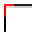 Raccordo Raggio Zero — `RACCORDA_0`

> **Dove:** menu *Disegno → Raccordi e Smussi → Raccordo Raggio Zero*; barra *Raccordo*, *Modifica Avanzata*

Unisce due **linee** con un angolo netto, come il raccordo di ZWCAD a raggio 0: le due linee si tagliano o si allungano
fino a incontrarsi.

1. `Seleziona la prima linea sul tratto da conservare`: clicca la prima linea **dalla parte che vuoi tenere**.
2. `Seleziona la seconda linea sul tratto da conservare`: lo stesso per la seconda.

Dal menu e dal pulsante il comando si ripete: unisci un angolo dopo l'altro ed esci con Esc.

Funziona solo con le linee semplici (non archi, non polilinee). Se le linee sono parallele, o se clicchi proprio sul
punto d'incontro, te lo dice e non cambia niente.

- **Raccordo Standard** e **Cima** (smusso) sono i comandi normali di ZWCAD (raccordo e cima), che dal menu si ripetono
  fino a Esc.

<a id="cmd-blend"></a>
#### 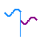 Blend Curve — `BLEND`

> **Dove:** menu *Disegno → Raccordi e Smussi → Blend Curve*; barra *Raccordo*

Raccorda due curve con un arco del raggio che scegli. È il raccordo di ZWCAD, ma il raggio te lo ricorda Leonardo, anche
dopo aver chiuso ZWCAD.

1. `Raggio del raccordo (0 = angolo vivo) <10>`: scrivi il raggio o prendilo nel disegno. Con 0 l'angolo resta vivo.
2. Clicca le due curve da raccordare, come nel raccordo di ZWCAD.

Alla fine ti dice se l'arco è stato creato. Se le due curve sono lati della stessa polilinea, il raccordo entra nella
polilinea e non compare un arco a parte.

### Modifica Avanzata

Comandi per tagliare, spezzare e specchiare, e per controllare e riparare i contorni prima del taglio.

<a id="cmd-cookiecutter2"></a><a id="cmd-cc"></a>
#### 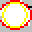 Svuota Polilinea (Cookie Cutter) — `COOKIECUTTER2`, `CC`

> **Dove:** menu *Disegno → Modifica Avanzata → Svuota Polilinea (Cookie Cutter)* · *Disegno → Modifica Avanzata → Cookie Cutter 2* · *Disegno → Modifica Avanzata → Cookie Cutter Alias (CC)*; barra *Modifica Avanzata*

Taglia tutto quello che attraversa un **contorno chiuso**, dalla parte che scegli: come uno stampino. Serve per
svuotare una forma (togliere quello che c'è dentro) o per rifilare tutto quello che esce dal contorno. **Svuota
Polilinea**, **Cookie Cutter 2** e `CC` sono lo stesso comando.

1. `Seleziona il contorno di taglio (cerchio, polilinea, ellisse o spline chiusa)`: il contorno deve essere chiuso e
   non deve incrociarsi da solo, altrimenti te ne chiede un altro.
2. `Clicca dalla parte da tagliare`: clicca dentro il contorno per tagliare quello che c'è dentro, fuori per tagliare
   quello che c'è fuori.
3. `Cancellare tutti gli oggetti all'interno? [Si/No] <No>` (oppure `all'esterno`): con **No** si tagliano solo le
   curve che attraversano il contorno e il resto rimane; con **Si** si cancella anche tutto quello che sta interamente
   da quella parte.

Che cosa succede agli oggetti attraversati:

- linee, archi, polilinee, spline ed ellissi si tagliano esattamente sul contorno e la parte scelta sparisce;
- i **blocchi** si esplodono e poi si tagliano (i valori degli attributi diventano testi semplici);
- i **tratteggi** si esplodono e si tagliano, tranne quelli **pieni**, che restano come sono;
- testi e quote non si tagliano.

Alla fine il comando conta gli oggetti tagliati, cancellati ed esplosi.

Attenzione: questo comando lavora anche sui **layer bloccati** (li sblocca per il taglio e poi li riblocca). I layer
spenti o congelati invece non vengono toccati. Se i dati del pezzo (`DATIT`, `DATIM`) attraversano il contorno, vengono
esplosi: tienili lontani dalla linea di taglio.

<a id="cmd-spezza-punto"></a>
#### 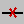 Spezza in Punto — `SPEZZA_PUNTO`

> **Dove:** menu *Disegno → Modifica Avanzata → Spezza in Punto*; barra *Modifica Avanzata*

Spezza un oggetto in un punto preciso.

1. `Seleziona l'oggetto da spezzare`: una linea, un arco, una polilinea, una spline o un'ellisse.
2. `Punto dove spezzare <punto della selezione>`: clicca il punto, oppure premi Invio per spezzare dove hai cliccato
   l'oggetto.

Una polilinea **chiusa** non si divide in due: si **apre** in quel punto, che diventa il suo inizio e la sua fine. È
utile per far partire un contorno da un punto scelto. I cerchi non si spezzano in un punto solo (usa `SPLITCIR`); gli
oggetti sui layer bloccati non si toccano.

<a id="cmd-splitcir"></a>
####  Spezza Cerchio — `SPLITCIR`

> **Dove:** menu *Disegno → Modifica Avanzata → Spezza Cerchio* · *Utilità → Utilità Geometria → Spezza Cerchio*; barra *Utilità Sistema Ext*

Divide un cerchio in archi uguali, partendo dal punto che scegli. Serve per esempio per mettere le tacche o i punti di
cucitura a distanze uguali su un pezzo tondo (un fondo, un oblò).

1. `Seleziona il cerchio da dividere`.
2. `Numero di parti uguali <2>`.
3. `Punto iniziale della divisione`: clicca sul cerchio (l'osnap **Vicino** è già attivo).

Il cerchio diventa tanti archi uguali, con lo stesso layer e colore; il primo comincia nel punto cliccato.

<a id="cmd-trova-gap"></a>
#### 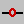 Trova Gap — `TROVA_GAP`

> **Dove:** menu *Disegno → Modifica Avanzata → Trova Gap* · *Utilità → Utilità Geometria → Trova Gap*; barra *Utilità Sistema Ext*

Cerca i **buchi** fra gli estremi degli oggetti (due tratti che dovrebbero toccarsi e non si toccano) e gli estremi che
arrivano vicino a un lato senza toccarlo, e li segna con un cerchio. È il controllo da fare quando un contorno non si
chiude e non capisci dove.

1. `Distanza massima dei buchi <0,05>`: i buchi più grandi non si segnalano (gli estremi sono lontani e basta).
2. `Distanza minima (sotto, gli estremi coincidono) <0,001>`.
3. `Diametro del cerchio <0,5>`: la grandezza del segno.
4. `Seleziona gli oggetti <Invio = tutto il disegno>`: se avevi già selezionato gli oggetti, usa quelli.

Ogni buco è segnato con un **cerchio rosso sul layer `GAP`** (creato se manca). I cerchi sono oggetti veri del disegno:
quando hai finito, cancellali o spegni il layer `GAP`. Le tre misure restano salvate per la volta dopo; la distanza
massima è la stessa che usano `HEAL` e `CONTROLLA_CONTORNI`.

Per chiudere i buchi trovati usa `HEAL` oppure **Correggi i semplici** di `CONTROLLA_CONTORNI`.

<a id="cmd-heal"></a>
####  Ripara Polilinee (Heal) — `HEAL`

> **Dove:** menu *Disegno → Modifica Avanzata → Ripara Polilinee (Heal)*; barra *Polilinea*

Ripara in un colpo i contorni sporchi, tipici dei DXF importati: cancella i doppioni, toglie i vertici doppi, unisce i
tratti in polilinee e chiude i buchi piccoli.

1. `Seleziona gli oggetti da riparare` (o usa quelli già selezionati).
2. `Tolleranza dei buchi da chiudere (mm) <0,05>`: i buchi fino a questa distanza si chiudono allungando o accorciando i
   tratti fino a farli incontrare, come fa l'unione delle polilinee.

Sulla riga di comando leggi i tre passi: doppioni cancellati, polilinee con vertici doppi sistemate, quanti oggetti sono
diventati quante polilinee e quante sono chiuse. I buchi rimasti aperti (più grandi della tolleranza, fino a 1 mm) li
vedi segnati con un cerchio rosso: è un segno provvisorio, che sparisce con RIGEN. Alla fine il comando ti dice se nei contorni resta qualche errore e lascia
selezionate le polilinee ottenute.

<a id="cmd-controlla-contorni"></a>
####  Controllo Contorni — `CONTROLLA_CONTORNI`

> **Dove:** menu *Disegno → Modifica Avanzata → Controllo Contorni*; barra *Polilinea*

Il controllo dei contorni **prima del taglio**: trova contorni aperti, buchi, doppioni, incroci e versi sbagliati, e
molti li corregge da solo. La sua finestra **resta aperta** mentre lavori e si aggiorna da sola dopo ogni comando.

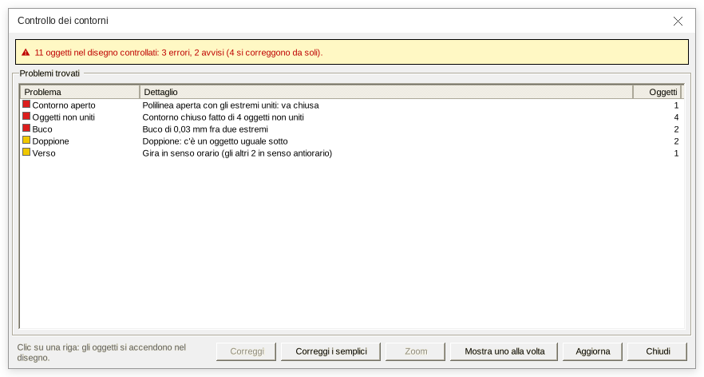

1. `Seleziona i contorni da controllare <Invio = tutto il disegno>` (o usa quelli già selezionati).
2. Si apre la finestra **Controllo dei contorni**.

Nella finestra non si scrive niente: si legge l'elenco e si usano i pulsanti.

- La **riga in alto** riassume quanti oggetti sono stati controllati (`nel disegno` o `scelti`) e quanti errori e
  avvisi ci sono, e quanti di questi si correggono da soli. È rossa se c'è almeno un errore, gialla se ci sono solo
  avvisi, verde con `nessun problema, contorni pronti per il taglio`.
- **Problemi trovati**: un problema per riga, con il quadratino rosso per gli errori e giallo per gli avvisi. Le
  colonne: **Problema** (il tipo, vedi la tabella), **Dettaglio** (che cosa c'è che non va, per esempio quanto è largo
  un buco o in che senso gira un contorno) e **Oggetti** (quanti oggetti del disegno sono coinvolti).

| Problema | Che cosa fa **Correggi** |
|---|---|
| **Contorno aperto** (errore) | se gli estremi coincidono, lo chiude; se manca un pezzo, va disegnato a mano |
| **Oggetti non uniti** (errore): un contorno chiuso fatto di più pezzi | li unisce in una polilinea chiusa |
| **Buco** fra due estremi (errore) | chiude il buco unendo i tratti |
| **Si incrocia** (errore) | va sistemato a mano |
| **Doppione** (avviso): un oggetto uguale sotto | cancella la copia |
| **Vertici doppi** (avviso): tratti lunghi zero | toglie i vertici in più, la sagoma non cambia |
| **Estremo staccato** da un lato (avviso) | va portato sul lato a mano |
| **Verso** diverso dagli altri contorni (avviso) | gira il contorno |

In basso, a sinistra, una riga ti ricorda che cosa fare (`Clic su una riga: gli oggetti si accendono nel disegno.`)
e poi ti dice com'è andata l'ultima correzione. I pulsanti, da sinistra:

- **clic su una riga**: gli oggetti di quel problema si accendono nel disegno; doppio clic li inquadra;
- **Correggi**: sistema il problema scelto; è spento finché non scegli una riga e per i problemi che vanno sistemati a
  mano (**Si incrocia**, **Estremo staccato**, **Contorno aperto** con un pezzo mancante);
- **Correggi i semplici**: sistema in un colpo doppioni, vertici doppi, oggetti da unire, contorni da chiudere e buchi;
  è spento se non ce n'è nessuno;
- **Zoom**: inquadra il problema scelto (spento finché non scegli una riga);
- **Mostra uno alla volta**: ti porta da un problema all'altro sulla riga di comando, partendo da quello scelto (o dal
  primo), vedi sotto;
- **Aggiorna**: rifà il controllo;
- **Chiudi** (o Esc): chiude la finestra.

Le tacche (linee attaccate al contorno con un estremo), le linee dentro un contorno (drittofilo, linee interne) e le
cuciture (tipo di linea non continuo) non sono contorni e non vengono segnalate. Un buco conta come buco fino alla
distanza massima di `TROVA_GAP` (all'inizio 0,05 mm). Se lanci di nuovo il comando, la finestra di prima si chiude.

<a id="cmd-controlla-contorni-correggi"></a><a id="cmd-controlla-contorni-giro"></a><a id="cmd-controlla-contorni-semplici"></a>
#### I comandi dei pulsanti del Controllo Contorni — `CONTROLLA_CONTORNI_CORREGGI`, `CONTROLLA_CONTORNI_GIRO`, `CONTROLLA_CONTORNI_SEMPLICI`

> **Dove:** si digita sulla riga di comando (non è nel menu)

Sono i comandi che la finestra di `CONTROLLA_CONTORNI` manda a ZWCAD quando premi **Correggi**
(`CONTROLLA_CONTORNI_CORREGGI`), **Mostra uno alla volta** (`CONTROLLA_CONTORNI_GIRO`) e **Correggi i semplici**
(`CONTROLLA_CONTORNI_SEMPLICI`). Non serve scriverli: funzionano solo se la finestra del controllo è aperta nel disegno.

Con **Mostra uno alla volta** il disegno si sposta su un problema alla volta, a partire da quello scelto, e la riga di
comando scrive di che cosa si tratta (per esempio `ERRORE 2 di 5: Buco - ...`) e chiede `[Correggi/Avanti/Fine]
<Avanti>` (solo `[Avanti/Fine]` se il problema va sistemato a mano). Alla fine ti dice quanti problemi hai visto e
corretto e rifà il controllo.

<a id="cmd-confronta-unione"></a>
#### Confronta Unione con PEDIT — `CONFRONTA_UNIONE`

> **Dove:** menu *Disegno → Modifica Avanzata → Confronta Unione con PEDIT*

Un comando di prova: serve a controllare che l'unione dei tratti fatta da Leonardo dia la **stessa sagoma** dell'unione
normale di ZWCAD (PEDIT). Il disegno non cambia.

1. `Seleziona gli oggetti da unire`.
2. `Distanza di congiunzione <0 = estremi coincidenti>`.

Il comando unisce due copie degli oggetti, una con PEDIT e una con Leonardo, ti dice quante polilinee escono in tutti e
due i modi e di quanto differiscono al massimo le sagome ("uguali" se non c'è differenza), poi cancella le copie. Se
c'è una differenza, un cerchio rosso provvisorio segna dove comincia la sagoma più diversa. Confronta solo linee,
archi e polilinee aperte.

<a id="cmd-qm"></a><a id="cmd-qmd"></a>
#### 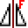 Specchia Rapido — `QM`, `QMD`

> **Dove:** menu *Disegno → Modifica Avanzata → Specchia Rapido* · *Disegno → Modifica Avanzata → Specchia Rapido e Cancella*; barra *Modifica Avanzata*

Specchia gli oggetti rispetto a un altro oggetto usato come asse: per esempio metà sagoma rispetto alla linea di centro,
per avere il pezzo intero.

1. `Seleziona gli oggetti da specchiare` (o usa quelli già selezionati).
2. `Seleziona l'oggetto che definisce l'asse`: clicca la linea, o il lato di una polilinea, che fa da asse.

L'asse è la direzione dell'oggetto **nel punto in cui lo clicchi** (su una polilinea, il lato cliccato). Con `QM` gli
originali restano e si aggiunge la copia specchiata; con `QMD` gli originali si cancellano. La copia è completa:
i blocchi dei dati restano con i loro valori. Gli oggetti sui layer bloccati non si specchiano.

<a id="cmd-qmo"></a><a id="cmd-qmod"></a>
#### 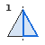 Specchia Oggetto su Se Stesso (1) — `QMO`, `QMOD`

> **Dove:** menu *Disegno → Modifica Avanzata → Specchia Oggetto su Se Stesso (1)* · *Disegno → Modifica Avanzata → Specchia Oggetto e Cancella*; barra *Modifica Avanzata*

Specchia **un oggetto rispetto a un suo lato**: per esempio un pezzo ribaltato sul lato dove si attacca al pezzo
accanto.

- `Seleziona l'oggetto che definisce l'asse`: clicca l'oggetto **sul lato** che fa da asse.

Con `QMO` l'originale resta e si aggiunge la copia ribaltata; con `QMOD` resta solo la copia. Se avevi già selezionato
l'oggetto prima del comando, l'asse è il suo primo lato: per scegliere il lato, lancia il comando senza selezione e
clicca.

- **Porta Dietro** è il comando normale di ZWCAD per l'ordine di visualizzazione.

<a id="cmd-perp2ent"></a>
#### 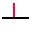 Perpendicolare a Entità — `PERP2ENT`

> **Dove:** menu *Disegno → Modifica Avanzata → Perpendicolare a Entità*; barra *Modifica Avanzata*

Disegna linee perpendicolari da un punto a una linea, un arco o una polilinea: utile per le quote di riferimento e per
riportare un punto su un lato.

1. `Seleziona entità di riferimento`.
2. `Punto da cui tracciare la perpendicolare (Invio termina)`: clicca un punto dopo l'altro; per ognuno si disegna una
   linea fino al punto più vicino dell'oggetto. Invio per finire.

Le linee vanno sul layer corrente. Se il piede della perpendicolare cadrebbe fuori dall'oggetto, la linea arriva
all'estremo più vicino e non è più perpendicolare.

- **Join Polilinee Fuzzy**: vedi [`PLJOINFUZZ`](#cmd-pljoinfuzz).

## 2. Polilinee

Per Leonardo un pezzo è una **polilinea chiusa**. In questo menu trovi tutto quello che serve per arrivarci: unire i
tratti sparsi (anche quelli che arrivano da un DXF), chiudere, controllare il verso e il punto di inizio, misurare lungo
il contorno, girare e spostare i pezzi.

### Creazione

Qui si trasformano linee, archi, spline ed ellissi in polilinee. Le unioni di `PJ`, `Y`, `PLJOINFUZZ` e
`CATENA_UNISCI` seguono le stesse regole:

- i tratti con gli estremi coincidenti si mettono in fila così come sono, archi compresi: la sagoma non cambia;
- si uniscono linee, archi, polilinee aperte, spline e archi di ellisse; spline e archi di ellisse diventano archi di
  polilinea che non si scostano dall'originale più di 0,01 mm;
- le polilinee già chiuse e i cerchi restano come sono; gli oggetti sui layer bloccati restano fuori;
- la polilinea che nasce prende layer e colore del primo oggetto;
- se dopo l'unione restano dei **buchi** fino a 1 mm, Leonardo te lo dice e li segna con un **cerchio rosso**, che
  sparisce con `RIGEN`.

<a id="cmd-pj"></a>
#### 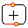 Creazione Manuale (PJ) — `PJ`

> **Dove:** menu *Polilinee → Creazione → Creazione Manuale (PJ)*; barra *Polilinea*

Unisce in polilinee gli oggetti che scegli. È il modo "manuale": scegli tu i tratti da unire.

1. `Seleziona linee, archi, polilinee, spline o archi di ellisse da congiungere`: scegli gli oggetti.

Sulla riga di comando leggi quanti oggetti sono diventati quante polilinee. Se i tratti formano più sagome separate,
ottieni una polilinea per ogni sagoma.

<a id="cmd-catena"></a>
#### 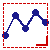 Creazione Automatica (Catena) — `CATENA`

> **Dove:** menu *Polilinee → Creazione → Creazione Automatica (Catena)*; barra *Polilinea*

Segue da sola una **catena di tratti** collegati, partendo da quello che clicchi, e alla fine la lascia
**selezionata**. Serve quando il contorno di un pezzo è fatto di tanti tratti in mezzo ad altre linee (tacche,
cuciture, linee interne): la catena prende solo il bordo.

1. `Seleziona il primo segmento`: clicca un tratto del contorno.
2. Leonardo prepara l'elenco dei tratti nell'area scelta in [`CATENA_CONFIG`](#cmd-catena-config) (tutto il disegno,
   la vista, una finestra o un rettangolo intorno al primo tratto). Se l'area è **Finestra**, ti chiede `Primo angolo`
   e `Angolo opposto`; l'area si vede tratteggiata.
3. Con il preset consigliato **Contorno esterno** la catena gira da sola sul bordo esterno del pezzo e scrive
   `Contorno esterno riconosciuto`. Se non capisce da che parte sta il pezzo ti chiede
   `clicca un punto INTERNO vicino al segmento <INVIO = continuità>`.
4. I tratti presi si colorano di **giallo** mentre la catena avanza. Se a un incrocio due rami si equivalgono, la vista
   si centra sul punto, i rami possibili diventano **blu** con delle frecce gialle e ti chiede
   `Più rami possibili: seleziona il prossimo segmento (in blu, frecce gialle) o INVIO per terminare`.
5. Se la catena si interrompe: `Catena interrotta. Seleziona un segmento per continuare o INVIO per terminare`. La
   catena riprende dall'estremo del nuovo tratto più vicino al tuo clic.

Invio termina, Esc annulla. La catena salta da sola i rami senza uscita (le tacche), i ritorni indietro e i tratti
doppi (alla fine ti dice quanti), e resta sul tipo di linea del primo tratto, così le cuciture non entrano nel
contorno. Prende solo oggetti su layer accesi e sbloccati.

I colori della catena servono solo a vederla: il disegno non cambia. Alla fine i tratti restano selezionati e puoi
lanciare subito un altro comando su di loro, per esempio `Y` per unirli.

<a id="cmd-catena-unisci"></a>
#### 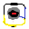 Catena e Unisci — `CATENA_UNISCI`

> **Dove:** menu *Polilinee → Creazione → Catena e Unisci*; barra *Polilinea*

Fa la catena come [`CATENA`](#cmd-catena) e poi **unisce** i tratti in una polilinea, che **chiude** se la catena è
tornata al punto di partenza. È il modo più rapido per ottenere il contorno chiuso di un pezzo da un disegno pieno di
linee.

Alla fine leggi `Perimetro chiuso: polilinea chiusa.` oppure `Polilinea aperta (estremi non coincidenti).`; se la
catena aveva dei buchi ottieni più polilinee. Con il preset **Gap piccoli** la catena collega anche estremi distanti
fino a 0,1 mm e l'unione chiude quei buchi. La polilinea nuova resta selezionata.

<a id="cmd-cs"></a>
#### 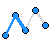 Chain Selection — `CS`

> **Dove:** menu *Polilinee → Creazione → Chain Selection*; barra *Modifica Avanzata*

Clicchi un oggetto e vengono **selezionati** tutti quelli collegati a lui per gli estremi, anche attraverso gli
incroci (a differenza della catena, non sceglie un percorso: prende tutto ciò che si tocca).

1. `Seleziona un oggetto della catena`: clicca un tratto.

Valgono linee, archi, polilinee e spline aperte, archi di ellisse, su layer accesi e sbloccati. Gli oggetti restano
selezionati, pronti per il comando successivo (per esempio `Y`).

<a id="cmd-catena-config"></a>
####  Catena Config — `CATENA_CONFIG`

> **Dove:** menu *Polilinee → Creazione → Catena Config*; barra *Polilinea*

Apre la finestra **Catena - configurazione** con tutte le impostazioni di `CATENA` e `CATENA_UNISCI`. Le impostazioni
restano salvate.

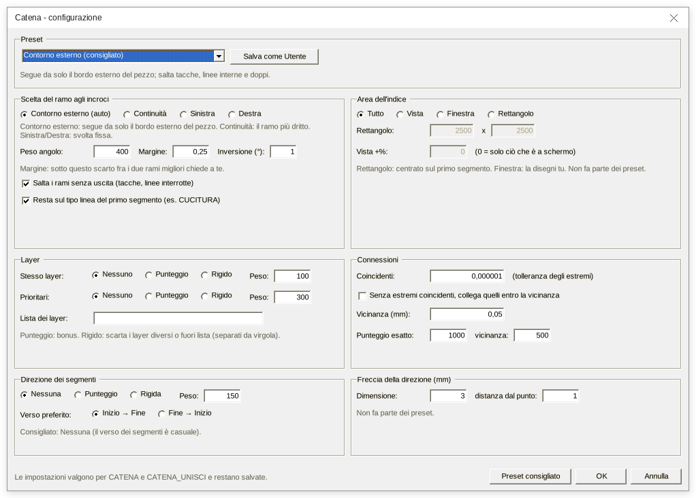

I punteggi della finestra sono numeri interi senza unità: a ogni incrocio la catena dà dei punti a ogni ramo possibile
e prende quello con più punti. Le misure sono in mm.

**Preset** (in alto):

- l'elenco: scegli un insieme di regole già pronto (vedi la tabella più sotto); sotto l'elenco leggi che cosa fa.
  Scegliere un preset cambia i valori della **Scelta del ramo agli incroci**, dei **Layer**, della **Direzione dei
  segmenti** e delle **Connessioni**, ma non tocca l'**Area dell'indice**, la **Lista dei layer**, il **Verso
  preferito** e la **Freccia della direzione**. Se cambi a mano uno dei valori che fanno parte dei preset, l'elenco
  passa a **(personalizzato)**.
- **Salva come Utente**: salva i valori che vedi come preset **Utente (salvato)**, che compare in fondo all'elenco.
  Resta salvato anche se poi premi **Annulla**.

**Scelta del ramo agli incroci**:

- **Contorno esterno (auto)**: segue da solo il bordo esterno del pezzo. **Continuità**: prende il ramo più dritto.
  **Sinistra** / **Destra**: gira sempre da quella parte.
- **Peso angolo** (`<400>`): quanto conta la direzione del ramo, secondo la scelta qui sopra, rispetto agli altri
  punti. 0 = la direzione non conta.
- **Margine** (`<0,25>`): se i due rami migliori hanno una differenza di punti uguale o minore di questo numero, la
  catena non sceglie e ti chiede quale ramo prendere. Più è alto, più spesso ti chiede (il preset **Guidato** usa
  100000: chiede a ogni incrocio).
- **Inversione (°)** (`<1>`, da 0 a 90): un ramo che torna indietro, cioè che riparte quasi nel verso opposto entro
  questi gradi, viene scartato se c'è un'altra strada. 0 = non scarta mai i ritorni indietro.
- **Salta i rami senza uscita (tacche, linee interrotte)**: con la spunta la catena non entra nei rami che finiscono
  nel vuoto, se c'è un ramo che prosegue.
- **Resta sul tipo linea del primo segmento (es. CUCITURA)**: con la spunta la catena prende solo i tratti con lo
  stesso tipo di linea del primo, così le cuciture non entrano nel contorno (e viceversa).

**Layer**:

- **Stesso layer**: **Nessuno** = il layer non conta; **Punteggio** = un tratto sullo stesso layer di quello appena
  preso riceve in più i punti scritti in **Peso** (`<100>`); **Rigido** = i tratti su un altro layer vengono scartati.
- **Prioritari**: come sopra, ma per i layer della **Lista dei layer** (**Peso** `<300>`).
- **Lista dei layer**: i nomi dei layer prioritari, separati da virgola (o punto e virgola). Se scegli **Rigido** con
  la lista vuota la finestra non si chiude e te lo segnala, perché la catena non prenderebbe niente.

**Direzione dei segmenti** (consigliato **Nessuna**, perché il verso in cui sono stati disegnati i tratti di solito è
casuale):

- **Nessuna** / **Punteggio** / **Rigida**: il verso non conta; i tratti percorsi nel **Verso preferito** ricevono in
  più i punti di **Peso** (`<150>`); oppure i tratti percorsi al contrario vengono scartati.
- **Verso preferito**: **Inizio → Fine** (la catena entra nel tratto dal punto dove è stato iniziato) oppure **Fine →
  Inizio**.

**Area dell'indice** (dove la catena cerca i tratti; non fa parte dei preset):

- **Tutto**: tutto il disegno. **Vista**: ciò che vedi a schermo, allargato della percentuale scritta in **Vista +%**
  (`<0>` = solo ciò che è a schermo). **Finestra**: un rettangolo che disegni tu ogni volta che lanci la catena.
  **Rettangolo**: un rettangolo fisso di larghezza × altezza in mm (`<2500>` × `<2500>`) centrato sul primo tratto.
  Le caselle **Rettangolo** e **Vista +%** si possono scrivere solo quando è scelta l'area corrispondente. Su disegni
  molto grandi un'area più piccola rende la catena più rapida.

**Connessioni**:

- **Coincidenti** (`<0,000001>` mm): entro questa distanza due estremi sono considerati lo stesso punto. Deve essere
  maggiore di 0.
- **Senza estremi coincidenti, collega quelli entro la vicinanza**: con la spunta, quando da un estremo non parte
  nessun tratto coincidente, la catena cerca anche i tratti con un estremo entro la **Vicinanza**. Serve per i disegni
  con piccoli buchi (DXF importati).
- **Vicinanza (mm)** (`<0,05>`): la distanza massima per quei collegamenti; non può essere più piccola di
  **Coincidenti**.
- **Punteggio esatto** (`<1000>`) e **vicinanza** (`<500>`): i punti di partenza di un ramo collegato con estremi
  coincidenti o collegato per vicinanza.

**Freccia della direzione (mm)** (non fa parte dei preset): **Dimensione** (`<3>`) è la lunghezza delle frecce gialle
che compaiono agli incroci, **distanza dal punto** (`<1>`) quanto partono lontano dal punto dell'incrocio.

Se un valore non va bene (lettere, numeri negativi, decimali dove serve un intero), la finestra non si chiude: in basso
leggi che cosa correggere e il cursore va nella casella sbagliata. In basso: **Preset consigliato** rimette i valori di
**Contorno esterno** (si salvano solo con OK), **OK** salva le impostazioni, **Annulla** chiude senza cambiare niente.

I preset:

| Preset | Quando usarlo |
|---|---|
| Contorno esterno (consigliato) | segue da solo il bordo esterno del pezzo, salta tacche, linee interne e doppi |
| Segui linea (continuità) | agli incroci prende il ramo più dritto, chiede se due rami sono simili |
| Guidato (chiede agli incroci) | va da solo solo quando c'è una strada; agli incroci scegli tu |
| Gap piccoli (DXF importati) | come Contorno esterno, ma collega estremi distanti fino a 0,1 mm |
| Valori v4.7 | i pesi e le tolleranze della versione precedente |
| Utente (salvato) | quello salvato con **Salva come Utente** |

<a id="cmd-catena-stato"></a>
#### Catena Stato — `CATENA_STATO`

> **Dove:** menu *Polilinee → Creazione → Catena Stato*

Scrive sulla riga di comando le impostazioni attuali della catena: preset, scelta del ramo, layer, direzione, area,
tolleranze e freccia. Utile per controllare con che regole lavorerà `CATENA` prima di lanciarla.

<a id="cmd-catena-preset"></a>
####  Catena Preset — `CATENA_PRESET`

> **Dove:** menu *Polilinee → Creazione → Catena Preset*; barra *Polilinea*

Cambia il preset della catena senza aprire la finestra. Sulla riga di comando compare l'elenco numerato dei preset,
con la descrizione e il segno `<- attivo` su quello in uso.

1. `Numero preset [1-5] <nessuna modifica>` (fino a 6 se hai salvato il preset Utente): scrivi il numero; Invio
   lascia tutto com'è.

<a id="cmd-s2p"></a>
#### 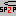 Da Spline — `S2P`

> **Dove:** menu *Polilinee → Creazione → Da Spline*; barra *Polilinea*

Trasforma le **spline** in polilinee fatte di tratti dritti.

1. `Seleziona le spline`: scegli le spline.
2. `Numero di segmenti <10>`: in quanti tratti dividere ogni spline.

Le spline vengono cancellate e al loro posto restano le polilinee, con lo stesso layer e colore. Una spline piana a
quota 0 diventa una polilinea normale, le altre una polilinea 3D. Più segmenti = curva più fedele.

<a id="cmd-el2pl"></a>
#### 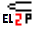 Da Ellisse — `EL2PL`

> **Dove:** menu *Polilinee → Creazione → Da Ellisse*; barra *Polilinea*

Trasforma **ellissi e archi di ellisse** in polilinee fatte di archi, che si possono unire, sfalsare e tagliare come
ogni altra sagoma.

1. `Seleziona ellissi e archi di ellisse`: scegli gli oggetti.

Di solito l'ellisse originale viene cancellata; se in ZWCAD la variabile `DELOBJ` vale 0, resta e te lo dice.

<a id="cmd-pell"></a>
####  Da Ellisse (Pell) — `PELL`

> **Dove:** menu *Polilinee → Creazione → Da Ellisse (Pell)*; barra *Polilinea*

Disegni un'ellisse con il comando **ELLISSE** di ZWCAD (rispondi alle sue domande come al solito) e appena finita
diventa una **polilinea** di archi. Sulla riga di comando leggi `Ellisse disegnata come polilinea.`

<a id="cmd-pljoinfuzz"></a>
#### 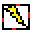 Join Polilinee Fuzzy — `PLJOINFUZZ`

> **Dove:** menu *Disegno → Modifica Avanzata → Join Polilinee Fuzzy* · *Polilinee → Creazione → Join Fuzzy*; barra *Polilinea*, *Polilinea Estesa*

Unisce come `Y`, ma con una **distanza di congiunzione**: chiude anche i piccoli buchi fra un tratto e l'altro.
Utile sui DXF importati, dove gli estremi spesso non coincidono per pochi centesimi.

1. `Seleziona gli oggetti da unire (uno solo = tutti quelli del disegno)`: scegli gli oggetti. Se ne scegli **uno
   solo**, Leonardo prova a unire tutto il disegno.
2. `Distanza di congiunzione`: la distanza massima del buco da chiudere (scrivila o prendila con due punti).

I buchi si chiudono allungando o accorciando i due tratti ai lati, finché si incontrano; se non si incontrano (per
esempio sono paralleli) si aggiunge un tratto dritto. Alla fine leggi quanti buchi sono stati chiusi e in che modo.

Una distanza troppo grande può unire tratti che non dovevano stare insieme: comincia con valori piccoli (0,05 - 0,1 mm).

<a id="cmd-y"></a>
####  Unione Rapida Y — `Y`

> **Dove:** menu *Polilinee → Creazione → Unione Rapida Y*; barra *Polilinea Estesa*

L'unione più rapida: unisce in polilinee leggere gli oggetti **già selezionati** (o quelli che scegli se non c'è
niente selezionato).

1. `Seleziona linee, archi, polilinee, spline e archi di ellisse da unire`: solo se non avevi già selezionato.

Va benissimo dopo [`CS`](#cmd-cs) o [`CATENA`](#cmd-catena), che lasciano i tratti selezionati. Se fra quelli scelti
non ci sono curve aperte leggi `Niente da unire (servono curve aperte).`

### Modifica, chiusura e misura

- **Modifica Polilinea** è il comando normale di ZWCAD (`PEDIT`).

<a id="cmd-pc"></a>
####  Chiudi Polilinea — `PC`

> **Dove:** menu *Polilinee → Chiudi Polilinea*; barra *Polilinea*

Chiude le polilinee aperte: aggiunge il tratto dall'ultimo vertice al primo.

1. `Seleziona le polilinee da chiudere`: scegli le polilinee.

Le polilinee già chiuse e quelle sui layer bloccati restano come sono; alla fine leggi quante ne ha chiuse. Se l'ultimo
vertice era già sopra il primo, resta un vertice doppio: [`CONTROLLA_CONTORNI`](#cmd-controlla-contorni) lo trova e
lo toglie.

### Direzione

Ogni polilinea ha un **verso** (da dove parte e dove va) e un **punto di inizio**. Per molte macchine da taglio e per i
comandi che lavorano lungo il contorno (tacche, misure, offset) contano tutti e due. Le frecce che compaiono sono solo
segni a video: spariscono al primo zoom o ridisegno.

<a id="cmd-pld"></a><a id="cmd-pldrev"></a>
####  Imposta Direzione — `PLD`, `PLDREV`

> **Dove:** menu *Polilinee → Direzione → Imposta Direzione*; barra *Polilinea*, *Modifica Avanzata*

Mostra il verso di una o più polilinee e ti chiede se invertirlo. Lavora in ciclo: puoi controllare un pezzo dopo
l'altro.

1. `Seleziona polilinea (o più di una con una finestra) [Invio per terminare]`: clicca una polilinea o prendine più di
   una con una finestra. Su ogni tratto compaiono delle **frecce doppie** nel verso della polilinea; una **X** con un
   quadratino segna il punto di inizio.
2. Con una polilinea: `Invertire la direzione? [Si/No] <No>`.
   Con più polilinee: `Invertire la direzione? [Tutte/Scegli/No] <No>`. Con **Scegli** te le propone una alla volta,
   accesa in rosso, e per ognuna rispondi Sì o No.
3. Dopo l'inversione le frecce si ridisegnano nel verso nuovo. Si ricomincia dal punto 1; Invio a vuoto termina.

Funziona su linee, polilinee (anche 2D e 3D) e spline; archi, cerchi ed ellissi si vedono ma non si invertono. Colore
e posizione delle frecce si cambiano con [`PLDREV_SETCOLOR`](#cmd-pldrev-setcolor) e
[`PLDREV_SETPOS`](#cmd-pldrev-setpos). `PLDREV` è un altro nome dello stesso comando.

<a id="cmd-pldrev-show-direction"></a>
####  Mostra Direzione — `PLDREV_SHOW_DIRECTION`

> **Dove:** menu *Polilinee → Direzione → Mostra Direzione*; barra *Polilinea Estesa*

Fa solo vedere il verso e il punto di inizio di una polilinea, senza chiedere niente: frecce semplici a metà di ogni
tratto e una X sul punto di inizio.

1. `Seleziona una polilinea per visualizzare direzione e punto di inizio`: clicca l'oggetto.

<a id="cmd-rvrsline"></a>
####  Inverti Direzione — `RVRSLINE`

> **Dove:** menu *Polilinee → Direzione → Inverti Direzione*; barra *Polilinea*, *Modifica Avanzata*

Inverte il verso di linee e polilinee, una dopo l'altra, senza mostrare le frecce: comodo quando sai già quali girare.

1. `Seleziona una linea o una polilinea [Invio per terminare]`: clicca l'oggetto; leggi ` direzione cambiata.` e puoi
   cliccare il successivo.

Vale per linee, polilinee (anche 2D e 3D) e spline. Gli archi non si invertono.

<a id="cmd-nuovoiniziop"></a>
####  Nuovo Inizio — `NUOVOINIZIOP`

> **Dove:** menu *Polilinee → Direzione → Nuovo Inizio*; barra *Polilinea*

Sposta il **punto di inizio** di una polilinea chiusa su un altro vertice, oppure in un punto qualsiasi di un lato. La
sagoma resta identica: cambia solo da dove parte il contorno.

1. `Seleziona la polilinea`: clicca la polilinea. I vertici compaiono **numerati** con un cerchietto rosso.
2. `Clicca vicino al vertice desiderato, o su un lato per un vertice nuovo (INVIO per annullare)`: clicca vicino a un
   vertice, oppure a metà di un lato per creare lì un vertice nuovo. Il punto scelto si segna in verde.
3. `Confermi questo vertice come nuovo inizio? [Si/No] <Si>`: con No ne scegli un altro.
4. Sulla riga di comando leggi la nuova direzione (verso quale vertice va il primo tratto), poi
   `Conferma FINALE: procedere con la modifica? [Si/No] <Si>`.

La polilinea resta la stessa (layer, colore, tipo di linea, archi e spessori non cambiano). Un arco tagliato a metà
diventa due archi.

Una polilinea **aperta** non si cambia: il suo inizio può essere solo uno dei due estremi, e per scambiarli c'è
[`RVRSLINE`](#cmd-rvrsline). Se però l'ultimo vertice è sopra il primo, la polilinea viene chiusa e poi cambiata.

<a id="cmd-verso-uniforme"></a>
####  Verso Uniforme (tutti i contorni) — `VERSO_UNIFORME`

> **Dove:** menu *Polilinee → Direzione → Verso Uniforme (tutti i contorni)*; barra *Polilinea*

Mette **tutti i contorni chiusi** scelti nello **stesso verso**, e se vuoi porta anche il loro inizio nello stesso
posto. Serve prima del taglio automatico, quando la macchina vuole tutti i pezzi girati allo stesso modo.

1. `Seleziona i contorni chiusi`: scegli i pezzi (o usa quelli già selezionati).
2. `Verso [Antiorario/Orario] <Antiorario>`.
3. `Cambiare anche il vertice di inizio (quello più in basso a sinistra)? [Si/No] <No>`: con Sì l'inizio di ogni
   polilinea va sul vertice più in basso a sinistra.

I contorni vengono girati sul posto, con archi e spessori al loro posto. Alla fine le frecce mostrano il verso e leggi
quanti contorni sono stati girati, quanti spostati e quanti erano già a posto. Cerchi ed ellissi non si girano:
trasformali prima con [`EL2PL`](#cmd-el2pl). I contorni aperti vengono ignorati: chiudili prima con [`PC`](#cmd-pc) o
[`CONTROLLA_CONTORNI`](#cmd-controlla-contorni).

<a id="cmd-pldrev-setcolor"></a>
####  Imposta Colore Frecce — `PLDREV_SETCOLOR`

> **Dove:** menu *Polilinee → Direzione → Imposta Colore Frecce*; barra *Polilinea Estesa*

Sceglie il colore delle frecce di direzione.

1. `Colore delle frecce (1-7): 1=Rosso, 2=Giallo, 3=Verde, 4=Ciano, 5=Blu, 6=Magenta, 7=Bianco <4>`: il numero
   proposto è il colore attuale (all'inizio il ciano).

Il colore resta salvato anche chiudendo ZWCAD.

<a id="cmd-pldrev-setpos"></a>
#### 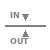 Imposta Posizione Frecce — `PLDREV_SETPOS`

> **Dove:** menu *Polilinee → Direzione → Imposta Posizione Frecce*; barra *Polilinea Estesa*

Sceglie se le frecce di direzione stanno **dentro** o **fuori** dalla figura.

1. `Posizione frecce [Interne/Esterne] <Esterne>`.

Anche questa scelta resta salvata.

### Rotazioni Rapide

Per girare al volo pezzi, testi e blocchi senza scrivere angoli. Usano gli oggetti già selezionati, se ci sono.

<a id="cmd-zr"></a>
#### 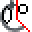 Rotazione Zero — `ZR`

> **Dove:** menu *Polilinee → Rotazioni Rapide → Rotazione Zero* · *Blocchi e Testi → Allineamento Testi → Rotazione Zero*; barra *Modifica Avanzata*

**Raddrizza** blocchi e testi: li rimette orizzontali, con rotazione zero. Utile dopo aver ruotato un pezzo, per
rimettere leggibili i suoi testi e i blocchi dei dati.

1. `Seleziona blocchi e testi da raddrizzare`: scegli gli oggetti. Vengono presi solo blocchi, testi, testi multilinea
   e direttrici multiple; il resto della selezione viene ignorato.

Il blocco o il testo resta dov'è e gira intorno al suo punto di inserimento.

<a id="cmd-r90"></a><a id="cmd-r9"></a><a id="cmd-r90m"></a><a id="cmd-r180"></a>
####  Rotazioni 90, -90 e 180 gradi — `R90`, `R9`, `R90M`, `R180`

> **Dove:** menu *Polilinee → Rotazioni Rapide → Rotazione 90 Gradi* · *Polilinee → Rotazioni Rapide → Rotazione 90 Gradi (R9)* · *Polilinee → Rotazioni Rapide → Rotazione -90 Gradi* · *Polilinee → Rotazioni Rapide → Rotazione 180 Gradi*; barra *Modifica Avanzata*

Ruotano gli oggetti di un angolo fisso intorno a un punto.

1. `Seleziona gli oggetti da ruotare` (se non avevi già selezionato).
2. `Punto di rotazione`: clicca il centro della rotazione.

| Comando | Rotazione |
|---|---|
| `R90` | 90 gradi in senso antiorario |
| `R9` | come `R90`: 90 gradi in senso antiorario |
| `R90M` | 90 gradi in senso orario |
| `R180` | mezzo giro |

### Utilità Polilinee

<a id="cmd-conp"></a>
####  Centro Polilinee (CONP) — `CONP`

> **Dove:** menu *Polilinee → Utilità Polilinee → Centro Polilinee (CONP)*; barra *Modaris*

Mette un **punto** al centro di ogni polilinea che scegli sul layer `0`: è il centro del rettangolo che contiene la
polilinea (il suo ingombro).

1. Scegli le polilinee: vengono prese solo quelle sul layer `0`, le altre sono ignorate.

I punti vanno sul layer corrente. Se non li vedi, cambia lo stile dei punti con il comando `DDPTYPE` di ZWCAD. Se nel
disegno mancano, il comando crea anche i layer `TAVOLA_DI_STAMPA_TAGLIO` e `TAVOLA_DI_STAMPA`.

<a id="cmd-conp-c"></a>
#### 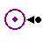 Cerchi in Punti (CONP_C) — `CONP_C`

> **Dove:** menu *Polilinee → Utilità Polilinee → Cerchi in Punti (CONP_C)*; barra *Modaris*

Trasforma i **cerchi** del layer `0` in **punti** al loro centro e cancella i cerchi.

1. Scegli i cerchi: vengono presi solo quelli sul layer `0`.

Come per `CONP`, i punti vanno sul layer corrente.

<a id="cmd-vlmr"></a><a id="cmd-vlmoverotate"></a>
#### 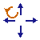 VL Move Rotate — `VLMR`, `VLMOVEROTATE`

> **Dove:** menu *Polilinee → Utilità Polilinee → VL Move Rotate*; barra *Polilinea*

Sposta e ruota gli oggetti **a piccoli passi**, con una pulsantiera che imita il tastierino numerico. Serve per
accostare e girare i pezzi a occhio, per esempio su una tavola o una pelle, vedendo subito il risultato.

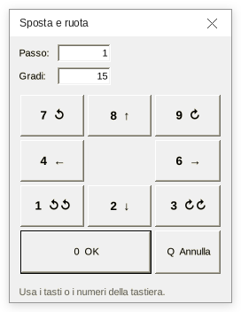

1. `Seleziona gli oggetti da spostare e ruotare`: scegli gli oggetti.
2. `Punto di rotazione <centro della selezione>`: clicca il centro delle rotazioni, o Invio per il centro degli
   oggetti scelti.
3. Si apre la finestrella **Sposta e ruota**:

```
 7 ↺    8 ↑    9 ↻
 4 ←           6 →
 1 ↺↺   2 ↓    3 ↻↻
 0 OK          Q Annulla
```

Nella finestrella, dall'alto:

- **Passo**: di quanto si spostano gli oggetti a ogni tasto, in mm (`<1>`).
- **Gradi**: di quanto ruotano a ogni tasto (`<15>`).
  Puoi cambiarli quando vuoi, anche a metà lavoro; premi Invio nella casella per tornare ai tasti. Devono essere
  maggiori di 0, se no in basso leggi `Passo o gradi non validi: scrivi un numero maggiore di 0.` e gli oggetti non
  si muovono. Gli ultimi valori restano salvati per la volta dopo.
- I tasti: **8 ↑**, **2 ↓**, **4 ←**, **6 →** spostano su, giù, a sinistra, a destra di un passo; **7 ↺** ruota in
  senso antiorario e **9 ↻** in senso orario dei gradi impostati; **1 ↺↺** e **3 ↻↻** fanno lo stesso di due passi.
- **0 OK** (o Invio) tiene la nuova posizione e chiude; **Q Annulla** (o Esc) rimette tutto com'era e chiude.
- La riga in basso: all'inizio `Usa i tasti o i numeri della tastiera.`, poi lo spostamento e la rotazione totali
  (X, Y, rot.).

Puoi usare il mouse, i numeri, il tastierino numerico o le frecce della tastiera. Il disegno si muove subito a ogni
tasto. Quando sposti, il punto di rotazione si sposta con gli oggetti. Gli oggetti sui layer bloccati restano fermi e
il comando te lo dice.

`VLMOVEROTATE` è un altro nome dello stesso comando.

<a id="cmd-vlmr"></a>
#### 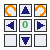 Muovi/Ruota da Tastierino (-VLMR) — `-VLMR`

> **Dove:** menu *Polilinee → Utilità Polilinee → Muovi/Ruota da Tastierino (-VLMR)*; barra *Polilinea*

La versione **da riga di comando** di [`VLMR`](#cmd-vlmr), senza finestra: si sposta e si ruota scrivendo i numeri
del tastierino.

1. `Seleziona gli oggetti da muovere/ruotare` (se non avevi già selezionato).
2. `Passo movimento <1>` e `Passo rotazione in gradi <15>`.
3. `Tastierino [8=Su/2=Giu/4=Sinistra/6=Destra/7=CCW/9=CW/1=CCW2/3=CW2/0=OK/Q=Annulla] <0>`: scrivi un numero e
   premi Invio, e ripeti quante volte vuoi. 8, 2, 4, 6 spostano di un passo; 7 ruota in senso antiorario e 9 in senso
   orario; 1 e 3 ruotano di due passi.

`0` o Invio a vuoto finiscono e tengono la posizione; `Q` rimette gli oggetti com'erano. Le rotazioni sono sempre
intorno al centro degli oggetti scelti, che segue gli spostamenti. Qui passo e gradi non si ricordano: ogni volta ti
vengono riproposti 1 e 15.

- **Valida Tacche Interattivo**: vedi [`VLWALK`](#cmd-vlwalk).

## 3. Blocchi e Testi

Qui ci sono le scritte e i simboli che si mettono sui pezzi: le indicazioni (verso del materiale, attenzione,
pelle, fodera), i fori della fustella, le diciture di lavorazione e di cucitura, i comandi per sistemare i testi e
quelli per lavorare con i blocchi.

Testi e blocchi vanno sul **layer corrente** (tranne i fori della fustella, che hanno un layer loro) e i testi usano lo
**stile di testo corrente**: scegli layer e stile prima di cominciare.

### Indicazioni

Simboli già pronti da mettere sul pezzo: la freccia del verso del materiale, il segnale di attenzione, la tabella dei
testi, le scritte di pelle e fodera.

<a id="cmd-vr"></a><a id="cmd-or"></a><a id="cmd-war"></a><a id="cmd-eq"></a><a id="cmd-tabt"></a><a id="cmd-pel"></a><a id="cmd-fod"></a>
#### 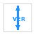 Indicazioni — `VR`, `OR`, `WAR`, `EQ`, `TABT`, `PEL`, `FOD`

> **Dove:** menu *Blocchi e Testi → Indicazioni → Verticale* · *Blocchi e Testi → Indicazioni → Orizzontale* · *Blocchi e Testi → Indicazioni → Attenzione* · *Blocchi e Testi → Indicazioni → Equalizzare* · *Blocchi e Testi → Indicazioni → Tabella Testi* · *Blocchi e Testi → Indicazioni → Pelle* · *Blocchi e Testi → Indicazioni → Fodera*; barra *Diciture Standard*, *Dati Pezzo*

Inseriscono il simbolo scelto in tutti i punti che clicchi.

1. `Punto di inserimento:` clicca il punto. Il simbolo va giù dritto (rotazione 0).
2. La domanda torna: clicca altri punti per metterne altri uguali, **Invio** per finire.

| Voce | Comando | Blocco inserito | Scala |
|---|---|---|---|
| Verticale | `VR` | `verticale` (verso del materiale in verticale) | 1,5 in larghezza, 1 in altezza |
| Orizzontale | `OR` | `orizzontale` (verso del materiale in orizzontale) | 1,5 in larghezza, 1 in altezza |
| Attenzione | `WAR` | `ATTENZIONE` | 1 |
| Equalizzare | `EQ` | `EQUALIZZARE` | 1 |
| Tabella Testi | `TABT` | `tabella_testi` | 1 |
| Pelle | `PEL` | `PELLE` | 1 |
| Fodera | `FOD` | `fodera` | 1 |

Se il blocco è già nel disegno si usa quello. Se manca, Leonardo lo prende dal file con lo stesso nome (per esempio
`verticale.dwg`), cercandolo nella cartella del disegno, nella cartella di ZWCAD e nella sua cartella `Support`, in
`C:\LEONARDO\Support` e in `C:\LEONARDO\Support\ZELX`. L'installazione mette questi file nella cartella di ZWCAD. Se
il file non si trova, sulla riga di comando compare `Blocco ... non trovato` con l'elenco delle cartelle guardate.

Consiglio: se vuoi simboli diversi (più grandi, con un'altra grafica), modifica il blocco nel disegno o il suo file
`.dwg`: da lì in avanti si inserisce il tuo.

### Fustelle

<a id="cmd-leo-fust"></a>
####  Fustelle (foro fustella) — `LEO_FUST`

> **Dove:** menu *Blocchi e Testi → Fustelle → Fustella P (punto)* · *Blocchi e Testi → Fustelle → Fustella 0.8* · *Blocchi e Testi → Fustelle → Fustella 1* · *Blocchi e Testi → Fustelle → Fustella 1.5* · *Blocchi e Testi → Fustelle → Fustella 2* · *Blocchi e Testi → Fustelle → Fustella 2.5* · *Blocchi e Testi → Fustelle → Fustella 3* · *Blocchi e Testi → Fustelle → Fustella 3.5* · *Blocchi e Testi → Fustelle → Fustella 4* · *Blocchi e Testi → Fustelle → Fustella 4.5* · *Blocchi e Testi → Fustelle → Fustella 5* · *Blocchi e Testi → Fustelle → Fustella 6*; barra *Fustelle*

Segna sul pezzo un **foro da fare con la fustella**: un piccolo cerchio con la croce e accanto la misura scritta.

Le voci del menu e i pulsanti della barra **Fustelle** danno già la misura: P (punto), 0.8, 1, 1.5, 2, 2.5, 3, 3.5,
4, 4.5, 5 e 6. Scrivendo `LEO_FUST` te la chiede:

1. `Dimensione del foro:` scrivi la misura o la sigla (una parola sola, senza spazi: lo spazio chiude la risposta).
2. `Punto di inserimento («2», Invio per finire):` clicca il centro del foro. La domanda torna finché premi **Invio**.

Alla fine ti dice quante volte l'ha inserito. Il simbolo è il blocco `Leo_Fust`, sempre della stessa grandezza:
cambia solo la misura scritta accanto (alta 1,5). Va sul layer `0`, colore magenta, e segue la rotazione dell'UCS
corrente. Se il blocco non è nel disegno, Leonardo lo crea e te lo dice.

### Allineamento Testi

<a id="cmd-atc"></a>
#### 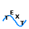 Allinea a Curva — `ATC`

> **Dove:** menu *Blocchi e Testi → Allineamento Testi → Allinea a Curva*; barra *Modifica Avanzata*

Mette un testo **lungo una curva** (linea, arco, cerchio, polilinea, spline, anche dentro un blocco): il testo si
appoggia alla curva, parallelo a lei, e la segue mentre muovi il mouse. Utile per scrivere lungo un bordo curvo.

1. Sulla riga di comando vedi come è impostato (`Allinea copia: No | Modalità multipla: Off`), poi
   `Seleziona testo da allineare [Nuovo/Impostazioni] <Esci>:`
   - clicca un testo che c'è già (a una riga o multilinea), oppure
   - **Nuovo**: `Specifica testo <Seleziona>:` scrivi un testo nuovo (Invio a vuoto torna a chiederti di selezionarne
     uno);
   - **Impostazioni**: apre la finestra delle impostazioni (vedi sotto).
2. `Seleziona curva per allineare testo <Esci>:` clicca la curva.
3. Muovi il mouse: il testo scorre lungo la curva e sta dalla parte del cursore, staccato dalla curva di una distanza
   che dipende dall'altezza del testo. Mentre lo muovi, la riga di comando ti ricorda i tasti:
   `[+/-] per [O]ffset | [</>] per [R]otazione | [L]eggibilità | <[E]sci>`.
   - **+** e **-** allontanano o avvicinano il testo alla curva; **O** ti fa scrivere la distanza esatta;
   - **<** e **>** girano il testo di 45°; **R** ti fa scrivere la rotazione;
   - **L** accende o spegne la "leggibilità": il testo non viene mai capovolto;
   - **M** (solo testi multilinea) accende o spegne la maschera di sfondo.
4. **Clic** per confermare. **E**, Invio o la barra spaziatrice chiudono.

La finestra **Impostazioni** ha: il tipo di oggetto per un testo nuovo (**Text** o **MText**), la **giustificazione**
del testo nuovo (Centro-Centro, Basso-Sinistra...), il **fattore offset** (la distanza dalla curva, in altezze di
testo), la **rotazione** del testo, **Mantieni Leggibilità Testo**, **Maschera Sfondo MText** con il suo **offset**,
**Modalità Testi Multipli** (ogni clic lascia una copia e puoi continuare a metterne) e **Copia Testo Selezionato**
(il testo cliccato resta dov'era e si allinea una sua copia). Le impostazioni si ricordano.

Il testo nuovo prende lo stile di testo corrente. Il comando non parte se il layer corrente o il layer `0` sono
bloccati.

- **Rotazione Zero**: vedi [`ZR`](#cmd-zr).

<a id="cmd-edt"></a>
#### 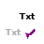 Ruota Testo — `EDT`

> **Dove:** menu *Blocchi e Testi → Allineamento Testi → Ruota Testo*; barra *Utilità Sistema Ext*

Gira tutti i testi scelti nella stessa direzione, data da **due punti**: per esempio parallela a un lato del pezzo.

1. `Seleziona i testi da orientare:` scegli i testi (vanno bene anche quelli già selezionati).
2. `Primo punto della direzione:` e `Secondo punto della direzione:` clicca i due punti (per esempio i due estremi del
   lato).

Ogni testo gira sul proprio punto di inserimento. Lavora sui testi a una riga, non sui testi multilinea.

### Modifica Testi

<a id="cmd-chg"></a>
#### 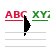 Sostituisci Testo — `CHG`

> **Dove:** menu *Blocchi e Testi → Modifica Testi → Sostituisci Testo*; barra *Utilità Sistema Ext*

Sostituisce una parola (o un pezzo di testo) in tanti testi insieme: per esempio cambiare "VITELLO" in "CERVO" su tutte
le scritte di un modello.

1. `Seleziona gli oggetti di testo:` scegli i testi (anche una finestra larga: gli altri oggetti vengono scartati).
2. `Testo da sostituire:` scrivi il testo da cercare.
3. `Testo sostitutivo:` scrivi quello nuovo (Invio a vuoto lo cancella dai testi).

Alla fine ti dice quanti testi ha cambiato (`Testi aggiornati: ...`). La ricerca distingue **maiuscole e minuscole**
("Vitello" non trova "VITELLO") e lavora sui testi a una riga, non sui testi multilinea né sugli attributi dei blocchi.

<a id="cmd-tcase"></a>
#### 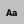 Maiuscolo/Minuscolo — `TCASE`

> **Dove:** menu *Blocchi e Testi → Modifica Testi → Maiuscolo/Minuscolo*; barra *Utilità Sistema Ext*

Cambia i testi selezionati da maiuscolo a minuscolo o al contrario.

- **Cambia Punto Base Blocco**: vedi [`CBP`](#cmd-cbp).

<a id="cmd-cambiacol"></a>
#### 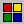 Cambia Colore — `CAMBIACOL`

> **Dove:** menu *Blocchi e Testi → Modifica Testi → Cambia Colore*; barra *Layer*, *Utilità Sistema Ext*

Cambia il colore degli oggetti, con qualsiasi colore: è il pulsante "tutti i colori" che nella barra **Layer** sta
accanto ai colori fissi.

1. Se hai già selezionato gli oggetti, il colore va su quelli; altrimenti te li chiede dopo il colore.
2. `Colore [Bianco/Giallo/Arancio/Verde/Fucsia/DaLayer] o numero da 1 a 255 <2>:` scrivi il nome (basta l'iniziale,
   **DaLayer** con D) oppure il numero del colore di ZWCAD (1 rosso, 2 giallo, 3 verde, 4 ciano, 5 blu, 6 magenta,
   7 bianco/nero, 30 arancio, 254 grigio chiaro...). Invio ripete l'ultimo colore usato.
3. `Seleziona gli oggetti da modificare:` scegli gli oggetti (se non li avevi già selezionati).

| Nome | Colore |
|---|---|
| Bianco | 254 |
| Giallo | 2 |
| Arancio | 30 |
| Verde | 3 |
| Fucsia | 6 |
| DaLayer | il colore del layer |

Il colore si può anche **passare al comando** in una macro, per farsi un pulsante per ogni colore:
`^C^C_CAMBIACOL Giallo` oppure `^C^C_CAMBIACOL 5`. I cinque colori più usati hanno già il loro pulsante, i colori
rapidi (`BBB`, `GGG`, `AAA`, `VVV`, `FFF`), spiegati in [Tipolinea e Layer](#6-tipolinea-e-layer).

### Diciture Standard

Le diciture sono le scritte di lavorazione sul pezzo. Funzionano tutte allo stesso modo: si clicca il punto, poi si
gira la scritta con il mouse.

<a id="cmd-dicitura"></a>
####  Testo Personalizzato... — `DICITURA`

> **Dove:** menu *Blocchi e Testi → Diciture Standard → Testo Personalizzato...*; barra *Diciture Standard*

Scrive un **testo tuo**, tutte le volte che vuoi, orientandolo ogni volta con il mouse.

1. `Testo personalizzato da ripetere:` scrivi il testo (può avere spazi).
2. `Punto di inserimento (Invio termina):` clicca dove comincia la scritta.
3. `Sposta il mouse per orientare il testo e clicca per confermare:` la scritta gira seguendo il cursore; clicca
   quando è nella direzione giusta.
4. Si torna al punto 2 per un'altra copia; **Invio** per finire.

Il testo è alto 2 e parte dal punto cliccato.

<a id="cmd-edg"></a><a id="cmd-fil"></a><a id="cmd-sca"></a><a id="cmd-sot"></a><a id="cmd-rim"></a><a id="cmd-tal"></a><a id="cmd-sal"></a><a id="cmd-ant"></a><a id="cmd-pie"></a><a id="cmd-bom"></a><a id="cmd-rin"></a><a id="cmd-bor"></a><a id="cmd-val"></a>
####  Diciture di lavorazione — `EDG`, `FIL`, `SCA`, `SOT`, `RIM`, `TAL`, `SAL`, `ANT`, `PIE`, `BOM`, `RIN`, `BOR`, `VAL`

> **Dove:** menu *Blocchi e Testi → Diciture Standard → Costola* · *Blocchi e Testi → Diciture Standard → Filo* · *Blocchi e Testi → Diciture Standard → Scarnire* · *Blocchi e Testi → Diciture Standard → Sottomettitura* · *Blocchi e Testi → Diciture Standard → Rimbocco* · *Blocchi e Testi → Diciture Standard → Talyn* · *Blocchi e Testi → Diciture Standard → Salpa* · *Blocchi e Testi → Diciture Standard → Antistrappo* · *Blocchi e Testi → Diciture Standard → Bombatura* · *Blocchi e Testi → Diciture Standard → Rinforzo* · *Blocchi e Testi → Diciture Standard → Bordatura* · *Blocchi e Testi → Diciture Standard → Valigiaia*; barra *Diciture Standard*

Scrivono sul pezzo la dicitura della lavorazione, con le stesse domande di `DICITURA` (punti 2-4): punto, orientamento
con il mouse, e così via finché premi **Invio**.

| Voce | Comando | Testo scritto | Altezza |
|---|---|---|---|
| Costola | `EDG` | COSTOLA | 1,8 |
| Filo | `FIL` | FILO | 2 |
| Scarnire | `SCA` | SCARNIRE | 2 |
| Sottomettitura | `SOT` | SOTTOMETTITURA | 2 |
| Rimbocco | `RIM` | RIMBOCCO | 2 |
| Talyn | `TAL` | TALYN | 2 |
| Salpa | `SAL` | SALPA | 2 |
| Antistrappo | `ANT` (o `PIE`) | ANTISTRAPPO | 2 |
| Bombatura | `BOM` | BOMBATURA | 2 |
| Rinforzo | `RIN` | RINFORZO | 2 |
| Bordatura | `BOR` | BORDATURA | 2 |
| Valigiaia | `VAL` | VALIGIAIA | 2 |

`PIE` non è nel menu: scritto sulla riga di comando fa lo stesso di `ANT`.

### Cucitura

Le diciture del tipo di cucitura, da mettere accanto alla linea di cucitura.

<a id="cmd-c5"></a><a id="cmd-c5p"></a><a id="cmd-c7"></a><a id="cmd-c7p"></a><a id="cmd-c5a"></a><a id="cmd-c7a"></a><a id="cmd-cip"></a>
#### 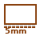 Diciture di cucitura — `C5`, `C5P`, `C7`, `C7P`, `C5A`, `C7A`, `CIP`

> **Dove:** menu *Blocchi e Testi → Cucitura → CUC.ROV. 5MM* · *Blocchi e Testi → Cucitura → CUC.ROV. 5MM CON PIPING* · *Blocchi e Testi → Cucitura → CUC.ROV. 7MM* · *Blocchi e Testi → Cucitura → CUC.ROV. 7MM CON PIPING* · *Blocchi e Testi → Cucitura → CUC.ROV. 5MM APERTA* · *Blocchi e Testi → Cucitura → CUC.ROV. 7MM APERTA* · *Blocchi e Testi → Cucitura → CUC. in Piedi*; barra *Diciture Standard*

Come le diciture di lavorazione: punto, orientamento con il mouse, e di nuovo finché premi **Invio**.

| Comando | Testo scritto | Altezza |
|---|---|---|
| `C5` | CUC.ROV. 5MM | 2 |
| `C5P` | CUC.ROV. 5MM CON PIPING | 2 |
| `C7` | CUC.ROV. 7MM | 2 |
| `C7P` | CUC.ROV. 7MM CON PIPING | 2 |
| `C5A` | CUC.ROV. 5MM APERTA | 2 |
| `C7A` | CUC.ROV. 7MM APERTA | 2 |
| `CIP` | CUC. IN PIEDI | 1,8 |

<a id="cmd-crov"></a><a id="cmd-crovp"></a><a id="cmd-crova"></a><a id="cmd-crovar"></a>
#### 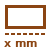 Cucitura rovesciata a misura — `CROV`, `CROVP`, `CROVA`, `CROVAR`

> **Dove:** menu *Blocchi e Testi → Cucitura → CUC.ROV. a Misura...* · *Blocchi e Testi → Cucitura → CUC.ROV. a Misura con Piping...* · *Blocchi e Testi → Cucitura → CUC.ROV. a Misura Riaperta...* · *Blocchi e Testi → Cucitura → CUC.ROV. a Misura Riaperta e Ribadita...*; barra *Diciture Standard*

Come le precedenti, ma prima ti chiede la misura della cucitura rovesciata.

1. `Inserisci misura cucitura rovesciata:` scrivi la misura (per esempio `6`).
2. Poi punto e orientamento, finché premi **Invio**. La misura vale per tutte le scritte di quella volta.

| Comando | Testo scritto (con misura 6) |
|---|---|
| `CROV` | CUC.ROV. 6 MM |
| `CROVP` | CUC.ROV. 6 MM CON PIPING |
| `CROVA` | CUC.ROV. 6 MM RIAPERTA |
| `CROVAR` | CUC.ROV. 6 MM RIAPERTA E RIBADITA |

Il testo è alto 2.

### Blocchi Avanzati

Comandi per creare blocchi al volo, metterli in serie lungo un contorno e spostarne il punto base.

<a id="cmd-blocco-rapido"></a>
#### 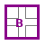 Blocco Rapido — `BLOCCO_RAPIDO`

> **Dove:** menu *Blocchi e Testi → Blocchi Avanzati → Blocco Rapido* · *Utilità → Utilità Blocchi → Blocco Rapido*; barra *BLOCCHI AVANZATI*

Trasforma subito gli oggetti scelti in un **blocco**, senza dover dare un nome: comodo per tenere insieme un gruppo di
linee e spostarlo o copiarlo come un pezzo solo.

1. `Seleziona gli oggetti da includere nel blocco:` scegli gli oggetti (vanno bene anche quelli già selezionati).
2. `Punto di inserimento:` clicca il punto base del blocco.

Gli oggetti spariscono e al loro posto, nella stessa posizione, c'è il blocco. Il nome lo dà Leonardo
(`MyBlock` seguito da lettere e numeri a caso). Gli oggetti sui layer bloccati vengono lasciati fuori.

<a id="cmd-blocchi-in-punti"></a>
####  Blocchi in Punti — `BLOCCHI_IN_PUNTI`

> **Dove:** menu *Blocchi e Testi → Blocchi Avanzati → Blocchi in Punti* · *Utilità → Utilità Blocchi → Blocchi in Punti*; barra *BLOCCHI AVANZATI*

Trasforma le **tacche Mozart `PitRTak`** in **punti**, ognuno nel punto di inserimento della tacca: serve per le
macchine da taglio che vogliono le tacche come punti.

1. `Seleziona le tacche (blocchi PitRTak)`: scegli i blocchi (va bene una finestra larga: gli altri blocchi vengono
   lasciati come sono).

I blocchi `PitRTak` vengono cancellati e al loro posto ci sono i punti, sul layer corrente. Alla fine ti dice quanti ne
ha sostituiti. Per le altre conversioni delle tacche vedi [Tacche](#7-tacche).

<a id="cmd-inserisci-blocchi"></a>
####  Inserisci Blocchi su Polilinea — `INSERISCI_BLOCCHI`

> **Dove:** menu *Blocchi e Testi → Blocchi Avanzati → Inserisci Blocchi su Polilinea* · *Utilità → Utilità Blocchi → Inserisci Blocchi su Polilinea*; barra *Tacche*, *BLOCCHI AVANZATI*

Mette un blocco **lungo una polilinea, a distanza regolare**: per esempio una tacca ogni 10 mm su un bordo, o un
simbolo ripetuto lungo una cucitura.

1. `Nome del blocco <tacca>:` scrivi il nome del blocco (Invio = l'ultimo usato). Il blocco deve essere nel disegno;
   le tacche (`tacca`, `tacca_t`, `PitTacCT`, `PitTacTa`, `PitRTak`) se mancano vengono create.
2. `Distanza tra i blocchi <10>:` e `Scala blocco <1>:` scrivi i valori.
3. `Scegli la polilinea:` clicca la polilinea (va bene anche una linea, un arco o un'altra curva). Ti dice quanto è
   lunga.
4. `Quanti blocchi vuoi inserire? [Tutti] <Tutti>:` scrivi il numero, oppure **Tutti** (o Invio, la prima volta)
   per metterne quanti ci stanno.
5. `Punto di inizio:` clicca sulla polilinea il punto del primo blocco. Compaiono dei **cerchietti verdi** dove
   andranno i blocchi.
6. `Clicca per indicare l'ORIENTAMENTO dei blocchi:` clicca da una parte o dall'altra della polilinea: i blocchi
   seguono la direzione della curva e si girano di 180° se clicchi dall'altra parte.
7. `Inserire ... blocchi '...'? [Si/No] <Si>:` conferma.

Su una polilinea **chiusa** con "Tutti" si fa un giro intero senza tornare sul primo; con un numero dato si continua
oltre la chiusura. Su una **aperta**, i blocchi che cadrebbero oltre la fine non si mettono e il comando te lo dice. I
blocchi vanno sul layer corrente e gli eventuali attributi prendono il loro valore predefinito. Nome, distanza, scala e
numero si ricordano anche dopo aver chiuso ZWCAD.

<a id="cmd-cbp"></a>
####  Cambia Punto Base — `CBP`

> **Dove:** menu *Blocchi e Testi → Modifica Testi → Cambia Punto Base Blocco* · *Blocchi e Testi → Blocchi Avanzati → Cambia Punto Base* · *Stampe e Nesting → Sbozzi → Sbozzo CBP* · *Utilità → Utilità Blocchi → Cambia Punto Base*; barra *UTILITA SISTEMA*

Sposta il **punto base** di un blocco. Vale per la definizione del blocco, quindi per **tutte** le copie di quel blocco
nel disegno.

1. `Seleziona un riferimento di blocco:` clicca un blocco (o selezionalo prima di lanciare il comando).
2. `Specifica il nuovo punto base:` clicca il punto che deve diventare il punto base.

Le copie del blocco **restano ferme sul loro punto di inserimento**: è il disegno del blocco che si sposta, in modo
che il punto scelto finisca sul punto di inserimento. Se vuoi che il disegno resti dov'è, usa `CBPR`. Gli attributi
si risistemano con il blocco; i layer bloccati vengono sbloccati il tempo del comando e poi bloccati di nuovo.

<a id="cmd-cbpr"></a>
####  Cambia Punto Base con Riferimento — `CBPR`

> **Dove:** menu *Blocchi e Testi → Blocchi Avanzati → Cambia Punto Base con Riferimento* · *Utilità → Utilità Blocchi → Cambia Punto Base con Riferimento*; barra *UTILITA SISTEMA*

Come `CBP`, ma il disegno del blocco **resta dov'è**: è il punto di inserimento di ogni copia che si sposta sul nuovo
punto base. Domande uguali: il blocco, poi il nuovo punto base. È quello da usare quando vuoi solo cambiare il punto da
cui il blocco si prende (per spostarlo, ruotarlo, inserirlo) senza muovere niente nel disegno.

<a id="cmd-conta"></a>
####  Conta (Numerazione Progressiva) — `CONTA`

> **Dove:** menu *Blocchi e Testi → Conta (Numerazione Progressiva)*; barra *Plugin*

Mette dei **numeri progressivi** (1, 2, 3...) cliccando i punti uno dopo l'altro: per numerare pezzi, fori o passaggi.

1. `Indicare numero di inizio:` scrivi il primo numero (un numero intero).
2. `Punto di inserimento:` clicca dove va il numero. Il numero dopo vale uno in più.
3. Continua a cliccare; **Invio** per finire.

Ogni numero è un blocco `conta` con il numero nel suo attributo, inserito sul layer corrente. Se il blocco non è nel
disegno, Leonardo lo prende dal file `conta.dwg`, nelle stesse cartelle delle [Indicazioni](#cmd-vr).

## 4. Offset

L'offset è la copia parallela di un contorno a una certa distanza: serve per le linee di cucitura, i ringrani, i
margini, le tracce di rimbocco. Qui trovi l'offset del ringrano, gli offset in serie, quelli con la linea di
cucitura e l'offset di **un solo tratto** di una polilinea.

Alcune cose valgono per tutti i comandi di questo menu (non per gli **Offset Standard**, che sono quelli di ZWCAD):

- vanno bene linee, archi, cerchi, polilinee, spline ed ellissi (l'offset del tratto vuole una polilinea);
- **il lato si sceglie con un clic**: clicca dalla parte dove vuoi l'offset. Mentre clicchi gli snap sono spenti, così il
  punto non cade sulla curva; dopo tornano come prima. Dove c'è l'opzione **Entrambi** puoi fare l'offset dalle due
  parti in una volta;
- se da quella parte l'offset non si può fare (per esempio dentro un arco più piccolo della distanza), il comando te lo
  dice e va avanti;
- distanze e scelte **si ricordano** anche dopo aver chiuso ZWCAD.

<a id="cmd-ofi"></a>
####  Offset Ringrano — `OFI`

> **Dove:** menu *Offset → Offset Ringrano*; barra *Offset Tratto*

L'offset del **ringrano**: fa l'offset del contorno e lo mette sul layer di taglio `OUTCUT`, mentre il contorno di
partenza passa sul layer `0` (la penna). Così il pezzo da tagliare è quello con il ringrano, e il disegno netto resta
come riferimento.

1. `>>> Offset di <0.35>:` scrivi la distanza (Invio = l'ultima usata; la prima volta 0,35).
2. `Seleziona la linea o [Distanza] <esci>:` clicca il contorno. Con **Distanza** cambi la misura senza uscire.
3. `Clicca dal lato dell'offset:` clicca dalla parte del ringrano (di solito fuori).
4. Si torna al punto 2 per un altro contorno; **Invio** per finire.

Tutti e due prendono il colore del layer. Il layer `OUTCUT` si crea se manca. Se il contorno di partenza è su un layer
bloccato, l'offset si fa lo stesso ma l'originale resta com'è (te lo dice).

- **Offset Tratto di Polilinea**: vedi più sotto [`OFFSET_TRATTO`](#cmd-offset-tratto).

<a id="cmd-ofinc"></a>
####  Offset Incrementali (OFINC) — `OFINC`

> **Dove:** menu *Offset → Offset Incrementali (OFINC)*; barra *Offset Tratto*

Fa **una serie di offset** dello stesso oggetto, con distanze che crescono: per esempio 1, 1,5, 2, 2,5, 3. Tutte le
distanze sono misurate **dall'originale**, non dall'offset precedente. Utile per le prove di ringrano o per le
scalette di cucitura.

1. `>>> Distanza iniziale <1>:` la distanza del primo offset.
2. `>>> Tipo incremento [Numerico/Percentuale] <Numerico>:`
   - **Numerico**: ogni offset è più lontano dell'incremento in mm (1 → 1,5 → 2...);
   - **Percentuale**: ogni offset è più lontano del precedente della percentuale data (con 10%: 1 → 1,1 → 1,21...).
3. `>>> Incremento in mm <0.5>:` (o `in %`) l'incremento. Può essere anche negativo: le distanze calano, e la serie si
   ferma se arriva a zero.
4. `>>> Numero di offset <5>:` quanti offset.
5. `>>> Seleziona l'oggetto:` clicca l'oggetto.
6. `>>> Clicca dal lato dell'offset [Entrambi]:` clicca la parte, oppure **Entrambi**.

Sulla riga di comando vedi l'elenco delle distanze fatte e alla fine quanti offset ha creato. Gli offset hanno layer,
colore e tipo di linea dell'originale.

### Offset Standard

- **Offset 2, 3, 4, 5, 6, 8, 10** sono il comando OFFSET normale di ZWCAD con la distanza già scritta (2, 3, 4, 5, 6,
  8 o 10 mm): da lì in avanti si sceglie l'oggetto e la parte come in ZWCAD. Il pulsante **Offset Variabile** della
  barra è il comando OFFSET senza distanza.

### Offset Tratteggiato (Cucitura)

Gli offset che disegnano direttamente la **linea di cucitura**.

<a id="cmd-oft-2"></a><a id="cmd-oft-3"></a><a id="cmd-oft-4"></a><a id="cmd-oft-5"></a><a id="cmd-oft-6"></a><a id="cmd-oft-8"></a><a id="cmd-oft-10"></a><a id="cmd-oft"></a>
####  Offset con cucitura — `OFT_2`, `OFT_3`, `OFT_4`, `OFT_5`, `OFT_6`, `OFT_8`, `OFT_10`, `OFT`

> **Dove:** menu *Offset → Offset Tratteggiato (Cucitura) → Offset 2 (scala 0.3)* · *Offset → Offset Tratteggiato (Cucitura) → Offset 3* · *Offset → Offset Tratteggiato (Cucitura) → Offset 4* · *Offset → Offset Tratteggiato (Cucitura) → Offset 5* · *Offset → Offset Tratteggiato (Cucitura) → Offset 6* · *Offset → Offset Tratteggiato (Cucitura) → Offset 8* · *Offset → Offset Tratteggiato (Cucitura) → Offset 10* · *Offset → Offset Tratteggiato (Cucitura) → Offset Variabile*; barra *Offset*

Fanno l'offset con l'aspetto della cucitura: tipo di linea `CUCITURA`, scala 0,3, layer `0`, colore del layer.
`OFT_2`... `OFT_10` hanno la distanza fissa (2, 3, 4, 5, 6, 8 o 10 mm); `OFT` (**Offset Variabile**) te la chiede.

1. Solo per `OFT`: `Inserisci l'offset (mm) <2>:` scrivi la distanza (Invio = l'ultima usata).
2. Sulla riga di comando vedi distanza, tipo di linea, layer e scala che verranno usati.
3. `Seleziona l'oggetto o [Aspetto] <esci>:` clicca l'oggetto (con `OFT` c'è anche **Distanza**, per cambiarla senza
   uscire).
4. `Clicca dal lato dell'offset [Entrambi]:` clicca la parte, oppure **Entrambi**.
5. Si torna al punto 3: puoi fare tutti i contorni che vuoi; **Invio** per finire.

**Aspetto** ti fa cambiare l'aspetto della cucitura: `Tipo linea della cucitura <CUCITURA>`, `Layer della cucitura <0>`
e `Scala del tipo linea <0.3>`. La scelta resta per tutti questi comandi e per l'offset tratteggiato del tratto. Un
layer che non c'è si crea.

Il tipo di linea `CUCITURA` si carica da solo dal file `LEONARDO.lin`. Se non si trova, il comando usa `DASHED` e te lo
scrive.

### Offset Tratto Avanzato

Questi comandi fanno l'offset di **un solo tratto** di una polilinea, fra due punti che scegli tu: per esempio per
allargare solo il lato alto di un pezzo, o per mettere la cucitura solo su un bordo.

<a id="cmd-offset-tratto"></a>
####  Offset Tratto di Polilinea — `OFFSET_TRATTO`

> **Dove:** menu *Offset → Offset Tratto di Polilinea*; barra *Offset Tratto*

Tutte le varianti dell'offset del tratto passano da questo comando e dalla sua finestra con l'anteprima. Si apre con
l'ultima variante usata; i cinque comandi che seguono fanno la stessa cosa ma aprono la finestra già sulla loro
variante.


1. `Seleziona Polilinea (INVIO per terminare):` clicca la polilinea. Compaiono le frecce del suo **verso** e una X sul
   punto di inizio: servono per capire quale è la sinistra e quale la destra.
2. `Specifica il primo punto:` e `Specifica il secondo punto:` clicca i due estremi del tratto (gli snap sono i tuoi).
   I punti vengono portati sulla polilinea.
3. Se la polilinea è **chiusa**, i due punti la dividono in due parti: `Punto sul tratto:` clicca un punto sulla parte
   che vuoi. Il tratto può anche passare per il punto di chiusura.
4. Si apre la finestra **Offset di un tratto**. Ogni scelta si vede subito nel disegno: **in verde** l'offset, **in
   giallo** i collegamenti, **in rosso** il tratto che verrà tolto oppure **in magenta** il tratto che resta. La riga
   in basso dice che cosa stai vedendo.
5. **OK** esegue; **Annulla** (o Esc) lascia tutto com'era. Poi puoi scegliere un'altra polilinea; **Invio** per finire.

Le parti della finestra, dall'alto:

- La **riga azzurra in alto** descrive in una frase che cosa fa la variante scelta.
- **Variante**: **Semplice**, **Collegato**, **Tratteggiato (cucitura)**, **Spezzato**, **Spezzato pulito** (vedi
  sotto le differenze). Se la polilinea è su un layer bloccato, Spezzato e Spezzato pulito sono spenti e accanto leggi
  `(layer bloccato: la polilinea non si può spezzare)`.
- **Offset**:
  - **Distanza**: di quanto si sposta l'offset dal tratto, in mm (da 0,001 in su; le frecce cambiano di 0,5). Accanto
    leggi la **lunghezza del tratto** che hai scelto, solo per controllo.
  - **Lato**: **Sinistra** o **Destra** guardando nel verso della polilinea (le frecce che hai visto quando l'hai
    scelta). Sulle polilinee chiuse il lato fuori dal pezzo è segnato **(esterno)**. **Inverti lato** passa all'altro.
- **Aspetto dell'offset** (diventa **Aspetto dell'offset (cucitura)** con il Tratteggiato):
  - **Layer**: il layer dell'offset. Scegli dall'elenco dei layer del disegno o scrivi un nome nuovo: un layer che non
    c'è si crea. **(come la polilinea)** lo mette sul layer della polilinea.
  - **Tipo linea**: il tipo di linea dell'offset, dall'elenco dei tipi di linea caricati (c'è sempre anche
    `CUCITURA`); **(come la polilinea)** usa quello della polilinea.
  - **Scala**: la scala del tipo di linea (da 0,001 in su). Si può scrivere solo quando in **Tipo linea** hai scelto
    un tipo di linea.
  - Il Tratteggiato ricorda un aspetto suo (all'inizio `CUCITURA`, layer `0`, scala 0,3), le altre varianti un altro
    (all'inizio tutto **(come la polilinea)**, scala 1): passando da una all'altra i valori cambiano da soli.
  - Il gruppo è spento con **Spezzato** e la spunta di unione accesa, perché lì l'offset diventa parte della
    polilinea.
- **Collegamenti**:
  - **Layer**: il layer delle due linee di collegamento (sono sempre linee continue; all'inizio `0`). Si sceglie solo
    con **Collegato** e con **Spezzato** senza unione.
  - **Spezzato: unisci resto, collegamenti e offset in una polilinea sola**: vale solo per **Spezzato** (vedi sotto).
- La **riga in basso** dice che cosa stai vedendo nel disegno (per esempio `Anteprima: verde l'offset (...), magenta
  il tratto.`) oppure perché quella scelta non si può fare.
- **OK** esegue e salva tutte le scelte per la volta dopo; **Annulla** (o Esc) lascia tutto com'era.

Se la distanza è troppo grande per quel lato, la riga in basso lo dice e **OK** si spegne: prova una distanza più
piccola o l'altro lato.

<a id="cmd-offset-tratto-simple"></a>
####  Offset Tratto Semplice — `OFFSET_TRATTO_SIMPLE`

> **Dove:** menu *Offset → Offset Tratto Avanzato → Offset Tratto Semplice*; barra *Offset Tratto*

Variante **Semplice**: fa solo l'offset del tratto. La polilinea resta com'è e l'offset è una curva a parte, staccata,
con l'aspetto scelto nella finestra. È l'offset di ZWCAD, ma limitato al pezzo di contorno che ti serve.

<a id="cmd-offset-tratto-linked"></a>
####  Offset Tratto Collegato — `OFFSET_TRATTO_LINKED`

> **Dove:** menu *Offset → Offset Tratto Avanzato → Offset Tratto Collegato*; barra *Offset Tratto*

Variante **Collegato**: l'offset del tratto più **due linee di collegamento** che uniscono gli estremi del tratto agli
estremi dell'offset. La polilinea resta com'è. Ottieni una figura "a U" appoggiata al contorno: utile per disegnare una
battuta, una sporgenza o una tasca su un lato. Le linee di collegamento vanno sul layer scelto in **Collegamenti**.

<a id="cmd-offset-tratto-hatched"></a>
####  Offset Tratto Tratteggiato — `OFFSET_TRATTO_HATCHED`

> **Dove:** menu *Offset → Offset Tratto Avanzato → Offset Tratto Tratteggiato*; barra *Offset Tratto*

Variante **Tratteggiato**: come Semplice, ma l'offset prende l'aspetto della **cucitura** (tipo di linea `CUCITURA`,
layer `0`, scala 0,3, oppure quello che hai impostato). È la cucitura messa solo su un bordo del pezzo. Questo aspetto
è lo stesso degli offset con cucitura (`OFT`...): cambiandolo qui cambia anche lì.

<a id="cmd-offset-tratto-break"></a>
####  Offset Tratto Spezzato — `OFFSET_TRATTO_BREAK`

> **Dove:** menu *Offset → Offset Tratto Avanzato → Offset Tratto Spezzato*; barra *Offset Tratto*

Variante **Spezzato**: il tratto **si toglie** dalla polilinea e al suo posto vanno **l'offset e i due collegamenti**.
È il modo per spostare in dentro o in fuori un lato del pezzo: il contorno cambia davvero.

- Con **unisci ... in una polilinea sola** (proposta accesa): resto, collegamenti e offset diventano **una polilinea
  sola**. Se era chiusa resta chiusa, ed è sempre la stessa polilinea (stesso layer, stessi dati), quindi il pezzo
  resta pronto per i comandi che vogliono il contorno chiuso. In questo caso l'aspetto e il layer dei collegamenti non
  si scelgono: tutto prende quelli della polilinea. Se l'offset non viene in un pezzo solo, i pezzi restano separati e
  il comando te lo dice.
- Senza unire: i pezzi restano separati. Una polilinea chiusa diventa aperta (le manca il tratto), una aperta si divide
  in due; offset e collegamenti sono oggetti a parte.

<a id="cmd-offset-tratto-break-clean"></a>
####  Offset Tratto Spezzato Pulito — `OFFSET_TRATTO_BREAK_CLEAN`

> **Dove:** menu *Offset → Offset Tratto Avanzato → Offset Tratto Spezzato Pulito*; barra *Offset Tratto*

Variante **Spezzato pulito**: il tratto **si toglie** dalla polilinea e resta **solo l'offset**, senza collegamenti.
Fra gli estremi della polilinea e quelli dell'offset resta un buco: lo chiudi tu come vuoi (con un raccordo, un arco,
unendo i pezzi). Una polilinea chiusa diventa aperta, una aperta si divide in due; l'offset è un oggetto a parte.

In breve:

| Variante | La polilinea | Si aggiunge |
|---|---|---|
| Semplice | resta | l'offset |
| Collegato | resta | l'offset e due collegamenti |
| Tratteggiato | resta | l'offset con la cucitura |
| Spezzato | perde il tratto | l'offset e due collegamenti (anche uniti alla polilinea) |
| Spezzato pulito | perde il tratto | solo l'offset |

## 5. Stampe e Nesting

Questo menu serve a preparare i pezzi per la stampa e per il taglio: gli **sbozzi** (il pezzo ingrandito da cui si
ritaglia il netto), le **dime**, il **tipo** del pezzo (infustitura, fodera, rifilo, taglio), le **tavole di stampa**
e i **nesting**, cioè la disposizione automatica dei pezzi su un foglio o una tavola per consumare meno carta o
materiale. In fondo ci sono i fogli del plotter e il passante per tracolla.

### Sbozzi

Lo sbozzo è il pezzo ingrandito tutto intorno: si taglia lo sbozzo e il netto si ricava dopo. Tutti gli sbozzi
lavorano sui contorni dei pezzi (polilinee sui layer `ENDCUT` o `OUTCUT`).

<a id="cmd-sbozzo"></a>
####  Sbozzo (geometrico o rettangolare) — `SBOZZO`

> **Dove:** menu *Stampe e Nesting → Sbozzi → Sbozzo (geometrico o rettangolare)*; barra *Sbozzo*

Fa lo sbozzo dei pezzi scelti, in due modi: **geometrico** (il contorno allargato seguendo la sua forma) oppure
**rettangolare** (il rettangolo che contiene il pezzo, allargato).

1. `Seleziona i contorni dei pezzi (ENDCUT, OUTCUT)`: scegli i contorni, anche molti insieme.
2. `Sbozzo [Geometrico/Rettangolare] <Geometrico>`: il tipo di sbozzo.
3. `Dimensione sbozzo`: di quanto allargare il pezzo per ogni lato.
4. `Spigoli [Vivi/Arrotondati] <Vivi>`: con **Arrotondati** gli angoli dello sbozzo geometrico sono raccordati;
   quelli dello sbozzo rettangolare diventano quarti di cerchio di raggio uguale allo sbozzo.

Per ogni pezzo:

- lo sbozzo va sul layer `OUTCUT`: è il nuovo contorno da tagliare;
- il contorno di partenza e tutto quello che tocca il rettangolo d'ingombro del pezzo (dati del pezzo, testi,
  cuciture...) vanno sul layer `0`;
- i blocchi `tacca` che toccano il pezzo si cancellano.

Tipo, dimensione e spigoli si ricordano anche dopo aver chiuso ZWCAD. Un contorno aperto non ha sbozzo: il comando
ti dice quanti ne ha saltati.

<a id="cmd-sbozzo-rett"></a>
####  Sbozzo Rettangolare — `SBOZZO_RETT`

> **Dove:** menu *Stampe e Nesting → Sbozzi → Sbozzo Rettangolare*; barra *Sbozzo*

È `SBOZZO` già impostato su **Rettangolare**: ti chiede i contorni, la `Dimensione sbozzo` e gli `Spigoli`. Alla fine
parte da solo [`NESTING3`](#cmd-nesting3); siccome il nesting dispone i pezzi preparati per la stampa (vedi
[`PRESTAMPA`](#cmd-prestampa)), se non ti serve premi Esc.

<a id="cmd-sbozzo-bound"></a>
####  Sbozzo Boundary — `SBOZZO_BOUND`

> **Dove:** menu *Stampe e Nesting → Sbozzi → Sbozzo Boundary*; barra *Sbozzo*

Disegna il **rettangolo d'ingombro** di ogni contorno scelto (`ENDCUT`, `OUTCUT`), senza allargarlo e senza toccare
il pezzo. Il rettangolo va sul layer corrente. Serve per vedere o misurare l'ingombro, o come base per uno sbozzo
fatto a mano.

<a id="cmd-copyarray"></a>
####  Sbozzo Multiplo (Array) — `COPYARRAY`

> **Dove:** menu *Stampe e Nesting → Sbozzi → Sbozzo Multiplo (Array)*; barra *Sbozzo*

Ripete un pezzo in una **griglia di righe e colonne** e disegna intorno lo sbozzo rettangolare di tutto il blocco:
serve quando si tagliano più pezzi uguali da un'unica lastra.

1. `Selezionare la polilinea del contorno (layer 'outcut')`: clicca il contorno del pezzo; deve essere sul layer
   `OUTCUT`.
2. `Numero di righe` e `Numero di colonne`.
3. `Distanza tra i pezzi`: lo spazio fra una copia e l'altra (anche 0).
4. `Dimensione sbozzo`: il margine intorno a tutta la griglia (anche 0).

Il pezzo (il contorno e tutto quello che tocca il suo ingombro) va sul layer `0`, con colore e tipo di linea DaLayer;
le copie si dispongono **verso destra** (colonne) e **verso l'alto** (righe). Il rettangolo dello sbozzo, a spigoli
vivi, va sul layer `OUTCUT`. Sulla riga di comando leggi quanti pezzi hai fatto e la misura dello sbozzo. I valori si
ricordano per la volta dopo.

<a id="cmd-dima"></a>
####  Dima Standard — `DIMA`

> **Dove:** menu *Stampe e Nesting → Sbozzi → Dima Standard*; barra *Sbozzo*

Fa una **dima** dai pezzi: il contorno allargato diventa il taglio esterno, la forma del pezzo diventa un taglio
interno.

1. `Dimensione sbozzo <10>`: di quanto allargare il contorno.
2. `Selezionare le sagome ENDCUT`: scegli i contorni sul layer `ENDCUT`.

Il contorno allargato va sul layer `OUTCUT`, la sagoma di partenza sul layer `INTCUT`. La dimensione si ricorda; la
trovi anche nelle impostazioni AAMA ([`AAMA-CFG`](#cmd-aama-cfg)).

<a id="cmd-dima-tacche-atom"></a>
####  Dima Tacche (Atom) — `DIMA_TACCHE_ATOM`

> **Dove:** menu *Stampe e Nesting → Sbozzi → Dima Tacche (Atom)*; barra *Sbozzo*

Come `DIMA`, ma porta sulla dima anche le **tacche** del pezzo, come punti (per Geber e macchine simili) o come intagli
a V veri nel contorno.

1. `Distanza offset dima <10>`: di quanto allargare il contorno.
2. `Tacche [Geber/V] <Geber>`: **Geber** mette un punto, **V** disegna l'intaglio nella linea.
3. `Su quale perimetro [Interno/Esterno/Entrambi] <Interno>`: sulla forma del pezzo, sul contorno allargato o su
   tutti e due.
4. Solo con **V**: `Verso della V sul perimetro interno [Dentro/Fuori]` e/o `Verso della V sul perimetro esterno
   [Dentro/Fuori]` (proposto **Dentro**), poi `Larghezza tacca <3>` e `Profondità tacca <3>`.
5. `Selezionare le sagome ENDCUT/OUTCUT`: scegli i contorni (devono essere chiusi).

Il contorno allargato va sul layer `ENDCUT`, la sagoma di partenza sul layer `INTCUT`. Le tacche sono i blocchi
`tacca`, `PitTacCT` e `PitRTak` che stanno dentro la dima: ognuna si porta sul punto più vicino del perimetro scelto
e il blocco si cancella. Con **Geber** diventa un punto sul layer `4`; con **V** diventa un intaglio nella polilinea.
Alla fine leggi quante dime e quante tacche hai fatto, e quante tacche non si sono potute fare (troppo larghe o
troppo lontane dalla linea). Le scelte si ricordano.

- **Sbozzo CBP**: vedi [`CBP`](#cmd-cbp).

<a id="cmd-check-linee-interne"></a>
#### Verifica Contorni Doppi — `CHECK_LINEE_INTERNE`

> **Dove:** menu *Stampe e Nesting → Sbozzi → Verifica Contorni Doppi*

Trova i **contorni doppi**: due polilinee una sopra l'altra sullo stesso layer (`OUTCUT` o `ENDCUT`), che la macchina
taglierebbe due volte e che i consumi conterebbero due volte.

1. `Seleziona le polilinee da controllare`: scegli i contorni (si prendono solo quelli su `OUTCUT` e `ENDCUT`).
2. `Tolleranza dei contorni doppi <0,5>`: quanto possono scostarsi due linee per essere considerate la stessa.

Una polilinea che sta tutta sopra un'altra più lunga dello stesso layer è un doppio: si tiene la più lunga, e il
doppio va sul layer `ERR` (giallo) ed è portato davanti, così lo vedi e lo cancelli. Sulla riga di comando c'è
l'elenco dei contorni con i loro doppi, oppure `[OK] Nessun contorno doppio.`

### Definisci Tipo Pezzo

Questi quattro comandi dicono **che tipo di pezzo** è, scrivendolo nel nome del pezzo (blocco `DATIT`, vedi
[I dati del pezzo](#i-dati-del-pezzo)).

<a id="cmd-ed-infust"></a><a id="cmd-ed-rif"></a><a id="cmd-ed-sboz"></a><a id="cmd-ed-fod"></a>
####  Definisci Infustitura, Rifilo, Sbozzo, Fodera — `ED-INFUST`, `ED-RIF`, `ED-SBOZ`, `ED-FOD`

> **Dove:** menu *Stampe e Nesting → Definisci Tipo Pezzo → Definisci Infustitura* · *Stampe e Nesting → Definisci Tipo Pezzo → Definisci Rifilo* · *Stampe e Nesting → Definisci Tipo Pezzo → Definisci Sbozzo (Taglio)* · *Stampe e Nesting → Definisci Tipo Pezzo → Definisci Fodera*; barra *Dati Pezzo*

Scegli il nome del pezzo (puoi anche selezionarlo prima di lanciare il comando), oppure rispondi a
`Seleziona il nome pezzo` cliccandolo. Il comando:

- scrive il tipo nel dato **TIPOLOGIA** del nome: `ED-INFUST` scrive **Infustitura**, `ED-RIF` **Rifilo**,
  `ED-SBOZ` **Taglio**, `ED-FOD` **Fodera**;
- mette la stessa parola **davanti al nome**: "QUADRANTE" diventa "Fodera QUADRANTE".

Se il nome comincia già con un tipo (una parola dell'elenco Nome 1 o una di queste quattro), la parola si sostituisce
invece di raddoppiarsi: "Fodera QUADRANTE" con `ED-RIF` diventa "Rifilo QUADRANTE". Sulla riga di comando leggi il
nome nuovo.

### Tavole di Stampa

Per stampare il cartamodello si fa così: `PRESTAMPA` trasforma ogni sagoma in un **pezzo di stampa** (un blocco con
dentro il contorno e tutto quello che c'è sopra), poi un **nesting** dispone i pezzi di stampa sulla tavola, cioè il
foglio del plotter (vedi [Fogli Plotter](#cmd-leoum)) o un'altra polilinea che fa da tavola.

<a id="cmd-prestampa"></a>
####  Prestampa — `PRESTAMPA`

> **Dove:** menu *Stampe e Nesting → Tavole di Stampa → Prestampa*; barra *Tavola di Stampa*

Prepara i pezzi per la stampa.

1. `Seleziona gli oggetti da preparare alla stampa`: scegli i contorni dei pezzi (polilinee su `ENDCUT`, `OUTCUT`,
   `TAVOLA_DI_STAMPA_TAGLIO` o `TAVOLA_DI_STAMPA`; gli altri oggetti si ignorano).

Per ogni contorno:

- il contorno va sul layer `TAVOLA_DI_STAMPA_TAGLIO` (rosso);
- il contorno e tutto quello che tocca il suo rettangolo d'ingombro (dentro o a cavallo del bordo: nome, materiale,
  tacche, testi, cuciture) diventano un blocco "oggetto 1", "oggetto 2"..., con il punto base al centro;
- il blocco si inserisce al suo posto, sul layer `TAVOLA_DI_STAMPA` (giallo).

Gli altri contorni scelti non finiscono nel blocco di un pezzo vicino, e un oggetto non entra in due blocchi. Valgono
anche i pezzi fuori dallo schermo. Gli oggetti sui layer bloccati restano fuori, e il comando lo dice.

<a id="cmd-tavola-di-stampa-antibug"></a>
####  Tavola Selezione Manuale — `TAVOLA_DI_STAMPA_ANTIBUG`

> **Dove:** menu *Stampe e Nesting → Tavole di Stampa → Tavola Selezione Manuale*; barra *Tavola di Stampa*

Fa tutto quello che fa [`PRESTAMPA`](#cmd-prestampa) e poi lancia [`NESTING3`](#cmd-nesting3) per disporre subito i
pezzi sulla tavola.

<a id="cmd-tavola-di-stampa-a3"></a>
####  Tavola Selezione A3 — `TAVOLA_DI_STAMPA_A3`

> **Dove:** menu *Stampe e Nesting → Tavole di Stampa → Tavola Selezione A3*; barra *Tavola di Stampa*

Prepara i pezzi e il foglio per una stampa su **A3**.

1. `Seleziona le sagome (ENDCUT, OUTCUT)`: i contorni dei pezzi. Ogni pezzo diventa un blocco come con `PRESTAMPA`
   (qui il blocco prende il nome dal layer e dal tipo di linea del contorno, con un numero).
2. `Punto di inserimento del foglio A3 (angolo in alto a sinistra)`: clicca dove mettere il foglio. Si disegna un
   rettangolo di 420 × 297.
3. Parte [`NESTING3`](#cmd-nesting3): come tavola scegli il foglio A3 appena disegnato.

<a id="cmd-nesting3"></a>
####  Nesting Avanzato — `NESTING3`

> **Dove:** menu *Stampe e Nesting → Tavole di Stampa → Nesting Avanzato* · *Stampe e Nesting → Nesting Base → Nesting Avanzato (3)*; barra *Tavola di Stampa*

Il nesting più usato: dispone i pezzi di stampa **a righe**. I pezzi si ordinano dal più basso al più alto e si mettono
uno accanto all'altro verso destra; quando la riga è piena si va a capo sopra il pezzo più alto della riga. È veloce e
dà file ordinate, facili da controllare.

**Le domande dei nesting su tavola.** `NESTING3` e quasi tutti gli altri nesting (Best Fit, MaxRects, True-Shape,
Ottimizzato, Centrato, Cluster, Colonna, Ghigliottina, Ibrido, Spirale, Tetris, Confronta) chiedono le stesse cose:

1. `Seleziona i pezzi da stampare...`: i blocchi sul layer `TAVOLA_DI_STAMPA` fatti con
   [`PRESTAMPA`](#cmd-prestampa). Di ogni blocco conta il contorno sul layer `TAVOLA_DI_STAMPA_TAGLIO` che ha dentro:
   un blocco senza quel contorno si salta, e il comando ti dice quanti ne ha saltati.
2. `Inserisci lo spazio intorno ai pezzi`: la distanza minima fra un pezzo e l'altro, in mm (deve essere maggiore di
   zero).
3. `Seleziona la tavola di stampa...`: la polilinea della tavola (per esempio un foglio
   [`LEOUM`](#cmd-leoum)); conta il suo rettangolo d'ingombro, e di solito i pezzi partono dall'angolo in basso a
   sinistra.

Il risultato:

- i pezzi si **copiano** sulla tavola, ruotati e spostati come dice il nesting, con i loro attributi; **gli originali
  restano dove sono**, così puoi riprovare con un altro nesting e cancellare quello che non ti piace;
- se i pezzi non entrano tutti, il comando **aggiunge altre tavole**: copie della polilinea della tavola, una accanto
  all'altra verso destra, distanziate dello spazio fra i pezzi;
- sulla riga di comando leggi il resoconto: quanti pezzi su quante tavole e, per molti nesting, l'occupazione di ogni
  tavola.

Per scegliere fra i tanti nesting leggi l'inizio di **Nesting Base** qui sotto.

### Nesting Base

**Quale nesting usare.** I nesting si distinguono per tre cose.

- **Che cosa dispongono.** Quasi tutti dispongono i **pezzi di stampa** fatti con `PRESTAMPA` e ne **copiano** i
  blocchi sulla tavola (le domande sono spiegate in [`NESTING3`](#cmd-nesting3)). `NESTING`, `NESTING5`, `NESTING51`,
  `NESTING52` prendono invece qualsiasi oggetto sul layer `TAVOLA_DI_STAMPA`, e `NESTING1_TAVOLA` qualsiasi oggetto.
  `NESTINGLINEA` e `NESTING1` non usano una tavola: **spostano** gli oggetti scelti in fila.
- **Rettangolo o forma vera.** Quasi tutti trattano ogni pezzo come il suo **rettangolo d'ingombro**: sono veloci, ma
  non incastrano un pezzo nella rientranza di un altro. `NESTING-TRUESHAPE3` e `NESTING-OTTIMIZZA` lavorano sulla
  **forma vera** dei contorni: i pezzi sagomati si incastrano e si risparmia materiale, ma il calcolo dura di più.
- **Rotazioni.** Alcuni non girano mai i pezzi (attenzione al ringrano: se un pezzo non deve ruotare, scegli un
  nesting senza rotazioni o metti come angoli solo `0`); altri provano le rotazioni che indichi tu o le quattro
  posizioni a 90°.

In pratica:

| Che cosa ti serve | Usa |
|---|---|
| una stampa veloce e ordinata | `NESTING3` |
| il meglio con i rettangoli d'ingombro | `NESTING-MAXRECTS` |
| pezzi sagomati, risparmiare foglio o pelle | `NESTING-TRUESHAPE3`, poi `NESTING-OTTIMIZZA` |
| scegliere guardando i risultati | `NESTING_CONFRONTA` |
| pezzi che non devono ruotare | `NESTING3`, `NESTING-BESTFIT`, `NESTING-MAXRECTS` senza rotazione |
| mettere in fila dei blocchi, senza tavola | `NESTINGLINEA` |

- **Nesting Avanzato (3)**: vedi [`NESTING3`](#cmd-nesting3).

<a id="cmd-nestinglinea"></a>
####  Nesting Linea — `NESTINGLINEA`

> **Dove:** menu *Stampe e Nesting → Nesting Base → Nesting Linea*; barra *AAMA*, *Nesting Base*

Mette gli oggetti scelti **in fila**, da un punto, su una o più righe dentro un'area di lavoro. Non usa una tavola e
**sposta** gli oggetti (non li copia). Serve anche per mettere in ordine i blocchi AAMA. I pezzi vanno dal più alto al
più basso.

1. `Distanza orizzontale tra i blocchi <25>`.
2. `Allineamento verticale [Alto/Medio/Basso] <Medio>`: come allineare i pezzi di una riga.
3. `Permetti righe multiple se necessario [Si/No] <Si>`: con **Si** si va a capo quando la riga supera la larghezza
   dell'area; allora chiede anche `Distanza verticale tra le righe <10>`.
4. `Larghezza massima area di lavoro <3000>` e `Altezza massima area di lavoro <10000>`.
5. `Seleziona i pezzi...`: gli oggetti (non quelli sui layer bloccati).
6. `Specifica il punto di inizio`: l'angolo in basso a sinistra della fila; le righe in più vanno verso l'alto.

Se un pezzo è più largo dell'area o le righe superano l'altezza, compare un avviso; il pezzo si mette comunque. Alla
fine leggi le misure occupate. I valori si ricordano.

<a id="cmd-nesting1"></a>
####  Nesting Singola Linea — `NESTING1`

> **Dove:** menu *Stampe e Nesting → Nesting Base → Nesting Singola Linea*; barra *Nesting Base*

La versione semplice di `NESTINGLINEA`: tutti gli oggetti in **una sola riga**, allineati in basso, a una distanza
fissa. Sposta gli oggetti.

1. `Specifica la distanza tra i blocchi <10>`.
2. `Seleziona i pezzi...` e `Specifica il punto di inizio`.

<a id="cmd-nestingarea"></a>
####  Nesting Area — `NESTINGAREA`

> **Dove:** menu *Stampe e Nesting → Nesting Base → Nesting Area*; barra *Nesting Base*

Fa vedere per un momento il **rettangolo dell'area di lavoro**, per capire che misure dare a `NESTINGLINEA`. Ti chiede
`Specifica il punto di inizio`, `Larghezza area <1000>` e `Altezza area <1000>`, e disegna il rettangolo in verde solo
sullo schermo: non entra nel disegno e sparisce al primo ridisegno.

<a id="cmd-nesting5"></a><a id="cmd-nesting51"></a><a id="cmd-nesting52"></a>
####  Nesting Multi-Riga, Alternato e Ordinato — `NESTING5`, `NESTING51`, `NESTING52`

> **Dove:** menu *Stampe e Nesting → Nesting Base → Nesting Multi-Riga (5)* · *Stampe e Nesting → Nesting Base → Nesting Alternato (51)* · *Stampe e Nesting → Nesting Base → Nesting Ordinato (52)*; barra *Nesting Base*

Tre nesting a righe per gli oggetti sul layer `TAVOLA_DI_STAMPA` (di qualsiasi tipo: conta il loro rettangolo
d'ingombro). I pezzi più larghi che alti si girano di 90°. Lo spazio si lascia anche dai bordi della tavola.

- `NESTING5`: righe dal basso, pezzi dal più alto al più basso.
- `NESTING51`: come `NESTING5`, ma **a serpentina**: una riga da sinistra, la successiva da destra.
- `NESTING52`: come `NESTING51`, e prima chiede `Ordinamento [Height/Width/Area] <Height>` (per altezza, larghezza o
  area). Alla fine scrive l'area utilizzata di ogni tavola.

Ti chiedono:

1. `Seleziona i pezzi da stampare`: gli oggetti sul layer `TAVOLA_DI_STAMPA`.
2. `Inserisci lo spazio intorno ai pezzi`: qui va bene anche 0, ma un valore va scritto.
3. `Seleziona la tavola di stampa`: clicca la tavola (un oggetto qualsiasi; conta il suo ingombro).

Come gli altri, copiano i pezzi, lasciano gli originali e aggiungono tavole a destra se serve.

<a id="cmd-nesting1-tavola"></a>
#### Nesting Base senza spazio — `NESTING1_TAVOLA`

> **Dove:** menu *Stampe e Nesting → Nesting Base → Nesting Base senza spazio*

Mette i pezzi sulla tavola **senza spazio e senza rotazione**, a scalini, una riga da sinistra e la successiva da
destra. Va bene per oggetti qualsiasi.

1. `Seleziona i pezzi...`: gli oggetti (non quelli sui layer bloccati).
2. `Seleziona tavola di stampa`: clicca un **rettangolo** (polilinea chiusa di 4 vertici, senza archi).

I pezzi si copiano; se non entrano si aggiungono tavole a destra.

### Nesting Algoritmi Avanzati

Qui ci sono i nesting più raffinati. Salvo dove è detto, si usano come [`NESTING3`](#cmd-nesting3): pezzi di stampa,
spazio, tavola.

<a id="cmd-nesting"></a>
####  Nesting Base — `NESTING`

> **Dove:** menu *Stampe e Nesting → Nesting Algoritmi Avanzati → Nesting Base*; barra *NESTING AVANZATO*

Il nesting "a scalini": gli oggetti sul layer `TAVOLA_DI_STAMPA` (di qualsiasi tipo, conta il loro ingombro) si
mettono dal più basso al più alto, e ogni pezzo sale sopra tutti quelli che ha sotto. I pezzi più larghi che alti si
girano di 90°. Chiede i pezzi, lo spazio (anche 0, ma va scritto) e la polilinea della tavola.

<a id="cmd-nesting-bestfit"></a>
####  Nesting Best Fit — `NESTING-BESTFIT`

> **Dove:** menu *Stampe e Nesting → Nesting Algoritmi Avanzati → Nesting Best Fit*; barra *NESTING AVANZATO*

Mette i pezzi dal più grande al più piccolo, ognuno nella **posizione più bassa** possibile, provando le posizioni da
sinistra a destra. Non gira i pezzi. Riempie bene i vuoti lasciati dai pezzi grandi.

<a id="cmd-nesting-bestfit2"></a>
####  Nesting Best Fit 2 — `NESTING-BESTFIT2`

> **Dove:** menu *Stampe e Nesting → Nesting Algoritmi Avanzati → Nesting Best Fit 2*; barra *NESTING AVANZATO*

Come `NESTING-BESTFIT`, ma **prova le rotazioni**. Dopo lo spazio chiede
`Angoli di rotazione da provare, separati da virgola <0,90>` (per esempio `0,90,180,270`, oppure solo `0` per non
ruotare). Prova le posizioni lungo i bordi dei pezzi già messi e riempie prima le tavole già aperte. Alla fine scrive un
resoconto per ogni tavola.

<a id="cmd-nesting-trueshape3"></a>
####  Nesting TrueShape 3 — `NESTING-TRUESHAPE3`

> **Dove:** menu *Stampe e Nesting → Nesting Algoritmi Avanzati → Nesting TrueShape 3*; barra *NESTING AVANZATO*

Il nesting sulla **forma vera**: i pezzi si incastrano seguendo il loro contorno, non il rettangolo. È il più adatto ai
pezzi sagomati.


All'inizio si apre la finestra **Nesting True-Shape 3 - Configurazione**. Il calcolo divide tavola e pezzi in una
griglia di celle quadrate e cerca per ogni pezzo il posto più basso dove entra.

**Parametri base**

- **Spazio minimo tra profili (mm)**: la distanza minima fra il contorno di un pezzo e quello di un altro (proposto
  `5`; deve essere maggiore di zero). È sempre rispettata.
- **Risoluzione griglia (mm, vuoto = spacing)**: il lato delle celle. Vuoto vuol dire uguale allo spazio fra i
  profili; un numero più piccolo è più preciso ma più lento. Se lo scrivi, deve essere maggiore di zero.
- **Margine dal bordo tavola (mm)**: quanto stare lontano dal bordo della tavola (proposto `0`; vuoto vale 0).
- **Angoli rotazione (es. 0,90,45)**: le rotazioni da provare per ogni pezzo, in gradi, separate da virgola, da 0 a
  meno di 360 (proposto `0,90`). Con solo `0` i pezzi non girano: usalo quando conta il ringrano.

**Abilita zone vietate (le selezioni dopo)**: se la spunti, dopo la tavola ti chiede le zone da evitare (morsetti,
difetti, parti già usate). Di solito è spenta.

**Allineamento sulla tavola**: dove spostare i pezzi di ogni tavola, tutti insieme, alla fine del calcolo: **In basso
a sinistra** (proposto), **In basso al centro** o **Centrato**. Lo spostamento si fa solo finché i pezzi restano
dentro la tavola e fuori dalle zone vietate.

**Multi-start**

- **Abilita multi-start (prova più strategie, disegna la migliore)**: invece di un solo ordine dei pezzi ne prova
  diversi e tiene il risultato migliore, cioè meno tavole e poi il più compatto. Di solito è spento. Più strategie
  vuol dire più tempo.
- **Strategie deterministiche**: gli ordini da provare, dal pezzo più grande al più piccolo per **Area decr.**, **Lato
  max decr.** (il lato più lungo), **Altezza decr.**, **Larghezza decr.** (proposti tutti). Si accendono solo con il
  multi-start.
- **Aggiungi tentativi casuali (shuffle)**: in più prova degli ordini a caso; quanti lo scrivi in **Numero tentativi
  casuali (1-50)** (proposto `6`; un numero fuori da 1-50 diventa 6).

Con il multi-start acceso serve almeno una strategia o i tentativi casuali.

**OK** controlla i valori (se uno è sbagliato lo dice in fondo alla finestra), **Annulla** chiude senza fare niente.
Dopo OK:

1. `Seleziona i pezzi da stampare...`.
2. `Seleziona la tavola di stampa (polilinea chiusa)...`: la tavola deve essere **chiusa**, ma può avere qualsiasi
   forma (anche una pelle o un ritaglio irregolare).
3. Con le zone vietate: `Seleziona le ZONE VIETATE (polilinee chiuse), INVIO per nessuna...`. Le zone restano nel
   disegno.

Alla fine leggi il resoconto: per ogni tavola quanti pezzi e l'occupazione. I valori della finestra si ricordano.

<a id="cmd-nesting-maxrects"></a>
####  Nesting MaxRects — `NESTING-MAXRECTS`

> **Dove:** menu *Stampe e Nesting → Nesting Algoritmi Avanzati → Nesting MaxRects*; barra *NESTING AVANZATO*

Il migliore fra i nesting a rettangoli d'ingombro. Per ogni tavola tiene conto di tutti gli spazi liberi e prova
diverse regole e diversi ordini dei pezzi, poi tiene la combinazione che usa meno tavole (e, a pari tavole, lascia
l'ultima più bassa). Dopo lo spazio chiede `Rotazione 90° [Si/No] <Si>`: con **Si** ogni pezzo si prova anche girato
di 90°; con **No** i pezzi restano come sono. La scelta si ricorda.

<a id="cmd-nesting-ottimizza"></a>
####  Nesting Ottimizzato (forma vera) — `NESTING-OTTIMIZZA`

> **Dove:** menu *Stampe e Nesting → Nesting Algoritmi Avanzati → Nesting Ottimizzato (forma vera)*; barra *NESTING AVANZATO*

Il nesting più stretto sulla forma vera: parte dal risultato del true-shape e, per il tempo che decidi tu, cerca di
**togliere una tavola** alla volta riposizionando i pezzi, poi compatta l'ultima tavola in basso a sinistra, così lo
sfrido resta in alto in un pezzo solo. Non usa mai più tavole del true-shape, spesso meno. I contorni si controllano
esatti, archi compresi.


1. Si apre la finestra **Nesting Ottimizzato - Configurazione**. Nel gruppo **Parametri**:
   - **Spazio minimo tra profili (mm)**: la distanza minima fra i contorni dei pezzi (proposto `5`, maggiore di zero);
   - **Margine dal bordo tavola (mm)**: quanto stare lontano dal bordo della tavola (proposto `0`; vuoto vale 0);
   - **Angoli rotazione (es. 0,180 o 0,90,180,270)**: le rotazioni da provare, in gradi, separate da virgola (proposto
     `0,180`, che tiene il verso del ringrano; `0` da solo non gira i pezzi);
   - **Tempo di ottimizzazione (secondi)**: quanto può durare la ricerca, da 1 a 3600 (proposto `30`). Più tempo vuol
     dire più tentativi, e puoi sempre fermarti prima tenendo il migliore.

   Sotto, **Abilita zone vietate (le selezioni dopo la tavola)** (di solito spenta). **OK** controlla i valori (gli
   errori compaiono in fondo alla finestra), **Annulla** chiude senza fare niente.
2. Scegli i pezzi, la tavola (polilinea **chiusa**, di qualsiasi forma) ed eventualmente le zone vietate (una zona non
   chiusa si ignora).
3. Durante il calcolo una finestra mostra la fase, una barra di avanzamento, le tavole usate e il tempo passato.
   **Ferma e usa il migliore** si ferma subito e applica il risultato migliore trovato fin lì; **Annulla** non fa
   niente.

Se alla fine qualcosa non torna, il comando tiene il risultato del true-shape. I valori si ricordano.

<a id="cmd-nesting-confronta"></a>
####  Nesting Confronta (tutti, sceglie il migliore) — `NESTING_CONFRONTA`

> **Dove:** menu *Stampe e Nesting → Nesting Algoritmi Avanzati → Nesting Confronta (tutti, sceglie il migliore)*; barra *NESTING AVANZATO*

Non sai quale nesting scegliere? Questo li **calcola tutti** sugli stessi pezzi e la stessa tavola e te li fa vedere.


1. `Seleziona i pezzi da stampare...`.
2. `Inserisci lo spazio intorno ai pezzi`: propone l'ultimo spazio usato.
3. `Seleziona la tavola di stampa...`.
4. Una finestra di avanzamento mostra il calcolo (con **Annulla** ti fermi).

Poi si apre la finestra **Confronto dei nesting**. Qui non scrivi niente: guardi e scegli.

- In alto una riga ti dice **il migliore**, con quante tavole usa e la sua occupazione.
- A sinistra, nel riquadro **Nesting**, una riga per ogni nesting calcolato, con un quadratino verde se è in regola,
  rosso se ha problemi, grigio se non è riuscito. Le colonne:
  - **Nesting**: il nome e, fra parentesi, il comando che lo fa;
  - **Tavole**: quante tavole usa;
  - **Occupaz.**: l'area vera dei pezzi divisa per l'area delle tavole usate (più alta è, meno sfrido);
  - **Ultima h**: quanto è alta la parte usata dell'ultima tavola, nelle unità del disegno (più bassa è, più foglio
    resta libero in un pezzo solo);
  - **Controlli**: `ok`, oppure quanti pezzi **si sovrappongono** davvero e quanti escono **fuori dalla tavola**; per un
    nesting non riuscito, il motivo.
- La **★** segna il migliore (senza problemi, meno tavole, ultima tavola più bassa), che è già scelto.
- A destra, nel riquadro **Anteprima**, il nesting della riga scelta: le tavole una accanto all'altra e i pezzi, in
  rosso quelli che hanno problemi. Clicca un'altra riga per vederne un altro.
- In fondo leggi quanti pezzi su quante tavole, o l'avviso dei pezzi in rosso.

**Applica** (o doppio clic sulla riga) fa quel nesting nel disegno, come il suo comando; con un nesting non riuscito il
pulsante è spento. **Annulla** non cambia niente.

Nel confronto tutti usano lo spazio che hai scritto. Il true-shape prende il resto (griglia, margine, angoli,
allineamento, multi-start) dalla sua finestra e l'ottimizzato margine e angoli dalla sua, ma senza zone vietate; quali
nesting confrontare, gli angoli di Best Fit 2, la rotazione di MaxRects e i secondi dell'ottimizzato si scelgono con
[`NESTING_CONFRONTA_IMPOSTAZIONI`](#cmd-nesting-confronta-impostazioni).

<a id="cmd-nesting-confronta-impostazioni"></a>
####  Nesting Confronta Impostazioni... — `NESTING_CONFRONTA_IMPOSTAZIONI`

> **Dove:** menu *Stampe e Nesting → Nesting Algoritmi Avanzati → Nesting Confronta Impostazioni...*; barra *NESTING AVANZATO*

Apre la finestra **Impostazioni del confronto dei nesting**:


- **Nesting da confrontare**: l'elenco di tutti i nesting che il confronto sa calcolare, ognuno con il suo nome e il
  comando fra parentesi. Spunta quelli da calcolare (la prima volta sono tutti scelti). A destra i pulsanti **Tutti**,
  **Nessuno** e **Solo veloci** (tutti tranne true-shape e ottimizzato, che sono i più lenti). Almeno uno va scelto.
- **Parametri nel confronto**:
  - **Ottimizzato: secondi di ottimizzazione**: quanto tempo dare all'ottimizzato dentro il confronto, da 1 a 600
    (proposto `10`); vale solo qui, non cambia il tempo della finestra di `NESTING-OTTIMIZZA`;
  - **Best Fit 2: angoli da provare**: le rotazioni per Best Fit 2, in gradi, separate da virgola (proposto `0,90`;
    vuoto vale `0,90`); gli angoli che scrivi in `NESTING-BESTFIT2` vengono scritti anche qui;
  - **MaxRects: prova anche i pezzi ruotati di 90°**: la stessa scelta di `Rotazione 90°` di `NESTING-MAXRECTS`.

  Come ricorda la nota in fondo, il true-shape e l'ottimizzato usano gli angoli e il margine delle loro finestre.

**OK** controlla e salva le scelte, che restano anche dopo aver chiuso ZWCAD; **Annulla** lascia tutto com'era.

<a id="cmd-nesting-centered"></a><a id="cmd-nesting-cluster"></a><a id="cmd-nesting-column"></a><a id="cmd-nesting-guillotine"></a><a id="cmd-nesting-hybrid"></a><a id="cmd-nesting-spiral"></a><a id="cmd-nesting-tetris"></a>
####  Nesting Centrato, Cluster, Colonna, Ghigliottina, Ibrido, Spirale, Tetris — `NESTING-CENTERED`, `NESTING-CLUSTER`, `NESTING-COLUMN`, `NESTING-GUILLOTINE`, `NESTING-HYBRID`, `NESTING-SPIRAL`, `NESTING-TETRIS`

> **Dove:** menu *Stampe e Nesting → Nesting Algoritmi Avanzati → Nesting Centrato* · *Stampe e Nesting → Nesting Algoritmi Avanzati → Nesting Cluster* · *Stampe e Nesting → Nesting Algoritmi Avanzati → Nesting Colonna* · *Stampe e Nesting → Nesting Algoritmi Avanzati → Nesting Ghigliottina* · *Stampe e Nesting → Nesting Algoritmi Avanzati → Nesting Ibrido* · *Stampe e Nesting → Nesting Algoritmi Avanzati → Nesting Spirale* · *Stampe e Nesting → Nesting Algoritmi Avanzati → Nesting Tetris*; barra *NESTING AVANZATO*

Altri nesting a rettangoli d'ingombro, tutti con le domande di [`NESTING3`](#cmd-nesting3). Cambia il modo di
disporre i pezzi:

- `NESTING-CENTERED` (**Centrato**): righe centrate sulla tavola, pezzi dal più alto. Bello da vedere in stampa.
- `NESTING-CLUSTER` (**Cluster**): divide i pezzi in grandi, medi e piccoli e li mette a gruppi; ogni gruppo comincia
  una riga nuova. Utile per tenere insieme i pezzi minuti.
- `NESTING-COLUMN` (**Colonna**): riempie colonne dal basso verso l'alto, pezzi dal più stretto al più largo.
- `NESTING-GUILLOTINE` (**Ghigliottina**): divide la tavola in rettangoli liberi tagliati da parte a parte e mette ogni
  pezzo dove spreca meno. Comodo se poi dividi il foglio con tagli dritti.
- `NESTING-HYBRID` (**Ibrido**): prova le quattro rotazioni (0, 90, 180, 270) e tutte le posizioni, e mette ogni pezzo
  il più in basso possibile.
- `NESTING-TETRIS` (**Tetris**): a righe; per ogni pezzo sceglie, fra le quattro rotazioni, quella che resta più
  bassa.
- `NESTING-SPIRAL` (**Spirale**): parte dal centro della tavola e gira a spirale. I pezzi **possono sovrapporsi** e
  usa molte tavole: controlla sempre il risultato.

`NESTING-CENTERED`, `NESTING-CLUSTER`, `NESTING-COLUMN`, `NESTING-GUILLOTINE` e `NESTING-SPIRAL` non girano i pezzi.

### Fogli Plotter

I fogli del plotter da usare come tavola nei nesting: un rettangolo della misura del foglio, disegnato
**dall'angolo in alto a sinistra** che clicchi.

<a id="cmd-leoum"></a>
####  Singolo Foglio (650x950) — `LEOUM`

> **Dove:** menu *Stampe e Nesting → Fogli Plotter → Singolo Foglio (650x950)*; barra *Tavola di Stampa*

Il foglio singolo, **650 × 950**. Alla domanda `Punto di inserimento o (Impostazioni)` clicca l'angolo in alto a
sinistra. Con l'opzione **Impostazioni** cambi la misura (`Nuova larghezza LEOUM`, `Nuova altezza LEOUM`); la nuova
misura vale fino alla chiusura di ZWCAD e il comando torna a chiederti il punto.

<a id="cmd-leoum2"></a><a id="cmd-leoum4"></a>
####  Due Fogli e Quattro Fogli — `LEOUM2`, `LEOUM4`

> **Dove:** menu *Stampe e Nesting → Fogli Plotter → Due Fogli (1300x950)* · *Stampe e Nesting → Fogli Plotter → Quattro Fogli (1300x1800)*; barra *Tavola di Stampa*

`LEOUM2` disegna due fogli affiancati, **1300 × 950**; `LEOUM4` quattro fogli, **1300 × 1800**. Clicca il
`Punto superiore sinistro`. Le misure sono fisse.

<a id="cmd-passante"></a>
####  Passante Tracolla — `PASSANTE`

> **Dove:** menu *Stampe e Nesting → Passante Tracolla*; barra *Plugin*

Calcola e disegna il **passante** di una tracolla: la striscia che gira intorno alla tracolla (o a più passaggi di
tracolla) e la tiene ferma. Si apre la finestra **PASSANTE - Passante per tracolla**.


A sinistra le misure, tutte in millimetri (le scrivi o le cambi con le frecce):

- **Tracolla**
  - **Altezza tracolla (mm)**: quanto è alta la fascia della tracolla, cioè il lato lungo della sezione che il
    passante abbraccia (proposta `40`).
  - **Spessore tracolla (mm)**: lo spessore della tracolla (proposto `3`).
  - **Passaggi nel passante**: quante volte la tracolla passa dentro il passante; i passaggi stanno uno accanto
    all'altro, e il passante li fascia tutti (proposto `2`, da 1 a 20).
- **Passante**
  - **Spessore passante (mm)**: lo spessore del materiale del passante (proposto `1,5`).
  - **Larghezza passante (mm)**: quanto è largo il passante; è la larghezza del pezzo da tagliare (proposta `10`).
  - **Sormonto in chiusura (mm)**: spunta la casella se le due teste del passante si sovrappongono dove si chiude, e
    scrivi di quanto (proposto `10`; la casella di solito è spenta e la misura resta grigia). Il sormonto si
    **aggiunge** alla lunghezza del pezzo, come ricorda la nota sotto.
- **Disegno**
  - **Disegna anche il prospetto accanto al pezzo**: oltre al pezzo da tagliare disegna anche il prospetto della
    tracolla con il passante (proposto spuntato).

Il pulsante **↔** accanto a una misura (tutte tranne **Passaggi nel passante**) te la fa prendere nel disegno: la
finestra si chiude, sulla riga di comando scrivi la misura o indichi due punti, e la finestra si riapre con il valore
nuovo. Con **↔** sul sormonto la casella del sormonto si spunta da sola.

A destra l'anteprima, che cambia mentre scrivi: il **Prospetto tracolla** (i passaggi uno accanto all'altro, il
passante che li fascia, il sormonto sul lato della chiusura, con le quote `H` dell'altezza e passaggi × spessore; gli
spessori molto sottili sono ingranditi per vederli, e lo dice la scritta `(spessori ingranditi)`) e il **Pezzo del
passante** con larghezza e lunghezza. Sotto leggi `Pezzo: larghezza × lunghezza mm` e, con il sormonto, quanto è lo
sviluppo e quanto il sormonto. Se una misura non va (zero, o il sormonto più lungo del passante) al posto della
misura del pezzo compare il motivo in rosso e **Disegna** resta spento.

La lunghezza del pezzo (lo sviluppo) è: 2 × altezza tracolla + 2 × spessore tracolla × passaggi, più lo spessore del
passante × 0,707 × 2 × passaggi aumentato del 10%, più il sormonto se c'è. Con i valori proposti il pezzo è
10 × 96,67 mm.

Premi **Disegna** e clicca il `Punto superiore sinistro del passante`. Si disegnano il pezzo (un rettangolo larghezza ×
sviluppo, verso il basso), la linea di piega del sormonto (solo se hai spuntato il sormonto) e, se l'hai chiesto, il
prospetto alla sua destra, a 30 mm. Le misure con cui hai disegnato restano proposte fino alla chiusura di ZWCAD;
**Annulla** chiude senza disegnare e la volta dopo ritrovi le misure di prima.

## 6. Tipolinea e Layer

Comandi da un clic per mettere gli oggetti sul layer giusto, dare un colore al volo o cambiare il tipo di linea. Tutti
lavorano sugli **oggetti già selezionati**; se non c'è niente selezionato, te li chiedono.

Ricorda che i layer di taglio non sono solo un ordine: i comandi di Leonardo e le macchine da taglio riconoscono il
contorno esterno, i tagli interni e il rifilo proprio dal layer (vedi [I layer che contano](#i-layer-che-contano)).

<a id="cmd-penna"></a>
####  Penna (Layer 0) — `PENNA`

> **Dove:** menu *Tipolinea e Layer → Penna (Layer 0)*; barra *Layer*

Riporta gli oggetti sul layer `0`, la "penna" con cui si disegna, con il colore **DaLayer**. È il modo rapido per
togliere un oggetto da un layer di taglio, o per ripulire un oggetto che aveva un colore suo.

1. `Seleziona gli oggetti da assegnare al layer 0`.

<a id="cmd-endcut"></a>
####  Rifilo (ENDCUT) — `ENDCUT`

> **Dove:** menu *Tipolinea e Layer → Rifilo (ENDCUT)*; barra *Layer*

Mette gli oggetti sul layer `ENDCUT`, il **rifilo**.

1. `Seleziona gli oggetti da assegnare al layer ENDCUT`.

Se il layer non c'è, viene creato in **ciano** (colore 4). Gli oggetti prendono il colore DaLayer, quindi si vedono
del colore del layer.

<a id="cmd-outcut"></a>
####  Taglio (OUTCUT) — `OUTCUT`

> **Dove:** menu *Tipolinea e Layer → Taglio (OUTCUT)*; barra *Layer*

Mette gli oggetti sul layer `OUTCUT`, il **contorno esterno** da tagliare.

1. `Seleziona gli oggetti da assegnare al layer OUTCUT`.

Se il layer non c'è, viene creato in **rosso** (colore 1). Gli oggetti prendono il colore DaLayer.

<a id="cmd-intcut"></a>
####  Taglio Interno (INTCUT) — `INTCUT`

> **Dove:** menu *Tipolinea e Layer → Taglio Interno (INTCUT)*; barra *Layer*

Mette gli oggetti sul layer `INTCUT`, i **tagli interni** (asole, finestre, fori sagomati).

1. `Seleziona gli oggetti da assegnare al layer INTCUT`.

Se il layer non c'è, viene creato in **blu** (colore 5). Gli oggetti prendono il colore DaLayer.

Questi quattro comandi creano il layer solo se manca: se esiste già, il suo colore non viene toccato.

### Colori Rapidi

<a id="cmd-ggg"></a><a id="cmd-vvv"></a><a id="cmd-aaa"></a><a id="cmd-fff"></a><a id="cmd-bbb"></a>
####  Colori rapidi — `GGG`, `VVV`, `AAA`, `FFF`, `BBB`

> **Dove:** menu *Tipolinea e Layer → Colori Rapidi → Giallo (2)* · *Tipolinea e Layer → Colori Rapidi → Verde (3)* · *Tipolinea e Layer → Colori Rapidi → Arancione (30)* · *Tipolinea e Layer → Colori Rapidi → Magenta (6)* · *Tipolinea e Layer → Colori Rapidi → Bianco (254)*; barra *Layer*

Danno un colore agli oggetti selezionati, senza cambiare il loro layer. Servono a distinguere a colpo d'occhio pezzi,
parti o varianti mentre lavori.

1. `Seleziona gli oggetti da modificare`.

| Comando | Colore |
|---|---|
| `GGG` | giallo (2) |
| `VVV` | verde (3) |
| `AAA` | arancione (30) |
| `FFF` | magenta (6) |
| `BBB` | colore 254, un grigio molto chiaro, quasi bianco |

Il colore resta all'oggetto anche se lo sposti su un altro layer. Per tornare al colore del layer usa
[`PENNA`](#cmd-penna) o uno dei comandi dei layer di taglio, che rimettono il colore DaLayer.

### Tipo di linea

<a id="cmd-cucitura"></a>
####  Nuova Cucitura — `CUCITURA`

> **Dove:** menu *Tipolinea e Layer → Nuova Cucitura*; barra *Layer*

Dà agli oggetti selezionati il tipo di linea **CUCITURA** (il tratteggio della cucitura), con scala del tipo di linea
0,3.

1. `Seleziona gli oggetti da modificare`.

Il tipo di linea CUCITURA viene dal file `LEONARDO.lin` e di solito Leonardo lo carica da solo all'apertura di ZWCAD.
Se leggi `Tipo linea non presente nel disegno: CUCITURA`, nessun oggetto è stato cambiato: carica il tipo di linea
CUCITURA dal file `LEONARDO.lin` con il comando `_LINETYPE` di ZWCAD (pulsante Carica) e ripeti il comando.

<a id="cmd-continua"></a>
####  Linea Continua — `CONTINUA`

> **Dove:** menu *Tipolinea e Layer → Linea Continua*; barra *Layer*

Toglie il tipo di linea dato all'oggetto e gli rimette quello **DaLayer** (con scala 0,3). È il contrario di
[`CUCITURA`](#cmd-cucitura).

1. `Seleziona gli oggetti da modificare`.

La linea diventa continua se il tipo di linea del layer è continuo, com'è normalmente per `0`, `OUTCUT`, `INTCUT` ed
`ENDCUT`.

## 7. Tacche

Le tacche sono i segni di riferimento sul contorno del pezzo: dicono dove due pezzi si incontrano in cucitura o in
montaggio (il fianco con la fascia, il quadrante con il fondo...). In Leonardo una tacca è un piccolo **blocco**
appoggiato sul contorno, girato verso l'esterno o verso l'interno del pezzo.

**Le forme della tacca.** La stessa tacca può servire in forme diverse, a seconda di chi la deve leggere:

| Forma | Blocco | A che cosa serve |
|---|---|---|
| **Tacca normale** | `tacca` | il segno di lavoro: si vede, si stampa, si copia da un pezzo all'altro |
| **Tacca tagliata** | `tacca_t` | una piccola V sul layer `OUTCUT`: la macchina la taglia insieme al contorno |
| **Formato Mozart** | `PitTacCT` | la tacca dei disegni Mozart, per scambiare i file con chi lavora con quel formato |
| **Punto** | punto (POINT) | solo la posizione, senza simbolo: per le macchine da taglio che vogliono i punti |

Si disegna e si lavora con la tacca normale; le **conversioni** servono alla fine, quando prepari il file per la
macchina (tacche tagliate o punti), oppure quando ricevi un disegno con tacche Mozart o con punti e vuoi riportarle a
tacche normali. Se invece vuoi la tacca **tagliata dentro il contorno** (la rientranza a V, a U o tonda fatta proprio
nella polilinea), usa `METTI_V` o `METTI_V_AUTO`.

**Regole comuni a tutti i comandi delle tacche.**

- Le tacche si mettono su una polilinea, ma vanno bene anche una linea, un arco o un'altra curva. Il punto che clicchi
  viene portato sul punto più vicino del contorno (una crocetta rossa lo segna).
- Quando scegli la polilinea compaiono delle **frecce gialle** che mostrano il suo verso e un **cerchio rosso** sul
  suo inizio. Spariscono a fine comando.
- **Il lato.** Le tacche nuove ti chiedono da che parte vanno: puoi **cliccare** dalla parte giusta (c'è l'elastico
  che parte dal contorno) oppure scrivere **Esterno** o **Interno**. Su un pezzo chiuso Esterno è davvero fuori dal
  pezzo, in qualunque verso sia stato disegnato; su una linea aperta Esterno è a destra del verso. Per le tacche che ci
  sono già c'è anche **Mantieni**: restano dalla parte in cui sono.
- Se nel disegno manca il blocco della tacca, Leonardo lo crea da solo e lo scrive sulla riga di comando.
- Le tacche nuove vanno sul layer corrente; quelle copiate o convertite tengono il layer e la scala di prima.

<a id="cmd-inserisci-tacca"></a>
####  Inserisci Tacca — `INSERISCI_TACCA`

> **Dove:** menu *Tacche → Inserisci Tacca*; barra *Tacche*

Mette le tacche una alla volta, dove clicchi: il modo più rapido per segnare pochi punti di montaggio.

1. `Scegli la polilinea (Invio per finire)`: clicca il contorno.
2. `Scegli il punto di inserimento sulla polilinea`: clicca dove va la tacca.
3. `Clicca dalla parte in cui va la tacca [Esterno/Interno] <Esterno>`: clic dalla parte giusta, oppure la parola.

Poi ricomincia dalla polilinea: Invio o Esc per finire. Ogni tacca è un blocco `tacca`.

<a id="cmd-tacca"></a><a id="cmd-tacca-da-misura"></a><a id="cmd-tacca-dapoli"></a>
####  Tacca da Misura e da Polilinea — `TACCA`, `TACCA_DA_MISURA`, `TACCA_DAPOLI`

> **Dove:** menu *Tacche → Menu Tacche (TACCA)* · *Tacche → Tacca da Misura* · *Tacche → Tacca da Polilinea*; barra *Tacche*

Mette una fila di tacche lungo un contorno, in due modi:

- **Misura**: scrivi le distanze fra una tacca e l'altra (per esempio le tacche a 50, 80, 120 mm lungo il fianco);
- **Polilinea**: clicchi i punti su un altro pezzo (l'**origine**) e le tacche vanno sul pezzo di **destinazione** alla
  stessa distanza dal punto di partenza. È il modo per riportare le tacche del fianco sulla fascia che ci si cuce.

`TACCA` ti chiede prima `Modalità [Misura diretta/copia da Polilinea] <Misura>` (Invio = l'ultima usata).
`TACCA_DA_MISURA` e `TACCA_DAPOLI` partono già nella modalità giusta, senza chiederla.

In modalità **Misura**:

1. `Seleziona la polilinea di destinazione`: il contorno su cui vanno le tacche.
2. `Punto di partenza sulla polilinea`: qui va la prima tacca.
3. Il lato (clic, **Esterno** o **Interno**).
4. `Distanza per la tacca 2 [Verso] (Invio per finire)`: la distanza dalla tacca precedente, misurata lungo il
   contorno (scritta o presa con due punti). Si continua con la 3, la 4... **Verso** cambia direzione: avanti o
   all'indietro rispetto al verso della polilinea.

Su un pezzo chiuso si può girare oltre l'inizio, fino al giro completo; su una linea aperta il comando si ferma alla
fine (`Lunghezza massima della polilinea raggiunta!`).

In modalità **Polilinea**:

1. `Seleziona la polilinea di destinazione` e `Punto di partenza sulla polilinea di destinazione`: qui va la prima
   tacca.
2. Il lato.
3. `Seleziona la polilinea origine` e `Punto di partenza sulla polilinea origine`: il punto che corrisponde a quello di
   partenza della destinazione.
4. `Prossimo punto sulla polilinea origine [Verso] (Invio per terminare)`: clicca i punti sull'origine, uno dopo
   l'altro; per ognuno nasce una tacca sulla destinazione, alla stessa distanza lungo il contorno. **Verso** fa andare
   la destinazione all'indietro (quando i due pezzi sono disegnati in versi opposti).

Le tacche sono blocchi `tacca`. Alla fine il comando dice quante ne ha messe.

### Modifica Tacche

Comandi per copiare, girare e spostare le tacche che ci sono già, e per tagliarle dentro il contorno.

<a id="cmd-copia-tacche"></a>
####  Copia Tacche — `COPIA_TACCHE`

> **Dove:** menu *Tacche → Modifica Tacche → Copia Tacche*; barra *Tacche*

Copia le tacche da un pezzo a un altro alla stessa distanza lungo il contorno: per esempio dal fianco al quadrante o
alla fascia. Funziona con tutti i tipi di tacca (normali, tagliate, Mozart).

1. `Seleziona le tacche da copiare`: gli altri blocchi selezionati vengono lasciati stare.
2. `Scegli la polilinea da cui prendere le tacche` e `Scegli il punto di partenza`: il contorno su cui stanno le tacche
   e il punto da cui misurare.
3. `Scegli la polilinea su cui copiare le tacche` e `Scegli il punto di partenza`: il contorno di arrivo e il punto che
   corrisponde a quello di prima.
4. `Sulla polilinea di arrivo si va [Uguale/Contrario] al verso <Uguale>`: **Contrario** quando i due pezzi si
   cuciono "uno contro l'altro" e le distanze vanno contate all'indietro.
5. `Lato delle tacche [Mantieni/Esterno/Interno] <Mantieni>`.

Ogni copia è lo stesso blocco della tacca di partenza, con lo stesso layer e la stessa scala. Le tacche che sul pezzo
di arrivo andrebbero oltre la fine non vengono copiate, e il comando ti dice quante sono. Se una tacca era a più di
1 mm dal contorno di partenza, viene contata dal punto più vicino (il comando lo segnala).

<a id="cmd-ribalta-tacche"></a>
####  Ribalta Tacche — `RIBALTA_TACCHE`

> **Dove:** menu *Tacche → Modifica Tacche → Ribalta Tacche*; barra *Tacche*

Gira di 180° le tacche scelte sul loro punto di inserimento: la tacca passa dall'altra parte del contorno.

1. `Seleziona le tacche a cui cambiare la direzione`: puoi selezionare anche con una finestra; gli altri blocchi
   restano come sono.

<a id="cmd-riposiziona-tacche"></a>
####  Riposiziona Tacche — `RIPOSIZIONA_TACCHE`

> **Dove:** menu *Tacche → Modifica Tacche → Riposiziona Tacche*; barra *Tacche*

Porta le tacche su un altro contorno, nel punto più vicino e dritte rispetto al bordo. Serve per esempio quando hai
fatto lo sbozzo o l'offset e le tacche devono passare dalla linea netta a quella nuova.

1. `Seleziona le tacche`.
2. `Scegli la polilinea su cui mettere le tacche`.
3. `Lato delle tacche [Mantieni/Esterno/Interno] <Mantieni>`.

Le tacche vengono spostate e girate, non cancellate e rifatte: restano gli stessi blocchi.

<a id="cmd-sostituisci-tacche"></a>
####  Sostituisci Tacche — `SOSTITUISCI_TACCHE`

> **Dove:** menu *Tacche → Modifica Tacche → Sostituisci Tacche*; barra *Tacche*

Raccoglie in un comando solo tutte le conversioni della forma delle tacche. Ti chiede quale vuoi:

`[T]acche=>tagliate  t[A]gliate=>tacche  p[U]nti=>tacche  tacche=>[P]unti  [M]ozart=>standard  standard=>moza[R]t`

Scrivi la lettera e il comando prosegue esattamente come la conversione scelta:

| Lettera | Fa la stessa cosa di |
|---|---|
| `T` | [`TACCHE_IN_TAGLIATE`](#cmd-tacche-in-tagliate) |
| `A` | [`TAGLIATE_IN_TACCHE`](#cmd-tagliate-in-tacche) |
| `U` | [`PUNTI_IN_TACCHE`](#cmd-punti-in-tacche) |
| `P` | [`TACCHE_IN_PUNTI`](#cmd-tacche-in-punti) |
| `M` | [`MOZART_IN_TACCHE`](#cmd-mozart-in-tacche) |
| `R` | [`TACCHE_IN_MOZART`](#cmd-tacche-in-mozart) |

<a id="cmd-metti-v"></a>
####  Metti V — `METTI_V`

> **Dove:** menu *Tacche → Modifica Tacche → Metti V*; barra *Tacche*

Taglia le tacche **dentro il contorno**, una alla volta: la polilinea prende una rientranza a V, a U (rettangolare) o
tonda nel punto che scegli. È la tacca che la macchina taglia direttamente con il contorno, senza blocchi.


All'inizio la riga di comando ricorda le impostazioni in uso (tipo, larghezza e profondità).

1. `Scegli la polilinea base`: una polilinea, una linea o un arco. Linee e archi vengono trasformati subito in
   polilinea. Una vecchia polilinea 2D va convertita prima con `CONVERTPOLY`.
2. `Punto sulla polilinea o [Impostazioni/Annulla l'ultima] <termina>`: clicca dove va la tacca. La tacca compare **in
   giallo dalle due parti** del contorno.
3. `Clicca per indicare il LATO della tacca`: clicca dalla parte in cui deve entrare la rientranza. Su un pezzo chiuso
   il comando dice se è esterna o interna. Invio a questa domanda rifà la scelta del punto.

Si torna al punto 2 per la tacca successiva. Le opzioni:

- **Impostazioni** (`I`) apre la finestra **METTI_V - Impostazioni tacca**:
  - **Tipo di tacca**: **Triangolare (V)** (una punta), **Rettangolare (U)** (fondo piatto e fianchi dritti) o
    **Semicircolare** (un arco);
  - **Larghezza**: l'apertura della tacca sul contorno, in mm, misurata lungo il contorno: metà da una parte e metà
    dall'altra del punto che clicchi. Su un pezzo chiuso deve essere meno di metà del perimetro;
  - **Profondità**: quanto entra la tacca, in mm, perpendicolare al contorno. Per la **Semicircolare** è l'altezza
    dell'arco: con la profondità uguale a metà della larghezza ottieni un mezzo cerchio esatto, con meno un arco più
    piatto;
  - le due caselle vanno da 0,01 a 1000 mm; le frecce cambiano il valore di 0,5. La prima volta sono 2 × 2;
  - a destra il disegno della tacca scelta con le sue due misure in blu, che cambia mentre scrivi; la tacca entra
    **verso il lato scelto** quando clicchi il lato;
  - **OK** salva le impostazioni (restano anche per la volta dopo e valgono anche per `METTI_V_AUTO`) e la riga di
    comando le riscrive; **Annulla** lascia tutto com'era (`Impostazioni invariate.`).
- **Annulla** (`A`) toglie l'ultima tacca senza uscire dal comando.

Invio o Esc per finire. La polilinea resta la stessa (stesso layer, stesse proprietà): cambiano solo i suoi vertici.
Durante il comando gli snap vengono impostati da Leonardo (spenti mentre scegli il lato) e alla fine tornano come li
avevi.

Se la tacca non ci sta il comando lo dice e non la fa: per esempio `tacca troppo larga per questa polilinea` o
`tacca troppo vicina a un estremo della polilinea`.

<a id="cmd-metti-v-auto"></a>
####  Metti V Automatico — `METTI_V_AUTO`

> **Dove:** menu *Tacche → Modifica Tacche → Metti V Automatico*; barra *Tacche*

Fa in un colpo solo il lavoro di `METTI_V` su tutte le tacche di un pezzo: trova i blocchi tacca appoggiati sul
contorno e al loro posto taglia la rientranza nella polilinea.

1. `Scegli la polilinea/linea/arco base`.
2. Il comando cerca i blocchi il cui nome comincia per **tacca** (anche `tacca_t`) vicini al contorno (entro due volte
   la larghezza della tacca). Se due tacche sono più vicine di una larghezza, tiene la prima e ignora l'altra.
   **Cerchi rossi** = tacche valide, **cerchi gialli** = tacche ignorate (queste non vengono cancellate).
3. `Clicca il LATO delle tacche, oppure [Blocchi=orientamento dei blocchi/Impostazioni]`:
   - un **clic** mette tutte le rientranze dalla stessa parte (esterna o interna);
   - **Blocchi** mette ogni rientranza dalla parte in cui punta il suo blocco tacca;
   - **Impostazioni** apre la stessa finestra di `METTI_V` (tipo, larghezza, profondità) e poi rifà la ricerca.
4. `Inserire N tacche ... ? [Si/No] <Si>`: conferma.
5. Le rientranze vengono tagliate nel contorno, una per tacca; la riga di comando dice tacca per tacca com'è andata.
   Linee e archi diventano polilinee.
6. `Eliminare i blocchi TACCA originali? [Si/No] <Si>`: con **Si** i blocchi usati spariscono.

Se non trova niente: `Nessun blocco TACCA trovato!` (controlla che i blocchi si chiamino `tacca` e siano vicini al
contorno).

### Conversione Tacche

Questi comandi cambiano la forma delle tacche (vedi la tabella all'inizio del capitolo). Funzionano tutti allo stesso
modo:

1. Selezioni le tacche (o i punti) da convertire: gli oggetti di un altro tipo vengono lasciati stare.
2. Scegli **la polilinea del pezzo**: ogni tacca vecchia viene cancellata e quella nuova va nel punto più vicino di
   quel contorno, dritta rispetto al bordo, con il layer e la scala di prima.

Il lato resta quello che era. Siccome tutte le tacche finiscono sulla polilinea che scegli, **converti un pezzo alla
volta** e seleziona solo le tacche di quel pezzo.

<a id="cmd-tacche-in-tagliate"></a>
####  Tacche in Tagliate — `TACCHE_IN_TAGLIATE`

> **Dove:** menu *Tacche → Conversione Tacche → Tacche in Tagliate*; barra *Conversione Tacche*

Trasforma le tacche normali (`tacca`) in tacche tagliate (`tacca_t`), da mandare alla macchina insieme al contorno.

1. `Seleziona le tacche...`
2. `Scegli la polilinea in cui sostituire le tacche`.

La V della tacca tagliata sta sul layer `OUTCUT` (rosso): se il layer non c'è, viene creato.

<a id="cmd-tagliate-in-tacche"></a>
####  Tagliate in Tacche — `TAGLIATE_IN_TACCHE`

> **Dove:** menu *Tacche → Conversione Tacche → Tagliate in Tacche*; barra *Conversione Tacche*

Il contrario: riporta le tacche tagliate (`tacca_t`) a tacche normali (`tacca`).

1. `Seleziona le tagliate...`
2. `Scegli la polilinea in cui inserire le tacche`.

<a id="cmd-tacche-in-punti"></a>
####  Tacche in Punti — `TACCHE_IN_PUNTI`

> **Dove:** menu *Tacche → Conversione Tacche → Tacche in Punti*; barra *Conversione Tacche*

Trasforma le tacche normali in **punti**, per le macchine da taglio che leggono i punti al posto dei blocchi. Vale per i
blocchi `tacca` e `PitRTak`.

1. `Seleziona le tacche...`
2. `Scegli la polilinea in cui trasformare le tacche in punti`.

Ogni punto sta sul contorno, sul layer della tacca da cui nasce. Il punto non ha direzione: il lato della tacca si perde.

<a id="cmd-punti-in-tacche"></a>
####  Punti in Tacche — `PUNTI_IN_TACCHE`

> **Dove:** menu *Tacche → Conversione Tacche → Punti in Tacche*; barra *Conversione Tacche*

Il contrario: trasforma i punti appoggiati sul contorno in tacche normali, per esempio quando ricevi un file con le tacche
come punti.

1. `Seleziona i punti...`
2. `Scegli la polilinea in cui inserire le tacche`.
3. `Lato delle tacche [Esterno/Interno] <Esterno>`: i punti non hanno direzione, quindi il lato lo scegli tu, uguale per
   tutte.

<a id="cmd-mozart-in-tacche"></a>
####  Mozart in Tacche — `MOZART_IN_TACCHE`

> **Dove:** menu *Tacche → Conversione Tacche → Mozart in Tacche*; barra *Conversione Tacche*

Trasforma le tacche Mozart (`PitTacCT`) in tacche normali (`tacca`), quando ricevi un disegno fatto in quel formato.

1. `Seleziona le tacche Mozart...`
2. `Scegli la polilinea in cui inserire le tacche`.

Fra tacca Mozart e tacca normale il segno passa dall'altra parte del contorno, come vuole il formato Mozart. Se ti serve
dall'altra parte, usa [`RIBALTA_TACCHE`](#cmd-ribalta-tacche).

<a id="cmd-tacche-in-mozart"></a>
####  Tacche in Mozart — `TACCHE_IN_MOZART`

> **Dove:** menu *Tacche → Conversione Tacche → Tacche in Mozart*; barra *Conversione Tacche*

Trasforma le tacche normali (`tacca`) in tacche Mozart (`PitTacCT`), per passare il disegno a chi lavora in quel formato.

1. `Seleziona le tacche standard da trasformare in tacche Mozart...`
2. `Scegli la polilinea in cui inserire le tacche`.

Anche qui il segno passa dall'altra parte del contorno, come in `MOZART_IN_TACCHE`.

<a id="cmd-vlwalk"></a>
####  Valida Tacche Interattivo — `VLWALK`

> **Dove:** menu *Polilinee → Utilità Polilinee → Valida Tacche Interattivo* · *Tacche → Valida Tacche Interattivo*; barra *Tacche*

Fa "camminare" un pezzo lungo un altro, come quando li appoggi sul tavolo per vedere se le cuciture tornano: la
polilinea **MOBILE** scorre lungo la polilinea **GUIDA**, passo dopo passo, e tu puoi mettere una tacca sulla guida
in ogni punto di contatto che ti interessa. Le tacche che stanno già sulla mobile si muovono con lei, così controlli
che cadano nei punti giusti.


1. `Seleziona la polilinea GUIDA` e `Seleziona la polilinea MOBILE`: polilinee, linee, archi o cerchi (una spline va
   convertita prima con `S2P`). La mobile deve essere diversa dalla guida e non può stare su un layer bloccato.
   Il comando dice quante tacche ha trovato sulla mobile (quelle a meno di 0,5 dal contorno).
2. `Step di movimento <1>`: di quanto si muove la mobile a ogni passo.
3. `Step rotazione manuale gradi <15>`: di quanto la giri a ogni tasto di rotazione.
4. `Orientamento tacca su guida [Normale/Inverso] <Normale>`: da che parte della guida vanno le tacche che metterai
   (Inverso = girate di 180°).
5. `Clicca punto di partenza sulla GUIDA` e `Clicca punto di contatto sulla MOBILE`: i due punti che devono
   combaciare (le frecce gialle mostrano il verso delle due curve). La mobile si sposta subito e si appoggia lì, con il
   suo verso lungo quello della guida.

Si apre la piccola finestra **VLWALK - Cammina lungo la guida**, che resta sopra il disegno. In alto:

- **Passo**: di quanto avanza o torna indietro la mobile lungo la guida a ogni tasto, in mm (parte dal valore che hai
  dato a `Step di movimento`).
- **Gradi**: di quanto la giri a ogni tasto di rotazione (parte da `Step rotazione manuale gradi`).
- **Tacca inversa (+180°)**: con la spunta le tacche che metti con **T** vanno dall'altra parte della guida (parte da
  come hai risposto a `Orientamento tacca su guida`).

Puoi cambiarli in qualsiasi momento senza uscire; premi Invio nella casella per tornare ai tasti. Passo e gradi devono
essere maggiori di 0, se no in basso leggi `Passo non valido` o `Gradi non validi` e la mobile non si muove.

Sotto ci sono i tasti:

| Tasto | Che cosa fa |
|---|---|
| `8` ▲ avanti / `2` ▼ indietro | la mobile avanza o torna indietro di un passo lungo la guida |
| `7` ↺ / `9` ↻ | gira la mobile di un passo di gradi, in senso antiorario o orario |
| `1` ↺↺ / `3` ↻↻ | come sopra, di due passi |
| `T` | mette una tacca sulla guida nel punto di contatto |
| `0` OK | finisce e tiene tutto |
| `Q` Annulla | rimette tutto com'era: la mobile, le sue tacche, e toglie le tacche messe con T |

I tasti si premono con il mouse o dalla tastiera (anche dal tastierino numerico; frecce su e giù per avanti e
indietro, Invio = OK, Esc = Annulla). La riga in fondo dice dove sei: `G` la distanza percorsa sulla guida e `M` quella
sulla mobile, ognuna con la lunghezza totale della curva (per esempio `G: 10/100`), poi la rotazione aggiunta a mano;
dopo un **T** leggi `[TACCA]` con quante tacche hai messo.
Sulle curve chiuse si gira oltre l'inizio; su una curva aperta, arrivati in fondo, compare `FINE POLILINEA` (o
`INIZIO POLILINEA` andando indietro).

Passo, gradi e orientamento restano salvati per la volta dopo.

## 8. Materiali e Articoli

Qui si mettono e si controllano i **dati del pezzo**: il materiale (blocco `DATIM`), il nome (blocco `DATIT`), le
lavorazioni (`DATLAV`) e gli accessori (`DATACC`), più il numero articolo e lo spessore finito. Che cosa contiene ogni
blocco e come si riconoscono le categorie dei materiali (`A-` Pelle, `I-` Infustiture, `D-` Tele, `F-` Fodere) è
spiegato in [I dati del pezzo](#i-dati-del-pezzo).

**Come Leonardo trova i pezzi.** I comandi che lavorano "per pezzo" (`SOSTMAT`, `MAT1`, `SELEZIONA-PERMAT`, `MAPPAMAT`,
`MAPPACAT`, `CONTROLLA`) considerano pezzi le polilinee sui layer `OUTCUT` ed `ENDCUT` (e, nei disegni importati,
`PIT_DIS_TA_CONT` e `PIT_DIS_AREA`). Un blocco dati appartiene a un pezzo se sta dentro il **rettangolo d'ingombro**
del suo contorno. Quindi metti i blocchi dentro il pezzo; e ricorda che, se un pezzo piccolo sta dentro il rettangolo
di uno grande, i suoi blocchi contano anche per quello grande.

**Gli elenchi.** Materiali, nomi, lavorazioni e accessori si scelgono da elenchi che stanno nella cartella
`C:\LEONARDO\Common`: si modificano con `GESTMAT`, `GNAMES`, `ED-DB-LAV` ed `ED-DB-ACC` (o con il pulsante
**Elenchi...** / **Database…** delle finestre), che a ogni salvataggio tengono una copia `.bak` del file di prima.

**Le finestre** di questo menu hanno in alto una **barra del blocco**: verde (✔) se il blocco (`DATIM`, `DATIT`,
`DATLAV`, `DATACC`) è già nel disegno; gialla (⚠) con il pulsante **Crea blocco ...** se manca. Finché il blocco manca
non puoi confermare: un clic su **Crea blocco** e si va avanti. Quando modifichi un blocco già messo (`ED-MAT`,
`ED-NOM`, `ED-LAV`, `ED-ACC`) la barra dice solo "Modifica del blocco ... scelto nel disegno". In fondo c'è una riga
di stato che spiega che cosa sta succedendo (rossa per gli errori, verde quando una cosa è riuscita). Le finestre
ricordano posizione e dimensione.

### Gestione Materiali

<a id="cmd-mat"></a>
####  Inserisci Materiale — `MAT`

> **Dove:** menu *Materiali e Articoli → Gestione Materiali → Inserisci Materiale*; barra *Dati Pezzo*

Mette il materiale nel pezzo: apre la finestra **Inserimento Materiali**, poi inserisce il blocco `DATIM` dove clicchi.


La finestra:

- **Materiale** (a sinistra; il titolo del riquadro dice la categoria scelta, per esempio "Materiale - Pelle"):
  - in alto i quattro pulsanti della categoria: **Infustiture**, **Pelle**, **Tele**, **Fodere** (tra parentesi
    quante voci ha l'elenco). La categoria decide il prefisso che il materiale prenderà nel blocco (`I-`, `A-`, `D-`,
    `F-`). All'apertura è scelta **Pelle**; in `ED-MAT` la categoria del blocco;
  - **Cerca**: scrivi una parte del nome e l'elenco mostra solo i materiali che la contengono (maiuscole o minuscole
    non contano). Il pulsante **Elenchi...** apre [`GESTMAT`](#cmd-gestmat) e al ritorno aggiorna le liste. Se il file
    della categoria non c'è, la riga di stato lo dice in rosso: lo crei con **Elenchi...**;
  - l'elenco dei materiali della categoria: clic per scegliere, doppio clic per scegliere e confermare.
- **Dati** (a destra):
  - **Quantità**: quanti pezzi di quel materiale (da 1 a 999; proposto 1). Va in NPEZZI e nel testo visibile;
  - **Vale per articoli**: per quanti articoli vale quella quantità (da 1 a 999). Lascia 1 se vale solo per
    questo articolo; con un numero più alto il testo diventa "2 VITELLO vale x 3 art.";
  - **Spessore**: lo spessore del materiale in mm. Scegli dalla tendina (`nessuno`, 0.5 ... 8.0) o scrivilo tu (va
    bene anche la virgola: 1,5 diventa 1.5). `nessuno` o la casella vuota vogliono dire senza spessore. Se scrivi
    qualcosa che non è un numero maggiore di zero, la riga di stato lo dice in rosso e **OK** resta spento.
- **Anteprima**: quello che finirà nel blocco, riga per riga (TESTO1, MATERIALE, NPEZZI, TIPOLOGIA, AREANETTA, TESTO6);
  finché non scegli il materiale dice "(scegli il materiale)".
- **OK** si accende quando il blocco `DATIM` c'è, hai scelto un materiale e lo spessore va bene. **Annulla** chiude
  senza inserire niente.

Dopo **OK**:

1. `Punto di inserimento del materiale`: clicca dentro il pezzo.
2. `Rotazione <0>`: Invio per lasciarlo dritto, oppure indica l'angolo.

Il blocco `DATIM` va nello spazio corrente, in scala 0,5. Si vede solo il testo (per esempio "2 VITELLO"), più "SP. 1.2"
se hai dato lo spessore. Nel blocco il nome del materiale prende il prefisso della categoria (`A-VITELLO`); la quantità
va in NPEZZI, gli articoli in TIPOLOGIA e in AREANETTA la quantità divisa per gli articoli (senza decimali, almeno 1).

Un pezzo può avere più `DATIM` (per esempio la pelle e la fodera): basta lanciare `MAT` di nuovo.

<a id="cmd-ed-mat"></a>
####  Modifica Materiale — `ED-MAT`

> **Dove:** menu *Materiali e Articoli → Gestione Materiali → Modifica Materiale*; barra *Dati Pezzo*

Cambia un materiale già messo, con la stessa finestra di [`MAT`](#cmd-mat) (titolo **Modifica Materiale**) già
compilata.

1. `Seleziona il blocco materiale (DATIM) da modificare`: se l'avevi selezionato prima di lanciare il comando, si usa
   quello. Se clicchi un altro blocco, il comando lo dice e lo richiede.
2. Nella finestra cambi categoria, materiale, quantità, articoli o spessore; **OK** scrive nel blocco.

Se il materiale del blocco non è più nell'elenco, la finestra lo avvisa e lo lascia com'è, a meno che tu non ne scelga
un altro. Cambiando categoria devi scegliere un materiale nuovo. **Annulla** lascia il blocco com'era.

<a id="cmd-ed-materiale"></a>
####  Modifica Quantità/Tipologia — `ED-MATERIALE`

> **Dove:** menu *Materiali e Articoli → Gestione Materiali → Modifica Quantità/Tipologia*; barra *Dati Pezzo*

Cambia al volo quantità e articoli di un materiale, senza finestra.

1. `Seleziona il materiale`: il blocco `DATIM` (anche già selezionato).
2. `Nuovo quantitativo <2>`: Invio tiene il valore attuale.
3. `Numero di pezzi per articolo (vale per quanti articoli) <1>`: Invio tiene il valore attuale.

Il testo visibile si rifà da solo ("3 VITELLO vale x 2 art."). Materiale e spessore non cambiano.

<a id="cmd-sostmat"></a>
####  Sostituisci Materiale (batch) — `SOSTMAT`

> **Dove:** menu *Materiali e Articoli → Gestione Materiali → Sostituisci Materiale (batch)*; barra *Gestione Materiali DB*

Sostituisce un materiale con un altro in tutti i pezzi scelti in una volta: per esempio quando il cliente cambia la
pelle di tutto il modello.


1. Selezioni i pezzi (i contorni; vanno bene anche già selezionati). Il comando dice quanti pezzi ha trovato e quanti
   hanno il materiale.
2. Si apre la finestra **Sostituzione materiali**:
   - a sinistra, **Nel disegno (pezzi scelti)**: i materiali che ci sono nei pezzi scelti. La tendina **Mostra:**
     filtra per categoria (**Tutte le categorie**, **Infustiture**, **Pelle**, **Tele**, **Fodere** o
     **Senza prefisso**, per i materiali scritti senza `A-`, `I-`...). Le colonne sono **Materiale** (il nome senza
     prefisso, con un quadratino del colore della categoria), **Categoria** e **Pezzi** (in quanti pezzi c'è).
     Clic sul materiale da cambiare;
   - a destra, **Database** (il titolo dice la categoria scelta): i pulsanti della categoria con il numero di voci
     (all'apertura **Pelle**), **Cerca**, **Elenchi...** (apre [`GESTMAT`](#cmd-gestmat)) e l'elenco dei materiali.
     Clic sul materiale nuovo. Il materiale nuovo prende il prefisso della categoria scelta qui: così puoi anche
     spostare un materiale in un'altra categoria (per esempio da Pelle a Fodere);
   - in mezzo, due scritte grigie ti dicono che cosa manca; quando hai scelto, diventano **Da:** (il materiale di
     sinistra con il prefisso e il numero di pezzi) e **A:** (quello nuovo, con il prefisso). Il pulsante
     **<< Sostituisci** (oppure doppio clic sul materiale a destra) si accende solo quando hai scelto tutti e due e
     sono diversi.
3. La sostituzione si fa subito nel disegno: l'elenco di sinistra si aggiorna (con il materiale nuovo già scelto) e la
   riga di stato dice quanti pezzi sono cambiati. Puoi sostituire più materiali uno dopo l'altro; alla fine **Chiudi**
   (che non annulla le sostituzioni fatte).

In ogni `DATIM` cambiano il materiale e il testo visibile, rifatto con la sua quantità e i suoi articoli. Quantità,
articoli e spessore restano come erano. I pezzi cambiati vengono segnati con un rettangolo giallo (un segno provvisorio,
non fa parte del disegno).

<a id="cmd-mat1"></a>
####  Visualizza per Materiale — `MAT1`

> **Dove:** menu *Materiali e Articoli → Gestione Materiali → Visualizza per Materiale*; barra *Gestione Materiali DB*

Ti fa vedere i pezzi di un materiale **uno alla volta**: utile per ripassare, per esempio, tutti i pezzi in fodera.


1. Selezioni i pezzi.
2. Nella finestra **Mostra i pezzi di un materiale** scegli il materiale (doppio clic, oppure **Mostra uno alla
   volta**).

La finestra (la stessa di [`SELEZIONA-PERMAT`](#cmd-seleziona-permat), con un altro titolo e un altro pulsante):

- **Materiali nei pezzi scelti**: la tendina **Mostra:** filtra per categoria (**Tutte le categorie**,
  **Infustiture**, **Pelle**, **Tele**, **Fodere** o **Senza prefisso**); sotto, l'elenco con le colonne
  **Materiale** (il nome senza prefisso, con il quadratino del colore della categoria), **Categoria** e **Pezzi** (in
  quanti dei pezzi scelti c'è). Ci sono solo i materiali che stanno davvero nei pezzi che hai selezionato.
- In fondo, la riga di stato dice quanti pezzi hai scelto e quanti materiali ci sono; **Mostra uno alla volta** si
  accende quando scegli un materiale; **Annulla** chiude senza fare niente.
3. Il primo pezzo viene inquadrato e circondato da un rettangolo giallo:
   `VITELLO: pezzo 1 di 6 [Avanti/Fine] <Avanti>`. Invio per il prossimo, **Fine** o Esc per smettere.

<a id="cmd-seleziona-permat"></a>
####  Seleziona per Materiale — `SELEZIONA-PERMAT`

> **Dove:** menu *Materiali e Articoli → Gestione Materiali → Seleziona per Materiale*; barra *Gestione Materiali DB*

Seleziona tutti i pezzi di un materiale, pronti per un altro comando (spostarli, copiarli, metterli in una tavola...).


1. Selezioni i pezzi fra cui cercare.
2. Nella finestra **Seleziona i pezzi per materiale** scegli il materiale e premi **Seleziona i pezzi** (o doppio
   clic). La finestra è fatta come quella di [`MAT1`](#cmd-mat1): tendina **Mostra:** per filtrare la categoria,
   elenco **Materiale** / **Categoria** / **Pezzi**, in fondo il numero di pezzi e di materiali; **Seleziona i pezzi**
   si accende quando scegli un materiale, **Annulla** chiude senza selezionare niente.

I contorni di quel materiale restano selezionati (con i grip) e vengono inquadrati tutti insieme. Si selezionano solo i
contorni, non i blocchi.

<a id="cmd-mappamat"></a>
####  Mappa dei Materiali — `MAPPAMAT`

> **Dove:** menu *Materiali e Articoli → Gestione Materiali → Mappa dei Materiali*; barra *Gestione Materiali DB*

Colora ogni pezzo con il colore del suo materiale e apre una legenda: a colpo d'occhio vedi quali pezzi sono in pelle,
quali in fodera, e quali sono rimasti senza materiale.


1. `Seleziona i pezzi ... <Invio = tutto il disegno>`: scegli i contorni, o Invio per tutto il disegno.

Ogni pezzo si riempie di un colore trasparente, uno per materiale, con il bordo dello stesso colore. I pezzi **senza
materiale** sono grigi e quelli con **più materiali** viola, tutti e due con il bordo rosso.

La finestra **Mappa dei materiali** resta aperta mentre lavori:

- in alto un riassunto: quanti pezzi ci sono, quanti senza materiale o con più materiali (barra gialla); verde se
  tutti i pezzi hanno un materiale;
- **Legenda**, con le colonne **Materiale** (il quadratino del colore usato nel disegno e il materiale con il
  prefisso, per esempio `A-VITELLO`), **Categoria** (Pelle, Fodere... oppure "senza prefisso") e **Pezzi**. In fondo,
  in rosso con la categoria "da sistemare", le righe **(più materiali)** e **(senza materiale)**, se ci sono pezzi in
  quei casi. Un pezzo con pelle e fodera è contato in tutte e due le righe e in "(più materiali)"; il totale in alto
  conta i pezzi veri;
- **clic su una riga**: restano colorati solo quei pezzi, che vengono inquadrati; la riga di stato in fondo dice
  "Solo: ..." con il numero di pezzi;
- **Tutti**: di nuovo tutti i colori (la riga di stato torna a "Tutti i materiali.");
- **Aggiorna**: rifà la mappa dopo che hai cambiato il disegno (per esempio dopo `SOSTMAT`);
- **Chiudi**: chiude la legenda e toglie i colori.

I colori non fanno parte del disegno: non si salvano, non si stampano, non si selezionano. Spariscono anche chiudendo il
disegno o lanciando di nuovo `MAPPAMAT` o `MAPPACAT`.

<a id="cmd-mappacat"></a>
####  Mappa delle Categorie — `MAPPACAT`

> **Dove:** menu *Materiali e Articoli → Gestione Materiali → Mappa delle Categorie*; barra *Gestione Materiali DB*

Come [`MAPPAMAT`](#cmd-mappamat), ma con un colore fisso per **categoria**: utile per vedere subito che cosa va in
pelle, che cosa in infustitura, in tela o in fodera.


| Categoria | Colore |
|---|---|
| Infustiture | arancione |
| Pelle | blu |
| Tele | verde |
| Fodere | arancione scuro |
| (più categorie) | viola, bordo rosso |
| (senza materiale) | grigio, bordo rosso |

Un pezzo con materiali di categorie diverse va in "(più categorie)". Un materiale senza prefisso di categoria conta come
"senza materiale". La finestra ha lo stesso titolo, **Mappa dei materiali**, e funziona come quella di `MAPPAMAT`
(clic su una riga, **Tutti**, **Aggiorna**, **Chiudi**); nella **Legenda** la colonna **Materiale** porta il nome della
categoria e la colonna **Categoria** dice "categorie" (o "da sistemare" per le due righe speciali).

<a id="cmd-controlla"></a><a id="cmd-controlla-correggi"></a><a id="cmd-controlla-giro"></a>
####  Controllo dei Pezzi — `CONTROLLA`, `CONTROLLA_CORREGGI`, `CONTROLLA_GIRO`

> **Dove:** menu *Materiali e Articoli → Gestione Materiali → Controllo dei Pezzi*; barra *Gestione Materiali DB*

Il giro di controllo prima del taglio: trova i pezzi senza materiale o senza nome e i blocchi dati rimasti fuori dai
pezzi, e ti porta a correggerli uno per uno.


1. `Seleziona i pezzi ... <Invio = tutto il disegno>`: scegli i contorni, o Invio per tutto il disegno.

Che cosa controlla:

| Problema | Quando | Tipo |
|---|---|---|
| Senza materiale | nel pezzo non c'è nessun `DATIM` | errore |
| Materiale vuoto | un `DATIM` ha il materiale vuoto | errore |
| Senza nome | nel pezzo non c'è né un `DATIT` né un `DATIM` | errore |
| 2 nomi (o più) | nel pezzo ci sono più `DATIT` | errore |
| Senza categoria | il materiale non comincia con `I-`, `A-`, `D-` o `F-` | avviso |
| Materiale fuori / Nome fuori | un `DATIM` o `DATIT` non sta dentro nessun pezzo (solo con Invio = tutto il disegno) | avviso |

Più `DATIM` nello stesso pezzo vanno bene (pelle e fodera), e un pezzo con il materiale ma senza `DATIT` non viene
segnalato.

Si apre la finestra **Controllo dei pezzi**, che **resta aperta mentre lavori** sul disegno:

- in alto il riassunto (quanti pezzi, quanti errori e avvisi; "nessun problema, pronti per il taglio" se è tutto a
  posto). La barra è rossa se ci sono errori, gialla se ci sono solo avvisi, verde se è tutto a posto;
- **Problemi trovati**, con tre colonne:
  - **Problema**: il tipo (vedi la tabella sopra), con il quadratino rosso per gli errori e giallo per gli avvisi;
  - **Pezzo**: il nome del pezzo (il `TESTO1` del suo `DATIT`); se non ha nome, "(senza nome)" e il materiale, o
    "(senza nome né materiale)"; per i blocchi fuori dai pezzi, "fuori dai pezzi";
  - **Dettaglio**: che cosa manca o che cosa c'è di sbagliato (per esempio "nessun DATIM dentro il pezzo", il
    materiale senza prefisso, i nomi doppi);
- **clic su una riga**: il contorno del pezzo si accende nel disegno (spesso, rosso o giallo); per un blocco fuori dai
  pezzi, un quadrato attorno al blocco. La vista non si sposta;
- **Correggi**: sistema il problema scelto (vedi sotto); poi la lista si aggiorna e resta scelto il problema dopo.
  Come **Zoom**, è spento finché non scegli una riga;
- **Zoom** (o doppio clic sulla riga): inquadra il problema scelto;
- **Mostra uno alla volta**: dal problema scelto in giù (dal primo, se non ne hai scelto nessuno), inquadra ogni
  problema e chiede sulla riga di comando `[Correggi/Avanti/Fine] <Avanti>`. Dopo ogni correzione il controllo si
  rifà: se una correzione ha sistemato anche un altro problema dello stesso pezzo, quello non ti viene più chiesto.
  Alla fine dice quanti ne hai corretti e che cosa resta;
- **Aggiorna**: rifà il controllo. Di solito non serve: la lista si aggiorna da sola alla fine di ogni comando (`MAT`,
  `CANCELLA`, `SPOSTA`...);
- **Chiudi**: chiude la finestra e spegne il contorno acceso. La finestra si chiude anche lanciando di nuovo
  `CONTROLLA` o chiudendo il disegno.

Come si corregge:

- **Senza materiale / senza nome**: si apre la finestra di [`MAT`](#cmd-mat) o di [`NOM`](#cmd-nom); poi
  `Punto di inserimento <Invio = dentro il pezzo>`: clicca il punto, o Invio per mettere il blocco al centro del
  rettangolo d'ingombro del pezzo. Se clicchi fuori dal pezzo, il comando ti avvisa che il blocco non gli apparterrà.
- **Più nomi**: la riga di comando li elenca numerati; `Quale tenere? Gli altri si cancellano. 1-2 <Invio = lasciali
  tutti>`.
- **Materiale vuoto o senza categoria**: si apre la finestra di [`ED-MAT`](#cmd-ed-mat) sul blocco.
- **Blocco fuori dai pezzi**: `Cancellare il blocco fuori dai pezzi? [Si/No] <No>`.

`CONTROLLA_CORREGGI` e `CONTROLLA_GIRO` sono i comandi che partono dai pulsanti **Correggi** e **Mostra uno alla
volta** (le domande sulla riga di comando hanno bisogno di un comando in corso). Non si usano da soli: senza un
controllo aperto rispondono `Nessun controllo aperto in questo disegno: usa CONTROLLA.`

<a id="cmd-gestmat"></a>
####  Database Materiali — `GESTMAT`

> **Dove:** menu *Materiali e Articoli → Gestione Materiali → Database Materiali*; barra *Gestione Materiali DB*

Apre la finestra **Gestione Elenchi Materiali**, dove modifichi i quattro elenchi da cui si scelgono i materiali:
`infustiture.txt`, `pelle.txt`, `Tele.txt`, `fodere.txt` in `C:\LEONARDO\Common`. È la stessa finestra che si apre con
**Elenchi...** in `MAT`, `ED-MAT` e `SOSTMAT`.


- **Elenco** (a sinistra): Infustiture, Pelle, Tele, Fodere, con il numero di voci; un asterisco `*` segna quelli
  cambiati e non ancora salvati. Clic su un elenco per lavorarci; puoi passare da uno all'altro senza perdere le
  modifiche.
- **Voci** (in mezzo; il titolo dice l'elenco e quante voci ha, e quante ne mostra quando cerchi): **Cerca** filtra
  le voci mentre scrivi; sotto c'è l'elenco delle voci e, in fondo, il percorso del file (con un avviso se il file
  non c'è ancora: si crea al salvataggio).
- **Voce** (a destra): nella casella scrivi il testo della voce (cliccando una voce dell'elenco, il suo testo va
  nella casella, così basta ritoccarlo). Poi:
  - **Aggiungi**: mette in fondo all'elenco il testo della casella;
  - **Modifica**: sostituisce la voce scelta nell'elenco con il testo della casella;
  - **Elimina**: toglie la voce scelta (anche con il tasto Canc).
  Se la casella è vuota o la voce c'è già (maiuscole o minuscole non contano), la riga di stato lo dice in rosso. Il
  carattere `|` diventa `/`.
- **Formato e ordine**:
  - la tendina *Come scritto*, *MAIUSCOLO*, *minuscolo*, *Prima maiuscola* decide come viene scritto il testo con
    **Aggiungi** e **Modifica** (*Come scritto* lo lascia com'è);
  - **Applica a tutte** porta tutte le voci dell'elenco al formato scelto (prima scegli un formato diverso da *Come
    scritto*); se due voci diventano uguali, ne resta una;
  - **Ordina A-Z** e **Ordina Z-A** mettono in ordine alfabetico l'elenco che stai guardando.
- **Salva** scrive insieme tutti gli elenchi cambiati (non solo quello che vedi), tenendo una copia `.bak` di
  ciascuno. Finché non premi **Salva** i file non cambiano. **Annulla** (o la X, o Esc): se ci sono modifiche non
  salvate, chiede se chiudere senza salvare.

Negli elenchi i materiali si scrivono **senza** il prefisso della categoria
(`VITELLO`, non `A-VITELLO`): il prefisso lo aggiunge Leonardo in base all'elenco da cui scegli.

<a id="cmd-gnames"></a>
####  Database Nomi — `GNAMES`

> **Dove:** menu *Materiali e Articoli → Gestione Materiali → Database Nomi*; barra *Gestione Materiali DB*

La stessa finestra di [`GESTMAT`](#cmd-gestmat), con il titolo **Gestione Elenchi Nomi Pezzo**, per i tre elenchi dei
nomi: **Nome 1**, **Nome 2**, **Nome 3** (`Nome1.txt`, `Nome2.txt`, `Nome3.txt` in `C:\LEONARDO\Common`). Si apre anche
con **Elenchi...** in `NOM` ed `ED-NOM`. Le voci di Nome 1 sono anche il **tipo** del pezzo (Infustitura, Fodera...).


Campi e pulsanti sono quelli di `GESTMAT`: a sinistra scegli **Nome 1**, **Nome 2** o **Nome 3**, in mezzo cerchi e
scegli le voci, a destra scrivi la voce e usi **Aggiungi**, **Modifica**, **Elimina**, il formato e l'ordine; **Salva**
scrive i tre file insieme. In ogni elenco scrivi solo la sua parte del nome: in Nome 1 il tipo del pezzo, in Nome 2 e
Nome 3 le parti che seguono (come "Fianco" ed "Esterno" nell'esempio di [`NOM`](#cmd-nom)). Il nome del pezzo le
unisce con uno spazio, con le maiuscole e minuscole che hai scritto qui.

### Gestione Articoli

<a id="cmd-num"></a>
####  Inserisci Numero Articolo — `NUM`

> **Dove:** menu *Materiali e Articoli → Gestione Articoli → Inserisci Numero Articolo*; barra *Dati Pezzo*

Scrive il numero dell'articolo nel disegno, fra due righe, nei punti che clicchi (per esempio su ogni pezzo o sulla
tavola).

1. `Numero articolo`: solo la prima volta; poi il numero resta e non viene più chiesto.
2. `Punto di inserimento del numero 1234 [Articolo] <fine>`: clicca dove va; si ripete finché premi Invio.
   **Articolo** cambia il numero (`Numero articolo <1234>`) per gli inserimenti che seguono.

Ogni volta inserisce il blocco `NUM` (il numero) e il blocco `RIF` (le due righe, sopra e sotto), in giallo e in scala
0,5.

<a id="cmd-ed-numart"></a>
#### Modifica Numero Articolo — `ED-NUMART`

> **Dove:** menu *Materiali e Articoli → Gestione Articoli → Modifica Numero Articolo*

Modifica un numero articolo già inserito nel disegno. Per cambiare il numero da mettere da ora in avanti usa invece
l'opzione **Articolo** di [`NUM`](#cmd-num).

<a id="cmd-nom"></a>
####  Inserisci Nome Pezzo — `NOM`

> **Dove:** menu *Materiali e Articoli → Gestione Articoli → Inserisci Nome Pezzo*; barra *Dati Pezzo*

Dà il nome al pezzo: apre la finestra **Inserimento Nome Pezzo**, poi inserisce il blocco `DATIT`.


La finestra:

- **Composizione dalle liste**: tre colonne, **Nome 1**, **Nome 2**, **Nome 3**. In ognuna, la casella in alto
  filtra la lista mentre scrivi; nella lista clicchi la parte che vuoi, oppure **(nessuno)** (la prima riga, in
  grigio) per lasciarla vuota. In **Nome 1** scegli il tipo del pezzo (Fodera, Infustitura, Netto, Rifilo...), in
  **Nome 2** e **Nome 3** le parti che seguono. Il nome si compone unendo le tre parti con uno spazio, con le
  maiuscole e minuscole delle liste (per esempio "Fodera" + "Fianco" + "Esterno" = "Fodera Fianco Esterno"); le parti
  lasciate a (nessuno) non lasciano spazi doppi.
- **Oppure: inserimento manuale**: la casella **Scrivi il nome a mano (disabilita le liste)** spegne le liste e
  accende la casella sotto, dove scrivi il nome come vuoi; si parte dal nome già composto, così basta ritoccarlo.
  Togliendo la spunta si torna alle liste. Qui c'è anche il pulsante **Elenchi...** che apre [`GNAMES`](#cmd-gnames)
  e al ritorno aggiorna le liste.
- **Anteprima**: il nome in grande e, sotto, il tipo del pezzo (`TIPOLOGIA`), che è la voce di Nome 1; con il nome
  scritto a mano il tipo resta vuoto ("Scritto a mano: TIPOLOGIA vuota"). Finché il nome è vuoto dice "(componi il
  nome dalle liste o scrivilo a mano)".
- **OK** si accende quando il blocco `DATIT` c'è e il nome non è vuoto. **Annulla** chiude senza inserire niente.

Dopo **OK**: `Punto di inserimento del nome pezzo` e `Rotazione <0>`. Il blocco `DATIT` va in scala 0,75; il nome sta
nell'attributo TESTO1.

<a id="cmd-ed-nom"></a>
####  Modifica Nome Pezzo — `ED-NOM`

> **Dove:** menu *Materiali e Articoli → Gestione Articoli → Modifica Nome Pezzo*; barra *Dati Pezzo*

Cambia il nome di un pezzo, con la stessa finestra di [`NOM`](#cmd-nom) (titolo **Modifica Nome Pezzo**).

1. `Seleziona il nome pezzo (DATIT) da modificare` (va bene anche già selezionato).
2. La finestra riconosce il nome nelle tre liste, anche le voci con gli spazi ("FIANCO ESTERNO"). Se il nome non si
   compone con le liste, lo trovi nella casella dell'inserimento manuale, con un avviso.
3. **OK** scrive il nome e il tipo nel blocco; **Annulla** lo lascia com'era.

### Accessori e Lavorazioni

Le lavorazioni (`LAV`) e gli accessori (`ACC`) hanno due finestre gemelle, fatte allo stesso modo:

- in alto la barra del blocco (`DATLAV` o `DATACC`);
- **a sinistra** (**Lavorazioni nel blocco** / **Accessori nel blocco**), le righe che andranno nel blocco (al massimo
  16), numerate nell'ordine in cui finiranno nel blocco, ognuna con il suo costo; sotto, quante sono (per esempio
  "3/16") e il **totale in euro**, più quante righe sono "senza costo" (il costo si mostra come `-` quando la voce non
  è più nell'elenco o non ha un costo). Arrivato a 16 il conteggio diventa arancione e non puoi aggiungere altro. Il
  costo serve solo a te: non va nel blocco;
- **a destra** (**Lavorazioni disponibili** / **Accessori disponibili**), l'elenco del file. La casella **Cerca**
  filtra mentre scrivi e cerca in tutte le colonne (nome, descrizione...). Il pulsante **Database…** apre la modifica
  del file ([`ED-DB-LAV`](#cmd-ed-db-lav) / [`ED-DB-ACC`](#cmd-ed-db-acc)): quando lì premi **Salva**, il file viene
  scritto subito (anche se poi qui premi Annulla) e l'elenco si aggiorna. Se il file non c'è o è vuoto, la riga di
  stato te lo dice;
- **in mezzo**, i pulsanti:
  - **◀ Aggiungi** (anche doppio clic o Invio sulla voce a destra): aggiunge in fondo a sinistra la voce scelta a
    destra, con i dettagli scritti sotto;
  - **Sostituisci**: mette la voce scelta a destra, con i dettagli scritti sotto, al posto della riga scelta a
    sinistra;
  - **Rimuovi** (anche con il tasto Canc): toglie la riga scelta a sinistra;
  - **▲ Sposta su** e **▼ Sposta giù**: spostano la riga scelta, per cambiare l'ordine nel blocco;
- **sotto**, i dettagli della riga, che valgono per Aggiungi e Sostituisci. Scegliendo una riga a sinistra, i suoi
  dettagli si caricano (e a destra si sceglie la stessa voce); dopo Aggiungi si svuotano;
- in fondo **Inserisci nel disegno**, che si accende quando c'è almeno una riga e il blocco è nel disegno, e
  **Annulla**, che chiude senza toccare il disegno. In modifica c'è **Aggiorna blocco**, sempre acceso: se hai tolto
  tutte le righe, il blocco resta vuoto.

Il blocco va nel punto che clicchi, girato come l'UCS corrente. Le scritte del blocco sono piccole (alte 0,2): si vedono
solo le righe piene.

<a id="cmd-acc"></a>
####  Inserisci Accessorio — `ACC`

> **Dove:** menu *Materiali e Articoli → Accessori e Lavorazioni → Inserisci Accessorio*; barra *Lavorazioni e Accessori*

Elenca gli accessori del pezzo (fibbie, anelli, rivetti, cerniere...) con la quantità: apre la finestra **Accessori -
nuovo blocco** e poi inserisce il blocco `DATACC`.


Nella finestra (vedi sopra) l'elenco a destra ha le colonne **Accessorio**, **Unità**, **Descrizione**, **Costo**; a
sinistra le righe hanno **#**, **Q.tà**, **Accessorio**, **Unità**, **Costo**. Il dettaglio della riga è **Quantità o
misura**:

- vuota vale 1;
- puoi scrivere un numero (2, 1,5) o una misura (30cm). Gli spazi vengono tolti, perché nel blocco il primo spazio
  separa la quantità dal nome;
- il pulsante ✕ svuota la casella.

Il costo della riga è il costo dell'elenco (per un'unità) per la quantità; se la quantità non è un numero (30cm) o
l'accessorio non ha costo nell'elenco, la riga non ha costo.

Dopo **Inserisci nel disegno**: `Punto di inserimento del blocco DATACC`. Ogni accessorio diventa una riga del tipo
"2 FIBBIA 30MM (pz)": quantità, nome e unità. Se non hai messo righe, non viene inserito niente.

<a id="cmd-ed-acc"></a>
####  Modifica Accessorio — `ED-ACC`

> **Dove:** menu *Materiali e Articoli → Accessori e Lavorazioni → Modifica Accessorio*; barra *Lavorazioni e Accessori*

Modifica un blocco `DATACC` già nel disegno: aggiungi, togli, sostituisci o riordina gli accessori.

1. `Seleziona il blocco accessori (DATACC) da modificare` (va bene anche già selezionato; se clicchi un altro blocco
   il comando lo dice e lo richiede).
2. Si apre la finestra di [`ACC`](#cmd-acc) con le righe del blocco; **Aggiorna blocco** le riscrive.

Si leggono anche i blocchi fatti con le versioni precedenti o scritti a mano: un accessorio senza l'unità tra
parentesi la prende dall'elenco. Se il blocco è vecchio e ha meno spazi del necessario, il comando avvisa quante righe
non ha potuto scrivere: in quel caso inserisci un `DATACC` nuovo.

<a id="cmd-ed-db-acc"></a>
####  Database Accessori — `ED-DB-ACC`

> **Dove:** menu *Materiali e Articoli → Accessori e Lavorazioni → Database Accessori*; barra *Lavorazioni e Accessori*

Modifica l'elenco degli accessori, il file `accessori.txt` in `C:\LEONARDO\Common`. Apre la finestra **Database
accessori**:


- a sinistra **Voci nel file accessori.txt**: la casella **Cerca** (filtra in tutte le colonne) e l'elenco con le
  colonne **Accessorio**, **Unità**, **Descrizione**, **Costo (EUR)**; sotto, **Totale** delle voci (e quante ne
  mostra quando cerchi). Clic su una voce: i suoi dati vanno nei campi a destra;
- a destra **Voce**, i campi (l'asterisco `*` segna quelli obbligatori):
  - **Accessorio** (obbligatorio): il nome, come comparirà nel blocco (per esempio FIBBIA 30MM);
  - **Unità** (obbligatorio): l'unità di misura (pz, m, cm...), che nel blocco va tra parentesi dopo il nome;
  - **Descrizione**: una nota libera, che si vede solo negli elenchi;
  - **Costo (EUR)**: il costo di un'unità, facoltativo; serve per il totale della finestra di `ACC`;
- sotto i campi, i pulsanti:
  - **Aggiungi nuova**: aggiunge una voce con i dati dei campi (il nome non deve esserci già);
  - **Modifica selezionata**: riscrive la voce scelta nell'elenco con i dati dei campi;
  - **Elimina selezionata**: toglie la voce scelta;
  - **Pulisci campi**: svuota i campi, per scrivere una voce nuova;
  sotto i pulsanti la finestra scrive che cosa ha fatto, o in rosso che cosa manca;
- in fondo **Salva**, che scrive il file, e **Annulla**, che chiude senza salvare (senza chiedere). A sinistra, in
  arancione, un avviso se il file non c'è ancora (si crea al salvataggio) o se ha righe che non si leggono.

Il costo si può scrivere con il punto o con la virgola e viene salvato come `12.50`; se non è un numero viene
rifiutato. Due voci con lo stesso nome (maiuscole o minuscole non contano) non sono ammesse; il carattere `|` diventa
`/`. Al salvataggio resta una copia `.bak` del file di prima; le righe del file che non si leggono vengono lasciate in
fondo così come sono.

<a id="cmd-crea-datacc"></a>
####  Crea Blocco Dati Accessori — `CREA-DATACC`

> **Dove:** menu *Materiali e Articoli → Accessori e Lavorazioni → Crea Blocco Dati Accessori*; barra *Lavorazioni e Accessori*

Crea nel disegno la definizione del blocco `DATACC` (32 attributi invisibili, sul layer 0), senza inserirlo. Se il
blocco c'è già, il comando non lo tocca. Di solito non serve: lo fa anche il pulsante **Crea blocco DATACC** della
finestra di `ACC`.

<a id="cmd-lav"></a>
####  Inserisci Lavorazione — `LAV`

> **Dove:** menu *Materiali e Articoli → Accessori e Lavorazioni → Inserisci Lavorazione*; barra *Lavorazioni e Accessori*

Elenca le lavorazioni del pezzo (cucitura, scarnitura, tinta bordo, piega...) con quante volte si fanno: apre la
finestra **Lavorazioni - nuovo blocco** e poi inserisce il blocco `DATLAV`.


Nella finestra (vedi sopra) l'elenco a destra ha le colonne **Operazione**, **Descrizione**, **Costo**; a sinistra le
righe hanno **#**, **Rip.** (le ripetizioni, `2x`), **Operazione**, **Descrizione** e **Costo**. I dettagli della riga
sono:

- **Ripetizioni**: quante volte si fa la lavorazione su questo pezzo, da 1 a 20 (proposto 1);
- **Descrizione (facoltativa)**: una nota tua per questo pezzo, che va nel blocco accanto alla lavorazione (il
  pulsante ✕ la cancella). È diversa dalla descrizione dell'elenco, che resta solo nell'elenco.

Il costo della riga è il costo dell'elenco per le ripetizioni (`-` se l'operazione non è più nell'elenco).

Dopo **Inserisci nel disegno**: `Punto di inserimento del blocco DATLAV`. Ogni lavorazione occupa due righe del blocco:
"2x CUCITURA" e, accanto, la descrizione.

<a id="cmd-ed-lav"></a>
####  Modifica Lavorazione — `ED-LAV`

> **Dove:** menu *Materiali e Articoli → Accessori e Lavorazioni → Modifica Lavorazione*; barra *Lavorazioni e Accessori*

Modifica un blocco `DATLAV` già nel disegno: aggiungi, togli, sostituisci o riordina le lavorazioni.

1. `Seleziona il blocco lavorazioni (DATLAV) da modificare` (va bene anche già selezionato).
2. Si apre la finestra di [`LAV`](#cmd-lav) con le righe del blocco; **Aggiorna blocco** le riscrive.

Una lavorazione scritta senza `Nx` davanti vale una volta. Se il blocco è vecchio e ha meno spazi del necessario, il
comando lo dice.

<a id="cmd-ed-db-lav"></a>
####  Database Lavorazioni — `ED-DB-LAV`

> **Dove:** menu *Materiali e Articoli → Accessori e Lavorazioni → Database Lavorazioni*; barra *Lavorazioni e Accessori*

Modifica l'elenco delle lavorazioni, il file `lavorazioni.txt` in `C:\LEONARDO\Common`, con la finestra **Database
lavorazioni**. È fatta come quella di [`ED-DB-ACC`](#cmd-ed-db-acc), con tre campi (l'asterisco `*` segna quelli
obbligatori).


- **Operazione** (obbligatorio): il nome della lavorazione, come comparirà nel blocco (per esempio CUCITURA);
- **Descrizione**: una nota libera, che si vede solo negli elenchi (nel blocco va la descrizione che scrivi nella
  finestra di `LAV`);
- **Costo (EUR)** (obbligatorio): il costo di una ripetizione, con il punto o con la virgola (salvato come `15.50`);
  serve per il totale della finestra di `LAV`.

I pulsanti (**Aggiungi nuova**, **Modifica selezionata**, **Elimina selezionata**, **Pulisci campi**), **Cerca**,
**Totale**, **Salva** e **Annulla** funzionano come in `ED-DB-ACC`.

<a id="cmd-crea-datlav"></a>
####  Crea Blocco Dati Lavorazioni — `CREA-DATLAV`

> **Dove:** menu *Materiali e Articoli → Accessori e Lavorazioni → Crea Blocco Dati Lavorazioni*; barra *Lavorazioni e Accessori*

Crea nel disegno la definizione del blocco `DATLAV` (32 attributi invisibili, sul layer 0), senza inserirlo. Se il
blocco c'è già, il comando non lo tocca. Lo fa anche il pulsante **Crea blocco DATLAV** della finestra di `LAV`.

<a id="cmd-spessore"></a>
####  Gestione Spessore — `SPESSORE`

> **Dove:** menu *Materiali e Articoli → Gestione Spessore*; barra *Dati Pezzo*

Scrive lo spessore finito del pezzo, nei punti che clicchi.

1. `Spessore finito del pezzo`: per esempio `1.2` (lo spazio chiude la risposta, come Invio).
2. `Punto di inserimento («SF. 1.2», Invio per finire)`: clicca dove va; si ripete finché premi Invio.

Ogni volta inserisce il blocco `SPESSORE` con il testo "SF. 1.2", sul layer corrente. Lo spessore del materiale
(quello che va nel `DATIM`) si dà invece nella finestra di [`MAT`](#cmd-mat).

## 9. AAMA e Export

Questo menu prepara il lavoro per le macchine da taglio: il **DXF AAMA** (il formato che leggono quasi tutti i
plotter e i banchi da taglio), i punti per **Geber**, i pezzi che arrivano da **Modaris** e i layout per la macchina
**ATOM**.

**Come funziona AAMA.** Il percorso è sempre lo stesso, in tre passi.

1. **Il pezzo.** Ogni pezzo è una **polilinea chiusa** (di solito su `OUTCUT`, ma vanno bene anche `ENDCUT`,
   `TAVOLA_DI_STAMPA` e `TAVOLA_DI_STAMPA_TAGLIO`) con dentro il blocco `DATIT` (il nome) e uno o più `DATIM` (il
   materiale): vedi [I dati del pezzo](#i-dati-del-pezzo). Dentro il contorno metti quello che la macchina deve fare:
   i tagli interni su `INTCUT`, i blocchi tacca, i fori e i segni sui loro layer (vedi
   [Foratura e Marcatura](#foratura-e-marcatura)). Il contorno deve essere **chiuso**: un contorno aperto non diventa
   un pezzo.
2. **I blocchi AAMA.** `AAMA` (o `AAMA-SEL`, `AAMA-MAT`) legge i pezzi e crea **un blocco per ogni pezzo e
   materiale**, chiamato `NOME_MATERIALE` (un pezzo con pelle e fodera dà due blocchi). Nel blocco ogni cosa va sul
   suo layer AAMA:

   | Layer | Colore | Che cosa c'è |
   |---|---|---|
   | `1` | rosso | il contorno e il testo `@NOME;MATERIALE[NPEZZI]TIPOLOGIA` |
   | `11` | arancio | i tagli interni (da `INTCUT`) |
   | `4` | bianco | le tacche (punti) |
   | `201` | giallo | drill 1 (punti) |
   | `202` | verde | drill 2 (punti) |
   | `100` | ciano | pricker, il punzone (punti) |
   | `91` | ciano | marcatura |
   | `90` | magenta | proiezione |

   Il materiale perde il prefisso della categoria (`A-VITELLO` diventa `VITELLO`); NPEZZI e TIPOLOGIA vuoti valgono 1.
   Il disegno di partenza **non si tocca**: sagome, tagli e dati restano dove sono, AAMA aggiunge solo i blocchi.
   I pezzi estratti si colorano di verde finché non dai `AAMA-TOGLI`.
3. **Il DXF.** `AAMA_ESTRAI` scrive i blocchi AAMA in un file DXF, pronto per la macchina.

Se hai fretta, `AAMA-SILENT` fa i passi 2 e 3 insieme su tutto il disegno, senza domande.

### AAMA Standard

<a id="cmd-aama"></a>
####  AAMA Standard — `AAMA`

> **Dove:** menu *AAMA e Export → AAMA Standard → AAMA Standard*; barra *AAMA*

Crea i blocchi AAMA dei pezzi che scegli e li dispone a righe accanto al disegno.


1. `Selezionare le sagome dei pezzi`: scegli i contorni (anche con una finestra su tutto il modello: valgono solo le
   polilinee sui layer dei contorni).
2. Se ci sono problemi si apre la finestra **Controllo dei pezzi AAMA** (vedi sotto). **Continua** va avanti,
   **Annulla** si ferma senza cambiare niente.
3. Sulla riga di comando leggi il riepilogo (blocchi da creare, errori, avvisi).
4. `Punto di inserimento blocchi`: è l'angolo in basso a sinistra dell'area dove vanno i blocchi. Si dispongono a
   righe verso destra e verso l'alto, i più alti per primi (misure in AAMA-CFG, scheda Posizionamento).
5. `Creare adesso il DXF di questi blocchi? [Si/No] <No>`: con **Si** fa subito quello che fa
   [`AAMA_ESTRAI`](#cmd-aama-estrai).

**La finestra Controllo dei pezzi AAMA** compare solo se ci sono errori o avvisi (e se in AAMA-CFG, scheda
Estrazione, è spuntata la finestra di controllo; altrimenti leggi solo quanti problemi ci sono e li rivedi con
[`AAMA_ERRORS`](#cmd-aama-errors)). Dall'alto:

- la **riga in alto** fa il conto: quanti errori, quanti avvisi e quanti blocchi verranno creati;
- l'**elenco**, una riga per ogni problema, prima gli errori:
  - la prima colonna dice di che cosa si tratta: **Errore** (quadratino rosso), **Avviso** (giallo) o **Info**;
  - **N.**: il numero del contorno, nell'ordine in cui li hai scelti;
  - **Pezzo**: il nome del pezzo (vuoto se il contorno non è diventato un pezzo);
  - **Materiale**: il materiale del blocco, quando conta (per esempio `nomaterial1`);
  - **Problema**: che cosa non va e che cosa ne fa AAMA. Gli **errori**: contorno aperto (te lo dice con la distanza
    fra primo e ultimo punto: il pezzo è escluso e va chiuso), più nomi nello stesso contorno (si usa il primo). Gli
    **avvisi**: manca il `DATIT` (il pezzo si chiama `NONAME_1`, `NONAME_2`...), `DATIT` senza nome (`UNNAMED_1`...),
    manca il `DATIM` (il blocco si chiama `nomaterial1`..., oppure il pezzo si salta, secondo AAMA-CFG), un oggetto
    del tipo sbagliato su un layer (per esempio una linea sul layer delle tacche o dei fori: escluso), una tacca troppo
    lontana dal bordo (ignorata).

  Un clic su una riga porta la vista sul punto del problema, così vedi subito dove correggere;
- **Mostra anche le informazioni (oggetti esclusi dai filtri, cerchi diventati punti...)**: spuntata, l'elenco fa
  vedere anche le note minori: i cerchi sui layer dei fori diventati punti, i fori e i tagli interni lasciati fuori
  perché più piccoli dei minimi di AAMA-CFG;
- **Continua** crea i blocchi dei pezzi buoni (resta spento se non c'è nessun pezzo da creare); **Annulla** si ferma
  e il disegno non cambia.

Che cosa entra in un pezzo:

- i **tagli interni** (`INTCUT`): polilinee, linee, archi, cerchi, anche aperti;
- **tacche, drill 1, drill 2, pricker**: **solo punti**. Un cerchio vale il suo centro; il resto si esclude con un avviso;
- **marcatura e proiezione**: qualsiasi cosa, testi compresi;
- i **blocchi tacca** (`tacca`, `PitTacCT`, `PitRTak`) dentro il pezzo diventano un punto sul layer `4`, portato sul
  taglio interno più vicino o sul contorno (oppure una V disegnata nel bordo, se lo scegli in AAMA-CFG, scheda
  Tacche e dime).

Un oggetto è del pezzo se sta **dentro** il contorno. Se un contorno ne contiene un altro (per esempio uno sbozzo
attorno al pezzo), i dati vanno al contorno più interno.

<a id="cmd-aama-silent"></a>
#### AAMA Silent (batch) — `AAMA-SILENT`

> **Dove:** menu *AAMA e Export → AAMA Standard → AAMA Silent (batch)*

Fa tutto senza domande: prende **tutte** le sagome del disegno, crea i blocchi AAMA e scrive subito il DXF. Nel
disegno non aggiunge niente.

Il file si chiama come il disegno (`MODELLO.dxf`) e va nella cartella dei DXF scelta in AAMA-CFG, oppure, se non l'hai
scelta, nella cartella del disegno. Accanto c'è il riepilogo `MODELLO_riepilogo.csv`. Se il file c'è già, viene
riscritto. Nel DXF i blocchi sono in fila, distanziati di `100` (AAMA-CFG, scheda Posizionamento).

<a id="cmd-aama-spacing"></a><a id="cmd-aama-nest-setup"></a>
#### AAMA Spaziatura — `AAMA_SPACING`, `AAMA_NEST_SETUP`

> **Dove:** menu *AAMA e Export → AAMA Standard → AAMA Spaziatura*

Apre le impostazioni di AAMA ([`AAMA-CFG`](#cmd-aama-cfg)) sulla scheda **Posizionamento**, quella che decide come
`AAMA` dispone i blocchi: distanze fra i blocchi e fra le righe, larghezza e altezza dell'area, allineamento, righe
multiple e lo spazio dei blocchi nel DXF di `AAMA-SILENT`. I campi sono spiegati in
[`AAMA-CFG`](#cmd-aama-cfg), scheda Posizionamento.

<a id="cmd-aama-estrai"></a><a id="cmd-aama-dxf"></a>
####  AAMA Estrai — `AAMA_ESTRAI`, `AAMA-DXF`

> **Dove:** menu *AAMA e Export → AAMA Standard → AAMA Estrai* · *AAMA e Export → AAMA Standard → AAMA DXF dai blocchi*; barra *AAMA*

Scrive il DXF dei blocchi AAMA che sono nel disegno.

1. `Selezionare i blocchi AAMA da esportare <Invio = tutti i N>`: scegli i blocchi, oppure premi Invio per prenderli
   tutti. Gli oggetti che non sono blocchi AAMA vengono lasciati fuori.
2. Si apre la finestra per salvare: propone `MODELLO.dxf` nella cartella dei DXF (o in quella del disegno).
3. `Cancellare dal disegno i blocchi esportati? [Si/No] <Si>`: attento, il valore proposto è **Si**. Rispondi **No**
   se vuoi tenerli (per esempio per un layout ATOM).

Con l'impostazione **Un file DXF per ogni pezzo** (AAMA-CFG, scheda DXF) il nome che scegli diventa una **cartella**,
e dentro c'è un DXF per ogni blocco (`FIANCO_VITELLO.dxf`...). Con la spunta **Riepilogo** accanto al DXF trovi anche
`NOME_riepilogo.csv`: pezzo, materiale, quantità, tipologia, blocco, area in dm², perimetro, numero di tagli interni,
tacche e fori. Il CSV si apre con Excel.

Se manca la cartella dei DXF nelle impostazioni, si usa quella del disegno. Il DXF è nella versione `2010` (si cambia
in AAMA-CFG).

<a id="cmd-aama-sel"></a>
####  AAMA Selezione (clic nei pezzi) — `AAMA-SEL`

> **Dove:** menu *AAMA e Export → AAMA Standard → AAMA Selezione (clic nei pezzi)*; barra *AAMA*

Come `AAMA`, ma i pezzi si scelgono **cliccando dentro**: comodo quando i contorni sono uno vicino all'altro.

1. `Clic dentro un pezzo o primo angolo della finestra <Invio = fine>`:
   - un clic dentro un pezzo lo sceglie; un altro clic dentro lo stesso pezzo lo toglie;
   - un clic fuori dai pezzi comincia una finestra: `Specificare l'angolo opposto`. Entrano i pezzi che stanno
     tutti dentro la finestra.
2. Invio quando hai finito. Da qui in poi è come [`AAMA`](#cmd-aama): controllo, punto di inserimento, DXF.

<a id="cmd-aama-mat"></a>
####  AAMA per Materiale — `AAMA-MAT`

> **Dove:** menu *AAMA e Export → AAMA Standard → AAMA per Materiale*; barra *AAMA*

Estrae i pezzi **per materiale**: per esempio solo la pelle, o un DXF per ogni materiale.


1. `Selezionare le sagome per materiale`: scegli i contorni. Se ci sono problemi compare la finestra di controllo.
2. Si apre la finestra **Estrazione per materiale**:
   - **Materiali da estrarre**: l'elenco dei materiali trovati nei pezzi scelti (già senza il prefisso della
     categoria), ognuno con quanti pezzi ha. All'inizio sono tutti spuntati: togli la spunta ai materiali che non
     vuoi. Un pezzo senza `DATIM` compare come `nomaterial1`, `nomaterial2`... **Tutti** spunta tutto, **Nessuno**
     toglie tutto;
   - **Estrazione**, il modo:
     - **File DXF (uno per materiale)** (la scelta di partenza): ogni materiale va in `MODELLO_MATERIALE.dxf`, nella
       cartella dei DXF (o del disegno), senza altre domande, con i blocchi in fila distanziati come in `AAMA-SILENT`.
       Valgono le scelte della scheda DXF di AAMA-CFG (versione, un file per pezzo, riepilogo). Un file che c'è già
       viene riscritto;
     - **Blocchi a video (si chiede il punto per ogni materiale)**: per ogni materiale ti chiede `MATERIALE Punto di
       inserimento` e mette i suoi blocchi in fila verso destra, distanziati della `Distanza orizzontale` di AAMA-CFG
       (scheda Posizionamento);
   - **OK** estrae i materiali spuntati (almeno uno, altrimenti in basso leggi `Scegliere almeno un materiale`);
     **Annulla** si ferma senza fare niente.

- **AAMA DXF dai blocchi**: vedi [`AAMA_ESTRAI`](#cmd-aama-estrai).

<a id="cmd-aama-batch"></a><a id="cmd-aama-run-folder"></a>
####  AAMA su Cartella — `AAMA-BATCH`, `AAMA_RUN_FOLDER`

> **Dove:** menu *AAMA e Export → AAMA Standard → AAMA su Cartella*; barra *AAMA*

Fa il DXF AAMA di **tutti i disegni di una cartella**, come `AAMA-SILENT`, senza aprirli e senza modificarli.


Si apre la finestra **AAMA su una cartella**:

- **Cartella dei DWG**: la cartella dei disegni da trasformare. Scrivila o cercala con **...**. Propone l'ultima usata
  (la prima volta, quella del disegno aperto);
- **Anche le sottocartelle**: spuntata, prende anche i disegni delle cartelle che stanno dentro;
- **Cartella di uscita**, con **...**: dove scrivere i DXF. Propone la cartella dei DXF scelta in AAMA-CFG (scheda
  DXF); se la lasci vuota, ogni DXF va nella cartella del suo disegno;
- sotto, la **barra** mostra l'avanzamento e il **registro** scrive, per ogni disegno, quanti blocchi, quanti errori e
  avvisi e il file fatto (`MODELLO.dwg: 12 blocchi → ...MODELLO.dxf`), con sotto gli errori. Un disegno che non si può
  fare compare come `[ERRORE] MODELLO.dwg: ...` (per esempio `nessuna sagoma` se non ha contorni sui layer giusti).
  L'ultima riga fa il conto: `Fine: N fatti, M con errori`;
- **Avvia** comincia. Se la cartella non esiste leggi in basso `Cartella non valida.`, se non ha disegni `Nessun DWG
  nella cartella.`. **Chiudi** chiude la finestra.

Ogni DXF si chiama come il suo disegno e si fa con le impostazioni di AAMA-CFG, come `AAMA-SILENT`. La cartella dei DWG
e la spunta delle sottocartelle si ricordano.

<a id="cmd-aama-run-file"></a>
#### AAMA su File — `AAMA_RUN_FILE`

> **Dove:** menu *AAMA e Export → AAMA Standard → AAMA su File*

Come `AAMA-BATCH`, ma per **un solo disegno**: `Seleziona DWG` apre la finestra per scegliere il file. Il disegno non
si apre e non cambia; il DXF va nella cartella dei DXF o accanto al disegno, con lo stesso nome. Il risultato lo leggi
sulla riga di comando.

<a id="cmd-aama-test"></a>
#### AAMA Test — `AAMA_TEST`

> **Dove:** menu *AAMA e Export → AAMA Standard → AAMA Test*

Prova AAMA su **un pezzo solo**, per capire che cosa non va. `Seleziona una sagoma da testare`: scegli un contorno. La
finestra di controllo compare **sempre**, anche senza problemi, e ogni messaggio viene scritto anche sulla riga di
comando. Poi si continua come in [`AAMA`](#cmd-aama).

<a id="cmd-aama-debug"></a><a id="cmd-aamar-debug"></a><a id="cmd-ma-debug"></a>
#### AAMA Debug — `AAMA_DEBUG`, `AAMAR_DEBUG`, `MA-DEBUG`

> **Dove:** menu *AAMA e Export → AAMA Standard → AAMA Debug* · *AAMA e Export → AAMA Rifilo → AAMA-R Debug* · *AAMA e Export → Modaris → Modaris Debug*

Accende o spegne i **messaggi dettagliati**: sulla riga di comando leggi `Debug mode: ATTIVO` o `DISATTIVATO`. Quando è
attivo, ogni estrazione scrive tutti i problemi sulla riga di comando, e `MODARIS-AAMA` scrive il risultato blocco per
blocco. È un interruttore solo: vale per AAMA, Rifilo e Modaris insieme, e si spegne chiudendo ZWCAD.

<a id="cmd-aama-errors"></a><a id="cmd-aamar-errors"></a>
#### AAMA Errori — `AAMA_ERRORS`, `AAMAR_ERRORS`

> **Dove:** menu *AAMA e Export → AAMA Standard → AAMA Errori* · *AAMA e Export → AAMA Rifilo → AAMA-R Errori*

Riapre l'elenco dei problemi dell'**ultima estrazione** (AAMA o Rifilo: l'elenco è uno solo), nella stessa finestra
del controllo (qui c'è solo **Chiudi**).
Un clic su una riga porta la vista sul pezzo. Se non c'è niente: `Nessun errore registrato.`

<a id="cmd-aama-clear-errors"></a><a id="cmd-aamar-clear-errors"></a>
#### AAMA Cancella Errori — `AAMA_CLEAR_ERRORS`, `AAMAR_CLEAR_ERRORS`

> **Dove:** menu *AAMA e Export → AAMA Standard → AAMA Cancella Errori* · *AAMA e Export → AAMA Rifilo → AAMA-R Cancella Errori*

Svuota l'elenco dei problemi dell'ultima estrazione (`Error log cancellato.`). Il disegno non cambia.

<a id="cmd-aama-cfg"></a>
####  Impostazioni AAMA... — `AAMA-CFG`

> **Dove:** menu *AAMA e Export → AAMA Standard → Impostazioni AAMA...*; barra *AAMA*

La finestra **Impostazioni AAMA** raccoglie tutte le scelte dei comandi AAMA. Ha sette schede; **OK** salva,
**Annulla** lascia tutto com'era. Le impostazioni restano anche chiudendo ZWCAD.


Le schede sono in alto: clicca il nome per passare dall'una all'altra. Le misure sono in mm (le unità del disegno). Se
un valore non va bene, **OK** non chiude: la scritta rossa in basso dice quale (`Valore non valido: ...`, `Il valore
non può essere negativo: ...`) e la finestra va sulla scheda da correggere.

**Scheda Estrazione**: come AAMA legge i pezzi.

- **Pezzi senza materiale (DATIM)**: **Crea** (di partenza) fa lo stesso il blocco, con il materiale `nomaterial1`,
  `nomaterial2`...; **Salta** lascia fuori il pezzo e lo segnala fra gli avvisi.
- **Altezza del testo @pezzo...** `<2>`: l'altezza, in mm, del testo `@NOME;MATERIALE[NPEZZI]TIPOLOGIA` scritto nel
  blocco.
- **Finestra di controllo prima di estrarre, se ci sono problemi** (spuntata di partenza): se ci sono errori o avvisi
  compare la finestra di controllo (vedi [`AAMA`](#cmd-aama)). Tolta la spunta, i comandi vanno avanti e scrivono solo
  quanti problemi ci sono.
- **I blocchi tacca dentro i pezzi diventano tacche AAMA** (spuntata di partenza): i blocchi tacca dentro un pezzo
  diventano tacche (un punto o una V, vedi la scheda Tacche e dime). Tolta la spunta, i blocchi tacca si ignorano.
- **Blocchi tacca** `<tacca,PitTacCT,PitRTak>`: i nomi dei blocchi che valgono come tacca, separati da virgola. Se usi
  un tuo blocco tacca, aggiungi qui il suo nome. Vale anche per `GEBER`, `DIMA_TACCHE_ATOM` e i comandi di vista
  (`AAMA-VIS`...).
- **Diametro minimo dei fori da tagliare** `<0>`: i cerchi sul layer dei tagli interni più piccoli di questo diametro
  si lasciano fuori. 0 = si tagliano tutti.
- **Lunghezza minima dei tagli interni** `<0>`: le linee, polilinee e archi dei tagli interni più corti di così si
  lasciano fuori. 0 = tutti. I fori e i tagli lasciati fuori li vedi nella finestra di controllo, con **Mostra anche
  le informazioni**.
- **Oggetti fuori dal contorno fino a (mm)** `<0>`: 0 = si prende solo quello che sta dentro il contorno. Con un
  valore, un oggetto che sta fuori da tutti i contorni ma più vicino di così (un taglio interno che esce di un niente)
  si prende lo stesso e va al pezzo più vicino.

Sotto, una nota grigia ricorda che cosa entra in un pezzo (come in [`AAMA`](#cmd-aama)).

**Scheda DXF**: come si scrive il file.

- **Versione DXF** `<2010>`: 2000, 2004, 2007, 2010 o 2018. Scegli quella che legge la tua macchina o il suo
  programma.
- **Cartella dei DXF**, con **Sfoglia...**: dove `AAMA-SILENT`, `AAMA-MAT` e `AAMA_RUN_FILE` scrivono i file, dove
  `AAMA_ESTRAI` apre la finestra per salvare, e la cartella di uscita che propone `AAMA-BATCH`. Vuota = la cartella
  del disegno.
- **Un file DXF per ogni pezzo (in una cartella col nome del modello)**: tolta (di partenza), un solo DXF con tutti i
  blocchi in fila; spuntata, una cartella `MODELLO` con dentro un DXF per ogni blocco, ognuno con il suo pezzo nel
  punto 0,0.
- **Riepilogo dei pezzi estratti (CSV accanto al DXF)** (spuntata di partenza): accanto al DXF scrive anche
  `MODELLO_riepilogo.csv` (che cosa c'è dentro: vedi [`AAMA_ESTRAI`](#cmd-aama-estrai)).
- **Archi e cerchi in segmenti**: spuntata, archi e cerchi diventano tratti dritti, nei blocchi AAMA e quindi nel DXF.
  Serve per le macchine che non leggono gli archi. Le due misure sotto contano solo con questa spunta:
  - **Lunghezza massima del segmento (mm)** `<2>`: più è piccola, più la curva è fedele (e il file più grande);
  - **Numero minimo di segmenti per arco** `<8>`: anche l'arco più piccolo ha almeno questi tratti.

**Scheda Posizionamento** (quella della figura): come `AAMA` e `AAMA-SEL` dispongono i blocchi nel disegno, a righe dal
punto che clicchi, i più alti per primi.

- **Distanza orizzontale** `<25>`: lo spazio fra un blocco e quello accanto nella stessa riga. Vale anche per i
  blocchi in fila di `AAMA-MAT`.
- **Distanza fra le righe** `<10>`: lo spazio fra una riga e quella sopra.
- **Larghezza dell'area** `<3000>`: quando un blocco farebbe passare la riga oltre questa larghezza, si comincia una
  nuova riga sopra.
- **Altezza dell'area** `<10000>`: se le righe la superano i blocchi si mettono lo stesso, ma alla fine leggi
  `Attenzione: superata l'altezza dell'area di posizionamento.`
- **Allineamento nella riga**: **Alto**, **Medio** (di partenza) o **Basso**: come si allineano, nella riga, i blocchi
  più bassi rispetto al più alto.
- **Righe multiple** (spuntata di partenza): tolta la spunta, i blocchi vanno tutti su una riga sola, senza limite di
  larghezza.
- **AAMA-SILENT: spazio fra i blocchi** `<100>`: lo spazio fra i blocchi in fila dentro il DXF di `AAMA-SILENT`,
  `AAMA-BATCH`, `AAMA_RUN_FILE` e nei DXF di `AAMA-MAT`.

**Scheda Rifilo**: materiale, tipologia, quantità e spazio dei blocchi di `AAMAR`; i campi sono spiegati in
[`AAMAR_MATERIAL`](#cmd-aamar-material).

**Scheda Tacche e dime**: che cosa diventano i blocchi tacca, e le misure delle dime.

- **Tacche**: **Geber** (di partenza): ogni blocco tacca diventa un punto sul layer delle tacche (`4`); **V**: la tacca
  si disegna come una V intagliata nel bordo su cui sta. Dove la V non si può disegnare (per esempio su un taglio
  interno aperto) resta il punto.
- **Perimetro (DIMA_TACCHE_ATOM)**: **Interno**, **Esterno** o **Entrambi**: su quale perimetro della dima vanno le
  tacche. Conta solo per [`DIMA_TACCHE_ATOM`](#cmd-dima-tacche-atom); in AAMA la tacca va sul perimetro su cui sta.
- **Verso della V sul perimetro interno** e **Verso della V sul perimetro esterno**: **Dentro** o **Fuori**, da che
  parte del perimetro entra la V. In AAMA il perimetro interno è il taglio interno su cui sta la tacca, quello esterno
  è il contorno del pezzo (lo ricorda la nota in fondo alla scheda).
- **Larghezza della V** `<3>` e **Profondità della V** `<3>`: la bocca e la profondità della V, in mm.
- **GEBER: tolleranza taglio interno** `<10>` e **GEBER: tolleranza contorno** `<11>`: una tacca va sul taglio
  interno più vicino se è entro la prima distanza, altrimenti sul contorno se è entro la seconda; più lontana viene
  ignorata, con un avviso. Valgono per AAMA e per `GEBER`, e si cambiano anche con
  [`SET_GEBER_TOLERANCE`](#cmd-set-geber-tolerance).
- **DIMA: dimensione sbozzo** `<10>`: quanto lo sbozzo di [`DIMA`](#cmd-dima) sta fuori dalla sagoma.
- **DIMA_TACCHE_ATOM: offset della dima** `<10>`: la distanza della dima di `DIMA_TACCHE_ATOM` dalla sagoma.

`DIMA` e `DIMA_TACCHE_ATOM` chiedono queste misure (e il modo delle tacche, il perimetro e i versi) anche sulla riga
di comando: propongono i valori scritti qui, e quello che rispondi diventa il nuovo valore della scheda.

**Scheda Layer e colori**: le **configurazioni**, una per macchina. Ognuna dice in quale layer del blocco AAMA, e con
che colore, finisce quello che sta sui layer del disegno. **Standard** è quella descritta in questo capitolo.

- **Configurazione**: scegli dall'elenco quella da vedere o cambiare. **Nuova** ne crea una (`Configurazione 1`,
  `Configurazione 2`...) con i valori di Standard; **Copia** fa una copia di quella che vedi; **Elimina** la toglie.
  Standard non si può eliminare.
- **Nome**: il nome della configurazione (quello di Standard non si cambia). **Configurazione attiva**: spuntala sulla
  configurazione che i comandi AAMA devono usare.
- **Contorni da**: i layer del disegno dove stanno i contorni dei pezzi, separati da virgola. In Standard:
  `ENDCUT,OUTCUT,TAVOLA_DI_STAMPA_TAGLIO,TAVOLA_DI_STAMPA,PIT_DIS_TA_CONT,PIT_DIS_AREA`.
- **→ layer AAMA** `<1>` e **colore** `<1>`: il layer del blocco dove vanno il contorno e il testo, e il suo colore
  (da 1 a 255).
- **Taglio interno** `<11>`: quale layer AAMA è quello dei tagli interni. Lì vanno solo linee, polilinee, archi e
  cerchi, e lì valgono il diametro e la lunghezza minimi della scheda Estrazione e le tacche portate sul taglio.
- **Tacche** `<4>`: il layer AAMA dove vanno le tacche fatte dai blocchi tacca.
- **Solo punti** `<4,201,202,100>`: i layer AAMA dove vanno solo punti (tacche, drill 1, drill 2, pricker): un cerchio
  diventa un punto nel suo centro, il resto si esclude con un avviso.
- la tabella delle **regole**, una riga per regola:
  - **Layer di origine (separati da virgola)**: i layer del disegno che la regola prende;
  - **Oggetti**: quali oggetti: **Tutti**, **Punti**, **Linee** (linee, polilinee, archi, cerchi, spline, aperti o
    chiusi) o **Testi**;
  - **Layer di destinazione**: il layer del blocco AAMA dove vanno;
  - **Colore (1-255)**: il colore di quel layer; la casella prende il colore.

  Un oggetto dentro un pezzo segue la prima regola che lo prende. Se sta sul layer di una regola ma è del tipo
  sbagliato (un punto sul taglio interno), resta fuori con un avviso; se il suo layer non è in nessuna regola, resta
  fuori senza avvisi.
- **Aggiungi regola** aggiunge in fondo una riga da riempire (oggetti **Tutti**, colore 7); **Togli regola** toglie la
  riga scelta; **Standard** rimette nella configurazione che vedi i layer e le regole di partenza.
- **Chiedi la configurazione quando si crea il DXF**: spuntata, e se le configurazioni sono più di una, i comandi che
  estraggono ti fanno scegliere ogni volta quale usare (finestra **Configurazione AAMA**).

Con **OK** si controllano le configurazioni: non possono mancare il nome, il layer del contorno, i layer dei contorni,
i due layer di ogni regola; i colori vanno da 1 a 255 e due configurazioni non possono avere lo stesso nome.

**Scheda Modaris**: come [`MODARIS-AAMA`](#cmd-modaris-aama) trasforma i blocchi di Modaris. Dove ci sono due caselle
sulla stessa riga, la seconda è il colore, la scala o la Y.

| Campo | Di partenza | Che cosa ci metti |
|---|---|---|
| **Layer outcut / colore** | `outcut`, `1` | il layer del contorno del pezzo esploso e il suo colore |
| **Layer intcut / colore** | `intcut`, `5` | il layer dei tagli interni |
| **Layer punti / colore** | `100`, `3` | il layer dei punti nati dai cerchietti |
| **Layer del perimetro nel blocco** | `1` | il layer, dentro il blocco di Modaris, delle polilinee rosse del perimetro |
| **Blocco nome / scala** | `DATIT`, `0.75` | il blocco del nome da inserire e la sua scala |
| **Blocco materiale / scala** | `DATIM`, `0.5` | il blocco del materiale e la sua scala |
| **Spostamento DATIT X / Y** | `1`, `-1.5` | di quanto spostare il blocco del nome dal centro del pezzo (anche negativo) |
| **Spostamento DATIM X / Y** | `1`, `1.5` | lo stesso per il blocco del materiale |
| **Raggio dei cerchi che diventano punti** | `0.25` | i cerchietti rossi sul layer `0` con questo raggio diventano punti |
| **Suffisso dei file (batch)** | `_AAMA` | quello che [`MODARIS-AAMA-BATCH`](#cmd-modaris-aama-batch) aggiunge al nome dei file nuovi |
| **Cartella di DATIT.dwg e DATIM.dwg** | vuota | dove cercare i due blocchi se il disegno non li ha; vuota = le cartelle Support di ZWCAD e di Leonardo. Con **Sfoglia...** la cerchi |

Il colore dei tre layer conta solo quando il layer non c'è ancora e viene creato.

Le impostazioni stanno in `%AppData%\Leonardo\Aama\` (`impostazioni.txt` e `configurazioni.txt`).

### AAMA Rifilo

Il **rifilo** si estrae come un pezzo normale, ma tutti i pezzi prendono lo **stesso materiale** (di partenza
`RIFILO`, tipologia 1, quantità 1): i `DATIM` del disegno non si leggono.

<a id="cmd-aamar-init"></a>
####  AAMA-R Inizializza — `AAMAR_INIT`

> **Dove:** menu *AAMA e Export → AAMA Rifilo → AAMA-R Inizializza*; barra *AAMA Rifilo*

Rimette il rifilo ai valori di partenza (`RIFILO`, tipologia `1`, quantità `1`, spazio `100`) e apre AAMA-CFG sulla
scheda **Rifilo**. I valori di partenza restano anche se chiudi con **Annulla**. Non serve darlo prima di `AAMAR`:
`AAMAR` funziona anche da solo.

<a id="cmd-aamar"></a>
####  AAMA-R Principale — `AAMAR`

> **Dove:** menu *AAMA e Export → AAMA Rifilo → AAMA-R Principale*; barra *AAMA*, *AAMA Rifilo*

Come [`AAMA`](#cmd-aama), con il materiale del rifilo per tutti i pezzi.

1. `Selezionare le sagome dei rifili`.
2. Finestra di controllo, se ci sono problemi.
3. `Punto di inserimento blocchi RIFILO`: i blocchi vanno **in fila** verso destra, distanziati di `100`.
4. `Creare adesso il DXF di questi blocchi? [Si/No] <No>`.

<a id="cmd-aamar-material"></a><a id="cmd-aamar-tipologia"></a><a id="cmd-aamar-quantita"></a><a id="cmd-aamar-spacing"></a><a id="cmd-aamar-settings"></a>
####  AAMA-R Materiale, Tipologia, Quantità, Spaziatura e Impostazioni — `AAMAR_MATERIAL`, `AAMAR_TIPOLOGIA`, `AAMAR_QUANTITA`, `AAMAR_SPACING`, `AAMAR_SETTINGS`

> **Dove:** menu *AAMA e Export → AAMA Rifilo → AAMA-R Materiale* · *AAMA e Export → AAMA Rifilo → AAMA-R Tipologia* · *AAMA e Export → AAMA Rifilo → AAMA-R Quantità* · *AAMA e Export → AAMA Rifilo → AAMA-R Spaziatura* · *AAMA e Export → AAMA Rifilo → AAMA-R Impostazioni*; barra *AAMA Rifilo*

Aprono tutti AAMA-CFG sulla scheda **Rifilo**, dove scrivi `Materiale`, `Tipologia`, `Quantità` e
`Spazio fra i blocchi`. Le scelte restano per le volte dopo.


In alto la nota ricorda che con `AAMAR` tutti i pezzi prendono lo stesso materiale e i `DATIM` non si leggono. Poi:

- **Materiale** `<RIFILO>`: il materiale di tutti i pezzi di `AAMAR`. Finisce nel nome del blocco (`FIANCO_RIFILO`) e
  nel testo `@NOME;MATERIALE...`. Gli spazi e i segni che non sono lettere, cifre, `_` o `-` diventano `_`.
- **Tipologia** `<1>`: come nel `DATIM`, 1 = pezzo singolo, 2 = coppia. Vuota vale 1.
- **Quantità** `<1>`: il numero di pezzi (NPEZZI) scritto in ogni blocco. Vuota vale 1.
- **Spazio fra i blocchi** `<100>`: in mm, la distanza fra un blocco e l'altro nella fila che `AAMAR` mette nel
  disegno.

**OK** salva, **Annulla** lascia i valori di prima. Per tornare ai valori di partenza usa
[`AAMAR_INIT`](#cmd-aamar-init).

<a id="cmd-aamar-test"></a>
#### AAMA-R Test — `AAMAR_TEST`

> **Dove:** menu *AAMA e Export → AAMA Rifilo → AAMA-R Test*

Come [`AAMA_TEST`](#cmd-aama-test), ma con il materiale del rifilo: un pezzo solo, finestra di controllo sempre e tutti
i messaggi.

- **AAMA-R Debug**: vedi [`AAMA_DEBUG`](#cmd-aama-debug).
- **AAMA-R Errori**: vedi [`AAMA_ERRORS`](#cmd-aama-errors).
- **AAMA-R Cancella Errori**: vedi [`AAMA_CLEAR_ERRORS`](#cmd-aama-clear-errors).

### Geber

Le macchine Geber vogliono le tacche come **punti** sul bordo del pezzo, non come blocchi.

<a id="cmd-geber"></a>
####  Geber Converti — `GEBER`

> **Dove:** menu *AAMA e Export → Geber → Geber Converti*; barra *AAMA*

Trasforma i blocchi tacca (`tacca`, `PitTacCT`, `PitRTak`) in **punti sul layer `4`**, nel disegno.

1. Sulla riga di comando leggi le due tolleranze in uso.
2. `Seleziona le sagome (polilinee) da processare`: scegli i contorni dei pezzi.

Ogni tacca dentro un pezzo viene portata sul **taglio interno** più vicino, se è entro la tolleranza del taglio interno
(`<10>`), altrimenti sul **contorno**, se è entro la tolleranza del contorno (`<11>`). Il punto prende il posto del
blocco tacca, che viene cancellato. Una tacca troppo lontana resta com'è e te lo dice.

A differenza di AAMA, questo comando **cambia il disegno**. Non serve per fare il DXF: `AAMA` trasforma già da solo i
blocchi tacca in punti dentro i blocchi AAMA. Usalo quando vuoi i punti nel disegno.

<a id="cmd-set-geber-tolerance"></a>
####  Geber Tolleranza — `SET_GEBER_TOLERANCE`

> **Dove:** menu *AAMA e Export → Geber → Geber Tolleranza*; barra *AAMA*

Cambia le due tolleranze di `GEBER` (le usa anche AAMA per i blocchi tacca):

1. `Nuova tolleranza Taglio interno <10>`.
2. `Nuova tolleranza polilinea esterna <11>`.

Si ricordano; le trovi anche in AAMA-CFG, scheda Tacche e dime.

### Foratura e Marcatura

Questi comandi mettono sui layer giusti gli oggetti che la macchina deve **forare**, **punzonare** o **segnare**.
Lavorano sul disegno, prima di `AAMA`. Gli oggetti prendono il colore del layer (DaLayer); se il layer manca, viene
creato con il suo colore.

<a id="cmd-drill1"></a>
####  Drill 1 — `DRILL1`

> **Dove:** menu *AAMA e Export → Foratura e Marcatura → Drill 1*; barra *AAMA*

Mette sul layer `201` (drill 1, giallo) i punti dove la macchina fa il **foro 1**.

`Seleziona un punto o un cerchio per il layer 201 (foro 1 (DRILL1)) o [Clic] <Invio = fine>`:

- scegli un **punto**: passa sul layer `201`;
- scegli un **cerchio**: nasce un punto nel suo centro, sul layer `201`; il cerchio resta com'è;
- **Clic**: `Posizione del punto <Invio = fine>`, e metti i punti cliccando dove vuoi; Invio torna alla domanda di prima.

Si ripete finché premi Invio. Durante il comando gli snap a estremo, centro, nodo, intersezione e simili sono accesi;
alla fine tornano come prima.

<a id="cmd-drill2"></a>
####  Drill 2 — `DRILL2`

> **Dove:** menu *AAMA e Export → Foratura e Marcatura → Drill 2*; barra *AAMA*

Come [`DRILL1`](#cmd-drill1), per il **foro 2**: layer `202` (verde).

<a id="cmd-drillp"></a>
####  Drill P — `DRILLP`

> **Dove:** menu *AAMA e Export → Foratura e Marcatura → Drill P*; barra *AAMA*

Come [`DRILL1`](#cmd-drill1), per il **pricker** (il punzone che segna con un forellino): layer `100` (ciano).

<a id="cmd-marcatura"></a>
####  Marcatura — `MARCATURA`

> **Dove:** menu *AAMA e Export → Foratura e Marcatura → Marcatura*; barra *AAMA*

`Seleziona gli oggetti per il layer 91 (marcatura)`: tutto quello che scegli (linee, testi, cerchi...) passa sul layer
`91` (ciano). Sono i segni che la macchina traccia sul pezzo.

<a id="cmd-proiezione"></a>
####  Proiezione — `PROIEZIONE`

> **Dove:** menu *AAMA e Export → Foratura e Marcatura → Proiezione*; barra *AAMA*

Come [`MARCATURA`](#cmd-marcatura), sul layer `90` (magenta): sono le linee da **proiettare** sul materiale, come
guida per l'operatore.

<a id="cmd-aama-oggetti"></a>
####  Definisci Oggetti AAMA... — `AAMA-OGGETTI`

> **Dove:** menu *AAMA e Export → Foratura e Marcatura → Definisci Oggetti AAMA...*; barra *AAMA*

Una finestra con un **pulsante colorato** per ogni regola della configurazione attiva (AAMA-CFG, scheda Layer e
colori): per esempio `PIT_DIS_TA_CONT_INT → 11 (taglio interno)`, `201 → 201 (foro 1 (DRILL1))`, `91 → 91
(marcatura)`. Il quadratino ha il colore della regola.


Nel titolo leggi quale configurazione stai usando (`Definisci oggetti AAMA - Standard`). Ogni pulsante dice, da
sinistra: il layer del disegno dove andranno gli oggetti (il primo layer di origine della regola), la freccia, il layer
AAMA dove finiranno nel blocco e, fra parentesi, che cosa sono. `(punti: si sceglie o si clicca)` vuol dire che su quel
layer vanno solo punti.

1. Clicca il pulsante di quello che vuoi definire. La finestra si chiude.
2. Scegli gli oggetti. Per i layer "solo punti" (tacche, drill, pricker) le domande sono quelle di
   [`DRILL1`](#cmd-drill1): punti, cerchi o **Clic**. Per gli altri una selezione normale: `Seleziona gli oggetti per
   il layer ...`.
3. Gli oggetti vanno sul primo layer di origine della regola, con il colore DaLayer (se il layer manca, viene creato
   con il colore della regola). Con la configurazione Standard i tagli interni vanno su `PIT_DIS_TA_CONT_INT`, che
   per AAMA vale come `INTCUT` (taglio interno). Poi la finestra si riapre. **Chiudi** per finire.

La spunta **Duplica gli oggetti (l'originale resta dov'è, la copia va sul layer)** lascia l'originale dov'è e mette
sul layer una copia: utile quando la stessa linea serve sia da cucitura sia da marcatura. La spunta resta com'è finché
non chiudi la finestra.

<a id="cmd-aama-vis"></a>
#### Visualizza Oggetti AAMA — `AAMA-VIS`

> **Dove:** menu *AAMA e Export → Foratura e Marcatura → Visualizza Oggetti AAMA*

Fa rivedere gli oggetti AAMA nascosti (gli oggetti sui layer delle regole: tagli interni, tacche, fori, pricker,
marcatura, proiezione, e i blocchi tacca).

<a id="cmd-aama-nas"></a>
#### Nascondi Oggetti AAMA — `AAMA-NAS`

> **Dove:** menu *AAMA e Export → Foratura e Marcatura → Nascondi Oggetti AAMA*

Nasconde gli oggetti AAMA, per vedere meglio i contorni.

<a id="cmd-aama-solo"></a>
####  Visualizza Solo Oggetti AAMA — `AAMA-SOLO`

> **Dove:** menu *AAMA e Export → Foratura e Marcatura → Visualizza Solo Oggetti AAMA*; barra *AAMA*

Fa vedere **soltanto** gli oggetti AAMA e i contorni dei pezzi: tutto il resto si nasconde. Serve per controllare a
colpo d'occhio che cosa andrà alla macchina.

<a id="cmd-aama-mod"></a>
####  Visualizza Modello — `AAMA-MOD`

> **Dove:** menu *AAMA e Export → Foratura e Marcatura → Visualizza Modello*; barra *AAMA*

Fa rivedere **tutto** il modello, dopo `AAMA-NAS` o `AAMA-SOLO`. Ricordatelo: gli oggetti nascosti restano nascosti
anche salvando e riaprendo il disegno.

<a id="cmd-aama-dav"></a>
#### Porta Davanti Oggetti AAMA — `AAMA-DAV`

> **Dove:** menu *AAMA e Export → Foratura e Marcatura → Porta Davanti Oggetti AAMA*

Porta gli oggetti AAMA **davanti** a tutto il resto, così non restano coperti da campiture o altri oggetti.

<a id="cmd-aama-togli"></a>
#### Togli Evidenziazione — `AAMA-TOGLI`

> **Dove:** menu *AAMA e Export → Foratura e Marcatura → Togli Evidenziazione*

Toglie il **verde** dai pezzi appena estratti con AAMA (`Tolta l'evidenziazione di N pezzi.`). Il verde non fa parte
del disegno: sparisce anche con una nuova estrazione o chiudendo il disegno.

### Modaris

I pezzi esportati da **Modaris** arrivano come blocchi con gli attributi `PNAME` (nome), `MNAME` (materiale),
`PQTYNUM` (quantità) e `PQTYDEN` (per quanti articoli). Questi comandi li trasformano in pezzi di Leonardo, pronti per
AAMA.

<a id="cmd-modaris-aama"></a>
####  Modaris AAMA — `MODARIS-AAMA`

> **Dove:** menu *AAMA e Export → Modaris → Modaris AAMA*; barra *Modaris*

`Selezionare i blocchi dei pezzi di Modaris`: per ogni blocco scelto

1. inserisce un `DATIT` con il nome del pezzo e un `DATIM` con il materiale, vicino al centro del pezzo. Il materiale
   prende il prefisso della categoria: **A-** se il nome contiene PELLE, **D-** se contiene TELA o TESSUTO, **F-** se
   contiene FODERA, altrimenti **I-**. NPEZZI è `PQTYNUM`, TIPOLOGIA è `PQTYDEN`;
2. esplode il blocco: delle polilinee rosse del perimetro, la più grande va su `OUTCUT`, le altre su `INTCUT`;
3. alla fine, i cerchietti rossi di raggio 0,25 sul layer `0` diventano punti sul layer `100`.

Un blocco a cui manca un attributo viene saltato e lo trovi nel riepilogo (`[PNAME?]`, `[MNAME?]`...), con la riga
`Blocchi OK: N/M`. Se il disegno non ha i blocchi `DATIT` e `DATIM`, vengono presi da `DATIT.dwg` e `DATIM.dwg` (nella
cartella scelta in `MA-CONFIG` o nelle cartelle Support di ZWCAD e di Leonardo).

Questo comando **cambia il disegno** (esplode i blocchi di Modaris): se vuoi tenere l'originale, lavora su una copia o
usa [`MODARIS-AAMA-BATCH`](#cmd-modaris-aama-batch).

<a id="cmd-ma-config"></a>
####  Modaris Config — `MA-CONFIG`

> **Dove:** menu *AAMA e Export → Modaris → Modaris Config*; barra *Modaris*

Apre AAMA-CFG sulla scheda **Modaris**: i layer di uscita con il colore (`outcut` 1, `intcut` 5, punti `100` 3), il
`Layer del perimetro nel blocco` `<1>`, i blocchi del nome e del materiale con la loro scala (`DATIT` 0,75, `DATIM`
0,5) e lo spostamento dal centro, il `Raggio dei cerchi che diventano punti` `<0.25>`, il `Suffisso dei file (batch)`
`<_AAMA>` e la `Cartella di DATIT.dwg e DATIM.dwg`. Che cosa scrivere in ogni campo: vedi la tabella in
[`AAMA-CFG`](#cmd-aama-cfg), scheda Modaris.

<a id="cmd-ma-test"></a>
#### Modaris Test — `MA-TEST`

> **Dove:** menu *AAMA e Export → Modaris → Modaris Test*

Controlla i blocchi di Modaris **senza cambiare niente**: per ogni blocco scelto scrive sulla riga di comando nome,
`PNAME`, `MNAME`, `PQTYNUM`, `PQTYDEN` e il centro trovato (`FALLITO` se il blocco non ha un perimetro chiuso). Gli
attributi che mancano compaiono come `?`.

- **Modaris Debug**: vedi [`AAMA_DEBUG`](#cmd-aama-debug).

<a id="cmd-modaris-aama-batch"></a>
####  Modaris su Cartella — `MODARIS-AAMA-BATCH`

> **Dove:** menu *AAMA e Export → Modaris → Modaris su Cartella*; barra *Modaris*

`MODARIS-AAMA` su **tutti i disegni di Modaris di una cartella**. La finestra è come quella di
[`AAMA-BATCH`](#cmd-aama-batch): cartella dei DWG, sottocartelle, cartella di uscita (vuota = quella di ogni disegno),
**Avvia** e il registro.


- **Cartella dei DWG**, con **...**: la cartella dei disegni esportati da Modaris. Propone l'ultima usata (la prima
  volta, quella del disegno aperto);
- **Anche le sottocartelle**: spuntata, prende anche i disegni delle cartelle che stanno dentro;
- **Cartella di uscita**, con **...**: dove scrivere i file nuovi; vuota, ogni file nuovo va accanto al suo disegno;
- la **barra** e il **registro**: per ogni disegno quanti pezzi, quanti blocchi saltati e quanti cerchi diventati
  punti, con il nome del file fatto (`MODELLO.dwg: 8 pezzi → MODELLO_AAMA.dwg`); sotto, i blocchi a cui manca un
  attributo. Un disegno che non si può fare compare come `[ERRORE] ...`;
- **Avvia** comincia, **Chiudi** chiude.

Per ogni disegno nasce un **nuovo file** `NOME_AAMA.dwg`; gli originali non si toccano. I file che finiscono già con
`_AAMA` si saltano. Il suffisso `_AAMA` si cambia in AAMA-CFG, scheda Modaris. Le due cartelle si ricordano.

### ATOM Layout

La **ATOM** è una macchina da taglio automatico: taglia i pezzi da un **foglio** o da un **rotolo** seguendo le
sagome, e nello stesso giro fa fori, punzonature e segni. Per la macchina un lavoro è fatto di tre tipi di file:

- **`.die`**: la **sagoma** di un pezzo (contorno, fori, tagli interni, forature, segni). Uno per pezzo;
- **`.shc`**: l'**articolo**, cioè l'elenco delle sagome con le loro quantità;
- **`.lay`**: il **layout**, cioè dove sta ogni pezzo sul foglio (posizione, rotazione, se è specchiato).

Con questi comandi prepari il layout dentro ZWCAD e salvi i tre file. I pezzi sono i **blocchi AAMA** fatti con
[`AAMA`](#cmd-aama), quindi prima si estraggono i pezzi con AAMA, poi si fa il layout.

Nel disegno il layout vive così:

- il **foglio** è un rettangolo sul layer `ATOM_FOGLIO` (grigio), con l'angolo in basso a sinistra come origine.
  Porta con sé i dati del layout (codice, materiale, misure, gap, cartella). Per un rotolo il rettangolo si allunga
  fino all'ultimo pezzo, più il gap;
- i **pezzi** sono copie dei blocchi AAMA sul layer `ATOM_PEZZI`. I blocchi AAMA di partenza restano dove sono. I
  pezzi li puoi **spostare, ruotare, specchiare e copiare** con i comandi normali di ZWCAD: la copia resta nel layout.
  Per togliere un pezzo, cancellalo.

Per i comandi che lavorano su un layout già fatto: `Scegli il foglio del layout o un suo pezzo`. Clicca il rettangolo
o un pezzo; se nel disegno c'è un solo layout basta Invio.

<a id="cmd-atom-layout"></a>
####  Nuovo Layout... — `ATOM-LAYOUT`

> **Dove:** menu *AAMA e Export → ATOM Layout → Nuovo Layout...*; barra *ATOM*

Crea un nuovo layout.


1. Si apre la finestra dei **dati del layout** (titolo `ATOM-LAYOUT - nuovo layout`; è la stessa finestra che
   riapri con [`ATOM-DATI`](#cmd-atom-dati)):
   - **Codice (nome del .lay)**: diventa il nome dei file (`CODICE.lay`, `CODICE.shc`), quindi niente spazi né
     `\ / : * ? " < > |`. Propone l'ultimo usato o, la prima volta, il nome del disegno;
   - **Descrizione**: una descrizione libera del lavoro, che va nel `.lay`; puoi lasciarla vuota;
   - **Materiale**: il materiale del foglio, che va nel `.lay`; vuoto, la macchina non lo mostra;
   - **Tipo di materiale**: **Foglio** (un pezzo di materiale di misura fissa) o **Rotolo** (lunghezza senza limite);
     con **Rotolo** la casella della lunghezza si spegne;
   - **Larghezza (X, mm)** `<1600>`: la misura del foglio o del rotolo in orizzontale;
   - **Lunghezza (Y, mm)** `<600>`: la misura del foglio in verticale (solo per il foglio);
   - **Gap fra i pezzi (mm)** `<2>`: lo spazio fra un pezzo e l'altro e dai bordi; lo usano la disposizione
     automatica e [`ATOM-CONTROLLA`](#cmd-atom-controlla). 0 vuol dire pezzi a contatto;
   - **Cartella di uscita**, con **...** per sceglierla: la cartella dove `ATOM-SALVA` propone di scrivere i file
     (`.lay`, `.shc` e `.die`). Vuota, propone l'ultima cartella usata.

   I numeri si scrivono con la virgola o con il punto. Se un dato non va bene, sotto c'è la scritta rossa che dice
   perché (`Scrivi il codice del layout...`, `La larghezza deve essere un numero maggiore di 0.`...) e **OK** resta
   spento. **Annulla** ferma il comando. I dati si ricordano per il prossimo layout.
2. `Angolo in basso a sinistra del foglio`: clicca dove disegnare il foglio.
3. `Pezzi da mettere nel layout [Tutti/Scegli/Nessuno] <Scegli>`: **Tutti** prende tutti i blocchi AAMA del disegno
   che non sono ancora in un layout; **Scegli** te li fa scegliere (i blocchi che non sono AAMA vengono scartati);
   **Nessuno** lascia il foglio vuoto.
4. `Copie di ogni pezzo [Aama/Uno] <Aama>`: **Aama** mette tante copie quante dice NPEZZI nel blocco; **Uno** una copia
   per ogni blocco scelto.

I pezzi si dispongono da soli: a file, dal più alto al più basso, da sinistra a destra, girati se serve (rotazioni
concesse in `ATOM-CFG`). Quelli che non ci stanno finiscono sopra il foglio e la riga di comando te lo dice: spostali a
mano o usa un foglio più grande. Un blocco senza contorno chiuso viene lasciato fuori, con il motivo.

<a id="cmd-atom-pezzi"></a>
####  Aggiungi Pezzi — `ATOM-PEZZI`

> **Dove:** menu *AAMA e Export → ATOM Layout → Aggiungi Pezzi*; barra *ATOM*

Aggiunge pezzi a un layout che c'è già: scegli il foglio, poi le stesse domande di `ATOM-LAYOUT` (**Tutti**/**Scegli**,
**Aama**/**Uno**). I nuovi pezzi si mettono sopra quelli che ci sono già.

<a id="cmd-atom-disponi"></a>
####  Disponi Pezzi — `ATOM-DISPONI`

> **Dove:** menu *AAMA e Export → ATOM Layout → Disponi Pezzi*; barra *ATOM*

Ridispone da capo **tutti** i pezzi del layout. Scegli il foglio, poi `Rotazioni concesse [Nessuna/90/180/Tutte] <90>`
(la scelta si ricorda). I pezzi specchiati restano specchiati. Per un rotolo ti dice quanti millimetri di rotolo hai
usato.

<a id="cmd-atom-controlla"></a>
####  Controlla Layout — `ATOM-CONTROLLA`

> **Dove:** menu *AAMA e Export → ATOM Layout → Controlla Layout*; barra *ATOM*

Controlla il layout e scrive sulla riga di comando i pezzi **fuori dal foglio**, quelli che **si sovrappongono** e
quelli **più vicini del gap** (con la distanza). Se va tutto bene: `Nessun problema`. Fallo dopo aver spostato i pezzi
a mano.

<a id="cmd-atom-dati"></a>
####  Dati del Layout... — `ATOM-DATI`

> **Dove:** menu *AAMA e Export → ATOM Layout → Dati del Layout...*; barra *ATOM*

Riapre la finestra dei dati di un layout (codice, descrizione, materiale, foglio o rotolo, misure, gap, cartella). Il
rettangolo del foglio si adegua alle nuove misure; i pezzi non si spostano, quindi dopo conviene un `ATOM-CONTROLLA`.

<a id="cmd-atom-salva"></a>
####  Salva per ATOM (.lay .die .shc) — `ATOM-SALVA`

> **Dove:** menu *AAMA e Export → ATOM Layout → Salva per ATOM (.lay .die .shc)*; barra *ATOM*

Scrive i file per la ATOM.

1. Scegli il foglio.
2. Se un pezzo non ha il contorno chiuso, il layout non si salva. Se ci sono pezzi fuori, sovrapposti o troppo
   vicini, li elenca e chiede `Salvare lo stesso? [Si/No] <No>`.
3. Si apre la finestra per salvare il `.lay`: propone `CODICE.lay` nella cartella del layout. Se cambi il nome, il
   nuovo nome diventa il codice del layout.
4. Se qualche file c'è già: `Sovrascriverli? [Si/No] <No>`.

Nella cartella scelta trovi `CODICE.lay`, `CODICE.shc` e **un `.die` per ogni sagoma**. Le sagome si chiamano
`PEZZO=MATERIALE%N.die`, con N = NPEZZI (per esempio `FIANCO=VITELLO%2.die`). Nei nomi restano solo lettere, cifre,
`_` e `-`, il resto diventa `_`. Un pezzo senza nome diventa `NONAME_1`... e due pezzi con lo stesso nome prendono un
numero in fondo. Nel `.lay` i pezzi sono in ordine di taglio: dal basso verso l'alto, da sinistra a destra.

Che cosa va nel `.die` (layer e utensili si cambiano in `ATOM-CFG`):

| Nel blocco AAMA | Nel `.die` |
|---|---|
| contorno (`1`) | il contorno da tagliare; gli archi diventano segmenti fitti (al massimo 0,05 mm di scarto) |
| tagli interni (`11`) | chiusi: fori; aperti: tagli. I tagli che si toccano diventano uno solo |
| tacche (punti sul `4`) | incise nel bordo su cui stanno (bocca 3 mm, profondità 2 mm), verso l'interno del materiale |
| drill 1 (`201`), drill 2 (`202`) | fori, con l'utensile 5 e 6 |
| pricker (`100`) | punzonature, con l'utensile 8 |
| marcatura (`91`) | segni, con l'utensile della macchina |
| proiezione (`90`) | niente |

Prima di tagliare il primo lavoro, apri un layout salvato con il programma della ATOM e controlla che i pezzi siano
dritti e al loro posto. Se i pezzi girati escono girati al contrario, in `ATOM-CFG` spunta **Angoli nel .lay in senso
orario**; se la lama compensa dalla parte sbagliata, cambia **Verso del contorno**.

<a id="cmd-atom-apri"></a>
####  Apri File ATOM... — `ATOM-APRI`

> **Dove:** menu *AAMA e Export → ATOM Layout → Apri File ATOM...*; barra *ATOM*

Apre nel disegno un file della ATOM. La finestra parte dall'ultima cartella usata.

- Un **`.lay`**: legge le sue sagome `.die` (nella loro cartella o accanto al `.lay`; quelle che mancano le elenca),
  chiede `Angolo in basso a sinistra del foglio` e disegna il foglio con tutti i pezzi. Lo modifichi con i comandi di
  ZWCAD e lo risalvi con `ATOM-SALVA`.
- Un **`.shc`**: chiede `Dove mettere i pezzi (in fila verso destra)` e mette una sagoma per ogni `.die` dell'articolo,
  con le quantità dello `.shc`.
- Un **`.die`**: chiede `Punto base della sagoma (il suo (0,0))` e mette la sola sagoma.

Le sagome lette diventano blocchi `ATOM$nome`, con gli oggetti sui layer AAMA. Valgono come i blocchi AAMA:
`ATOM-LAYOUT` e `ATOM-PEZZI` con **Tutti** li prendono, e risalvando il `.die` mantiene il suo nome.

<a id="cmd-atom-die"></a>
####  Solo Sagome .die e .shc — `ATOM-DIE`

> **Dove:** menu *AAMA e Export → ATOM Layout → Solo Sagome .die e .shc*; barra *ATOM*

Scrive **solo le sagome**, senza layout: un `.die` per ogni blocco AAMA e lo `.shc` dell'articolo. Serve quando il
layout lo fai sulla macchina.

1. `Pezzi: Tutti = i blocchi AAMA del disegno [Tutti/Scegli] <Scegli>`.
2. La finestra per salvare lo `.shc`: propone `NOMEDISEGNO.shc`; i `.die` vanno nella stessa cartella.
3. Se qualche file c'è già: `Sovrascriverli? [Si/No] <No>`.

Le quantità nello `.shc` sono quelle scritte nei blocchi AAMA (NPEZZI).

<a id="cmd-atom-cfg"></a>
####  Impostazioni ATOM... — `ATOM-CFG`

> **Dove:** menu *AAMA e Export → ATOM Layout → Impostazioni ATOM...*; barra *ATOM*

La finestra delle **impostazioni ATOM**. **Standard** rimette i valori di partenza, **OK** salva, **Annulla** lascia
tutto com'era. Un valore sbagliato si vede in rosso in basso e tiene spento **OK**.


La finestra ha due colonne. A sinistra:

- **Layer dei pezzi (più layer separati da virgola)**: in quale layer del blocco AAMA sta ogni cosa. Di partenza sono i
  layer AAMA: **Contorno** `<1>`, **Tagli interni** `<11,INTCUT>`, **Tacche (punti)** `<4>`, **Foro 1 (drill)**
  `<201>`, **Foro 2 (drill)** `<202>`, **Punzone (pricker)** `<100>`, **Marcatura (segni)** `<91>`, **Proiezione**
  `<90>`. Più layer si separano con la virgola; `*` vale qualsiasi testo (`TAGLIO*` prende `TAGLIO1`, `TAGLIO_INT`...);
  maiuscole e minuscole sono uguali. Cambiali solo se i tuoi blocchi usano altri layer. Il **Contorno** non può
  restare vuoto; gli oggetti che stanno su un layer non scritto qui restano fuori dal `.die` (te lo dice con un
  avviso).
- **Utensili ATOM (numero in TOOLS.INI)**: per ogni lavorazione il numero dell'utensile, come è scritto nel file
  `TOOLS.INI` della macchina. Solo numeri interi, non negativi (tranne la marcatura):
  - **Qualità del contorno (def_quality)** `<1>`: la qualità con cui la macchina taglia il contorno;
  - **Foro 1** `<5>`, **Foro 2** `<6>`, **Punzone** `<8>`: gli utensili per drill 1, drill 2 e pricker;
  - **Marcatura (-1 = quello della macchina)** `<-1>`: l'utensile dei segni; con -1 lo sceglie la macchina;
  - **Proiezione (0 = non va alla macchina)** `<0>`: con 0 le linee di proiezione non entrano nel `.die`; con un
    numero vanno come segni con quell'utensile;
  - **Tacche (se drill)** `<1>`: l'utensile delle tacche quando vanno come foratura (vedi sotto).

A destra:

- **Tacche**:
  - **Forma (poligono = incisa nel contorno)**: **poligono** (di partenza) incide la tacca nel bordo su cui sta il
    punto, contorno o taglio interno. **NI**, **NV**, **NU**, **NC** sono le sigle delle tacche della macchina: la
    tacca va come foratura con quel nome, sul punto, girata verso l'interno del pezzo;
  - **Poligono: profondità,lato; ...**: la forma della tacca incisa, come coppie `profondità,lato` in mm separate da
    `;`. Quella di partenza ha la bocca di 3 mm e la profondità di 2 mm: cambiala solo se sai che forma vuole la tua
    macchina;
  - **Profondità (mm, se drill)** `<3>` e **Larghezza (mm, se drill)** `<1>`: le misure delle tacche NI, NV, NU, NC.
    **NI** usa solo la profondità, **NV** e **NU** larghezza e profondità, **NC** solo la larghezza (come diametro).

  Con **poligono**, una tacca a più di 1 mm da ogni bordo non si può incidere: va come foratura, con l'utensile
  **Tacche (se drill)**, e te lo dice con un avviso.
- **Pezzi**: **Dopo [NPEZZI] nel testo AAMA**: che cosa vuol dire il numero che nel testo del blocco
  (`@NOME;MATERIALE[NPEZZI]N`) viene dopo la quantità. **divisore** (di partenza): va nello `.shc` come divisore, cioè
  per quanti articoli valgono i pezzi. **tipologia**: come la TIPOLOGIA del `DATIM`, 2 vuol dire coppia: NPEZZI pezzi
  dritti e altrettanti specchiati.
- **Geometria**:
  - **Archi in segmenti: freccia massima (mm)** `<0.05>`: gli archi diventano tratti dritti, e questa è la distanza
    massima fra l'arco e i tratti. Più piccola = curva più fedele. Deve essere maggiore di 0;
  - **Tagli interni chiusi come fori (hole)** (spuntata di partenza): un taglio interno chiuso diventa un foro; tolta
    la spunta, va come taglio, come quelli aperti;
  - **Verso del contorno (fori al contrario)**: **orario** (di partenza), **antiorario**, oppure **disegno** (come è
    disegnato). I fori vanno nel verso opposto. Cambialo se la lama compensa dalla parte sbagliata.
- **Layout**:
  - **Rotazioni nella disposizione automatica**: **0** = i pezzi non si girano; **90** (di partenza) = 0 e 90 gradi;
    **180** = 0 e 180; **tutte** = 0, 90, 180 e 270. È la stessa scelta che ti chiede `ATOM-DISPONI`;
  - **Angoli nel .lay in senso orario (UseCcwAngle)**: spuntala se, aprendo il layout sulla macchina, i pezzi girati
    escono girati al contrario. Vale sia quando scrivi il `.lay` sia quando lo riapri con `ATOM-APRI`.

Un numero sbagliato o un campo vuoto fanno comparire in basso, in rosso, il motivo (`...: serve un numero intero.`,
`...: serve un numero maggiore di 0.`, `Il layer del contorno non può essere vuoto.`).

Le impostazioni e gli ultimi dati del layout stanno in `%AppData%\Leonardo\AtomLayout\impostazioni.txt`.

## 10. Consumi e Report

Il menu **Consumi e Report** serve quando il modello è disegnato e i pezzi hanno i loro dati: ti dice **quanto
materiale consuma** un modello, **quanto costa**, quanti metri di taglio e di cucitura ci sono, e prepara le **schede**
da dare in produzione (pezzi con l'immagine, materiali, accessori, lavorazioni).

Tutti questi comandi leggono i pezzi così: il contorno è una **polilinea sui layer `ENDCUT`, `OUTCUT`,
`PIT_DIS_TA_CONT` o `PIT_DIS_AREA`**, e i dati sono i blocchi che stanno **dentro** quel contorno (`DATIT` per il nome,
`DATIM` per i materiali, `DATACC` e `DATLAV` per accessori e lavorazioni: vedi [I dati del pezzo](#i-dati-del-pezzo)).
I file che scrivono (CSV per Excel, pagine HTML da aprire nel browser) vanno **nella cartella del disegno**: salva il
disegno prima di lanciarli. Se un file è aperto in Excel o nel browser e non si può riscrivere, compare un avviso:
chiudilo e riprova.

### Come si calcola il consumo

Il consumo di un materiale si calcola **pezzo per pezzo** e poi si somma per materiale e per categoria (Pelle,
Infustiture, Tele, Fodere, Accessori, Altri: la categoria si riconosce dal prefisso del materiale). I passi sono
sempre questi:

1. **Superficie netta**: l'area vera del contorno del pezzo.
2. **Approssimazione**: come si misura il pezzo, più l'**offset** (il margine di taglio intorno al pezzo):
   - **Nessuna**: la superficie netta allargata dell'offset tutto intorno (il contorno allargato vero, non una stima);
   - **Rettangolo**: il rettangolo d'ingombro del pezzo, allargato dell'offset su ogni lato. Va bene per i materiali a
     rotolo (tele, fodere);
   - **Rettangolo minimo**: il rettangolo più piccolo che contiene il pezzo girandolo, più l'offset;
   - **Piazzamento su pelle**: superficie netta più offset, ma lo sfrido del materiale non lo scrivi tu: si **misura**
     piazzando davvero i pezzi su una pelle campione (vedi sotto).
3. **+ sfrido geometrico** (in %): lo scarto dovuto alla forma del pezzo. Al posto del numero puoi mettere **AUTO**:
   allora si calcola dalla forma di ogni pezzo, `(area dell'inviluppo convesso / area del pezzo − 1) × K`. Un
   rettangolo o un tondo danno 0, una sagoma con rientri (una L, una mezzaluna) dà di più. Il fattore K (proposto
   `50`%) si imposta in `NOG-CONFIG`.
4. **+ sfrido materiale** (in %): lo scarto del materiale stesso (difetti della pelle, bordi, fine rotolo).
5. **Quantità**: il risultato si moltiplica per **NPEZZI** (quanti pezzi uguali si tagliano) e si divide per la
   **tipologia**, cioè per quanti articoli vale quella quantità. Un materiale scritto "2 VITELLO vale x 3 art." conta
   2 / 3 di pezzo per ogni modello.

In breve: **consumo = superficie approssimata × (1 + sfrido geometrico) × (1 + sfrido materiale) × NPEZZI /
tipologia**, sempre **per un modello**. Esempio: un pezzo di 10 dm² senza offset, con +10% e +15%, diventa 11 dm² e
poi 12,65 dm².

Gli **accessori** (prefisso `G-`) non hanno superficie: si contano **a pezzi** (NPEZZI / tipologia). Lo sfrido
geometrico della categoria Accessori (proposto `5`%) fa da scorta: 20 bottoni diventano 21.

**Da dove vengono offset, sfridi e approssimazione.** Dal file di configurazione dei consumi, `nog_config.txt` nella
cartella comune di Leonardo (`C:\leonardo\common`), che si modifica con [`NOG-CONFIG`](#cmd-nog-config) e
[`NOG-ADDMAT`](#cmd-nog-addmat). Per ogni materiale vale, nell'ordine:

1. la riga del **materiale specifico** (per esempio `A-NAPPA`), se c'è;
2. altrimenti la riga della sua **categoria** (per esempio Pelle per tutti i materiali `A-`);
3. altrimenti offset 0, sfrido geometrico 0 e sfrido materiale 5%.

Se il file non c'è, viene creato con questi valori:

| Categoria | Offset | Sfrido geometrico | Sfrido materiale | Approssimazione |
|---|---|---|---|---|
| Pelle | 10 | 0 | 45 | Nessuna (AREA) |
| Tele, Fodere | 5 | 0 | 0 | Rettangolo (BBOX) |
| Infustiture, Altri | 5 | 0 | 0 | Nessuna (AREA) |
| Accessori | 0 | 5 | 0 | (a pezzi) |

**Il piazzamento su pelle.** Per i materiali con approssimazione "Piazzamento su pelle", i pezzi di più modelli (per
ogni pezzo NPEZZI / tipologia × numero di modelli, arrotondato per eccesso) vengono piazzati incastrandoli sulla forma
vera di una **pelle campione**: un rettangolo (proposto 2000 × 1300 mm) oppure il contorno di una pelle vera
disegnata, con i suoi difetti. Fra i pezzi resta il doppio dell'offset più uno spazio (proposto 2 mm). Lo sfrido
materiale diventa quello misurato: pelle usata / area dei pezzi − 1. Dell'ultima pelle si conta solo la parte
usata. Un pezzo più grande della pelle campione resta fuori dal piazzamento e te lo segnala un avviso.

> Controlla le **unità del disegno**: `NOG` scrive sulla riga di comando `Unità correnti del disegno`. Le aree si
> portano in metri quadri da quelle unità: con i disegni in millimetri devi leggere "Millimetri". Con "Nessuna unità"
> le superfici di un disegno in millimetri vengono 1000 volte più grandi del vero.

### Calcolo Consumi

Due conti veloci per i materiali in fogli o a rotolo, su un pezzo rettangolare: non servono i blocchi dei dati.

<a id="cmd-consumi-metro"></a>
####  Consumi Metro — `CONSUMI_METRO`

> **Dove:** menu *Consumi e Report → Calcolo Consumi → Consumi Metro*; barra *CONSUMI NOG*

Ti dice **quanti pezzi stanno in un foglio** di materiale, messi in file e colonne.

1. `Inserire LARGHEZZA PEZZO o [Seleziona]:`: scrivi la larghezza o prendila con due punti. Con **Seleziona**
   (`Selezionare il pezzo:`) clicchi un contorno e larghezza e altezza si prendono dal suo ingombro.
2. `Inserire LARGHEZZA MATERIALE:`.
3. `Inserire ALTEZZA PEZZO:` (non te la chiede se hai usato Seleziona).
4. `Inserire ALTEZZA FOGLIO:`.
5. `Spazio fra i pezzi <0>:`: lo spazio fra un pezzo e l'altro (non sui bordi del foglio).

Sulla riga di comando leggi il risultato (per esempio `4 x 6 = 24 pezzi nel foglio`) e, se girando il pezzo di 90°
ne starebbero di più, anche quanti (`se il materiale lo permette`). Infine `punto di inserimento:`: il numero di
pezzi viene scritto nel disegno come testo alto 2.

<a id="cmd-consumi-rotolo"></a>
####  Consumi Rotolo — `CONSUMI_ROTOLO`

> **Dove:** menu *Consumi e Report → Calcolo Consumi → Consumi Rotolo*; barra *CONSUMI NOG*

Ti dice **quanti metri di rotolo** servono per tagliare un certo numero di pezzi uguali.

1. `Inserire LARGHEZZA PEZZO o [Seleziona]:` e `Inserire LARGHEZZA MATERIALE:` (la larghezza utile del rotolo),
   come sopra.
2. `Inserire ALTEZZA PEZZO:` (se non hai usato Seleziona).
3. `Inserire TOTALE PEZZI <1>:`: quanti pezzi devi tagliare.
4. `Spazio fra i pezzi <0>:`.

Il conto: i pezzi per fila sono quelli che stanno nella larghezza del materiale, le file quelle che servono per il
totale (l'ultima anche se non è piena), la lunghezza è file × altezza del pezzo più gli spazi. Sulla riga di comando
leggi pezzi per fila, file e lunghezza (e la lunghezza con il pezzo girato, se è più corta); con
`punto di inserimento:` la lunghezza viene scritta nel disegno come testo alto 2. La lunghezza è nelle unità del
disegno (millimetri). Se il pezzo è più largo del materiale il comando te lo dice e si ferma.

Lo spazio fra i pezzi è lo stesso per i due comandi e resta proposto la volta dopo.

### Computo Materiali

Il calcolo vero dei consumi del modello, con i dati dei pezzi e la configurazione spiegata in
[Come si calcola il consumo](#come-si-calcola-il-consumo).

<a id="cmd-nog"></a>
####  Computo NOG... — `NOG`

> **Dove:** menu *Consumi e Report → Computo Materiali → Computo NOG...*; barra *CONSUMI NOG*

Calcola i **consumi di tutti i materiali del modello**, per un modello, e ti dà un documento riepilogativo, un file
CSV per Excel e i pezzi colorati nel disegno.


Si apre la finestra **Calcolo consumi**. A sinistra scegli il modello, i pezzi e come calcolare; a destra la pelle
campione e il documento.

- **Modello**: il nome del modello (ti viene proposto l'ultimo usato o il nome del disegno). Serve per il titolo e
  per il nome dei file; non può restare vuoto.
- **Pezzi**: **Tutti i pezzi del disegno** (accanto vedi quanti contorni ha trovato; se sono zero, lo dice anche la
  riga in fondo alla finestra) oppure **Li seleziono io nel disegno**: in questo caso, dopo **Calcola**, selezioni tu
  i contorni (vengono prese solo le polilinee sui layer dei pezzi).
- **Approssimazione geometrica**: **Del materiale (dal file di configurazione)** (proposta), cioè ognuno con la sua,
  oppure una sola per tutti: **Nessuna (superficie netta + offset)**, **Rettangolo (ingombro)**, **Rettangolo minimo
  (girando il pezzo)**, **Piazzamento su pelle**. Che cosa vuol dire ognuna è spiegato in
  [Come si calcola il consumo](#come-si-calcola-il-consumo).
- **Sfrido materiale**: **Del materiale (specifico, poi categoria)** (proposto), **Generico (della categoria)**, che
  ignora lo sfrido materiale scritto per i materiali specifici, o **Nessuno**. Con Generico e Nessuno non si fa il
  piazzamento su pelle: quei materiali si misurano con l'approssimazione Nessuna.
- **Pelle campione (piazzamento su pelle)**: è accesa solo con l'approssimazione Piazzamento su pelle o Del materiale
  (che la usa se il file di configurazione lo chiede per qualche materiale) e insieme lo sfrido Del materiale, come
  ricorda la nota grigia nel riquadro.
  - **Rettangolo (mm)**: una pelle campione rettangolare; nelle due caselle scrivi larghezza × altezza in mm (proposto
    `2000` × `1300`, maggiori di zero). Sono le stesse misure della **Pelle rettangolare** di
    [`NOG-CONFIG`](#cmd-nog-config): se le cambi qui, cambiano anche là.
  - **Contorno di una pelle vera nel disegno (si sceglie dopo, con i difetti)**: la pelle la clicchi nel disegno dopo
    **Calcola**.
  - **Modelli da piazzare**: quanti modelli piazzare sulla pelle campione, un numero intero da 1 a 200 (proposto `5`):
    più modelli danno uno sfrido più stabile, ma il calcolo dura di più.
- **Documento**:
  - **Unità**: in che unità scrivere le superfici: cm², dm² (proposto), m² o piedi².
  - **mm per piede**: si accende solo con i piedi quadri; quanti millimetri vale un piede (proposto `304,8`, il piede
    inglese).
  - **Formato**: quante colonne mettere nel documento (Completo, Esatti e netti, Solo netti: vedi sotto).
  - **Apri il documento nel browser alla fine**: se la spunti, la pagina del documento si apre da sola.
- Sotto il riquadro Documento una nota ricorda la catena del calcolo (S netta → S0 → S1 → S totale) e che offset e
  sfridi si cambiano con Preferenze.

I pulsanti:

- **Preferenze...** apre la configurazione dei consumi (la stessa di [`NOG-CONFIG`](#cmd-nog-config), qui con il titolo
  **Preferenze consumi**) senza uscire; con il suo OK la configurazione si salva subito e la finestra riprende le
  misure della pelle campione.
- **Calcola** controlla i valori (se uno è sbagliato lo dice in fondo alla finestra), ricorda le scelte per la volta
  dopo (le usa anche [`COMPUTO_FILE`](#cmd-computo-file)) e parte il calcolo.
- **Annulla** chiude senza calcolare.

Dopo **Calcola**, se hai scelto il contorno della pelle vera e qualche materiale va piazzato, sulla riga di comando ti
viene chiesto `Contorno della pelle campione (Invio = rettangolo 2000 x 1300):` (con le misure del tuo rettangolo):
clicca la pelle (una curva chiusa), poi `Selezionare i difetti della pelle (contorni chiusi, Invio = nessuno)`. Il
piazzamento può richiedere qualche secondo per materiale.

Alla fine:

- **Nel disegno** i pezzi calcolati diventano **verdi** e quelli scartati **rossi**. Un pezzo è scartato se non ha il
  nome (manca `DATIT`) o non ha il materiale (manca `DATIM`). I colori non cambiano il disegno; li togli con
  [`NOG-TOGLI`](#cmd-nog-togli), e ogni nuovo `NOG` toglie quelli di prima.
- **Accanto al disegno** trovi due file con il nome del modello, la data e l'ora:
  `<modello>_consumi_<aaaammgg.hhmmss>.csv` e lo stesso nome con `.html`.
- Si apre la finestra **Documento consumi** con il risultato.

**La finestra dei risultati.** In alto un riassunto (modello, approssimazione, sfrido, quanti pezzi calcolati e
scartati), gialla se ci sono pezzi scartati o avvisi. Sotto, una barra dove cambi al volo **Unità**, **mm per piede**
(solo con i piedi quadri) e **Formato**: le tabelle si rifanno subito e le scelte restano per la volta dopo. In fondo
alla finestra leggi quanti materiali e righe ci sono e in che unità. Le schede:

- **Documento**: una tabella per categoria con i materiali e il totale della categoria; in fondo la superficie netta,
  lorda e totale di tutto il modello e il numero di accessori.
- **Per pezzo**: per ogni pezzo e materiale tutta la catena: superficie netta, dopo l'approssimazione, sfrido
  geometrico (con "A" se è AUTO), dopo lo sfrido geometrico, sfrido materiale, superficie totale e quantità (con
  "/3" se vale per 3 articoli).
- **Piazzamento su pelle**: per ogni materiale piazzato, modelli, pezzi, pelli usate, area della pelle, area usata,
  area dei pezzi, resa e sfrido misurato.
- **Avvisi**: pezzi senza nome o senza materiale, materiali vuoti, pezzi esclusi dal piazzamento... Clicca un avviso
  e il disegno va in zoom sul pezzo.

I pulsanti: **Apri documento** riscrive la pagina HTML con l'unità e il formato scelti in quel momento e la apre nel
browser (da lì la stampi o la salvi in PDF); **Apri CSV**; **Apri cartella**; **Chiudi**.

**I formati del documento:**

| Formato | Colonne |
|---|---|
| Completo | pezzi, approssimazione, netta, lorda (con approssimazione e sfrido geometrico), totale (anche con lo sfrido materiale), sfrido % complessivo |
| Esatti e netti | pezzi, netta, consumo esatto (con tutti gli sfridi) |
| Solo netti | pezzi, netta |

"Pezzi" è la somma delle quantità (NPEZZI); "netta" è già divisa per la tipologia.

**Il file CSV** (si apre con Excel; separatore `;`, decimali con la virgola) è sempre completo, qualunque formato
scegli: in testa il modello, la data, lo sfrido scelto, l'approssimazione e la tabella delle categorie del file di
configurazione; poi una riga per ogni materiale di ogni pezzo, divise per categoria, con aree in metri quadri (o
pezzi), offset, sfridi, tipologia, misure d'ingombro, i consumi passo per passo (**CONS FINALE** con l'approssimazione
e lo sfrido geometrico, **CONS TOTALE** anche con lo sfrido materiale) e la catena della superficie (S NETTA, S0, S1, S
TOTALE); infine i totali per categoria, il **CONSUMO TOTALE MATERIALI** e, se c'è stato, la tabella del piazzamento su
pelle. La colonna SCARTO TOTALE c'è ancora per compatibilità e vale sempre 0.

> Se il file di configurazione è di una versione vecchia e ha uno "scarto totale" diverso da 0, `NOG` lo ignora e te lo
> segnala negli avvisi: apri `NOG-CONFIG` e premi OK per sistemare il file.

<a id="cmd-computo-file"></a>
####  Computo su File (senza finestra) — `COMPUTO_FILE`

> **Dove:** menu *Consumi e Report → Computo Materiali → Computo su File (senza finestra)*; barra *CONSUMI NOG*

Fa lo stesso calcolo di `NOG` **senza finestra e senza domande**: comodo quando hai già deciso le impostazioni e vuoi
solo rifare i conti dopo una modifica. Usa le scelte dell'ultimo `NOG` (approssimazione, sfrido materiale, unità,
formato) e le scrive sulla riga di comando; prende **tutti i pezzi del disegno**, usa **il nome del disegno** come nome
del modello e, se serve il piazzamento, la pelle campione **rettangolare** delle impostazioni.

Scrive gli stessi due file (`<disegno>_consumi_<data>.csv` e `.html`) e colora i pezzi in verde e rosso come `NOG`. Non
apre la finestra dei risultati; il documento si apre nel browser solo se in `NOG` hai spuntato **Apri il documento nel
browser alla fine**.

<a id="cmd-nog-togli"></a>
#### Togli Evidenziazione Consumi — `NOG-TOGLI`

> **Dove:** menu *Consumi e Report → Computo Materiali → Togli Evidenziazione Consumi*

Toglie i colori verde e rosso che `NOG` e `COMPUTO_FILE` hanno messo sui pezzi e ti dice quanti erano. I colori
spariscono comunque chiudendo il disegno.

<a id="cmd-nog-addmat"></a>
####  NOG Aggiungi Materiale — `NOG-ADDMAT`

> **Dove:** menu *Consumi e Report → Computo Materiali → NOG Aggiungi Materiale*; barra *NOG Configurazione*

Apre la finestra della **configurazione dei consumi** sulla scheda **Materiali specifici**: qui dai a un singolo
materiale offset, sfridi e approssimazione diversi da quelli della sua categoria (per esempio una scamosciata che
scarta più di un vitello).


A sinistra:

- **Categoria**: la categoria del materiale: Pelle (prefisso `A-`), Infustiture (`I-`), Tele (`D-`), Fodere (`F-`),
  Accessori (`G-`), Altri (senza prefisso). Sotto vedi l'elenco dei materiali del suo archivio (`Pelle.txt`,
  `Infustiture.txt`, `Tele.txt`, `Fodere.txt` della cartella comune) e in fondo alla finestra quanti sono. Accessori
  e Altri non hanno archivio: scrivi il codice a mano.
- **Filtro**: scrivi una parte del nome per restringere l'elenco.
- L'elenco dei materiali: quelli già configurati hanno **[*]** (lo ricorda la nota sotto l'elenco). Clicca un
  materiale per vederne i parametri a destra; in fondo alla finestra leggi se è già configurato o se ha ancora i
  valori della categoria.

A destra, **Parametri del materiale**:

- **Codice**: il materiale con il prefisso della categoria, come è scritto nei dati del pezzo (es. `A-NAPPA`). Si
  riempie da solo quando clicchi un materiale; puoi anche scriverlo tu. Non può essere il nome di una categoria (quelle
  si cambiano nella scheda Categorie) e non può contenere `;`.
- **Offset (mm)**: il margine di taglio intorno al pezzo, in mm.
- **Sfrido geometrico %**: lo scarto dovuto alla forma, in percentuale; oppure spunta **AUTO (dalla forma)** per
  calcolarlo dalla forma di ogni pezzo (la casella del numero si spegne).
- **Sfrido materiale %**: lo scarto del materiale stesso, in percentuale.
- **Approssimazione**: come si misura il pezzo: **AREA - netta + offset**, **BBOX - rettangolo**, **RUOTATO - rett.
  minimo**, **PELLE - piazzamento**.

Offset e sfridi sono numeri da zero in su (la virgola e il punto vanno bene tutti e due). I valori proposti sono quelli
già salvati per quel materiale o, se è nuovo, quelli della sua categoria.

- **Aggiungi / aggiorna** mette il materiale (o ne aggiorna i valori) nell'elenco in basso a destra.
- **Togli** toglie il materiale scelto nell'elenco (o quello scritto in Codice): torna ai valori della categoria.
- L'elenco in basso a destra mostra i materiali configurati con **Materiale configurato**, **Off.** (offset),
  **Geom.** (sfrido geometrico), **Mat.** (sfrido materiale) e **Appross.**; clicca una riga per rivederne i valori.

Le modifiche si salvano in `nog_config.txt` solo con **OK** (**Annulla** le butta via). Le altre schede della finestra
sono spiegate in [`NOG-CONFIG`](#cmd-nog-config).

<a id="cmd-nog-config"></a>
####  NOG Configurazione — `NOG-CONFIG`

> **Dove:** menu *Consumi e Report → Computo Materiali → NOG Configurazione*; barra *NOG Configurazione*

Apre la stessa finestra, **Configurazione consumi materiali (NOG)**, sulla scheda **Categorie**: i valori che valgono
per tutti i materiali di una categoria. La finestra parte dai valori attuali del file. Aperta dal pulsante
**Preferenze...** di [`NOG`](#cmd-nog) è la stessa finestra, con il titolo **Preferenze consumi**.


La finestra ha tre schede.

**Categorie.** Una tabella con una riga per categoria (Pelle, Tele, Fodere, Infustiture, Accessori, Altri). La colonna
**Categoria** non si cambia; nelle altre clicchi la cella e scrivi:

| Colonna | Che cosa ci metti |
|---|---|
| **Offset (mm)** | il margine di taglio intorno a ogni pezzo, in mm (0 = nessuno) |
| **Sfrido geometrico %** | lo scarto dovuto alla forma, in percentuale; oppure `AUTO` per calcolarlo dalla forma di ogni pezzo. Per gli Accessori è la scorta sui pezzi |
| **Sfrido materiale %** | lo scarto del materiale stesso (difetti, bordi, fine rotolo), in percentuale |
| **Approssimazione** | dall'elenco: **AREA - netta + offset**, **BBOX - rettangolo**, **RUOTATO - rett. minimo**, **PELLE - piazzamento** |

I numeri vanno da zero in su (con la virgola o con il punto). Sotto la tabella:

- **Sfrido geometrico AUTO: fattore K (%)**: il fattore K della formula AUTO, da 0 a 100 (proposto `50`); vale per
  tutti i materiali con sfrido geometrico AUTO.
- **Preset standard**: riempie la tabella con Pelle, Tele, Fodere e Infustiture senza offset, con approssimazione
  AREA, +10% di sfrido geometrico e +15% di sfrido materiale (Accessori e Altri non cambiano). Si salva solo con OK.
- Il testo grigio riassume la catena del calcolo e le approssimazioni, e ricorda che i materiali specifici hanno la
  precedenza sulle categorie.

**Materiali specifici.** I valori di un singolo materiale: vedi [`NOG-ADDMAT`](#cmd-nog-addmat).

**Piazzamento su pelle.** I parametri dell'approssimazione PELLE, cioè del piazzamento dei pezzi sulla pelle
campione:

- **Modelli da piazzare**: quanti modelli piazzare, un numero intero da 1 a 200 (proposto `5`). Più modelli danno uno
  scarto più stabile, ma il calcolo dura di più. È lo stesso valore della finestra di `NOG`.
- **Spazio fra i pezzi (mm)**: lo spazio da lasciare fra un pezzo e l'altro, in più del doppio dell'offset (proposto
  `2`, da 0 in su).
- **Griglia (mm)**: la finezza del piazzamento, da 0,5 a 50 (proposto `3`; di solito fra 1 e 5): più fine è più
  preciso ma più lento.
- **Angoli ammessi (gradi)**: le rotazioni permesse ai pezzi, separate da spazi o virgole, da 0 a meno di 360
  (proposto `0 180`, che rispetta il verso della pelle; `0 90 180 270` lascia girare i pezzi in ogni senso).
- **Pelle rettangolare: larghezza (mm)** e **Pelle rettangolare: altezza (mm)**: la pelle campione che si usa quando
  non scegli il contorno di una pelle vera (proposto `2000` × `1300`, maggiori di zero). Sono le stesse misure del
  **Rettangolo (mm)** della finestra di `NOG`.

**OK** controlla i valori (se uno è sbagliato ti porta sulla scheda giusta e lo dice in fondo alla finestra) e salva
tutto: le categorie e i materiali specifici in `C:\leonardo\common\nog_config.txt`, il piazzamento su pelle nelle tue
impostazioni personali. Sulla riga di comando leggi il riassunto di quello che è stato salvato. **Annulla** chiude
senza salvare niente.

### Schede e Report

Le schede da dare in produzione: i pezzi con l'immagine e i materiali, gli accessori, le lavorazioni, il riepilogo
dei materiali. Ognuna scrive i suoi file nella cartella del disegno (la scheda PRO dove scegli tu).

<a id="cmd-scheda"></a><a id="cmd-scheda-esegui"></a>
####  Menu Schede e Computi... — `SCHEDA`, `SCHEDA_ESEGUI`

> **Dove:** menu *Consumi e Report → Schede e Report → Menu Schede e Computi...*; barra *Schede e Report*

Apre la finestra **Schede, consumi e computi**: un elenco di tutte le schede, i consumi e i computi di questo menu,
divisi in **Schede**, **Consumi** e **Computi**, ognuno con una riga che dice che cosa fa. Fai doppio clic su una voce
(o sceglila e premi **Esegui**) e parte quel comando. Utile se non ricordi il nome di un comando.


Nella finestra non scrivi niente: nel riquadro **Scegli che cosa fare** a sinistra c'è il nome del comando, a destra
che cosa fa; la prima voce (`SCHEDAPRO`) è già scelta. **Esegui** (o doppio clic) chiude la finestra e lancia la voce
scelta, che poi ti fa le sue domande come se l'avessi scritta tu; **Annulla** chiude senza fare niente. `SCHEDA_ESEGUI`
apre la stessa finestra.

<a id="cmd-riepilogo-materiali"></a>
####  Riepilogo Materiali — `RIEPILOGO_MATERIALI`

> **Dove:** menu *Consumi e Report → Schede e Report → Riepilogo Materiali*; barra *Schede e Report*

Fa il **riepilogo dei materiali** del modello: per ogni materiale e spessore, quanti pezzi in tutto.

Selezioni i contorni dei pezzi (sui layer impostati nella [configurazione della scheda PRO](#cmd-schedapro), di solito
quelli dei pezzi). Ne esce una tabella con **QTA TOTALE** (la somma di NPEZZI), **MATERIALE**, **SPESSORE (mm)**
("n.d." se il materiale non ha lo spessore), quante **SAGOME** e quali **PEZZI**; se i materiali sono di più
categorie, anche una tabella **Per categoria**. Scrive `<disegno>_riepilogo_materiali.csv` e `.html` e apre la pagina
nel browser; le righe compaiono anche sulla riga di comando.

<a id="cmd-schedapro"></a><a id="cmd-spro"></a>
####  Scheda Pezzi PRO (immagini, HTML) — `SCHEDAPRO`, `SPRO`

> **Dove:** menu *Consumi e Report → Schede e Report → Scheda Pezzi PRO (immagini, HTML)*; barra *Schede e Report*

La **scheda dei pezzi** con l'immagine di ogni pezzo e la tabella dei suoi materiali: è il documento da passare al
taglio o al reparto. Ne esce una pagina HTML che si può ancora modificare nel browser, un CSV per Excel e un file di
dati per rifare la pagina più avanti. `SPRO` è lo stesso comando, più corto da scrivere.


Prima si apre la finestra **Scheda Pezzi PRO - Configurazione** (la stessa che aprono
[`SCHEDAPRO_CFG`](#cmd-schedapro-cfg) e, con il titolo **Scheda Pezzi PRO - Rigenera HTML**,
[`SCHEDAPRO_HTML`](#cmd-schedapro-html)).

**Intestazione documento**: i testi che compaiono in testa alla pagina HTML e al CSV.

- **Titolo scheda**: il titolo del documento (proposto `SCHEDA MATERIALI`).
- **Commessa / Ordine**: il numero della commessa o dell'ordine (vuoto se non serve).
- **Cliente / Modello**: il cliente o il modello (vuoto se non serve).
- **Compilato da**: chi ha fatto la scheda (proposto il tuo nome utente di Windows).

**Destinazione**: dove vanno i file.

- **Cartella**: la cartella della scheda (proposta la cartella del disegno); **Sfoglia...** per sceglierne un'altra.
  Se non c'è, viene creata. Non può restare vuota.
- **Nome file (senza estensione)**: il nome della pagina, del CSV e del file di dati (proposto `<disegno>_scheda`).
  Non può restare vuoto; i caratteri che non vanno bene in un nome di file vengono tolti.
- **Sottocartella immagini**: la cartella delle immagini, dentro la cartella della scheda. Come ricorda la nota sotto:
  vuota = `<nome file>_IMG`; un punto `.` = le immagini accanto alla pagina.
- Le due righe **Scheda** e **Immagini** ti fanno vedere, mentre scrivi, dove finiranno la pagina e le immagini.

**Estrazione e immagini**

- **Layer polilinee**: i layer dei contorni dei pezzi, separati da virgole (proposto
  `ENDCUT,OUTCUT,PIT_DIS_TA_CONT,PIT_DIS_AREA`); quando selezioni si prendono solo le polilinee su questi layer. Ne
  serve almeno uno.
- **Formato**: il tipo di file delle immagini, JPG (proposto), PNG o BMP.
- **Pixel**: larghezza e altezza di ogni immagine, da 100 a 8000 (proposto 1024 × 768).
- **Margine %**: lo spazio intorno al pezzo nell'immagine, in percentuale della misura del pezzo per ogni lato
  (proposto `1`; meno dell'1% vale 1%).
- La nota sotto ricorda che le immagini si fanno in bianco e nero, senza plotter né stili di stampa.

**Output**

- **Genera CSV per Excel**: scrive anche il CSV (proposto spuntato).
- **Genera scheda HTML interattiva**: scrive la pagina HTML (proposto spuntato).
- **Apri la scheda al termine**: alla fine apre la pagina HTML (o il CSV, se la pagina non l'hai chiesta).
- La nota ricorda che le immagini sono collegate con un percorso relativo e che il riepilogo dei materiali è
  [`RIEPILOGO_MATERIALI`](#cmd-riepilogo-materiali).

**OK** controlla i valori (gli errori compaiono in fondo alla finestra) e salva le scelte in un file
`<disegno>.schedapro.ini` accanto al disegno: ogni disegno si ricorda la sua configurazione. **Annulla** ferma il
comando. Dopo OK selezioni i contorni dei pezzi.

Per ogni pezzo vengono fatti l'**immagine** (il pezzo con le linee e i testi visibili intorno, in bianco e nero, il
contorno più spesso) e le righe della tabella: **Qta**, **Materiale**, **Spessore (mm)** e **Valido per art.** per
ogni materiale del pezzo, più una riga **SPESSORE FINITO** se nel pezzo c'è il blocco dello spessore finito. Un pezzo
senza `DATIT` diventa "PEZZO n" e te lo segnala la riga di comando.

I file, nella cartella scelta: `<nome file>.html`, `<nome file>.csv`, `<nome file>.dat` (i dati per
[`SCHEDAPRO_HTML`](#cmd-schedapro-html)) e la cartella delle immagini.

**La pagina HTML** si apre nel browser e si può sistemare prima di stamparla:

- in alto i dati dell'intestazione, la data e il numero di pezzi; una casella per **filtrare per nome pezzo**;
- i pezzi si **riordinano** trascinandoli o con le frecce ▲ ▼, e si **tolgono** con ✕;
- clicca un'immagine per **ingrandirla** (con la rotellina zoomi, Esc chiude);
- le celle della tabella si **correggono** scrivendoci sopra, e **+ Aggiungi riga** aggiunge una riga;
- **Note tecniche** sotto ogni pezzo: un piccolo editor con grassetto, colori, elenchi (serve la connessione a
  internet; senza, è una semplice casella di testo);
- in fondo **SALVA COPIA EDITABILE** (si può riaprire e modificare ancora), **ESPORTA VERSIONE FINALE** (senza
  pulsanti né editor) e **STAMPA / PDF**.

> Le due copie salvate dalla pagina finiscono nella cartella dei download del browser con nome
> `<nome file>_EDIT_<data>.html` o `_FINAL_`. Le immagini sono collegate con un percorso relativo: sposta la copia nella
> cartella della scheda, accanto alla cartella delle immagini, altrimenti non le vedi.

Il riepilogo dei materiali non è nella scheda: è il comando [`RIEPILOGO_MATERIALI`](#cmd-riepilogo-materiali).

<a id="cmd-scheda-acc"></a>
####  Scheda Accessori — `SCHEDA-ACC`

> **Dove:** menu *Consumi e Report → Schede e Report → Scheda Accessori*; barra *Schede e Report*

La scheda degli **accessori** (blocchi `DATACC`) con i **costi**. I costi vengono dall'elenco degli accessori
`C:\leonardo\common\accessori.txt` (si modifica con `ED-DB-ACC`); se il file manca il comando si ferma.

Selezioni i contorni dei pezzi. Il file `<disegno>_scheda_accessori.csv` ha, per ogni blocco degli accessori (con il
nome del pezzo), le righe con **quantità o misura**, **accessorio**, **unità**, **costo unitario** e **costo totale**,
e in fondo il **TOTALE ACCESSORI** in euro. Gli accessori che non sono nell'elenco contano zero e sono elencati in
fondo come "NON IN ARCHIVIO". Un messaggio finale ti dà il totale.

<a id="cmd-scheda-lav"></a>
####  Scheda Lavorazioni — `SCHEDA-LAV`

> **Dove:** menu *Consumi e Report → Schede e Report → Scheda Lavorazioni*; barra *Schede e Report*

La scheda delle **lavorazioni** (blocchi `DATLAV`) con i **costi** dell'elenco `C:\leonardo\common\lavorazioni.txt`
(si modifica con `ED-DB-LAV`).

Come per gli accessori: selezioni i pezzi e ottieni `<disegno>_scheda_lavorazioni.csv` con, per ogni blocco,
**quantità** (le ripetizioni), **lavorazione**, **costo unitario**, **descrizione** e **costo totale**, il **TOTALE
LAVORAZIONI** e le lavorazioni che non sono nell'elenco.

<a id="cmd-scheda-pezzi-acc"></a>
####  Scheda Pezzi Accessori — `SCHEDA-PEZZI-ACC`

> **Dove:** menu *Consumi e Report → Schede e Report → Scheda Pezzi Accessori*; barra *Schede e Report*

Una scheda **per pezzo** con la sua **immagine** e i suoi **accessori** (quantità, accessorio, unità), senza costi.

Selezioni i contorni dei pezzi. Le immagini (PNG 1024 × 768, una per pezzo, `<nome pezzo>_<n>.png`) vanno nella
cartella `SCHEDA_PEZZI_ACC_` accanto al disegno; il file è `<disegno>_scheda_pezzi_accessori.csv`, con per ogni pezzo
il nome, il percorso dell'immagine e gli accessori. I pezzi senza `DATIT` ci sono lo stesso, segnalati.

<a id="cmd-scheda-pezzi-lav"></a>
####  Scheda Pezzi Lavorazioni — `SCHEDA-PEZZI-LAV`

> **Dove:** menu *Consumi e Report → Schede e Report → Scheda Pezzi Lavorazioni*; barra *Schede e Report*

Come `SCHEDA-PEZZI-ACC`, ma con le **lavorazioni** di ogni pezzo (quantità, lavorazione, descrizione). Immagini nella
cartella `SCHEDA_PEZZI_LAV_`, file `<disegno>_scheda_pezzi_lavorazioni.csv`.

<a id="cmd-schedapro-html"></a><a id="cmd-sproh"></a>
####  Rigenera HTML — `SCHEDAPRO_HTML`, `SPROH`

> **Dove:** menu *Consumi e Report → Schede e Report → Rigenera HTML*; barra *Schede e Report*

**Rifà la pagina HTML** della scheda PRO dai dati di un'estrazione precedente (il file `.dat`), senza rifare le
immagini e senza toccare il disegno: per esempio per cambiare il titolo, la commessa o il cliente. `SPROH` è lo
stesso comando.

Cerca il `.dat` dove dice la configurazione della scheda; se non c'è, ti fa scegliere il file
(`Seleziona l'estrazione da rigenerare`). Poi si apre la finestra della configurazione, qui con il titolo **Scheda
Pezzi PRO - Rigenera HTML** (i campi sono spiegati in [`SCHEDAPRO`](#cmd-schedapro)): cambia quello che serve e premi
OK. La pagina HTML viene riscritta (il CSV no) e, se è spuntato **Apri la scheda al termine**, aperta. Qui contano
soprattutto i testi dell'intestazione: le immagini non si rifanno, quindi layer, formato, pixel e margine non cambiano
niente. Se cambi cartella o nome file, la pagina nuova va altrove ma le immagini restano collegate con il percorso
relativo di prima. Se non trova nessuna estrazione ti dice di lanciare
prima `SCHEDAPRO`.

<a id="cmd-schedapro-cfg"></a><a id="cmd-sproc"></a>
####  Configura Scheda — `SCHEDAPRO_CFG`, `SPROC`

> **Dove:** menu *Consumi e Report → Schede e Report → Configura Scheda*; barra *Schede e Report*

Apre solo la finestra **Scheda Pezzi PRO - Configurazione**, la stessa di [`SCHEDAPRO`](#cmd-schedapro) (lì sono
spiegati i campi), e con OK salva le scelte nel file `<disegno>.schedapro.ini`, senza fare la scheda: la prossima
`SCHEDAPRO` te le ripropone. Con Annulla non cambia niente. `SPROC` è lo stesso comando.

### Computi

I conti del modello: costo, pezzi, taglio. Ognuno scrive un CSV e una pagina HTML accanto al disegno
(`<disegno>_computo_costi`, `_computo_pezzi`, `_computo_taglio`) e apre la pagina nel browser; le cifre principali
compaiono anche sulla riga di comando.

<a id="cmd-computo-costi"></a>
####  Computo Costi del modello — `COMPUTO_COSTI`

> **Dove:** menu *Consumi e Report → Computi → Computo Costi del modello*; barra *Schede e Report*

Calcola il **costo del modello**: materiali (consumo × prezzo), accessori, lavorazioni e cuciture, con il ricarico.


1. `Inserire nome tipo linea cucitura <CUCITURA>:`: il tipo di linea delle cuciture (vedi
   [`MISURA-CUCITURA`](#cmd-misura-cucitura)).
2. Selezioni i contorni dei pezzi.
3. Se qualche materiale si misura con il piazzamento su pelle:
   `Contorno della pelle campione o [Rettangolo] <Rettangolo>:`. Clicca una pelle vera (poi i difetti) oppure
   Invio e scrivi `Larghezza della pelle <2000>:` e `Altezza della pelle <1300>:`; infine
   `Modelli da piazzare sulla pelle <5>:`.
4. Si apre la finestra **Computo costi - prezzi**.

Nel riquadro **Prezzi dei materiali (prezzi_materiali.txt)** c'è una riga per ogni materiale consumato dal modello.
Le prime colonne sono già scritte e non si cambiano: **Materiale**, **Categoria**, **Consumo** (il consumo per un
modello) e **Unità** (`mq`, o `pz` per gli accessori). Tu scrivi solo nell'ultima:

- **€ per unità**: il prezzo del materiale in euro al metro quadro (al pezzo per gli accessori). Ti viene proposto
  quello salvato per quel materiale o, se manca, quello della sua categoria. Le caselle **gialle** non hanno un prezzo:
  contano zero finché non lo scrivi, e la riga in fondo alla finestra ti dice quanti sono.

Sotto la tabella:

- **Cuciture (n m): € al metro**: fra parentesi vedi i metri di cucitura trovati dentro i pezzi; scrivi quanto costa un
  metro di cucitura (0 se non vuoi contarla).
- **Ricarico %**: la percentuale da aggiungere al costo industriale per avere il prezzo (0 = nessun ricarico).
- La nota a destra ricorda che accessori e lavorazioni prendono il costo da `accessori.txt` e `lavorazioni.txt`.

**Calcola** controlla i numeri (un prezzo sbagliato lo dice in fondo alla finestra), salva i prezzi e scrive il
computo; **Annulla** chiude senza fare il computo.

I consumi sono quelli di `NOG` con l'approssimazione **del materiale** e lo sfrido **del materiale** (il consumo
totale, con tutti gli sfridi), per un modello. Accessori e lavorazioni prendono il costo da `accessori.txt` e
`lavorazioni.txt`; le cuciture sono i metri di cucitura dentro i pezzi × € al metro.

La pagina ha le tabelle **Materiali**, **Accessori**, **Lavorazioni**, **Cuciture** (con le voci senza prezzo
segnalate), il **Riepilogo costi** con la percentuale di ogni voce e il **COSTO INDUSTRIALE**, e, se hai dato un
ricarico, il **PREZZO CON RICARICO**.

I prezzi che scrivi si salvano per materiale nel file `C:\leonardo\common\prezzi_materiali.txt` e te li ritrovi la
volta dopo; € al metro delle cuciture e ricarico restano proposti. Nel file puoi anche scrivere a mano un prezzo per
una **categoria** (una riga `Pelle|30`): vale per i materiali di quella categoria che non hanno un prezzo loro.

<a id="cmd-computo-pezzi"></a>
####  Computo Pezzi — `COMPUTO_PEZZI`

> **Dove:** menu *Consumi e Report → Computi → Computo Pezzi*; barra *Schede e Report*

Fa l'elenco dei **pezzi del modello** con materiali, quantità, aree e perimetri.

Selezioni i contorni dei pezzi. La pagina ha due tabelle:

- **Sagome**: per ogni pezzo e materiale, nome del pezzo, layer, materiale, quantità, spessore, **area** (m²),
  **perimetro** (m) e ingombro;
- **Per materiale (quantità per un modello)**: quante sagome, quanti pezzi, l'area totale (area × quantità) e il
  perimetro totale.

In alto il numero di sagome, i pezzi per modello e l'area dei pezzi. Le aree sono nette: niente offset né sfridi (per
quelli c'è `NOG`).

<a id="cmd-computo-taglio"></a>
####  Computo Taglio — `COMPUTO_TAGLIO`

> **Dove:** menu *Consumi e Report → Computi → Computo Taglio*; barra *Schede e Report*

Stima i **metri di taglio** e il **tempo di taglio** per materiale.

1. `Velocità di taglio (mm/s) <50>:`.
2. `Secondi per pezzo (carico, scarico, ripresa) <5>:`.
3. `Modelli da tagliare <1>:`.
4. Selezioni i contorni dei pezzi.

Per ogni materiale: i pezzi (NPEZZI × modelli / tipologia), i metri di taglio (perimetro del contorno, senza offset,
per i pezzi), il tempo di taglio (metri / velocità), il tempo per i pezzi (pezzi × secondi) e il tempo totale, con il
totale generale e, se i modelli sono più di uno, il tempo per modello. Velocità e secondi per pezzo restano proposti
la volta dopo.

### Misura Cucitura

<a id="cmd-misura-cucitura"></a>
####  Misura Cucitura — `MISURA-CUCITURA`

> **Dove:** menu *Consumi e Report → Misura Cucitura* · *Utilità → Utilità Geometria → Misura Cucitura*; barra *Utilità Sistema Ext*

Misura la **lunghezza delle cuciture** di ogni pezzo: utile per il costo della cucitura e per il consumo di filo.

1. `Inserire nome tipo linea cucitura <CUCITURA>:`: il tipo di linea delle tue cuciture (Invio = quello proposto, che
   è l'ultimo usato). Vengono prese tutte le linee il cui tipo di linea **contiene** quel nome, anche quando lo
   prendono dal layer: linee, archi, polilinee e spline.
2. Selezioni i contorni dei pezzi.

Di ogni cucitura si conta **solo la parte che sta dentro il contorno** del pezzo; i contorni stessi non contano. Sulla
riga di comando leggi, pezzo per pezzo, quante linee e quanti millimetri; il file `<disegno>_cuciture.csv` accanto al
disegno ha per ogni pezzo la lunghezza in mm, cm e m e il numero di linee, e in fondo il totale. Un messaggio finale
ti dà la lunghezza totale in millimetri e in metri.

## 11. Utilità e menu LEONARDO

Due menu piccoli: **Utilità** raccoglie alcuni strumenti di servizio e le scorciatoie verso comandi che stanno anche in
altri menu; **LEONARDO** contiene le informazioni sul programma e la gestione della licenza.

### Menu Utilità

**Sistema**

<a id="cmd-inizializza2"></a>
####  Inizializza Librerie — `INIZIALIZZA2`

> **Dove:** menu *Utilità → Sistema → Inizializza Librerie* · *LEONARDO → Inizializza App Sistema*; barra *UTILITA SISTEMA*

Ricarica i moduli aggiuntivi di Leonardo, fra cui il traduttore dei testi ([`TRAD`](#cmd-trad)), il confronto dei
modelli ([`COMPARAMODELLI`](#cmd-comparamodelli)) e il cambio layer su una cartella
([`CAMBIALAYERBATCH`](#cmd-cambialayerbatch)). Non chiede niente.

Di solito non serve: all'avvio di ZWCAD Leonardo carica già tutto da solo. Usalo se, scrivendo uno di questi comandi,
ZWCAD risponde che il comando non esiste.

<a id="cmd-font-test"></a>
####  Test Font SHX — `FONT_TEST`

> **Dove:** menu *Utilità → Sistema → Test Font SHX*; barra *Utilità Sistema Ext*

Ti fa vedere, uno sotto l'altro, come vengono i font `.shx`: utile per scegliere il font delle scritte sui pezzi o
sulle tavole di stampa.

1. `Seleziona il punto di partenza per il testo:` clicca dove vuoi la prima riga.
2. Per ogni font trovato scrive una riga `1234567890 - Font: NOME`, alta 4, e scende alla riga dopo.

Per ogni font crea uno stile di testo che si chiama `TEMP_` più il nome del font. Quando hai scelto, cancella le righe
di prova e togli gli stili che non ti servono con il comando `_PURGE` di ZWCAD. Se compare `Nessun font trovato nella directory
specificata.`, nella cartella dei font cercata dal comando non c'è nessun `.shx`.

<a id="cmd-hexdecconverter"></a>
####  HexDec Converter — `HEXDECCONVERTER`

> **Dove:** menu *Utilità → Sistema → HexDec Converter*; barra *Utilità Sistema Ext*

Converte un numero scritto in un testo del disegno da esadecimale a decimale o al contrario, e lo riscrive al posto
del vecchio.

1. `Seleziona tipo di conversione [Hex/Dec]:`
   - **Dec**: il testo contiene un numero esadecimale (anche con `0x` davanti), per esempio `FF`, e diventa decimale
     (`255`);
   - **Hex**: il testo contiene un numero intero decimale, per esempio `1000`, e diventa esadecimale con `0x` davanti.
2. `Seleziona un oggetto TEXT o MTEXT:` clicca il testo (va bene anche un testo già selezionato). Se ne prendi più
   d'uno, viene convertito solo il primo.

Sulla riga di comando leggi `vecchio -> nuovo`. Se il testo non contiene un numero valido, il comando lo dice e non
cambia niente.

**Utilità Blocchi**

- **Blocco Rapido**: vedi [`BLOCCO_RAPIDO`](#cmd-blocco-rapido).
- **Blocchi in Punti**: vedi [`BLOCCHI_IN_PUNTI`](#cmd-blocchi-in-punti).
- **Inserisci Blocchi su Polilinea**: vedi [`INSERISCI_BLOCCHI`](#cmd-inserisci-blocchi).
- **Cambia Punto Base**: vedi [`CBP`](#cmd-cbp).
- **Cambia Punto Base con Riferimento**: vedi [`CBPR`](#cmd-cbpr).

**Utilità Geometria**

- **Spezza Cerchio**: vedi [`SPLITCIR`](#cmd-splitcir).
- **Trova Gap**: vedi [`TROVA_GAP`](#cmd-trova-gap).
- **Misura Cucitura**: vedi [`MISURA-CUCITURA`](#cmd-misura-cucitura).

### Menu LEONARDO

- **Versione 1.18.2** è solo un'indicazione: dice la versione del menu che stai usando.
- **Visita Sito Web** apre nel browser il sito www.guasqui.it.
- **Guida in Linea** apre nel browser la pagina della guida in rete.
- **Crediti** apre la finestra di presentazione di Leonardo, la stessa che compare all'avvio.
- **Inizializza App Sistema**: vedi [`INIZIALIZZA2`](#cmd-inizializza2).

**Gestione Licenza**

Come funziona il controllo della licenza all'avvio dei comandi è spiegato in [Avvio e licenza](#avvio-e-licenza).
Qui trovi i comandi per attivarla e controllarla. Il risultato compare in una finestra di avviso che chiudi con OK.

<a id="cmd-activate-license"></a>
#### Attiva Licenza — `ACTIVATE-LICENSE`

> **Dove:** menu *LEONARDO → Gestione Licenza → Attiva Licenza*

Attiva Leonardo con la **chiave di licenza online** ricevuta con l'acquisto. Serve la connessione a internet.

1. Sulla riga di comando leggi `Attivazione Leonardo - richiede connessione internet.`
2. `Inserire la chiave di licenza ricevuta con l'acquisto:` incolla la chiave e premi Invio.

Compare **ATTIVAZIONE RIUSCITA** oppure **ATTIVAZIONE FALLITA**, con il motivo. Se premi Invio senza scrivere niente
leggi `Attivazione annullata.`

La licenza statica (il testo che comincia con `LEOV4` o il file `.lic`) non si attiva da qui: la incolli quando un
comando di Leonardo te la chiede, come spiegato in [Avvio e licenza](#avvio-e-licenza).

<a id="cmd-show-system-id"></a>
#### Mostra System ID — `SHOW-SYSTEM-ID`

> **Dove:** menu *LEONARDO → Gestione Licenza → Mostra System ID*

Mostra in una finestra l'**ID Sistema**, il codice che identifica questo PC (la postazione). Lo scrive anche sulla
riga di comando (`ID Sistema: ...`), così puoi copiarlo. Comunicalo all'assistenza quando ti viene chiesto.

<a id="cmd-license-info"></a>
#### Stato della licenza — `LICENSE-INFO`

> **Dove:** si digita sulla riga di comando (non è nel menu)

Mostra la scheda della licenza online: **Stato**, **Cliente**, **Prodotto**, **Variante**, **Edizione**, **Chiave**, **Scadenza**, **Ultima convalida** e **ID Sistema**. Non chiede niente.

## Comandi che non sono nel menu

Questi comandi non hanno una voce di menu né un pulsante: si lanciano **scrivendo il nome** sulla riga di comando
(per esempio `CS3`) e premendo Invio. Gli alias e i comandi di servizio degli altri strumenti (le abbreviazioni, i
comandi interni che un comando usa per conto suo) sono spiegati insieme ai comandi a cui appartengono, nei capitoli dei
menu.

### Cerca Sagome

Cerca in **tutti i disegni di una cartella** i pezzi uguali a una o più sagome che hai nel disegno: anche girati,
spostati o specchiati, e anche con un offset (lo stesso pezzo, più grande o più piccolo di qualche millimetro tutto
intorno). Serve per ritrovare in archivio in quali modelli c'è già un certo pezzo.

<a id="cmd-cercasagome3"></a><a id="cmd-cs3"></a>
#### Cerca sagome — `CERCASAGOME3`, `CS3`

> **Dove:** si digita sulla riga di comando (non è nel menu)

Apre la finestra **Cerca sagome 3**. La finestra **resta aperta** mentre lavori nel disegno, così dai risultati puoi
aprire i disegni e vedere i pezzi. Se l'hai chiusa o nascosta, `CS3` la riporta davanti. È divisa in tre schede, da
seguire in ordine.


Le schede si scelgono con le linguette in alto. Quando riapri la finestra con già delle sagome e una cartella, si apre
direttamente sulla scheda **2. Dove e come cercare**.

**1. Sagome da cercare**

Qui prepari l'elenco dei pezzi da cercare. Non si scrive niente a mano: le sagome si prendono dal disegno.

- L'elenco mostra per ogni sagoma: **Nome**, **Area mm²**, **Perimetro mm**, **Ingombro sugli assi** (lunghezza ×
  larghezza del pezzo messo per il lungo), **Vertici / archi** (quanti vertici e quanti tratti ad arco), **Layer** e
  **Disegno di origine**. Una riga rossa è una sagoma con il contorno non valido: non verrà cercata. Puoi selezionare
  più righe insieme.
- A destra vedi l'anteprima della sagoma selezionata e sotto le sue misure (anche l'ingombro in X e Y, il disegno da
  cui l'hai presa e quando l'hai aggiunta).
- **Aggiungi dal disegno**: la finestra si toglie di mezzo e selezioni nel disegno una o più **polilinee chiuse**
  (anche con archi); gli oggetti che non sono contorni chiusi vengono scartati. Il nome della sagoma si prende
  dall'etichetta del pezzo (il nome scritto con [`NOM`](#cmd-nom)); se non c'è, diventa "Sagoma 1", "Sagoma 2"...
- Quando prendi **una sagoma sola** si apre la finestrella **Nuova sagoma di riferimento** (la seconda immagine): a
  sinistra il disegno del pezzo con il suo ingombro, a destra la casella **Nome** e le misure (**Area**,
  **Perimetro**, **Ingombro sugli assi**, **Vertici**, **Layer**, **Disegno**). Correggi il nome se serve e premi
  **OK**; il nome non può restare vuoto. Con **Annulla** la sagoma **non viene aggiunta**.
- **Rinomina** (oppure doppio clic sulla riga, o F2): riapre la stessa finestrella per una sagoma già in elenco, dove
  cambi solo il nome. Funziona con una riga sola selezionata.
- **Rimuovi** (oppure il tasto Canc): toglie dall'elenco le righe selezionate, dopo una conferma. Il disegno non
  cambia.
- Accanto ai pulsanti leggi quante sagome ci sono da cercare. **Avanti** passa alla scheda 2.
- Le sagome **restano salvate**: la volta dopo le ritrovi nell'elenco.

**2. Dove e come cercare**

Nel riquadro **Cartella dei disegni**:

- **Cartella con i disegni DWG**: scrivi il percorso della cartella dell'archivio, oppure sceglila con
  **Sfoglia…**.
- **Anche nelle sottocartelle** (accesa di partenza): cerca anche dentro tutte le cartelle che contiene.

Nel riquadro **Quando due pezzi sono uguali** (tutte le misure sono in mm):

| Campo | Che cosa ci metti |
|---|---|
| **Tolleranza sulla forma** | quanto possono scostarsi i due contorni dopo averli sovrapposti al meglio, girati e spostati (`<0,50>`, da 0,05 a 5). Più alto trova anche pezzi disegnati in modo meno preciso, ma anche pezzi solo simili |
| **Conta uguali anche i pezzi specchiati (girati sul rovescio)** | con la spunta (accesa di partenza) trova anche il pezzo rovesciato; nei risultati è segnato "specchiata" |
| **Conta uguali i pezzi con offset** da ... a ... mm | con la spunta (accesa di partenza) trova anche lo stesso pezzo più grande o più piccolo tutto intorno di una misura compresa fra i due numeri (`<4,00>` e `<5,00>`, da 0 a 50; se li scrivi al contrario si scambiano da soli). Vale sia l'offset con gli spigoli vivi sia quello con gli spigoli arrotondati |
| l'elenco accanto | **verso fuori (pezzo più grande)**, **verso dentro (pezzo più piccolo)** oppure **fuori e dentro** (di partenza) |
| **Tolleranza sull'offset** | quanto può cambiare l'offset lungo il contorno (`<0,50>`, da 0,05 a 3) |
| **Filtro veloce** | in %: scarta subito, senza confrontarli, i pezzi con area o perimetro troppo diversi (`<3,0>`, da 0,5 a 20). Più basso è più veloce, ma sotto il 2 % rischi di perdere pezzi disegnati in modo un po' diverso |
| **Cerca anche fra spline, ellissi e cerchi chiusi (non solo fra le polilinee)** | normalmente si cerca solo fra le polilinee chiuse; con la spunta anche fra questi oggetti |

Le caselle dell'offset, l'elenco del verso e **Tolleranza sull'offset** si possono scrivere solo con **Conta uguali i
pezzi con offset** spuntato. **Valori di partenza** rimette i valori di questo riquadro come all'inizio (la cartella
resta).

Il riquadro **Riepilogo** ti dice a parole che cosa verrà cercato, e si aggiorna mentre cambi i campi: controllalo
prima di partire. Poi premi **AVVIA LA RICERCA**: se manca una sagoma o la cartella non esiste, la finestra te lo
dice e non parte. Cartella e valori restano salvati per la volta dopo.

**3. Risultati**

Nel riquadro **Avanzamento**: la riga di stato (il disegno che si sta leggendo, poi com'è finita), la barra, e
**Disegni** (quanti letti su quanti), **Velocità**, **Tempo** e quanto **Mancano**. I disegni si leggono uno alla volta
**senza aprirli**. **Pausa** ferma la ricerca dopo il disegno in corso (il pulsante diventa **Riprendi**); **Annulla**
la interrompe e tiene i pezzi trovati fin lì. I disegni che non si riescono a leggere (rovinati, di una versione più
nuova o protetti) vengono contati: clicca la scritta `disegni non letti: vedi quali` per vederne l'elenco.

Sopra l'elenco leggi quanti pezzi sono stati trovati e in quanti disegni. L'elenco ha le colonne:

- **Disegno** (il nome del file) e **Cartella** (dove sta);
- **Sagoma**: quale delle tue sagome è stata trovata; **Nome pezzo**: il nome del pezzo trovato, se nel disegno ha
  un'etichetta;
- **Esito**: **Identica**, oppure **Offset** con la misura (per esempio "Offset +4,50" più grande, con il meno più
  piccolo), con "· specchiata" se il pezzo è rovesciato. Le righe **verdi** sono pezzi identici, quelle **gialle**
  pezzi con offset;
- **Scarto mm**: la distanza entro cui sta quasi tutto il contorno (fermando il mouse sulla riga leggi anche lo scarto
  nel punto peggiore e il percorso del file);
- **Rotazione**: di quanto il pezzo è girato rispetto alla sagoma;
- **Area mm²**, **Perimetro mm** e **Layer** del pezzo trovato.

Un clic sull'intestazione ordina la colonna (compare ▲), un secondo clic la ordina al contrario (▼). In basso:

- **Esporta…**: salva i risultati come tabella per Excel (`.csv`) o come testo (`.txt`, raggruppato per disegno).
  Alla fine ti chiede se vuoi aprire il file.
- **Apri il disegno con zoom sul pezzo** (oppure doppio clic sulla riga): apre il disegno delle righe selezionate, fa
  lo zoom sul pezzo e lo lascia selezionato. Se il disegno è già aperto usa quello.
- **Apri tutti i disegni con zoom**: apre tutti i disegni dei risultati; se sono più di 10 ti chiede prima conferma.
- **Apri in sola lettura** (acceso di partenza): apri i disegni per guardarli senza il rischio di modificarli.
- **Chiudi**: chiude la finestra.
- Con il **tasto destro** su una riga: **Apri il disegno con zoom sul pezzo**, **Mostra il file nella cartella** o
  **Copia il percorso**.

Esporta e i due pulsanti di apertura sono spenti mentre la ricerca è in corso.

<a id="cmd-cs3aggiungi"></a>
#### Aggiungi sagome da cercare — `CS3AGGIUNGI`

> **Dove:** si digita sulla riga di comando (non è nel menu)

È il pulsante **Aggiungi dal disegno** della finestra, dato dalla riga di comando: aggiunge sagome all'elenco anche se
la finestra è chiusa.

1. `Seleziona le sagome di riferimento (polilinee chiuse):` seleziona i contorni.

Sulla riga di comando leggi `Sagome aggiunte: N`; gli oggetti che non sono contorni chiusi vengono scartati e contati.

### Disegna Guanti

<a id="cmd-disegnaguanti"></a><a id="cmd-dg"></a>
#### Disegna guanti — `DISEGNAGUANTI`, `DG`

> **Dove:** si digita sulla riga di comando (non è nel menu)

Disegna il **cartamodello completo di un guanto** partendo dalle misure della mano o dalla taglia: tutti i pezzi con
taglio, cucitura, pieghe, tacche e scritte, pronti nel disegno. Due tipi di guanto, **Classico (tranca piegata)** e
**A due pezzi (palmo e dorso)**, a cui puoi aggiungere i dettagli del guanto **sportivo** (da guida).


La finestra **Disegna guanti** ha tre parti: a sinistra le scelte, in mezzo **Dove si misura** (la mano) e a destra
**Pezzi** (l'anteprima dei pezzi), che si aggiorna a ogni modifica. Sotto l'anteprima, una riga riassume la larghezza
calcolata (circonferenza + agio, dorso e palmo), il foro del pollice con il suo perimetro e la base del pollice, e
quante sagome e pezzi da tagliare escono per il paio; in arancione gli avvisi. Se con i valori scritti il guanto non si
può costruire (per esempio un dito che viene troppo stretto), la riga diventa rossa, dice perché e **Disegna** si
spegne.

Tutte le misure sono in **mm**, tranne gli angoli (in gradi) e i valori con "×", che sono proporzioni. Nelle caselle
puoi scrivere il decimale con la virgola o con il punto, oppure usare le frecce. Le caselle grigie non servono con le
scelte fatte (per esempio le misure del foro quando sono calcolate da sole). Accanto a ogni misura il pulsante **↔** la
prende dal disegno (vedi più sotto).

**In alto a sinistra (Guanto)**

- **Metodo di partenza**: mette tutti i valori di costruzione come li usa una scuola di modellistica; poi cambi quello
  che vuoi. **Documento (modellistica avanzata)**, **Video / Shapes of Fabric**, **Misure base (Lady Katerina)**,
  **Sew-ing (pollice Bolton)**, **Sportivo / da guida** (manichetta corta, pollice keystone e tutti i dettagli
  sportivi accesi), **Personalizzato** (non cambia niente). Sotto la scelta leggi in breve che cosa imposta. Le misure
  della mano (tranne a volte la manichetta), la taglia, il tipo e il materiale restano quelli scelti.
- **Tipo**: **Classico (tranca piegata)** (palmo e dorso in un pezzo, piegato su un lato) oppure **A due pezzi (palmo
  e dorso)** (cuciti su tutti e due i lati).
- **Materiale**: **Nappa (agnello)**, **Capretto**, **Camoscio / scamosciato**, **Tessuto non elastico**,
  **Maglia elasticizzata**, **Pelle con fodera**. Rimette l'agio, il margine e le forchette adatti (per esempio la
  maglia elasticizzata ha agio negativo e niente forchette); poi puoi cambiarli uno per uno.
- **Taglia**: scegli la taglia e la scheda **Misure** si riempie con le misure di quella taglia.
- **Tabella taglie…**: apre la **Tabella delle taglie (mm)**, una riga per taglia con tutte le misure della mano. Metti
  le taglie della tua azienda (**Aggiungi taglia**, **Togli la riga**, **Valori di partenza (EN 420)**, che rimette la
  tabella dalla 6 alla 11 a mezze taglie) e premi **OK**: resta salvata. Ogni casella vuole un numero e deve restare
  almeno una taglia.
- **Disegna**: **un guanto** (ogni sagoma una volta, con scritto quanti pezzi tagliare per il paio) oppure
  **destro e sinistro** (anche il secondo guanto, specchiato sotto il primo).

**Scheda Misure** (le misure della mano: vengono dalla taglia e si possono ritoccare)

| Campo | Che cosa ci metti |
|---|---|
| **Circonferenza mano** | il giro della mano sulle nocche, senza il pollice, con la mano un po' chiusa |
| **Lunghezza mano** | dalla prima piega del polso alla punta del medio |
| **Indice**, **Medio**, **Anulare**, **Mignolo** | ogni dito dal cavo fra le dita (lato palmo) alla punta |
| **Pollice, lato esterno** | dalla base verso il polso alla punta |
| **Pollice, lato palmo** | dal cavo fra pollice e indice alla punta |
| **Circonferenza pollice** | il giro del pollice alla seconda nocca |
| **Circonferenza base pollice** | il giro della base del pollice compreso l'incavo verso l'indice: diventa il perimetro del foro |
| **Dal polso al centro del foro** | dalla piega del polso al centro del foro del pollice |
| **Circonferenza medio** | il giro del medio (serve per le forchette prese dalla circonferenza) |
| **Spessore dito** | lo spessore del dito dal dorso al palmo: lo danno le forchette e i bordi esterni |
| **Circonferenza polso** | il giro del polso (serve se stringi il guanto al polso) |
| **Manichetta (oltre il polso)** | quanto il guanto va oltre la piega del polso |

**Scheda Costruzione**

- *Larghezze*: **Agio sulla circonferenza** (quanto si aggiunge al giro della mano: pelle circa +10, tessuto +20,
  maglia elastica da −10 a −20); **Dorso più largo del palmo (±)** (il dorso è metà larghezza più questo valore, il
  palmo metà meno questo); **Correzione indice**, **medio**, **anulare**, **mignolo** (mm in più o in meno sulla
  larghezza di quel dito); **Metà spessore del dito sui bordi esterni (indice e mignolo)**; **Apertura fra medio e
  anulare** e **L'apertura** (**si aggiunge alla larghezza**, **si toglie a medio e anulare**, metà per dito, oppure
  **nessuna apertura**); **Piega della tranca** (**sul lato dell'indice** o **sul lato del mignolo**).
- *Lunghezze e punte*: **Dita del dorso più lunghe di** (negativo = più corte); **Ribasso del mignolo** (di quanto il
  cavo del mignolo sta più in basso degli altri); **Forma della punta** (**tonda**, **a ogiva**, **squadrata**);
  **Altezza punta (× larghezza dito)** (0,5 = mezzo cerchio).
- *Polso e manichetta*: **Svasatura in fondo (per lato)** (quanto si allarga la manichetta in fondo, per ogni lato);
  **Stringi al polso (circonferenza polso + agio)**; **Orlo sotto la manichetta** (si ripiega); **Tre cuciture
  decorative sul dorso (points)** e la loro **Lunghezza**; **Spessore della fodera** (solo con **Pelle con fodera**:
  l'agio cresce di 2π × spessore quando scegli il materiale).

**Scheda Pollice**

- **Pollice**: il tipo, **a campana (documento)**, **Bolton (sew-ing)** (pollice e quirk in un pezzo), **ovale
  (video)**, **tondo a mela (misure base)**, **keystone (sportivo)**, **ad ala (due pezzi)** (il pollice è tagliato
  insieme al palmo e ripiegato), **goccia con V (tutorial)**. Il foro sta sotto il centro dell'indice, all'altezza
  scritta in **Dal polso al centro del foro**.
- *Foro*: **Misure del foro calcolate dalle misure della mano** (togli la spunta per scrivere tu **Lunghezza del
  foro** e **Larghezza del foro**; se le prendi con ↔ la spunta si toglie da sola); **Inclinazione (cima verso
  l'indice)** in gradi; **Distanza minima dalla piega**; per la goccia con V **larghezza del pollice** (0 = un terzo
  della circonferenza del pollice) e di quanto la punta e il fondo escono dalle linee del foro; **Sposta il foro verso
  l'esterno** e **Sposta il foro in su** (spostamenti a mano, anche negativi).
- *Pezzo del pollice*: **La base del pollice ha lo stesso perimetro del foro** (consigliato: così cucitura combacia
  con cucitura); **Altezza della base (× lunghezza foro)** per campana, Bolton e keystone; **Angolo dell'ala** per il
  pollice ad ala.

**Scheda Forchette**

- **Tipo**: **separate (6 per guanto)**, **a forcella (3)**, **continue per cavo (3, sew-ing)** o **nessuna
  (materiali elastici)**: senza forchette le dita si allargano di metà spessore per lato.
- **Larghezza**: **base e apice fissi** (scrivi **Larghezza alla base** e **Larghezza all'apice**) oppure **dalla
  circonferenza del medio** (scrivi **Base (× circonferenza medio)** e **Apice (× base)**).
- **Più lunghe del lato del dito di**: quanto la forchetta supera il lato del dito (negativo = più corta).
- *Quirk*: **Un quirk in ogni cavo fra le dita**, la **Forma** (**rombo** o **triangolo**) e il **Lato del quirk**.

**Scheda Sportivo** (i dettagli si accendono uno per uno, con qualsiasi tipo di guanto): **Fori sulle nocche (dorso)**
con **Diametro dei fori** e **Sotto la linea dei cavi di**; **Apertura al polso sul dorso** con **Lunghezza** e
**Larghezza dell'apertura**; **Linguetta con il bottone a pressione** con **Lunghezza** e **Larghezza della
linguetta**; **Dita del dorso traforate** con **Diametro dei forellini** e **Passo dei forellini**; **Rinforzo sul
palmo fra pollice e indice**.

**Scheda Margini e uscita**

- *Margini*: **Le misure comprendono già i margini (il contorno è il taglio)**: con la spunta il contorno disegnato è
  la linea di taglio; senza, le misure sono nette e il taglio si allarga del margine. **Margine di cucitura** (`<3>`)
  e **Disegna la linea di cucitura (tratteggiata)**.
- *Nel disegno*: **Tacche di montaggio** e **Lunghezza delle tacche**; **Nome, taglia e quantità su ogni pezzo** e
  **Altezza del testo**; **Freccia del verso della pelle (lungo le dita)**; **Spazio fra i pezzi**; **Nome del
  modello** (il nome scritto sui pezzi); **Prefisso dei layer** (`GUANTO` se lo lasci vuoto).

In basso: **Carica preset…** e **Salva preset…** (vedi Preset), **Annulla** chiude senza disegnare, **Disegna** chiude
la finestra e disegna.

**La mano.** Quando ti metti su una misura (con un clic o passandoci sopra con il mouse), la mano disegnata in mezzo
mostra in rosso **quale tratto si misura**, con una frase che lo spiega; nell'anteprima a destra si evidenzia il pezzo
che quella misura cambia.

**Prendere una misura dal disegno (↔).** Oltre ai due punti, qui puoi misurare **lungo una curva**:

1. `Seleziona la polilinea su cui misurare ... <Invio = distanza fra due punti>:` scegli una polilinea, una linea o un
   arco (Invio per misurare fra due punti qualsiasi).
2. `Primo estremo di ... [Tutta]:` e `Secondo estremo:` la misura è il tratto **lungo la curva** fra i due punti;
   **Tutta** prende la curva intera (per esempio una circonferenza disegnata). Su una curva chiusa il tratto misurato
   si colora: Invio per tenerlo, **Altro** per prendere l'altra parte.

Per gli angoli indichi tre punti (vertice, punto sul primo lato, punto sul secondo lato) oppure, con Invio, due linee.

**Preset.** **Salva preset…** e **Carica preset…** tengono i modelli della tua azienda in file `.xml`. L'ultimo guanto
disegnato resta salvato e te lo ritrovi la volta dopo.

**Disegnare.** Premi **Disegna**: `Punto in basso a sinistra dei pezzi:` il primo pezzo segue il mouse, gli altri gli
vengono dietro in fila. Sulla riga di comando leggi quante sagome e quanti pezzi da tagliare per il paio sono stati
disegnati, ed eventuali avvisi (`Attenzione: ...`, per esempio un foro del pollice troppo vicino alla piega).

I pezzi vanno su questi layer (il prefisso `GUANTO` si cambia in **Margini e uscita**):

| Layer | Colore | Che cosa c'è |
|---|---|---|
| `GUANTO_TAGLIO` | bianco | contorni di taglio e fori |
| `GUANTO_CUCITURA` | grigio, tratteggiata | linea di cucitura |
| `GUANTO_PIEGA` | rosso, tratto e punto | pieghe della tranca, dell'orlo e del pollice |
| `GUANTO_SEGNI` | verde, nascosta | linea del polso, cuciture decorative, segno del bottone |
| `GUANTO_TACCHE` | rosso | tacche di montaggio |
| `GUANTO_TESTI` | giallo | nome, taglia, quantità, freccia del verso |

Ogni pezzo è un **gruppo** (`GUANTO_TRANCA_001`, `GUANTO_POLLICE_001`...): con un clic lo prendi e lo sposti tutto
insieme. Le punte delle dita sono archi veri.

### Traduttore dei testi

Traduce i testi del disegno (scritte, note, nomi) in un'altra lingua, usando un servizio di traduzione in rete. Serve
la connessione a internet.

<a id="cmd-trad"></a>
#### Traduci i testi — `TRAD`

> **Dove:** si digita sulla riga di comando (non è nel menu)

1. Seleziona i testi da tradurre (TEXT e MTEXT); leggi quanti ne hai presi.
2. `Lingua ORIGINALE` **IT** EN ES FR DE ZH JA KO RU PT AR (proposta `<IT>`).
3. `Lingua TRADUZIONE` **SQ** (albanese) IT EN ES FR DE ZH JA KO RU PT AR (proposta `<EN>`).
4. Dopo `Traduzione in corso...` vedi l'**ANTEPRIMA** delle prime tre traduzioni (`'originale' -> 'tradotto'`).
5. `Applicare traduzioni?` **Si** / **No** `<Si>`: con Si i testi vengono sostituiti dalla traduzione.

Prima di chiedere al servizio, ogni testo viene cercato nel **dizionario personale** ([`TRAD-DICT`](#cmd-trad-dict)):
se c'è, si usa la traduzione che hai scritto tu. Se il servizio non risponde (niente rete, servizio non disponibile) il
testo resta com'era, senza avviso: guarda l'anteprima prima di confermare. Il servizio usato si sceglie con
[`TRAD-SETUP`](#cmd-trad-setup).

<a id="cmd-trad-setup"></a>
#### Impostazioni del traduttore — `TRAD-SETUP`

> **Dove:** si digita sulla riga di comando (non è nel menu)

Sceglie il servizio di traduzione. Basta farlo una volta: la scelta resta salvata.

1. `Scelta` fra:
   - **M** = MyMemory/Google, gratuito (proposto);
   - **L** = LibreTranslate, gratuito; poi ti chiede l'indirizzo del servizio (`URL LibreTranslate`), Invio per quello
     pubblico;
   - **D** = DeepL, a pagamento, di qualità migliore; poi ti chiede la tua chiave (`Inserisci DeepL API Key:`).

Alla fine leggi dove è stata salvata la configurazione.

<a id="cmd-trad-dict"></a>
#### Dizionario del traduttore — `TRAD-DICT`

> **Dove:** si digita sulla riga di comando (non è nel menu)

Il tuo **dizionario personale**: le traduzioni "forzate" che vuoi sempre uguali, per esempio i termini del mestiere
che un traduttore automatico sbaglia (sagoma, tacca, ringrano...). All'inizio leggi quanti termini ci sono.

- **Aggiungi** (proposto): `Testo ORIGINALE:` e `Traduzione FORZATA:`.
- **Lista**: scrive tutti i termini sulla riga di comando.
- **Rimuovi**: `Testo da rimuovere:` scrivi il testo originale da togliere.
- **Esci**.

Attenzione: vale solo quando **tutto il testo** è uguale al termine del dizionario (maiuscole e minuscole non contano),
non per le parole dentro una frase più lunga.

### Confronto modelli

Confronta due versioni dello stesso modello messe nel disegno (per esempio il modello vecchio e quello corretto) e ti
dice che cosa è cambiato: pezzi aggiunti, pezzi tolti, materiali cambiati, sagome cambiate e oggetti cambiati dentro i
pezzi.

<a id="cmd-comparamodelli"></a><a id="cmd-compara"></a>
#### Confronta modelli — `COMPARAMODELLI`, `COMPARA`

> **Dove:** si digita sulla riga di comando (non è nel menu)

1. `Tolleranza percentuale per confronto perimetri:` `<1>`: di quanto per cento può cambiare il perimetro di un pezzo
   prima di considerarlo una sagoma diversa.
2. **Gruppo A (Modello Originale/Vecchia Versione)**: `Seleziona polylines Gruppo A:` seleziona i contorni del modello
   vecchio.
3. **Gruppo B (Modello Nuovo/Nuova Versione)**: `Seleziona polylines Gruppo B:` seleziona i contorni del modello nuovo.

Vengono prese solo le polilinee sui layer di taglio `OUTCUT` ed `ENDCUT` (oltre ai layer dei contorni dei disegni
Mozart), e solo i pezzi che hanno il **nome** (blocco `DATIT`, messo con [`NOM`](#cmd-nom)): i pezzi dei due gruppi si accoppiano **per nome**. Per ogni pezzo si leggono anche i
materiali (blocchi `DATIM`: materiale, quantità e tipologia) e si contano gli oggetti che stanno nel suo ingombro
(polilinee, punti, cerchi, archi, linee, testi e blocchi).

Sulla riga di comando compare il **RIEPILOGO**: componenti **AGGIUNTI** (solo nel nuovo), **RIMOSSI** (solo nel vecchio),
**MANTENUTI** (in tutti e due) e, fra questi, quanti hanno variazioni di **MATERIALE**, di **SAGOMA** (perimetro oltre la
tolleranza), di **CONTENUTO** (oggetti dentro il pezzo) e quanti sono **INVARIATI**.

Il resoconto completo viene salvato **nella cartella del disegno** in due file, `COMPARAZIONE_` più data e ora: uno
`.txt` da leggere (con perimetri, aree, dimensioni e le differenze pezzo per pezzo) e uno `.csv` da aprire con Excel.
Alla domanda `Aprire i report? [Si/No]` `<Si>` li apre tutti e due.

Consigli:

- **salva il disegno** prima del confronto, così i report finiscono nella sua cartella;
- fai uno **zoom** in modo da vedere sullo schermo tutti i pezzi dei due gruppi: nomi, materiali e oggetti vengono
  cercati nella parte di disegno visibile;
- se in un gruppo ci sono due pezzi con lo stesso nome, viene confrontato solo il primo.

### Cambio layer su cartella

<a id="cmd-cambialayerbatch"></a>
#### Cambia layer su una cartella di disegni — `CAMBIALAYERBATCH`

> **Dove:** si digita sulla riga di comando (non è nel menu)

Sposta tutti gli oggetti da un layer a un altro **in tutti i disegni di una cartella**, senza aprirli uno per uno: per
esempio per rinominare in un colpo un layer di taglio in tutto l'archivio di un modello.


Si apre la finestra **Cambia layer ricorsivo**. Va compilata dall'alto in basso: ogni parte si accende quando hai
fatto quella prima.

1. **Cartella di ricerca**:
   - la casella mostra la cartella scelta, ma non si scrive a mano: premi **Sfoglia...** e scegli la cartella con i
     DWG;
   - **Includi sottocartelle** (acceso di partenza): entra anche nelle cartelle che contiene. Se lo cambi dopo la
     scansione, rifai **Scansiona Layer**, perché l'elenco dei file si prepara lì;
   - **Scansiona Layer** (si accende dopo aver scelto la cartella): legge tutti i disegni e raccoglie i nomi dei layer
     che ci sono. Nel gruppo sotto leggi `Trovati N layer unici in N file DWG`. I file con `backup`, `autosave` o
     `_recover` nel nome e i `.bak` vengono saltati; i disegni che non si leggono vengono ignorati. Se cambi cartella,
     gli elenchi dei layer si svuotano e la scansione va rifatta.
2. **Configurazione layer** (si accende dopo la scansione):
   - **Layer origine (da spostare)**: scegli dall'elenco il layer da cui togliere gli oggetti; qui non si può scrivere;
   - **Layer destinazione**: scegli dall'elenco **oppure scrivi un nome nuovo**; deve essere diverso dall'origine;
   - **Crea layer destinazione se non esiste nel file** (acceso di partenza): nei disegni dove manca lo crea (bianco);
     se lo spegni, quei disegni vengono saltati.
3. **Progresso**: la riga di stato (`In attesa...`, poi il file che si sta leggendo, infine `COMPLETATO!`), la barra e
   `File: N / N | Oggetti spostati: N`.
4. **Log elaborazione**: l'elenco di quello che succede, file per file (vedi sotto).
5. **AVVIA CAMBIO LAYER** (si accende quando hai scelto l'origine e scritto una destinazione diversa): ti riassume
   quanti file e quali layer e chiede conferma. **Chiudi** chiude la finestra.

Durante il lavoro vedi la barra di avanzamento, i file fatti e gli oggetti spostati; il **Log elaborazione** dice per
ogni file com'è andata (`OK - N oggetti spostati`, `Layer origine ... non presente`, `Layer destinazione ... non esiste`,
`Nessun oggetto sul layer origine`,
`ERRORE: ...`). Alla fine un riepilogo con i file elaborati e gli oggetti spostati.

Attenzione:

- i disegni vengono **modificati e salvati direttamente su disco** e non si torna indietro con Annulla: **fai prima una
  copia della cartella**, come ti ricorda anche la finestra di conferma;
- vengono salvati solo i disegni in cui qualcosa è stato spostato, nel formato DWG di questa versione di ZWCAD;
- si spostano solo gli oggetti dello spazio modello: quelli dentro i blocchi (per esempio nei blocchi AAMA) e nei
  layout di stampa non cambiano;
- chiudi in ZWCAD i disegni della cartella prima di cominciare, altrimenti potrebbero non essere salvati.

## Consigli e problemi frequenti

### Buone abitudini

- **Un pezzo = una polilinea chiusa.** Quasi tutto (AAMA, consumi, nesting, schede, tacche) parte dal contorno chiuso.
  Prima di inserire i dati, passa i contorni con [`CONTROLLA_CONTORNI`](#cmd-controlla-contorni): trova i tratti
  aperti, i doppioni e i contorni che si incrociano.
- **Nome e materiale subito.** Dai `NOM` e `MAT` appena il pezzo è definitivo e fai un giro di
  [`CONTROLLA`](#cmd-controlla) prima di AAMA o dei consumi: un pezzo senza materiale non entra nei conti.
- **Non rinominare i layer di Leonardo** (`OUTCUT`, `INTCUT`, `ENDCUT`, `1`, `4`, `201`...): i comandi li riconoscono
  dal nome. Vedi [I layer che contano](#i-layer-che-contano).
- **Lavora su una copia** quando provi un comando nuovo su un modello importante: un `ANNULLA` riporta indietro
  l'ultimo comando, ma una copia ti lascia tranquillo.
- **Prova le impostazioni su pochi pezzi.** Spaziature AAMA, distanze del nesting, sfridi dei consumi: le ultime scelte
  restano, quindi controlla i valori proposti prima di confermare su tutto il modello.

### Il menu LEONARDO non c'è

All'avvio Leonardo carica il suo menu da solo. Se non compare, scrivi `MENULOAD` e carica il file del menu
`LEONARDO 0` dalla cartella di Leonardo. Se il menu compare ma i pulsanti sono senza icona, le immagini `.bmp` non
sono nella stessa cartella del file del menu, oppure i nomi non corrispondono (maiuscole e minuscole contano).

### "Comando sconosciuto"

All'avvio di ZWCAD Leonardo carica tutti i suoi comandi dalla cartella `C:\LEONARDO\Support`. Se un comando risulta
sconosciuto, chiudi e riapri ZWCAD e guarda i messaggi sulla riga di comando all'avvio (F2): se la cartella manca o
un file non si carica, rifai l'installazione.

### La licenza non viene accettata

Leggi il messaggio: "NON ATTIVATA" vuol dire che su questo PC non c'è ancora una licenza, "LICENZA SCADUTA" che va
rinnovata. Per la licenza online serve la connessione a Internet al momento dell'attivazione. Se hai cambiato PC o
componenti importanti, la licenza legata alla postazione non vale più: comunica all'assistenza il codice che ti dà
[`SHOW-SYSTEM-ID`](#cmd-show-system-id). Vedi [Avvio e licenza](#avvio-e-licenza).

### AAMA salta dei pezzi o non fa niente

Le cause più comuni:

- il contorno **non è chiuso** o è fatto di tratti separati: uniscilo (`CATENA_UNISCI`, `Y`, `PC`) e cerca i buchi con
  [`TROVA_GAP`](#cmd-trova-gap);
- mancano i blocchi **`DATIT`/`DATIM`** dentro il contorno, o sono fuori dal pezzo;
- il pezzo è su un **layer bloccato**.

A fine elaborazione la riga di comando dice quanti errori e avvisi ci sono stati; [`AAMA_ERRORS`](#cmd-aama-errors) li
mostra uno per uno nella finestra di controllo.

### Gli elenchi dei materiali o dei nomi sono vuoti

Le finestre leggono i file di testo in `C:\LEONARDO\Common` (`Pelle.txt`, `Nome1.txt`, `lavorazioni.txt`...). Se la
cartella è stata spostata o i file cancellati, gli elenchi restano vuoti. Ripristinali dall'installazione, oppure dalla copia
`.bak` che le finestre di Leonardo lasciano accanto a ogni elenco quando lo salvano.

### La cucitura viene continua

La linea di cucitura usa il tipo linea **CUCITURA** del file `LEONARDO.lin`. Se il tratteggio non si vede, controlla
la scala del tipo linea (la proprietà dell'oggetto e la variabile `LTSCALE`): a scale molto piccole o molto grandi il
tratteggio sembra una linea continua. Se il tipo linea manca del tutto, caricalo da `LEONARDO.lin` (vedi [`CUCITURA`](#cmd-cucitura)).

### Le indicazioni (frecce, attenzione, pelle, fodera) non si inseriscono

I simboli sono blocchi. Se nel disegno non ci sono, Leonardo li prende dai file `.dwg` con lo stesso nome nella
cartella del disegno o nelle cartelle di supporto (per esempio `C:\LEONARDO\Support`). Se il file manca, il comando te
lo dice: copialo lì dall'installazione.

### I pezzi sono rimasti verdi (o rossi)

Sono solo evidenziazioni, non colori del disegno: non si stampano e non si salvano. Le togli con
[`AAMA-TOGLI`](#cmd-aama-togli) (pezzi AAMA) o [`NOG-TOGLI`](#cmd-nog-togli) (consumi), oppure chiudendo il disegno.

### Ho sbagliato un comando

Un solo `ANNULLA` (U) riporta il disegno com'era prima dell'ultimo comando di Leonardo, anche se il comando ha creato
molti oggetti.

## Parole del mestiere e del programma

| Parola | Che cosa vuol dire in questa guida |
|---|---|
| **AAMA** | Formato DXF standard per i cartamodelli, letto da molte macchine da taglio e CAD di modellistica. |
| **ATOM** | Macchina da taglio; legge i suoi file di piazzamento e sagome (`.lay`, `.die`, `.shc`). |
| **Attributo** | Un campo di testo dentro un blocco (per esempio il materiale in `DATIM`). |
| **Blocco** | Un gruppo di oggetti con un nome, inserito come un pezzo unico. I dati del pezzo sono blocchi. |
| **Cucitura rovesciata (CUC.ROV.)** | Cucitura fatta a rovescio e poi girata; la misura è la distanza dal bordo. |
| **DXF** | Formato di file di disegno che si scambia con le macchine e con altri programmi. |
| **Dima** | Sagoma di riscontro per il banco, per segnare o controllare. |
| **Fodera** | Il pezzo interno, di tessuto o pelle sottile. |
| **Fustella** | Lo stampo a lama per tagliare o forare; nel disegno, il simbolo del foro della fustella. |
| **Geber** | Sistema di taglio automatico; ha un suo modo di leggere i DXF. |
| **Infustitura** | Il rinforzo interno che dà corpo al pezzo. |
| **Ingombro** | Il rettangolo più piccolo che contiene il pezzo. |
| **Layer** | Il "foglio" su cui sta un oggetto; in Leonardo dice anche *che cosa* è l'oggetto. |
| **Modaris** | CAD di modellistica (Lectra): Leonardo converte i suoi file in AAMA. |
| **Mozart** | Sistema di taglio; usa una sua forma di tacca. |
| **Nesting** | Disporre i pezzi sul foglio o sulla pelle per sprecare meno materiale. |
| **Offset** | Una linea parallela al contorno, a distanza fissa (cucitura, ringrano, sormonto). |
| **Passante** | La striscia che tiene la tracolla o la cinghia. |
| **Pence** | Piega cucita che dà forma (volume) al pezzo. |
| **Polilinea** | Una linea unica fatta di tratti dritti e archi; chiusa, è il contorno del pezzo. |
| **Quadrante** | Il fianco sagomato della borsa, su cui si monta la fascia. |
| **Rifilo** | Il margine che si taglia via dopo il montaggio, per pareggiare. |
| **Ringrano** | Margine che si lascia attorno al pezzo per lavorarlo (offset del contorno). |
| **Sagoma** | La forma del pezzo, il cartamodello. |
| **Sbozzo** | Il pezzo tagliato grezzo, più grande del finito, da rifinire dopo. |
| **Scarnire** | Assottigliare la pelle sul bordo o in una zona. |
| **Sfrido** | Il materiale che si perde nel taglio; nei consumi è la percentuale di scarto. |
| **Sormonto** | La parte in cui un pezzo si sovrappone a un altro per cucirlo o incollarlo. |
| **Sottomettitura** | Il margine piegato o messo sotto un altro pezzo. |
| **Squadratura** | La croce che segna il centro dell'ingombro di un pezzo, per allinearlo. |
| **Tacca** | Il segno sul bordo che indica dove combaciano due pezzi in cucitura. |
| **Tavola di stampa** | Il foglio con i pezzi pronti da stampare al plotter. |

## Supporto

**Email:** leonardo@guasqui.it · **Sito:** www.guasqui.it

Quando chiedi aiuto, scrivi:

1. che cosa stavi facendo e quale comando hai usato;
2. il messaggio che è comparso: premi **F2** per aprire la finestra di testo di ZWCAD e copia le ultime righe;
3. la versione del menu (la vedi in alto nel menu **LEONARDO**) e la versione di ZWCAD;
4. per i problemi di licenza, il codice di [`SHOW-SYSTEM-ID`](#cmd-show-system-id);
5. se puoi, il disegno (o un pezzo del disegno) in cui succede.

Sono disponibili corsi di formazione su Leonardo: scrivi per informazioni.
